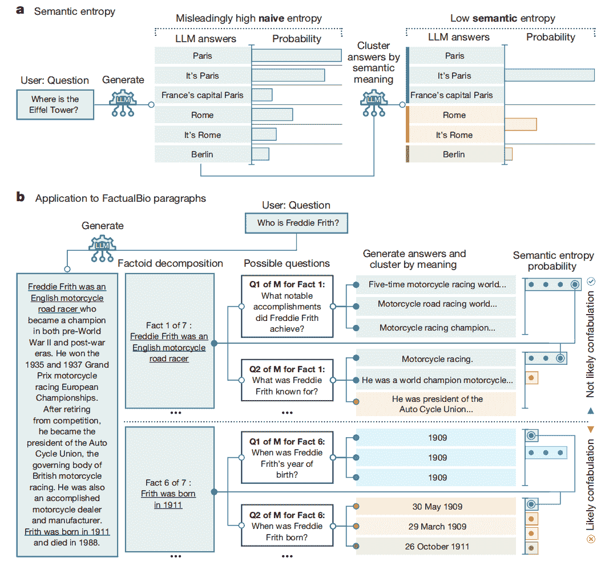
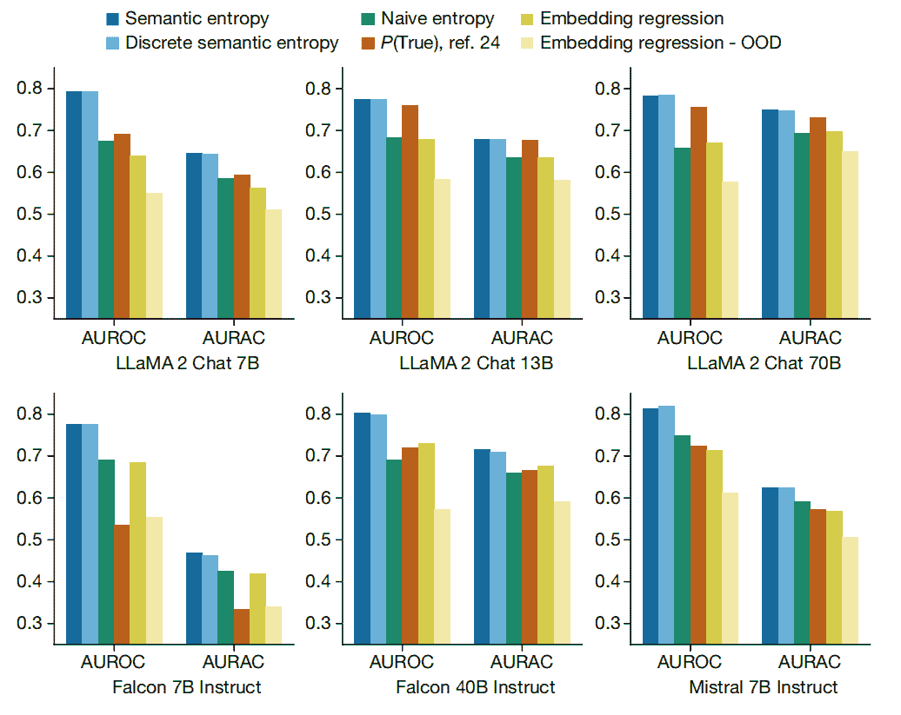
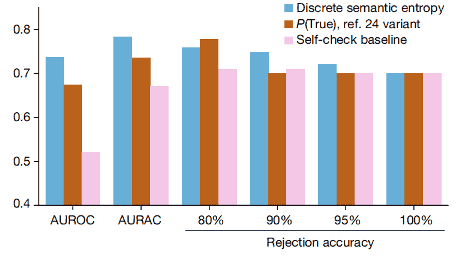

# Nature重磅：大模型的谎言如何“破”？牛津团队提出新方法，无需人工监督或特定领域知识

> 来源：[https://agijuejin.feishu.cn/docx/M2u0dAoROoMxI4xOX3Zc4fo6n8e](https://agijuejin.feishu.cn/docx/M2u0dAoROoMxI4xOX3Zc4fo6n8e)

> 学术头条｜[阅读原文](https://mp.weixin.qq.com/s/3PV9fA6faSC-9608pCY3Dg)

> 转载请联系原作者取得授权

世界卫生组织（WHO）的人工智能**健康资源助手 S**ARAH 列出了旧金山 本不存在的诊所 的虚假名称和地址。

**Meta公司“短命**”的科学聊天机器人 Galactica 凭空捏造学术论文 ，还生成关于太空熊历史的维基文章。

**今年2月，加拿大**航空被命令遵守其客户服务聊天机器人 捏造的退款政策 。

去年，一名律师因提交 充满虚假司法意见和法律引用的法庭文件 而被罚款，这些文件都是由 ChatGPT 编造的。

……

如今，大语言模型（LLM）胡编乱造的例子已屡见不鲜，但问题在于，它们非常擅长一本正经地胡说八道，编造的内容大部分看起来都像是真的，让人难辨真假。

在某些情况下，可以当个乐子一笑而过，但是 一旦涉及到法律、医学等专业领域，就可能会产生非常严重的后果 。

如何有效、快速地检测大模型的幻觉（hallucination），已成为当前国内外科技公司和科研机构竞相关注的热门研究方向。

如今，牛津大学团队提出的一种新方法**便能够帮助我们快速检测大模型的幻觉—— 他们尝试量化一个LLM**产生幻觉的程度，从而判断生成的内容有多忠于提供的源内容，从而提高其问答的准确性 。

研究团队表示，他们的方法能在LLM生成的个人简介，以及关于琐事、常识和生命科学这类话题的回答中识别出“编造”（confabulation）。

**该研究意义重大，因为它为检测 LLM 幻觉提供了一种通**用的方法，无需人工监督或特定领域的知识 。这有助于用户了解 LLM 的局限性，并推动其在各个领域的应用。

相关研究论文以“ Detecting Hallucinations in Large Language Models Using Semantic Entropy ”为题，已发表在权威科学期刊 Nature 上。

在**一篇同时发表的“新闻与观点”文章**中，皇家墨尔本理工大学计算机技术学院院长Karin Verspoor教授指出， 该任务由一个LLM完成，并通过第三个LLM进行评价，等于在“以毒攻毒” 。

但她也写道，“ **用一个 LLM 评估一种基于LLM的**方法似乎是在循环论证，而且可能有偏差。 ”不过，作者指出他们的方法有望帮助用户理解在哪些情况下使用LLM 的回答需要注意，也意味着可以提高LLM在更多应用场景中的可信度。

**如何量化 LLM 的幻觉程度？**

我们先来了解一下，大模型的幻觉是如何产生的。

LLM的设计初衷是生成新内容。当你问聊天机器人一些问题时，它的回答并不是全部从数据库中查找现成的信息，也需要通过大量数字计算生成。

这些模型通过预测句子中的下一个词来生成文本。模型内部有成千上亿个数字，就像一个巨大的电子表格，记录了词语之间的出现概率。模型训练过程中不断调整这些数值，使得它的预测符合互联网海量文本中的语言模式。

因此，大语言模型实际上是根据统计概率生成文本的“统计老虎机”，摇杆一动，一个词便出现了。

现有的检测 LLM 幻觉的方法大多依赖于监督学习，需要大量的标注数据，且难以泛化到新的领域。

在这项研究中，研究团队使用了语义熵的方法，该方法无需标注数据，且在多个数据集和任务上表现出色。

> 语义熵（semantic entropy）是一种衡量语言模型生成的文本中潜在语义不确定性的方法，通过考虑词语和句子在不同上下文中的意义变化来评估模型预测的可靠性。

该方法能检测“编造”（confabulation）——这是“幻觉”的一个子类别，特指不准确和随意的内容，常出现在LLM缺乏某类知识的情况下。这种方法考虑了语言的微妙差别，以及回答如何能以不同的方式表达，从而拥有不同的含义。

图｜语义熵与虚构内容检测简述

如上图所示，传统的基于熵的不确定性度量在精确答案的识别上存在局限，例如，它将“巴黎”、“这是巴黎”和“法国的首都巴黎”视为不同答案。然而，在涉及语言任务时，这些答案虽表述不同但意义相同，这样的处理方式显然不适用。语义熵方法则在计算熵之前，先将具有相同意义的答案进行聚类。低语义熵意味着大语言模型对其内容含义具有很高的确定性。

另外，语义熵方法还能有效检测长段落中的虚构内容。研究团队首先将生成的长答案分解为若干小事实单元。随后，针对每个小事实，LLM 会生成一系列可能与之相关的问题。然后，原LLM会为这些问题提供M个潜在答案。接着，研究团队计算这些问题答案的语义熵，包括原始的小事实本身。高平均语义熵表明与该小事实相关的问题可能存在虚构成分。在这里，由于即使用词差异显著，但生成的答案通常传达相同意义，语义熵成功将事实1分类为非虚构内容，而传统的熵方法则可能忽略这一点。

研究团队主要在以下两个方面对比了语义熵与其他检测方式的差别。

1.检测问答和数学问题中的虚构内容

图｜检测句子长度生成中的虚构内容。

从上图中可以看出，语义熵优于所有基线方法。在 AUROC 和 AURAC 两个指标上，语义熵均展现了更好的性能，这表明其能够更准确地预测 LLM 错误，并提高模型拒绝回答问题时的准确率。

**2.检测传记中的虚构内容**

图｜检测段落长度传记中的 GPT-4 虚构内容。

如上图所示，语义熵估计器的离散变体在 AUROC 和 AURAC 指标（在 y 轴上得分）上均优于基线方法。AUROC 和 AURAC 都明显高于两个基线。在回答超过 80% 的问题时，语义熵的准确性更高。只有当拒绝最有可能是虚构内容的前 20% 答案时，P(True) 基线的剩余答案准确性才好于语义熵。

**不足与展望**

研究团队提出的概率方法充分考虑了语义等价性，成功识别出一类关键的幻觉现象——即由于 LLM 知识缺乏而产生的幻觉。这类幻觉构成了当前众多失败案例的核心，且即便模型能力持续增强，由于人类无法全面监督所有情境和案例，这类问题仍将持续存在。虚构内容在问答领域中尤为突出，但同样在其他领域也有所体现。

值得注意的是，该研究使用的语义熵方法无需依赖特定的领域知识，预示着在抽象总结等更多应用场景中也能取得类似的进展。此外，将该方法扩展到其他输入变体，如重述或反事实情景，不仅为交叉检查提供了可能，还通过辩论的形式实现了可扩展的监督。这表明该方法具有广泛的适用性和灵活性。语义熵在检测错误方面的成功，进一步验证了LLM在“知道自己不知道什么”方面的潜力，实际上可能比先前研究所揭示的更为出色。

然而，语义熵方法主要针对由 LLM 知识不**足导致的幻觉，比如无中生有或张冠李戴，** 对于其他类型的幻觉，比如由训练数据错误或模型设计缺陷导致的幻觉，可能效果不佳 。此外，语义聚类过程依赖于自然语言推理工具，其准确性也会影响语义熵的估计。

未来， **研**究人员希望进一步探索语义熵方法在更多领域的应用，并与其他方法相结合，从而提高 LLM 的可靠性和可信度 。例如，可以研究如何将语义熵方法与其他技术，比如与对抗性训练和强化学习相结合，从而进一步提高 LLM 的性能。此外，他们还将探索如何将语义熵方法与其他指标相结合，从而更全面地评估 LLM 的可信度。

但需要我们意识到的是，只要 LLM 是基于概率的，其生成的内容中就会有一定的随机性。 投掷100个骰子，你会得到一个模式，再投一次，你会得到另一个模式 。即使这些骰子像 LLM 一样被加权来更频繁地生成某些模式，每次得到的结果仍然不会完全相同。即使每千次或每十万次中只有一次错误，当你考虑到这种技术每天被使用的次数时，错误的数量也会相当多。 这些模型越准确，我们就越容易放松警惕。

对于大模型的幻觉，你怎么看？

参考资料：

https://www.nature.com/articles/s41586-024-07421-0

https://www.technologyreview.com/2023/12/19/1084505/generative-ai-artificial-intelligence-bias-jobs-copyright-misinformation/