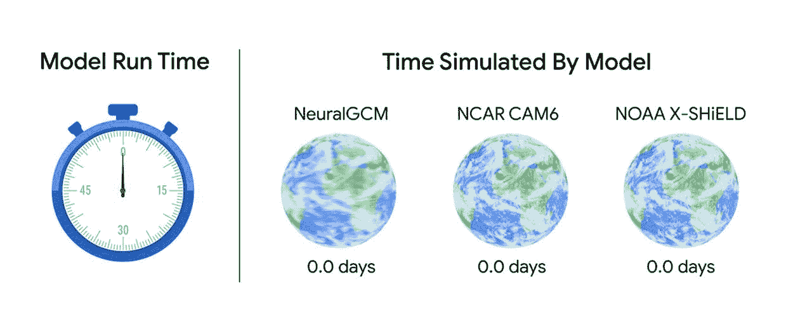
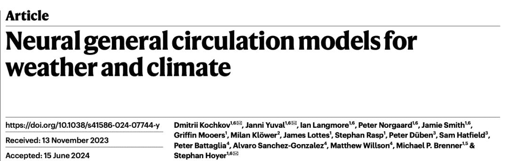
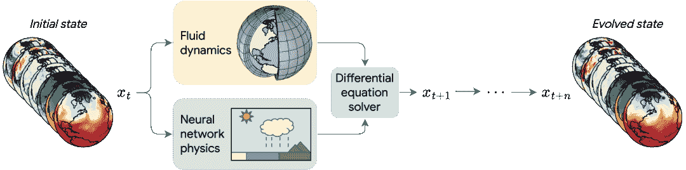
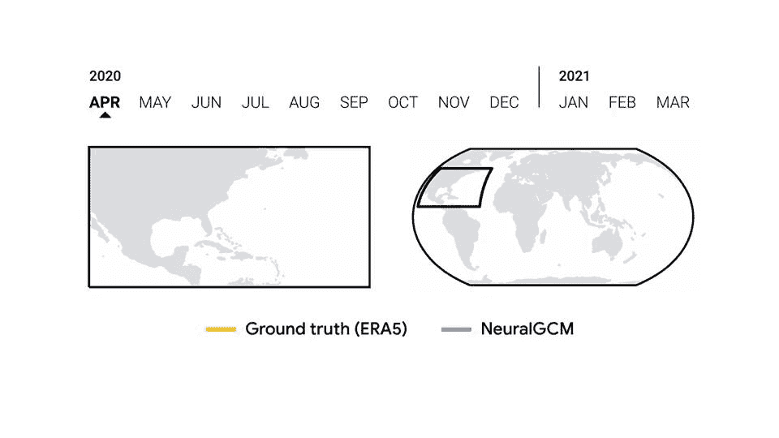
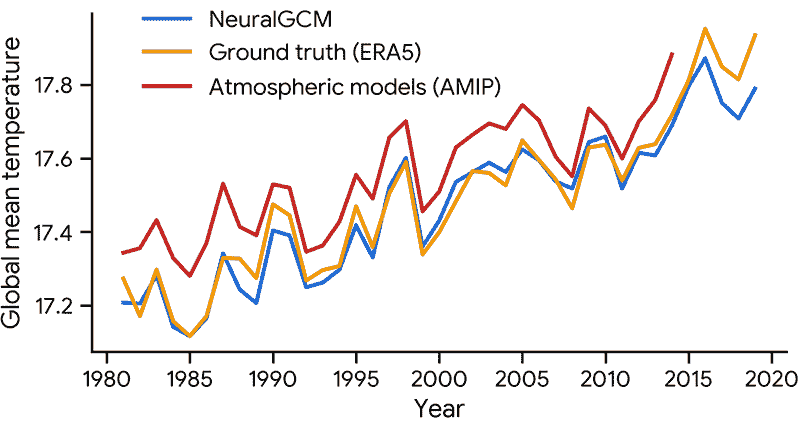

# Nature重磅：AI击败最先进全球传统天气、气候模型，30秒生成22.8天大气模拟，准确预测40年全球变暖趋势

> 来源：[https://agijuejin.feishu.cn/docx/D8J9dJ8ekoo8nzxCcz5cqpNTnpe](https://agijuejin.feishu.cn/docx/D8J9dJ8ekoo8nzxCcz5cqpNTnpe)

> 学术头条｜[阅读原文](https://mp.weixin.qq.com/s/Lu5pk6-9dO8Pbi3Kd8B-FQ)

> 转载请联系原作者取得授权

撰文｜马雪薇

编审｜库珀

# **前言**

来**自世界气象组织（WMO）的数据显**示，在过去 50 年里，平均每一天都会发生一场与天气、气候或水患有关的灾害，而 每一场灾害平均会造成约 115 人死亡、约 2.02 亿美元的经济损失 。

更令人唏嘘的是，近年来，由人类活动加速的气候变化，更是使得热浪、寒潮、强降水、干旱等极端天气和气候灾害异常频发。

因此， **及时、准确 **的天气预测和气候模拟不仅可以每年帮助挽救数万人的生命，还能够降低极端天气和气候事件对人类社会和生态系统的灾难性影响。

如今， **由 Google Research 研究团队及其合作者开发的人工**智能（AI）模型 NeuralGCM，将天气预测和气候模拟提升到了一个新的高度 ——

+   NeuralGCM 对 1-15 天预报的准确率，媲美欧洲中期天气预报中心（ECMWF），后者拥有世界上最先进的传统物理天气预报模型；

+   对提前 10 天预报的准确率，NeuralGCM 与现有其他 AI 模型性能相当，甚至更好；

+   加入海平面温度后，NeuralGCM 的 40 年气候预测结果，与从 ECMWF 数据中发现的全球变暖趋势一致；

+   NeuralGCM 在预测气旋及其轨迹方面也超过了现有的气候模型。

值得一提的是，NeuralGCM 不仅在准确度方面达到甚至超过了现有传统数值天气预报模型和其他机器学习（ML）模型；在速度上也是“遥遥领先”，可以在 30 秒计算时间内生成 22.8 天大气模拟 ；且可以比传统模型节省数量级的计算量。

[0bc3xuaaeaaabeanu4e5cntfbpodak6qaaqa.f10002.mp4](https://internal-api-drive-stream.feishu.cn/space/api/box/stream/download/all/JrYubQY7goLbjhxKe1Ac9n3LnNc)

视频｜NeuralGCM 模拟大气的速度比最先进的物理模型更快，同时生成的预测结果精确度相当。该视频比较了 NeuralGCM 与 NOAA X-SHiELD、NCAR CAM6 两种物理模型在 30 秒计算时间内生成的大气模拟天数。其中，NOAA X-SHiELD 是一个高分辨率（0.03°）物理模型，必须在超级计算机上运行；NCAR CAM6 则是一个分辨率较低（1.0°）的纯大气物理学模型，由于计算成本较低，是科学家们更常用的选择。虽然 NeuralGCM 运行的分辨率较低（1.4°），但其精度与较高分辨率的模型相当。（来源：Google Research）

相关研究论文以 “Neural general circulation models for weather and climate” 为题，已发表在权威科学期刊 Nature 上。

这些结果共同表明，NeuralGCM 可以生成确定性天气、天气和气候的集合预报，在长期天气和气候模拟方面显示出了足够的稳定性。

研究团队认为，这种端到端深度学习与传统大气环流模型（GCM，表征大气、海洋和陆地的物理过程，是天气和气候预测的基础）所执行的任务是兼容的，且能够增强对理解和预测地球系统至关重要的大规模物理模拟。

此外，NeuralGCM 的混合建模方法还可以应用于其他科学领域，比如材料发现、蛋白质折叠和多物理工程设计等。

**真实效果怎么样 ？**

减少长期预报的不确定性以及估算极端天气事件，是理解气候缓解和适应的关键。

**ML 模型 **一直被认为是天气预测的一种替代手段，具有节省算力成本的优势，甚至在确定性天气预报方面已经达到或超过了大气环流模型的水平，但 在长期预报的表现常常不如大气环流模型 。

在这项工作中，研究团队结合机器学习和物理方法设计了 NeuralGCM，利用 ML 组件替换或校正 GCM 中的传统物理参数化方案，由以下几个关键部分组成：

+   **可微分的动力核心 **：该核心负责求解离散化的动力方程，模拟大尺度流体运动和热力学过程，受重力、科氏力和其他因素影响。动力核心使用水平伪谱离散化和垂直 sigma 坐标，并使用 JAX 库实现，支持自动微分。它模拟七个预报变量：水平风涡度、水平风散度、温度、地表压力和三种水物质（比湿、冰云水含量和液态云水含量）。

+   **学习物理模块 **：该模块使用 GCM 中的单柱方法，仅使用单个大气柱的信息来预测该柱内未解析过程的影响。它使用具有残差连接的全连接神经网络，并在所有大气柱之间共享权重。神经网络的输入包括大气柱中的预报变量、总入射太阳辐射、海冰浓度和海表温度，以及预报变量的水平梯度。神经网络的输出是预报变量趋势，按目标字段无条件标准差进行缩放。

+   **编码器和解码器 **：由于 ERA5 数据存储在压力坐标中，而动力核心使用 sigma 坐标系统，因此需要编码器和解码器进行转换。这些组件执行压力水平和 sigma 坐标水平之间的线性插值，并使用与学习的物理模块相同的神经网络架构进行校正。编码器可以消除初始化冲击引起的重力波，从而避免污染预测结果。

图｜NeuralGCM 模型架构。 NeuralGCM 结合了传统的流体动力学求解器和用于小尺度物理的神经网络。 这些组件由微分方程求解器组合而成，在时间上依次向前推进系统。 （来源： Google Research）

结果显示，NeuralGCM 在天气预测方面展现出强大的能力，在超短期、短期和中期时间尺度上与最先进的模型相媲美。如下：

**超短期预测（0-1 天）**

+   泛化能力：与 GraphCast 相比，NeuralGCM 在未经训练的天气条件下表现更好，因为它使用局部神经网络来预测大气垂直柱中的物理过程。

**短期预测（1-10 天）**

+   准确性：在 1-3 天的短期预测中，NeuralGCM-0.7° 和 GraphCast 的表现最佳，准确追踪天气模式的变化。

+   物理一致性：与其他机器学习模型相比，NeuralGCM 的预测更加清晰，避免了物理上不一致的模糊预测。

+   可解释性：通过诊断降水减去蒸发，NeuralGCM 的结果更具可解释性，方便进行水资源分析。

+   地转风平衡：与 GraphCast 相比，NeuralGCM 更准确地模拟了地转风和地转风的垂直结构及其比率。

**中期预测（7-15 天）**

+   集合预报：NeuralGCM-ENS 在 1.4° 分辨率下的集合平均 RMSE、RMSB 和 CRPS 误差均低于 ECMWF-ENS，表明其能够更好地捕捉可能的天气平均状态。

+   可校准性：NeuralGCM-ENS 的集合预报与 ECMWF-ENS 一样，具有大约 1 的发散率-技能比，这是校准预报的必要条件。

此外，除了在天气预测方面表现出色，NeuralGCM 在气候模拟方面也展现出了强大的能力，表现在季节循环模拟、热带气旋模拟和历史温度趋势模拟等方面。如下：

**季节循环模拟**

+   准确性：NeuralGCM 能够准确地模拟季节循环，包括全球可降水和全球总动能的年度循环，以及哈德利环流和经向平均风等关键大气动力学。

+   与全球云分辨模型的比较：与全球云分辨模型 X-SHiELD 相比，NeuralGCM 在可降水方面的偏差更小，并且在热带地区具有更低的温度偏差。

**热带气旋模拟**

+   轨迹和数量：即使在 1.4° 的粗糙分辨率下，NeuralGCM 也能产生与 ERA5 相似的热带气旋轨迹和数量，而全球云分辨模型 X-SHiELD 在 1.4° 分辨率下却低估了热带气旋数量。

[0bc3zqaaeaaa74anwou5artfbtgdalgaaaqa.f10002.mp4](https://internal-api-drive-stream.feishu.cn/space/api/box/stream/download/all/UzQWbPhDWoXBCExdyCDcVCAinee)

视频｜NeuralGCM 预测了 2020 年全球热带气旋的路径。 预测结果与 ECMWF 再分析第 5 版（ERA5）数据集显示的当年实际气旋的数量和强度相吻合。 （来源： Google Research）

**历史温度趋势模拟**

+   AMIP 模拟：NeuralGCM-2.8° 进行了 40 年的 AMIP 模拟，结果表明，所有模拟均准确地捕捉了 ERA5 数据中观察到的全球变暖趋势，并且年际温度趋势与 ERA5 数据具有强相关性，表明 NeuralGCM 能够有效地模拟海温强迫对气候的影响。

+   与 CMIP6 模型的比较：与 CMIP6 AMIP 模型相比，NeuralGCM-2.8° 在 1981-2014 年期间的温度偏差更小，即使在消除了 CMIP6 AMIP 模型的全球温度偏差之后，这一结果仍然成立。

图｜NeuralGCM 在十年时间尺度上的准确性和捕捉全球变暖的能力。 NeuralGCM 和 AMIP 在预测 1980 年至 2020 年全球平均气温方面的表现比较。 （来源： Google Research）

**尽管 NeuralG**CM 在天气和气候预测方面展现了强大的能力，但它 仍然存在一些局限性 。

首先， NeuralGCM 预测未来气候的能力有限 。NeuralGCM 目前无法预测与历史气候明显不同的未来气候。当海表温度（SST）增加幅度较大时（比如 +4K），NeuralGCM 的响应与预期不符，并出现气候漂移现象。

其次， NeuralGCM 模拟未观测气候的能力不足 。与其他机器学习气候模型类似，NeuralGCM 也面临着模拟未观测气候的挑战，比如未来气候或与历史数据差异较大的气候。这需要模型具备更强的泛化能力，以及更先进的训练策略，比如对抗训练或元学习。

然后， NeuralGCM 还存在物理约束和数值稳定性问题 。例如，NeuralGCM 的谱分布仍然比 ECMWF 物理预报模糊，且在模拟热带极端事件方面存在低估现象。这需要进一步研究和改进模型的物理过程参数化和数值方法，以提高模型的物理一致性和数值稳定性。

最后， **缺乏与其他地球系统组件的耦合 **。目前 NeuralGCM 仅模拟大气系统，而气候系统是一个复杂的相互作用系统，包括海洋、陆地、冰雪和生物圈等。要进行更全面的气候模拟，NeuralGCM 需要与这些组件进行耦合，并考虑它们之间的相互作用。这需要开发新的模型架构和训练策略，以实现多物理场耦合模拟。

# 传统天气预测、气候模拟，正被 AI 颠覆

在天气预测和气候模拟方面，NeuralGCM 并非“先行者” 。

在过去几年中，包括华为、谷歌和 清华大学等 在内的科技公司和高校在这一方向均取得了重大进展。

2023 年 7 月，由华为云开发的 盘古气象（Pangu-Weather）模型 登上了 Nature，其使用 39 年的全球再分析天气数据作为训练数据，预测准确率与全球最好的数值天气预报系统 IFS 相当，且在相同的空间分辨率下比 IFS 系统快 10000 倍以上。

**同期发表在 Natur**e 上的另一篇论文则介绍了 NowcastNet ，其出自机器学习领域泰斗、加州大学伯克利分校教授 Michael Jordan 和清华大学教授王建民领导的研究团队，该模型可以结合物理规律和深度学习，进行实时预报降水。

2023 年 11 月，Google DeepMind 推**出了一款基于机器学习**的天气预测模型—— GraphCast ，在全球 0.25° 的分辨率下，该模型可以在一分钟内预测未来 10 天的数百个天气变量，显著优于传统气象预报方法，同时在预测极端事件方面表现良好。相关研究论文已发表在权威科学期刊 Science 上。

今年 3 月，同样来自 Google Research 团队开发的 AI 模型，击败了最先进全球洪水预警系统，其利用现有的 5680 个测量仪进行训练，可预测未测量流域在 7 天预测期内的日径流。

如今，传统的天气预测和气候模拟正在被 AI 颠覆。在未来，AI 将进一步加速气象预测的速度和精度，造福全人类。

参考链接：

https://www.nature.com/articles/s41586-024-07744-y

https://www.science.org/doi/10.1126/science.adi2336

https://www.nature.com/articles/s41586-024-07145-1

https://www.nature.com/articles/s41586-023-06185-3

https://www.nature.com/articles/s41586-023-06184-4