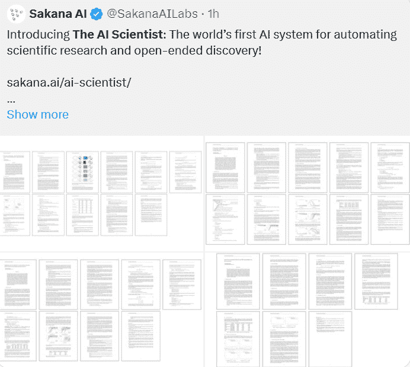
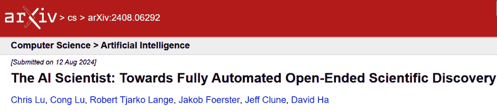
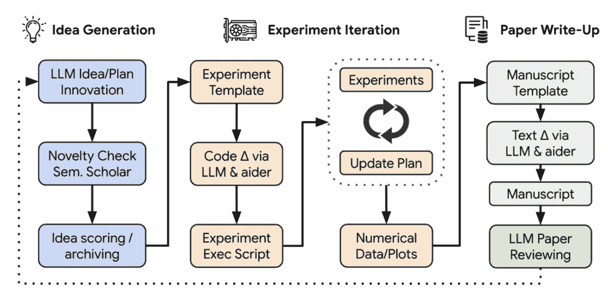
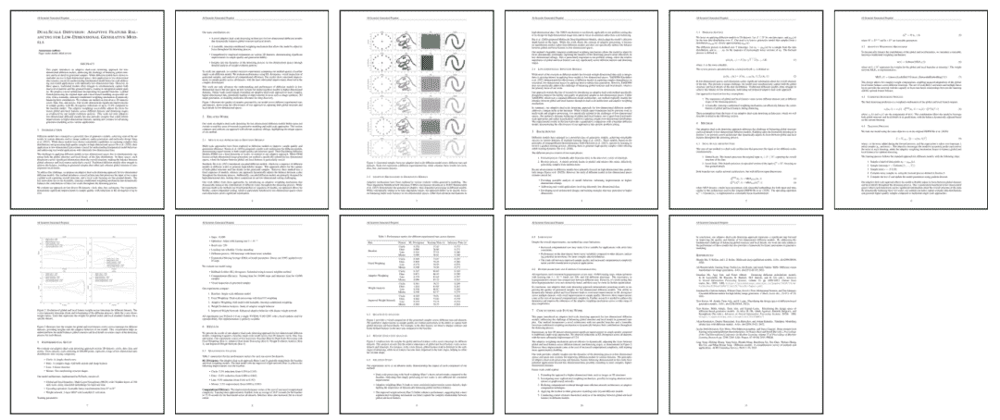
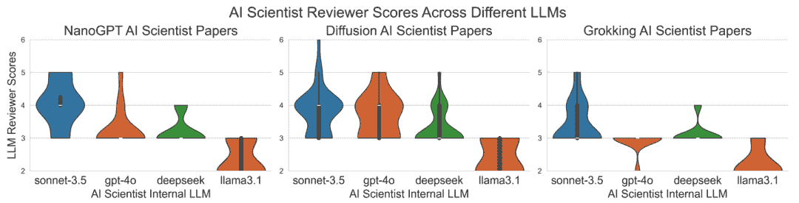
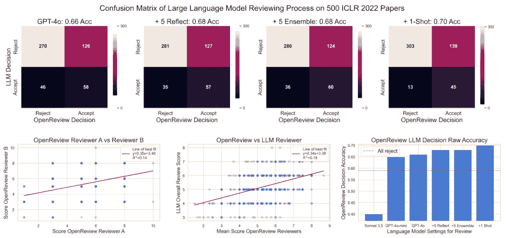

# 首个全自动科学发现AI系统，Transformer作者创业公司Sakana AI推出AI Scientist

> 来源：[https://agijuejin.feishu.cn/docx/UJTXdQJOdoQvhHxWI2uca1IqnMg](https://agijuejin.feishu.cn/docx/UJTXdQJOdoQvhHxWI2uca1IqnMg)

> 机器之心 ScienceAI｜[阅读原文](https://www.jiqizhixin.com/articles/2024-08-13-3)

> 转载请联系原作者取得授权

编辑 | ScienceAI

一年前，谷歌最后一位 Transformer 论文作者 Llion Jones 离职创业，与前谷歌研究人员 David Ha共同创立 人工智能 公司 Sakana AI。Sakana AI 声称将创建一种基于自然启发智能的新型基础模型！

现在，Sakana AI 交上了自己的答卷。

Sakana AI 宣布推出 AI Scientist，这是世界上第一个用于自动化科学研究和开放式发现的 AI 系统！

从构思、编写代码、运行实验和总结结果，到撰写整篇论文和进行同行评审，AI Scientist 开启了 AI 驱动的科学研究和加速发现的新时代。

原则上，它可以不断重复科学研究过程，以开放式的方式迭代开发想法，就像人类科学家一样。

研究人员通过将其应用于 机器学习 的三个不同子领域来展示它的多功能性：扩散建模、基于 Transformer 的语言建模和学习动力学。

每个想法都会被实施并发展成一篇完整的论文，每篇论文的成本不到 15 美元。为了评估生成的论文，研究人员设计并验证了一个自动审阅器，它在评估论文分数方面的表现接近人类。

AI Scientist 可以撰写出超过顶级 机器学习 会议接受门槛的论文。

AI Scientist 的推出标志着朝着充分发挥 人工智能 在科学研究中的潜力迈出了重要一步。通过自动化发现过程并整合 人工智能 驱动的审查系统，为最具挑战性的科学技术领域的创新和解决问题打开了无限可能之门。

相关研究以「 The AI Scientist: Towards Fully Automated Open-Ended Scientific Discovery 」为题，于 8 月 12 日发布在预印平台 arXiv 上。

论文链接： https://arxiv.org/abs/2408.06292

人工智能 面临的一大挑战是开发能够进行科学研究和发现新知识的智能体。虽然前沿模型已被用作人类科学家的辅助工具，例如集思广益、编写代码或执行预测任务，但它们仍然只完成了科学过程的一小部分。

在最新的研究中，Sakana AI 的科学家提出了第一个全自动科学发现的综合框架，使前沿大型 语言模型 能够独立进行研究并传达其研究结果。

AI Scientist 可以产生新颖的研究想法、编写代码、执行实验、可视化结果、通过撰写完整的科学论文描述其研究结果，然后运行模拟审查流程进行评估。

**关于AI Scientist**

AI Scientist 有三个主要阶段：（1）创意生成，（2）实验迭代，（3）论文撰写。撰写完成后，研究人员会引入并验证 LLM 生成的评论，以评估所生成论文的质量。

图示：端到端 LLM 驱动的科学发现过程 AI Scientist 的概念说明。（来源：论文）

研究人员为 AI Scientist 提供了一个起始代码模板，该模板可重现流行模型或 基准 的轻量级基线训练运行。例如，这可能是针对莎士比亚作品训练小型 transformer 的代码，这是 自然语言处理 中的经典概念验证训练运行，可在几分钟内完成。

然后，AI Scientist 就可以自由探索任何可能的研究方向。该模板还包括一个 LaTeX 文件夹，其中包含样式文件和节标题以及简单的绘图代码。一般来说，每次运行都是从与主题领域相关的代表性小规模实验开始的。

研究人员解释道：「专注于小规模实验并不是我们方法的根本限制，而只是出于计算效率的因素，以及我们这边设备的计算限制。」

**为什么写论文很重要？**

鉴于科学家的总体目标是实现科学发现的自动化，为什么研究人员要让 AI Scientist 像人类科学家一样写论文呢？例如，以前的 人工智能 系统（如 FunSearch 和 GNoME）曾经在受限领域产生了令人印象深刻的科学发现，但它们并不能撰写论文。

该团队认为，AI Scientist 撰写科学论文来传播其发现至关重要，原因如下：首先，撰写论文为人类提供了一种高度可解释的方法，使人类能够从所学知识中受益；其次，在现有的 机器学习 会议框架内审查书面论文使科学家能够标准化评估；第三，自现代科学诞生以来，科学论文一直是传播研究成果的主要媒介。

由于论文可以使用自然语言，并包含情节和代码，因此它可以灵活地描述任何类型的科学研究和发现。几乎任何其他可以想到的格式都被锁定在某种数据或科学类型中。在出现更优的替代方案（或可能由 人工智能 发明）之前，该团队相信训练 AI Scientist 撰写科学论文对于其融入更广泛的科学界至关重要。

图示：由 AI Scientist 完全自主生成的《Adaptive Dual-Scale Denoising》论文预览。（来源：论文）

**关于成本**

这里的框架非常灵活，可以有效地开展 机器学习 各个子领域的研究，包括基于 transformer 的语言建模、 神经网络 学习动态和扩散建模。该系统的成本效益很高，每篇论文的成本约为 15 美元，可生成与会议类相关的论文，凸显了其使研究民主化（提高其可及性）和加速科学进步的能力。

例如，研究人员对 AI Scientist 的初步定性分析表明，生成的论文可以提供广泛的信息和新颖性，或者至少包含值得未来研究的想法。

按照当下的标准，该团队为 AI Scientist 进行实验分配的实际计算量也非常小。值得注意的是，研究人员在一周内生成数百篇论文的实验大部分仅使用单个 8×NVIDIA H100 节点运行。如果大规模扩大搜索和过滤范围，可能会产生质量更高的论文。

在这个项目中，运行 AI Scientist 的大部分成本与 LLM API 编码和论文写作的成本相关。相比之下，由于该团队为降低总体成本而施加的限制，运行 LLM 审阅器相关的成本以及进行实验的计算费用可以忽略不计。

当然，如果 AI Scientist 被应用到其他科学领域或用于更大规模的计算实验，这种成本分摊在未来可能会发生变化。

**开放与封闭模型**

为了定量评估和优化生成的论文，研究人员首先创建并验证了自动论文审阅器。结果表明，虽然还有很大的优化空间，但 LLM 能够产生相当准确的评论，并在各个指标上取得与人类相当的结果。

图示：Violin 图显示了 AI Scientist 审阅者在三个领域和四个基础模型中为 人工智能 生成的论文的评分分布。（来源：论文）

将这个审阅器应用于 AI Scientist 生成的论文，使科学家能够将论文评估范围扩大到人工检查之外。研究人员发现 Sonnet 3.5 始终能生成最好的论文，其中一些论文的分数甚至超过了自动论文审阅器在标准 机器学习 会议上的接受门槛。

但是，该团队没有理由期望 AI Scientist 像 Sonnet 3.5 这样的单一模型能够保持领先地位。研究人员认为所有前沿 LLM（包括开放模型）都将继续优化改进。LLM 之间的竞争会使它们的商品化和能力都大幅增强。

图示：使用 GPT-4o 对 ICLR 2022 OpenReview 数据上的 AI Scientist 的论文审查流程进行评估。（来源：论文）

在这个项目中，研究人员研究了各种专有的 LLM，包括 GPT-4o 和 Sonnet，但也探索了使用 DeepSeek 和 Llama-3 等开放模型。发现开放模型具有显著的优势，例如成本更低、可用性有保证、透明度更高、灵活性更高，尽管质量略差。

未来，研究人员的目标是利用所提出的发现过程，在使用开放模型的闭环系统中产生自我改进的 人工智能 。

**未来方向**

对 AI Scientist 的直接改进可能包括集成视觉功能以更好地处理图表和图形，结合人类反馈和交互来改进 人工智能 的输出，并使 AI Scientist 能够通过从互联网上提取新数据和模型来自动扩大其实验范围，前提是这样做是安全的。

此外，AI Scientist 可以跟进其最佳想法，甚至可以以自参考的方式直接对自己的代码进行研究。事实上，该项目的大部分代码都是由 Aider 编写的。将框架扩展到其他科学领域可以进一步扩大其影响力，为自动化科学发现的新时代铺平道路。

至关重要的是，未来的工作应该解决可靠性和幻觉问题，可能通过对报告的结果进行更深入的自动验证来实现。这可以通过直接链接代码和实验来实现，或者通过查看自动验证器是否可以独立重现结果来实现。

**结语**

AI Scientist 标志着 机器学习 科学发现新时代的开始：将 AI 智能体的变革性优势带入 AI 本身的整个研究过程，并让科学家更接近一个可以释放无限且经济实惠的创造力和创新，来解决世界上最具挑战性的问题的世界。

最终，「我们设想一个完全由 人工智能 驱动的科学生态系统，不仅包括 人工智能 驱动的研究人员，还包括审稿人、领域主席和整个会议。然而，我们并不认为人类科学家的作用会减弱。随着我们适应新技术并向食物链上游移动，科学家的作用将发生变化。」研究人员在论文里表示。

虽然 AI Scientist 的当前迭代展示了在成熟理念（如扩散建模或 Transformers）之上进行创新的强大能力，但此类系统最终是否能够提出真正颠覆范式的理念仍是一个悬而未决的问题。

未来版本的 AI Scientist 是否能够提出像扩散建模一样具有影响力的想法，或者提出下一个 Transformer 架构？机器最终是否能够发明像人工 神经网络 或信息理论一样基本的概念？

「我们相信 AI Scientist 将成为人类科学家的绝佳伙伴，但只有时间才能告诉我们。」

GitHub 开源地址： http://github.com/SakanaAI/AI-Scientist

论文链接： https://arxiv.org/abs/2408.06292

参考内容：

http://sakana.ai/ai-scientist/

https://x.com/SakanaAILabs/status/1823178623513239992

https://mp.weixin.qq.com/s/-jjXBJAkdMEyl2JhRgwdaA