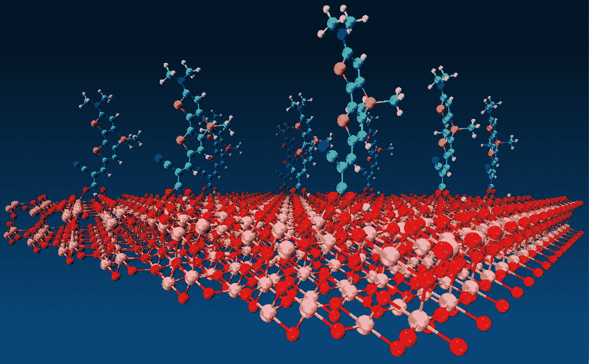
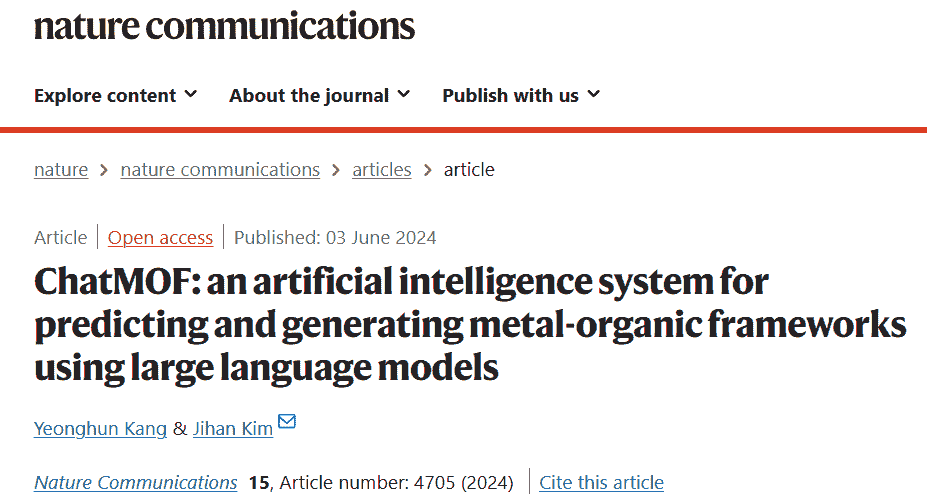
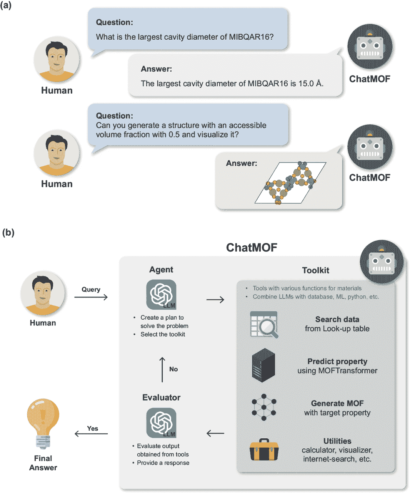
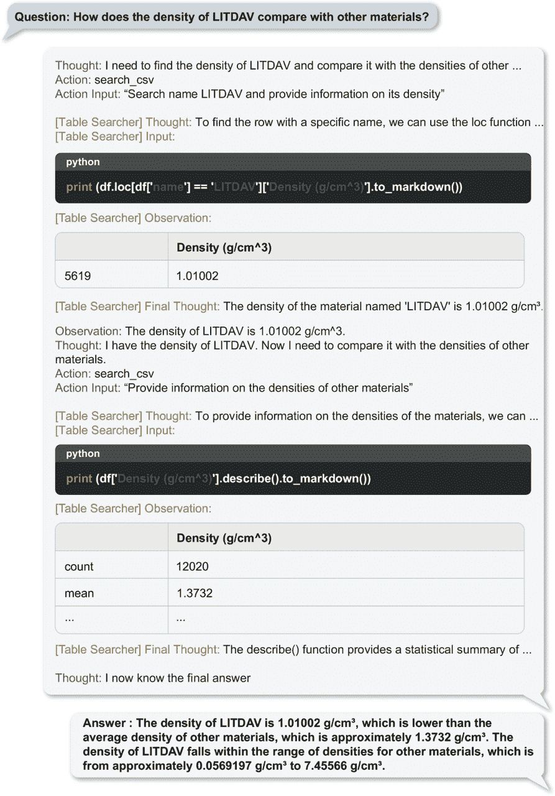
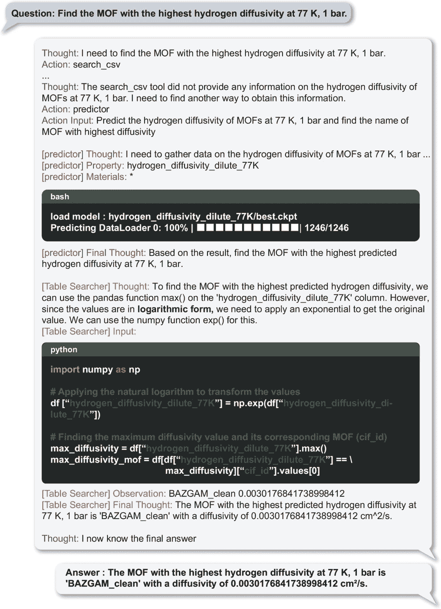
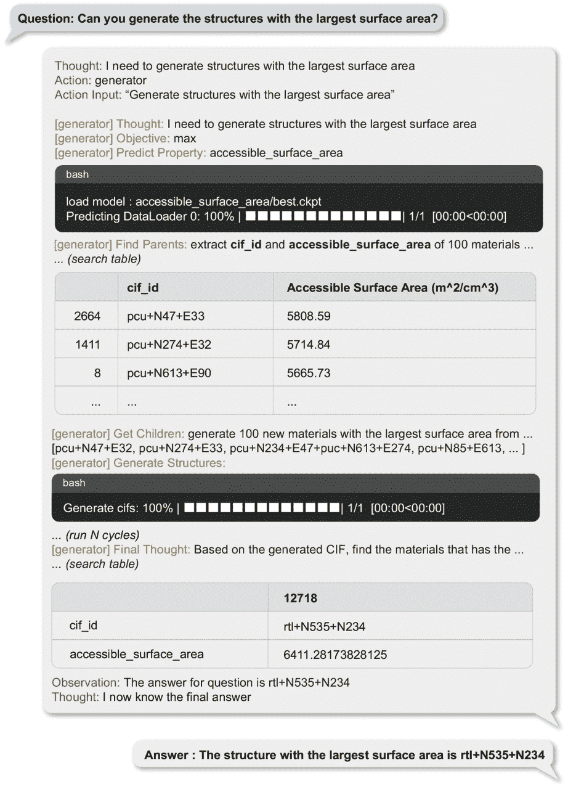
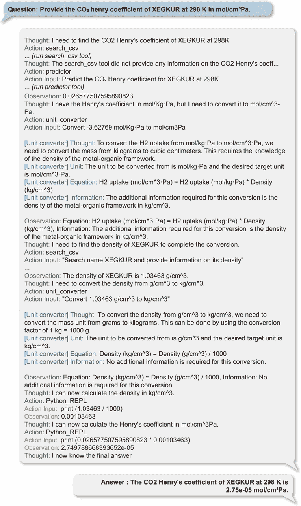
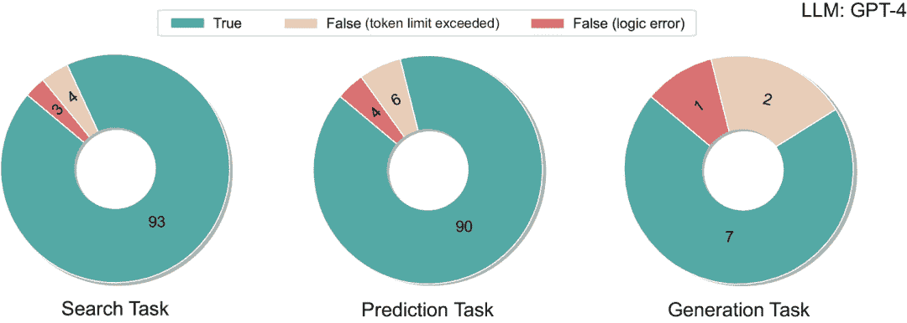
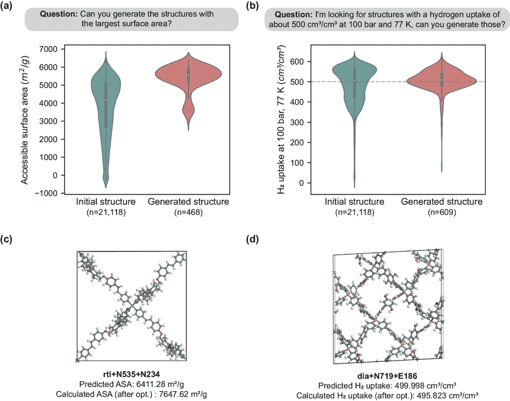

# 预测准确率达95.7%，ChatMOF利用LLM预测和生成金属有机框架

> 来源：[https://agijuejin.feishu.cn/docx/Ak0vdBha4otLXhxOeTMcF5jOnkd](https://agijuejin.feishu.cn/docx/Ak0vdBha4otLXhxOeTMcF5jOnkd)

> 机器之心 ScienceAI｜[阅读原文](https://www.jiqizhixin.com/articles/2024-06-11-20)

> 转载请联系原作者取得授权

编辑 | X

金属有机框架（MOF）因其孔隙率大、表面积大和出色的可调性而用于许多化学应用。然而，在利用 AI 深入探索 MOF 设计与性能优化的研究征途中，科学家们正面临着前所未有的挑战。

去年 3 月，韩国科学技术院（Korea Advanced Institute o[f Science and Technology，KAIST](http://mp.weixin.qq.com/s?__biz=MzI3MjM3ODk0NQ==&mid=2247494506&idx=1&sn=9e1e58006456274541c8649471d8845d&chksm=eb31d644dc465f529fd7ea29bd3197440ec1e3177a7c033e7f3b8425fbc63b06efa10d167fc6&scene=21#wechat_redirect)）的研究人员提出的 MOFTransformer 模型经过一百万个假设的 MOF 的预训练，在预测各种属性方面表现出色。

近日，KAIST 团队提出了一种 AI 系统——ChatMOF，用于预测和生成 MOF。通过利用大语言模型 (GPT-4、GPT-3.5-turbo 和 GPT-3.5-turbo-16k)，ChatMOF 从文本输入中提取关键细节并提供适当的响应，从而无需进行严格而正式的结构化查询。

ChatMOF 由三个核心组件组成（即智能体、工具包和评估器），它形成了一个强大的管道，可管理各种任务，包括数据检索、属性预测和结构生成。ChatMOF 的搜索准确率高达 96.9%，预测准确率高达 95.7%。此外，它还成功地从自然语言中创建了具有用户所需属性的材料。

该研究进一步探讨了在材料科学中使用大型语言模型 (LLM) 与数据库和机器学习结合的优点和局限性，并展示了其对未来进步的变革潜力。

相关研究以「 ChatMOF: an artificial intelligence system for predicting and generating metal-organic frameworks using large language models 」为题，于 6 月 3 日发布在《 Nature Communications 》上。

论文链接： https://www.nature.com/articles/s41467-024-48998-4

生成式 AI 领域正在经历前所未有的激增，尤其是 LLM 的兴起，它们能处理文本数据、模仿人类认知某些方面的任务，例如基于少样本和零样本学习来处理和应用新信息。

尽管 LLM 在化学、医学等领域取得进展，但在材料科学中的潜力尚未充分挖掘，主要受材料复杂性和缺乏专业训练数据限制。这一限制主要源于两个重大挑战。首先，这些先进材料（如 MOF）的固有复杂性构成了重大障碍。其次，该领域材料特定的训练数据明显稀缺。

在此，研究人员提出 ChatMOF 用于自动生成新材料并预测其属性。该系统能根据基于文本的查询预测 MOF 属性并生成具有指定属性的 MOF (即逆向设计)。

**ChatMOF 的设计**

自主 LLM 智能体的有效性取决于其能够准确地从文本输入中提取基本细节并提供相关响应，而不管是否存在严格结构化的查询。

ChatMOF 清楚地说明了这一概念。用户可以以文本形式提出有关材料属性的查询，ChatMOF 通过提供与所讨论材料相关的详细描述来响应该查询。此外，该系统的操作范围超出了简单的信息检索。当用户表示需要生成具有特定属性的 MOF 时，ChatMOF 能够相应地生成请求的材料结构。

图示：ChatMOF 的概念和示意图。（来源：论文）

在 ChatMOF 的背景下，LLM 充当中央协调器，管理和评估流程，类似于中央处理单元 (CPU) 在计算中的运行方式。ChatMOF 使用 LLM 系统地组织和应用各种工具来收集信息，类似于计算机编程中执行良好的算法。这种协同作用使系统能够精确预测材料属性，从文本挖掘数据库中检索合成方法，并制造具有预设属性的新材料。

ChatMOF 由三个主要组件组成：智能体、工具包和评估器。智能体通过四个主要操作阶段（即数据分析、操作确定、输入管理和结果观察）处理人类查询。

首先，将用户的查询确立为目标，然后进行系统规划以确定实现此目标的步骤。随后，ChatMOF 从可用选项中决定使用哪种合适的工具。执行所选工具后，观察到的结果将作为评估是否可以生成最终答案的基础。如果可行，则提供最终答案，否则，该过程将循环回到思考步骤以制定新策略。

**四类工具包**

ChatMOF 使用各种工具来获取、预测或生成材料信息。这些工具主要可分为四类：表格搜索器、互联网搜索器、预测器、生成器和实用程序。

如果用户查找有关 MOF 数据库中包含的特定 MOF 的信息，ChatMOF 可以从预先制表的数据中找到并提供所需的信息。下图为 ChatMOF 进行的表搜索操作的说明性示例。

图示：表格搜索器针对问题「LITDAV 的密度与其他材料相比如何」的示例。（来源：论文）

作为预测任务的合适工具，ChatMOF 使用该小组之前开发的 MOFTransformer 模型，用于 MOF 性质的通用预测。

下图展示了使用 MOFTransformer 预测器的 ChatMOF 示例提示。

图示：「找到在 77 K, 1 bar 时氢扩散率最高的 MOF」问题的预测器示例。（来源：论文）

最后，MOF 领域研究人员的一个主要愿望是逆向设计表现出所需特性的 MOF。遗传算法特别适合与 LLM 集成。作为一种受生物启发的优化方法，遗传算法基于选择、突变和交叉原理运行，使其具有适应性且效率高。下图展示了 ChatMOF 利用遗传算法根据用户规范制作 MOF。

图示：针对「你能生成具有最大表面积的结构吗」这一问题生成器的示例。（来源：论文）

此外，ChatMOF 被设计用于执行多种实用程序，这些实用程序超出了 LLM 的范围。这包括文件搜索、互联网搜索甚至简单计算等功能。

图示：一个复杂且多步骤问题的示例「给出 XEGKUR 在 298 K 时的 CO2 亨利系数」。（来源：论文）

**ChatMOF 性能评估**

为了评估 ChatMOF 的性能，对「搜索任务」、「预测任务」和「生成任务」进行了分析。为了进行评估，使用 GPT-4 创建了 ChatMOF 问题，以生成有关 MOF 给定属性的各种句子。

ChatMOF 的准确性分析涉及使用三个标签：「真」、「假（超出 token 限制）」和「假（逻辑错误）」。

下图展示了使用 ChatMOF 和 GPT-4 完成的三项任务的准确度测量。对搜索和预测任务的 100 个样本问题和生成任务的 10 个样本问题进行了准确性测量。ChatMOF 的搜索准确率高达 96.9%，预测准确率高达 95.7%。对于生成任务，准确率为 87.5%。

图示：使用 GPT-4 模型（搜索、预测和生成）执行三个任务的准确度描述（于 2023.08.10 至 2023.08.14 测试）。

此外，ChatMOF 与 GPT-4 集成时的性能也优于与 GPT-3.5-turbo 集成时的性能。

**逆向设计验证**

ChatMOF 通过规划遗传算法和执行遗传算法进行材料逆向设计。在逆向设计方面表现出相当高的准确性（7/10），规划过程中的主要错误是在选择亲本基因（parent gene）时遇到的。执行阶段中，GPT-4 表现优于 GPT-3.5-turbo，能生成较少重复的后代，尽管生成数量不稳定。

图示：ChatMOF 进行的 MOF 逆向设计分析。（来源：论文）

尽管如此，ChatMOF 已成功生成满足用户要求的材料，如高比表面积和指定氢气吸附量的结构，且预测值与优化后实验结果接近，显示出方法的有效性。

**局限性**

尽管 ChatMOF 取得了成功，但它的生成任务确实存在一些局限性。其中最主要的是由于输入和输出 token 的限制导致基因多样性下降。其他限制，例如拓扑和循环数量有限，源于资源和时间限制。

然而，尽管存在这些限制，ChatMOF 的算法仍能有效地生成与目标函数高度一致的 MOF，证明了其操作有效性。ChatMOF 代表了在材料科学领域实现 AI 更高自主性方面取得的重大进展。随着技术的进步，以及模型容量和在线平台数据共享的结构化改进，ChatMOF 的性能可以进一步优化，从而促进 MOF 研究取得显著进展。