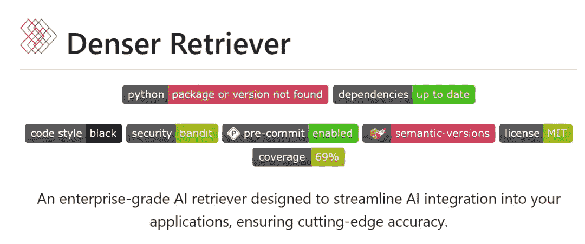
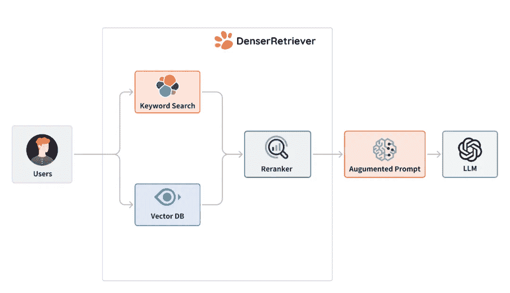
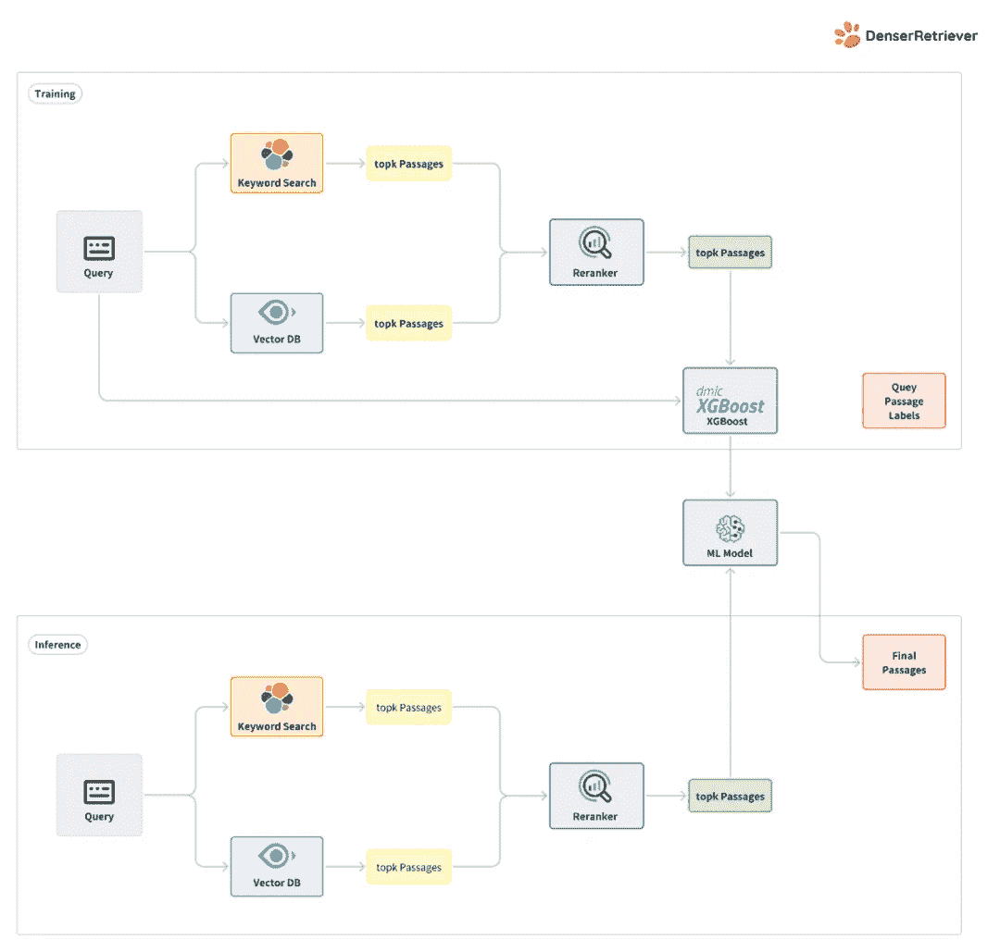
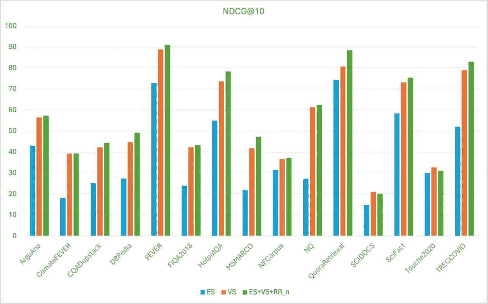
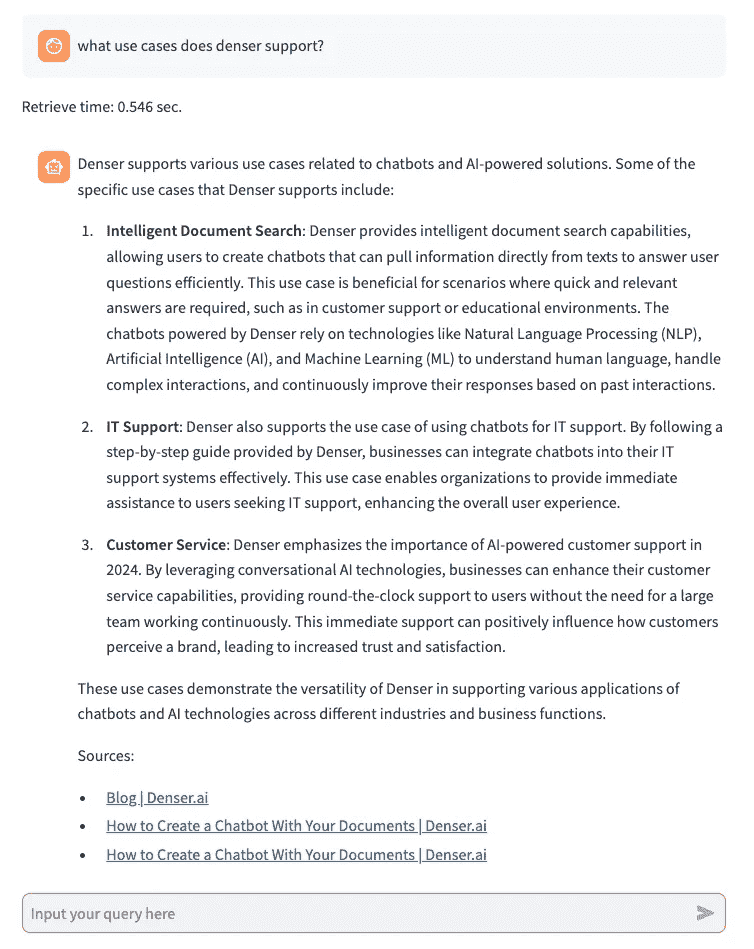

# 轻松构建聊天机器人、准确性新SOTA，RAG有了更强大的AI检索器

> 来源：[https://agijuejin.feishu.cn/docx/YKGEdgsdpo83IPx9bXccErSKnNh](https://agijuejin.feishu.cn/docx/YKGEdgsdpo83IPx9bXccErSKnNh)

> 机器之心｜[阅读原文](https://www.jiqizhixin.com/articles/2024-06-09)

> 转载请联系原作者取得授权

**黄志恒拥**有爱丁堡大学博士和加州大学伯克利博士后研究经历。志恒曾在微软、百度、Facebook、 腾讯 和亚马逊等 IT 公司工作。志恒在亚马逊 AWS 担任首席科学家领导了 Amazon Kendra 和 Amazon Q。志恒现在是 Denser.ai 的创始人。截至 2024 年 5 月，Google Scholar 引用次数超过 13,300 次。

**李万钧是一位资深全栈工程师，同时具备设计师和运维工程师的专长。他曾在多个大型项目中担任核心工程师和架**构师，拥有丰富的实战经验。目前在 denser.ai 担任全栈工程师，专注于将 AI 技术深度融合到软件开发的各个阶段 。

检索增 强生 成 (RAG) 是将检索模型与 生成模型 结合起来，以提高生成内容的质量和相关性的一种有效的方法。RAG 的核心思想是利用大量文档或 知识库 来获取相关信息。各种工具支持 RAG，包括 Langchain 和 LlamaIndex。

AI Retriever 是 RAG 框架的基础，确保 AI 应用中的准确和无缝体验。Retriever 大致分为两类：关键词搜索和向量搜索。关键词搜索依赖于关键词匹配，而向量搜索则关注语义相似性。流行的工具包括用于关键词搜索的 Elasticsearch 和用于向量搜索的 Milvus、Chroma 和 Pinecone。

在大 语言模型 时代，从工程师和科学家到市场营销等各个领域的专业人士，都热衷于开发 RAG AI 应用原型。像 Langchain 这样的工具对此过程至关重要。例如，用户可以使用 Langhian 和 Chroma 快速构建一个用于法律文档分析的 RAG 应用。

本文中， **DenserAI 团队推出的 Denser Retr**iever 在快速原型设计方面表现突出 。用户可以通过一个简单的 Docker Compose 命令快速安装 Denser Retriever 及其所需工具。Denser Retriever 不仅仅止步于此，它还提供了自托管解决方案，支持企业级生产环境的部署。

此外，Denser Retriever 在 MTEB 检索数据集上提供了全面的检索 基准 测试，以确保部署中的最高准确性。用户不仅可以享受 Denser Retriever 的易用性，还可以享受其最先进的准确性。



+   GitHub地址：https://github.com/denser-org/denser-retriever/tree/main

+   博客地址：https://denser.ai/blog/denser-retriever/

Denser Retriever 能做什么？

Denser Retriever 的初始版本提供了以下功能：

+   支持异构检索器，如关键词搜索、向量搜索和 机器学习 模型重排序。

+   利用 xgboost 机器学习 技术有效结合异构检索器。

+   在 MTEB 检索 基准 测试中实现 State of the art accuracy。

+   演示如何使用 Denser Retriever 来驱动端到端应用，如 聊天机器人 和语义搜索。

为什么选择 Denser Retriever？

+   Open Source Commitment：Denser Retriever 是开源的，提供透明性和持续的社区驱动改进机会。

+   Production-Ready：设计用于生产环境的部署，确保在实际应用中的可靠性和稳定性。

+   State-of-the-art accuracy：提供最先进的准确性，提高 AI 应用质量。

+   可扩展性：无论是处理不断增长的数据需求还是扩展用户需求，Denser Retriever 都能无缝扩展以满足要求。

+   灵活性：该工具适应广泛的应用，并可根据具体需求进行定制，是多种行业的多功能选择。

在这篇博客中，我们将展示如何安装 Denser Retriever，从文本文件或网页页面构建检索索引，并在此索引上进行 查询 。

由于篇幅限制，本文不会涵盖更多高级主题，如使用自定义数据集训练 Denser Retriever、在 MTEB 基准 数据集上进行评估以及创建端到端 AI 应用（如 聊天机器人 ）。有兴趣的用户可参考以下资源获取这些高级主题的信息。

**设置**

安装 Denser Retriever

我们使用 Poetry 安装和管理 Denser Retriever 包。在仓库根目录下使用以下命令安装 Denser Retriever。

```
git clone [https://github.com/denser-](https://github.com/denser-org/denser-retriever)org/denser-retrievercd denser-retrievermake install
```

更多细节可以在 DEVELOPMENT 文档中找到：https://github.com/denser-org/denser-retriever/blob/main/DEVELOPMENT.md

安装 Elasticsearch 和 Milvus

运行 Denser Retriever 需要 Elasticsearch 和 Milvus，它们分别支持关键词搜索和向量搜索。我们按照以下指示在本地计算机（例如，您的笔记本电脑）上安装 Elasticsearch 和 Milvus。

要求：docker 和 docker compose，它们都包含在 Docker Desktop 中，适用于 Mac 或 Windows 用户。

+   手动下载 docker-compose.dev.yml 并保存为 docker-compose.yml，或者使用以下命令。

```
wget https://raw.githubusercontent.com/denser-org/denser-retriever/main/docker-compose.dev.yml \-O docker-compose.yml
```

+   使用以下命令启动服务。

```
docker compose up -d
```

+   Optionally，我们可以运行以下命令验证 Milvus 是否正确安装。

```
poetry run python -m pytest tests/test_retriever_milvus.py
```

**索引和 查询 用例**

在索引和 查询 用例中，用户提供一组文档，如文本文件或网页，以构建检索器。然后用户可以 查询 该检索器以从提供的文档中获取相关结果。此用例的代码可在 index_and_query_from_docs.py 中找到。

代码地址：https://github.com/denser-org/denser-retriever/blob/main/experiments/index_and_query_from_docs.py

要运行此示例，请导航到 denser-retriever 仓库并执行以下命令：

```
poetry run python experiments/index_and_query_from_docs.py=
```

如果运行成功，我们预期会看到类似以下的输出。

```
2024-05-27 12:00:55 INFO: ES ingesting passages.jsonl record 962024-05-27 12:00:55 INFO: Done building ES index2024-05-27 12:00:55 INFO: Remove existing Milvus index state_of_the_union2024-05-27 12:00:59 INFO: Milvus vector DB ingesting passages.jsonl record 962024-05-27 12:01:03 INFO: Done building Vector DB index[{&#x27;source&#x27;: &#x27;tests/test_data/state_of_the_union.txt&#x27;,&#x27;text&#x27;: &#x27;One of the most serious constitutional responsibilities...&#x27;,&#x27;title&#x27;: &#x27;&#x27;, &#x27;pid&#x27;: 73,&#x27;score&#x27;: -1.6985594034194946}]
```

在接下来的部分中，我们将解释其中的基础过程和机制。

**概述**

下图说明了 Denser Retriever 的结构，它由三个组件组成：



+   **关键词搜索 **依赖于使用精确关键词匹配的传统搜索技术。我们在 Denser Retriever 中使用 Elasticsearch。

+   **向量搜索 **使用 神经网络 模型将 查询 和文档编码为高维空间中的密集向量表示。我们使用 Milvus 和 snowflake-arctic-embed-m 模型，该模型在 MTEB/BEIR 排行榜的各个尺寸变体中均实现了最先进的性能。

+   **ML 交叉编码器重排序器 **可用于进一步提升上述两种检索方法的准确性。我们使用 cross-encoder/ms-marco-MiniLM-L-6-v2，该模型在准确性和推理延迟之间具有良好的平衡。

**配置文件**

我们在以下 yam 文件中配置上述**三个组件。大多数 参数** 是不言自明的。 关键字、向量、重排序 的部分分别配置 Elasticsearch、Milvus 和重排序器。

我们使用 combine: model 通过一个 xgboost 模型（experiments/models/msmarco_xgb_es+vs+rr_n.json）来结合 Elasticsearch、Milvus 和重排序器，该模型是使用 mteb msmarco 数据集训练的（参见训练配方了解如何训练这样的模型）。

除了模型组合，我们还可以使用线性或排名来结合 Elasticsearch、Milvus 和重排序器。在 MTEB 数据集上的实验表明，模型组合可以显著提高准确性，优于线性或排名方法。

一些 参数 ，例如 es_ingest_passage_bs，仅在训练 xgboost 模型时使用（即 查询 阶段不需要）。

```
version: &quot;0.1&quot;
# linear, rank or modelcombine: modelkeyword_weight: 0.5vector_weight: 0.5rerank_weight: 0.5model: ./experiments/models/msmarco_xgb_es+vs+rr_n.jsonmodel_features: es+vs+rr_n
keyword:  es_user: elastic  es_passwd: YOUR_ES_PASSWORD  es_host: http://localhost:9200  es_ingest_passage_bs: 5000  topk: 100
vector:  milvus_host: localhost  milvus_port: 19530  milvus_user: root  milvus_passwd: Milvus  emb_model: Snowflake/snowflake-arctic-embed-m  emb_dims: 768  one_model: false  vector_ingest_passage_bs: 2000  topk: 100
rerank:  rerank_model: cross-encoder/ms-marco-MiniLM-L-6-v2  rerank_bs: 100  topk: 100
output_prefix: ./denser_output_retriever/
max_doc_size: 0max_query_size: 10000
```

生成 passages (段落)

我们现在描述如何从给定的文本文件（state_of_the_union.txt）构建一个检索器。以下代码显示如何读取文本文件，将文件分割成文本块并将其保存为 jsonl 文件（passages.jsonl）。

```
from langchain_community.document_loaders import TextLoaderfrom langchain_text_splitters import RecursiveCharacterTextSplitterfrom denser_retriever.utils import save_HF_docs_as_denser_passagesfrom denser_retriever.retriever_general import RetrieverGeneral
# Generate text chunksdocuments = TextLoader(&quot;tests/test_data/state_of_the_union.txt&quot;).load()text_splitter = RecursiveCharacterTextSplitter(chunk_size=500, chunk_overlap=100)texts = text_splitter.split_documents(documents)passage_file = &quot;passages.jsonl&quot;save_HF_docs_as_denser_passages(texts, passage_file, 0)
```

passages.jsonl 中的每一行都是一个段落，包含 source、title、text 和 pid（段落 ID）字段。

```
{&quot;source&quot;: &quot;tests/test_data/state_of_the_union.txt&quot;,&quot;title&quot;: &quot;&quot;,&quot;text&quot;: &quot;Madam Speaker, Madam Vice President, our First Lady and Second Gentleman...&quot;,&quot;pid&quot;: 0}
```

**构建 Denser 检索器**

我们可以使用给定的 passages.jsonl 和 experiments/config_local.yaml 配置文件来构建 Denser 检索器。

```
# Build denser indexretriever_denser = RetrieverGeneral(&quot;state_of_the_union&quot;, &quot;experiments/config_local.yaml&quot;)retriever_denser.ingest(passage_file)
```

**查询 Denser 检索器**

我们可以简单地使用以下代码来 查询 检索器以获得相关段落。

```
# Queryquery = &quot;What did the president say about Ketanji Brown Jackson&quot;passages, docs = retriever_denser.retrieve(query, {})print(passages)
```

每个返回的段落都会接收一个置信分数，以指示它与给定 查询 的相关性。我们得到类似以下的结果。

```
[{&#x27;source&#x27;: &#x27;tests/test_data/state_of_the_union.txt&#x27;,&#x27;text&#x27;: &#x27;One of the most serious constitutional...&#x27;,&#x27;title&#x27;: &#x27;&#x27;, &#x27;pid&#x27;: 73,&#x27;score&#x27;: -1.6985594034194946}]
```

**将所有内容整合在一起**

我们将所有代码整合如下。代码也可在 repo 中找到。

```
from langchain_community.document_loaders import TextLoaderfrom langchain_text_splitters import RecursiveCharacterTextSplitterfrom denser_retriever.utils import save_HF_docs_as_denser_passagesfrom denser_retriever.retriever_general import RetrieverGeneral
# Generate text chunksdocuments = TextLoader(&quot;tests/test_data/state_of_the_union.txt&quot;).load()text_splitter = RecursiveCharacterTextSplitter(chunk_size=500, chunk_overlap=100)texts = text_splitter.split_documents(documents)passage_file = &quot;passages.jsonl&quot;save_HF_docs_as_denser_passages(texts, passage_file, 0)
# Build denser indexretriever_denser = RetrieverGeneral(&quot;state_of_the_union&quot;, &quot;experiments/config_local.yaml&quot;)retriever_denser.ingest(passage_file)
# Queryquery = &quot;What did the president say about Ketanji Brown Jackson&quot;passages, docs = retriever_denser.retrieve(query, {})print(passages)
```

**从网页构建检索器**

与上述方法类似，除了段落 语料库 的生成。index_and_query_from_webpage.py 源代码可以在这里找到。

要运行这个用例，请进入 denser-retriever repo 并运行：

```
poetry run python experiments/index_and_query_from_webpage.py
```

poetry run python experiments/index_and_query_from_webpage.py

如果成功，我们预计会看到类似以下的内容。

```
2024-05-27 12:10:47 INFO: ES ingesting passages.jsonl record 662024-05-27 12:10:47 INFO: Done building ES index2024-05-27 12:10:52 INFO: Milvus vector DB ingesting passages.jsonl record 662024-05-27 12:10:56 INFO: Done building Vector DB index[{&#x27;source&#x27;: &#x27;https://lilianweng.github.io/posts/2023-06-23-agent/&#x27;,&#x27;text&#x27;: &#x27;Fig. 1. Overview of a LLM-powered autonomous agent system...&#x27;,&#x27;title&#x27;: &#x27;&#x27;,&#x27;pid&#x27;: 2,&#x27;score&#x27;: -1.6985594034194946}]
```

**进一步阅读**

由于篇幅限制，我们在这篇博客中未包括以下主题。

+   使用客户数据集训练 Denser Retriever 。用户提供一个训练数据集来训练一个 xgboost 模型，该模型决定如何结合关键字搜索、向量搜索和重排序。训练和测试的工作流程如下图所示。



+   在 MTEB 数据集上评估 Denser Retriever 。通过 xgboost 模型结合关键字搜索、向量搜索和重排序可以进一步提高向量搜索基线。例如，我们最好的 xgboost 模型在所有 MTEB 数据集上的 NDCG@10 得分为 56.47，相比向量搜索基线（NDCG@10 得分 54.24）绝对提高了 2.23，相对提高了 4.11%。



+   **端到端搜索和聊天应用 **。我们可以轻松使用 Denser Retriever 构建端到端的 聊天机器人 。



+   **过滤器 (Filters) **。上述索引和 查询 用例假设搜索项仅包含非结构化文本。此假设可能不成立，因为数据集可能包含数值、分类和日期属性。过滤器可用于为这些属性设置约束。

Denser Retriever文档：https://retriever.denser.ai/docs