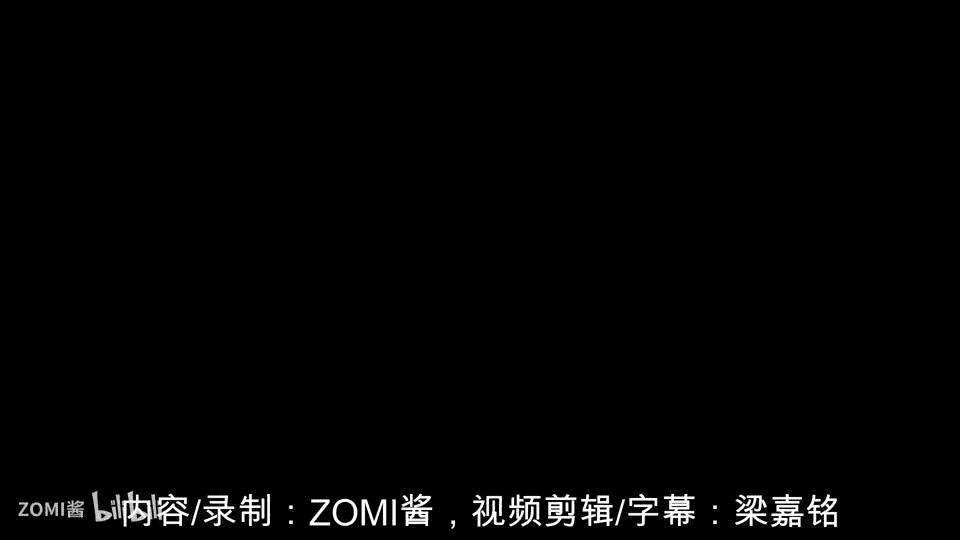

# 端到端自动驾驶算法综述

> 来源：[https://agijuejin.feishu.cn/docx/ZPL1dYcT9oNERFxsJfjcFOzanGb](https://agijuejin.feishu.cn/docx/ZPL1dYcT9oNERFxsJfjcFOzanGb)

# 👀快看👀

> **作者：**[**ZOMI酱**](https://space.bilibili.com/517221395)

> **原文链接：**[**端到端自动驾驶算法综述**](https://www.bilibili.com/video/BV1xi421a7er/?spm_id_from=333.999.0.0&vd_source=5a54577a6bc7d876f6e5df88640c8e9f)

---

# ⚡️摘要⚡️

> 端到端自动驾驶算法的综述，涉及到特斯拉的自动驾驶技术。

---

# 🤖分集🤖

### 端到端自动驾驶算法综述

全面介绍端到端自动驾驶算法，从基础原理阐述端到端学习概念及在自动驾驶中的应用，详论特斯拉的技术实现，包括软硬件整合及数据训练优化，还探讨端到端方法与传统方案的比较、面临的挑战和未来趋势。

[端到端自动驾驶算法综述 #特斯拉 #自动驾驶 #端到端.mp4](https://internal-api-drive-stream.feishu.cn/space/api/box/stream/download/all/QYLLblVvMo9CbNxYZrVcCcjYnth)

---

# ✏️课代表✏️

+   端到端学习在自动驾驶中的应用：强调了端到端学习方法在自动驾驶领域中的重要性，以及它如何直接将感官输入转换为驾驶行为，减少了中间步骤的复杂性。

>

+   特斯拉的自动驾驶技术：讨论特斯拉如何利用端到端方法来开发其自动驾驶系统，以及其技术栈的特点，如神经网络的使用和数据驱动的方法。

>

+   端到端方法的优势与局限性：分析端到端自动驾驶算法相较于传统方法的优势，同时也指出其在泛化性、解释性和安全性方面可能存在的局限性。

>

+   行业发展趋势：探讨端到端自动驾驶技术的未来发展方向，包括技术创新、监管环境的变化以及对整个汽车行业的潜在影响。