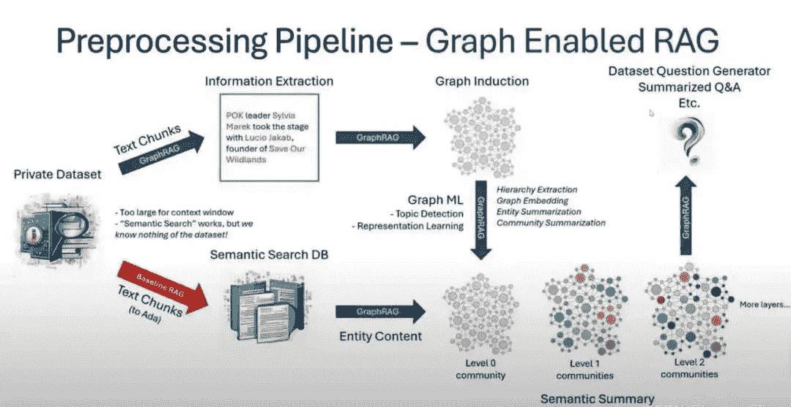
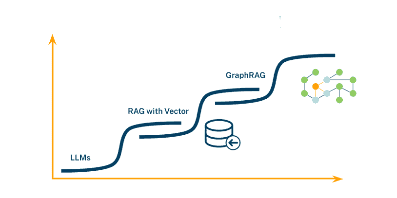
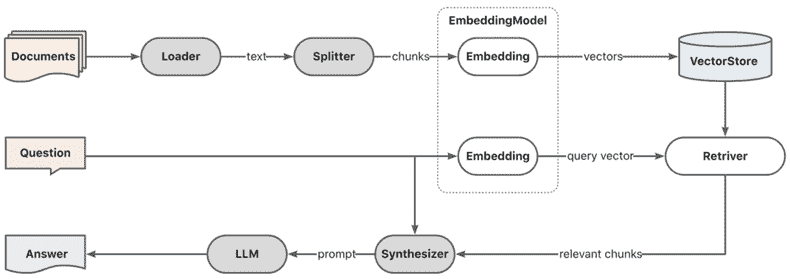
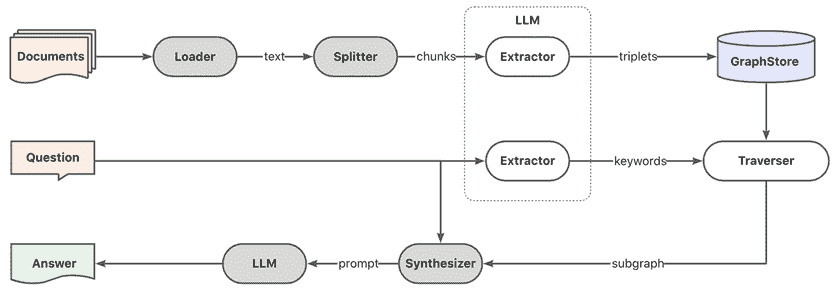
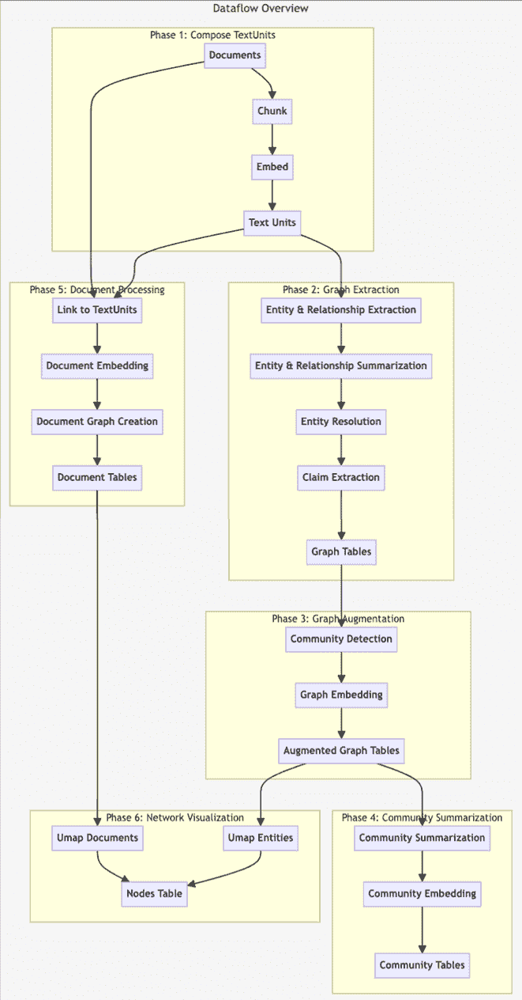
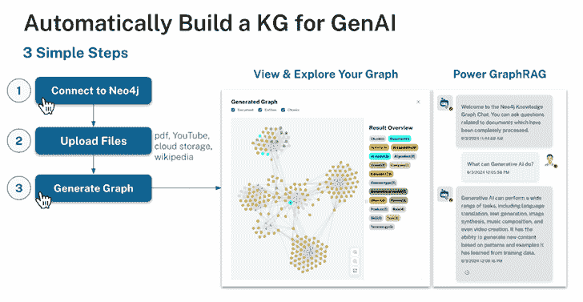
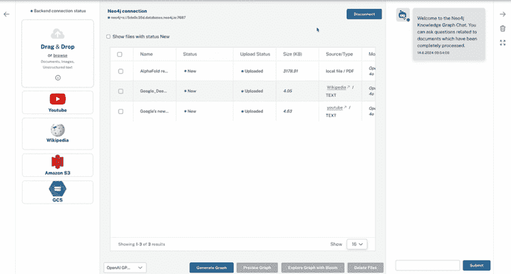
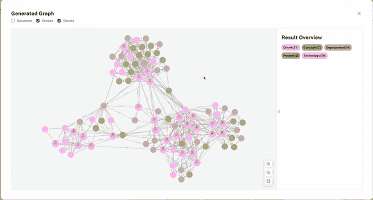

# 项目解析：GraphRAG是RAG的下一场

> 来源：[https://agijuejin.feishu.cn/docx/MXFTdNyGko3enlxnJkNcITBqnEe](https://agijuejin.feishu.cn/docx/MXFTdNyGko3enlxnJkNcITBqnEe)

> Blaze 智见AGI｜[阅读原文](https://mp.weixin.qq.com/s/sCbn7ztkoAiNVsAFAgyceg)

> 转载请联系原作者取得授权

> GraphRAG：如何将传统的文档检索转变为智能知识图谱分析的下一代工具

**©作者 | **Blaze

**来源 | **神州问学

# **引言**

随着技术的不断进步，信息检索和生成模型的结合已经成为提升模型性能的关键方法。RAG（Retrieval-Augmented Generation）作为这一领域的先驱，通过将检索和生成相结合，大大提高了模型的回答准确性和相关性。然而，RAG并不是故事的终点，而是一个全新的起点。

今年4月份，微软曾发布一篇论文《From Local to Global: A Graph RAG Approach to Query-Focused Summarization》，文章提出了一种基于图的RAG方法——GraphRAG，通过知识图谱技术，提升查询聚焦总结（QFS）任务的响应。短短两个月之后，微软便正式开源了GraphRAG项目，为RAG技术带来了更多可能性和更高的性能。本文旨在剖析GraphRAG基本原理以及案例解析，希望能够更进一步理解其核心架构。

**RAG的回顾**

常规RAG主要包括索引、检索、生成三个阶段，可以通过知识库的关联知识增强大模型问答的上下文以提升生成内容质量，但是也存在诸多问题。GraphRAG项目作者提出了一个常规RAG无法处理的应用场景：

However，RAG fails on global questions directed at an entire text corpus，such as “What are the main themes in the dataset?”，since this is inherently a queryfocused summarization (QFS) task，rather than an explicit retrieval task.

作者认为，这种应用场景本质上是一种查询聚焦总结(QueryFocused Summarization，QFS)任务，单纯只做数据检索是无法解决的。于是提出一种解决方案，利用像Louvain和Leiden这样的社区检测算法，通过将图分割成紧密相关节点的模块化社区，从这些社区描述生成的摘要旨在完整覆盖底层图索引和其所代表的输入文档。通过映射-减少（map-reduce）方法，每个社区摘要独立并行地回答查询，最终的全局答案总结了所有相关的部分答案。于是，GraphRAG应运而生。

**GraphRAG的提升**

考虑到传统RAG能力上的不足，GraphRAG从增强知识确定性的角度做了进一步的改进。GraphRAG的核心创新在于引入了知识图谱技术，使用图格式存储知识，而非传统的向量格式。

与传统RAG类似，GraphRAG整个Pipeline可划分为索引（Indexing）与查询（Query）两个阶段，不同的是，GraphRAG利用大型语言模型（LLM）从文本中提取出节点（如实体）、边（如关系）和协变量（如声明），再利用社区检测算法对整个知识图谱进行划分，然后LLM进行总结，最后根据特定查询，汇总所有与之相关的信息生成一个全局性的答案。

**GraphRAG 知识模型**

为了支持 GraphRAG 系统，索引引擎的输出（在默认配置模式下）与我们称之为 GraphRAG 知识模型的知识模型保持一致。该模型旨在作为底层数据存储技术的抽象，并为 GraphRAG 系统提供一个通用接口。在正常使用情况下，GraphRAG 索引器的输出会被加载到数据库系统中，而 GraphRAG 的查询引擎将使用知识模型的数据存储类型与数据库进行交互。我们可以在GraphRAG仓库python/graphrag/graphrag/model目录下可以找到，知识模型主要包含以下内容：

**文档 (Document) **- 系统中的输入文档。这些文档可以是 CSV 中的单独行或单独的 .txt 文件。

文本单元 (TextUnit) - 要分析的文本块。可以配置这些块的大小、它们的重叠以及是否遵循任何数据边界。一个常见的用例是将 CHUNK_BY_COLUMNS 设置为 id，以便在文档和文本单元之间建立一对多关系，而不是多对多关系。

**实体 (Entity) **- 从文本单元中提取的实体。这些实体可以表示人、地点、事件或您提供的其他实体模型。

关系 (Relationship) - 两个实体之间的关系。这些关系是从协变量中生成的。

协变量 (Covariate) - 提取的声明信息，其中包含关于实体的陈述，这些陈述可能是时间相关的。

社区报告 (Community Report) - 一旦生成实体，我们对它们进行分层社区检测，并为这个层次结构中的每个社区生成报告。

**节点 (Node) **- 此表包含已嵌入和聚类的实体和文档的渲染图视图的布局信息。

**索引构建流程**

那么如何将文本文档转换为GraphRAG知识模型，主要有以下步骤：

编写TextUnit（ Compose TextUnits）

图谱提取（Graph Extraction）

图谱增强（Graph Augmentation）

社区总结（ Community Summarization）

文档处理（Document Processing）

网络可视化（Network Visualization）

通过这些步骤，文本文档被系统化地转化为 GraphRAG 知识模型，从而支持高效的知识管理和信息检索。

**GraphRAG查询引擎**

查询阶段的pipeline相对而言要简单些，查询引擎主要负责本地搜索、全局搜索、问题生成。

**本地搜索： **本地搜索方法通过结合 AI 提取的知识图谱中的相关数据和原始文档的文本块来生成答案。此方法适用于需要理解文档中提到的特定实体的问题（例如，洋甘菊的治疗特性是什么？）。

**全局搜索： **全局搜索方法通过 MapReduce 方式搜索所有 AI 生成的社区报告来生成答案。这是一种资源密集型方法，但对于需要理解整个数据集的问题（例如，这本笔记本中提到的草药的最重要价值是什么？），通常可以提供良好的响应。

**问题生成： **此功能接收用户查询列表并生成下一个候选问题。这对于在对话中生成后续问题或为调查人员生成深入数据集的问题列表非常有用。

**GraphRAG项目案例**

GraphRAG自开源以来，它迅速在技术社区中引起了广泛关注和讨论，吸引了一大批技术大牛追捧，它既不是第一个GraphRAG项目，也更不会是最后一个GraphRAG项目，一大批GraphRAG项目如雨后春笋般迸发。GraphRAG项目众多，有Vector|Graph-蚂蚁首个开源GraphRAG框架、LlamaIndex发文介绍的Property Graphs，以及Neo4j开源的llm-graph-builder等等。

7月13日，Neo4j开源了基于LLM提取知识图谱的生成器：llm-graph-builder

Neo4j LLM 知识图谱构建器是一款在线应用程序，用于将非结构化文本转化为知识图谱，提供了一个神奇的文本到图谱体验。

它使用多种机器学习模型（LLM - OpenAI、Gemini、Llama3、Diffbot、Claude、Qwen）将 PDF、文档、图像、网页和 YouTube 视频转录内容转化为知识图谱。该提取过程将它们转化为文档和片段的词汇图（包括嵌入）以及包含节点和其关系的实体图，这些都存储在您的 Neo4j 数据库中。您可以配置提取模式，并在提取后应用清理操作。

之后，您可以使用不同的 RAG 方法（GraphRAG、Vector、Text2Cypher）对数据进行提问，并查看提取的数据是如何构建答案的。

GraphRAG是RAG的下一场

GraphRAG 是 RAG 的下一场，通过结合知识图谱技术，超越了传统基于单词的计算，提供了更精确和解释性更强的结果。它不仅解决了查询聚焦总结性任务的难题，还内置了一套完整的工作流编排系统，尽管使用成本较高，但在数据分析等广泛应用领域展现了巨大潜力。相比之下，常规RAG的创新点较少，而GraphRAG在处理颗粒度和模块化方面仍有改进空间，值得深入研究和应用。

# **未来展望与挑战**

GraphRAG作为RAG的下一场，展示了其在信息检索与生成模型融合领域的巨大潜力。未来，GraphRAG技术的发展方向可能包括：

**进一步优化图结构构建与存储 **：通过引入更高效的图结构构建与存储方法，提升检索和生成的效率。

**扩展应用场景 **：在更多领域中应用GraphRAG技术，如教育、金融和科学研究等，进一步验证其实际效果和应用价值。

尽管GraphRAG展示了很大的潜力，但仍面临一些挑战：

**数据质量和完备性 **：知识图谱的构建依赖于高质量和完备的数据，未来需要进一步提升数据的质量和完备性。

**算法效率和可扩展性 **：随着知识图谱规模的扩大，如何保持算法的高效性和可扩展性是一个重要挑战。

**隐私保护和安全性 **：在利用大规模知识图谱进行信息检索时，仍需加强数据隐私保护和安全措施，确保用户数据的安全性。

# **结论**

通过以上分析可以看出，GraphRAG作为RAG技术的下一场，在信息检索与生成模型融合方面展示了巨大的潜力和优势。其通过引入知识图谱技术，提升了知识的组织和检索效率，显著改善了生成结果的准确性和相关性。未来，随着技术的不断进步和应用场景的扩展，GraphRAG有望在更多领域中得到应用，为复杂问题的解决提供更为高效和准确的工具和方法。

我们期待GraphRAG技术的进一步发展，并鼓励更多研究人员和开发者参与到这一领域的探索和创新中，共同推动人工智能技术的进步。

参考文献

https://arxiv.org/abs/2404.16130

https://microsoft.github.io/graphrag/

https://neo4j.com/labs/genai-ecosystem/llm-graph-builder/