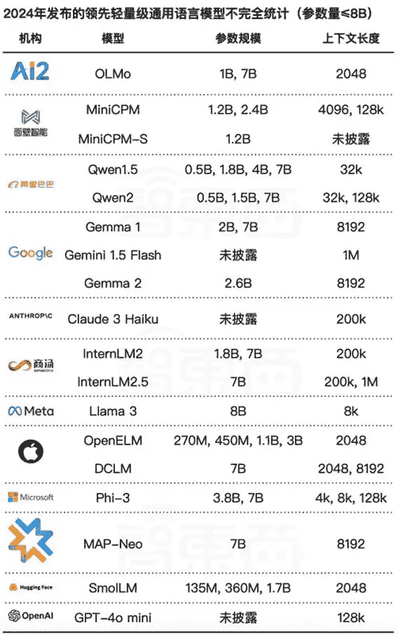
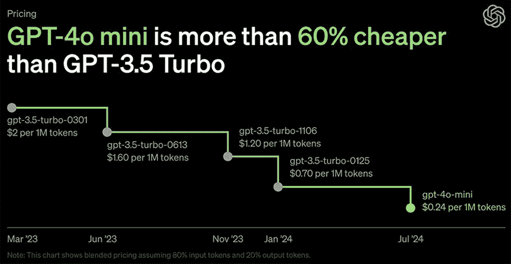
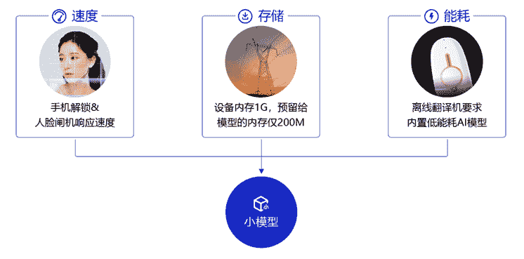
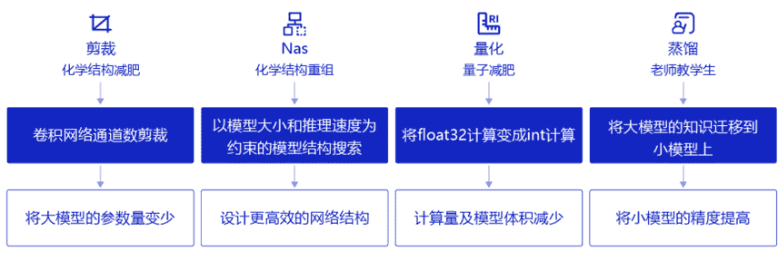

# GPT-4o mini发布，轻量级大模型如何颠覆AI的未来？

> 来源：[https://agijuejin.feishu.cn/docx/G3TxdTYnzoucRoxSsdncQ8yInyc](https://agijuejin.feishu.cn/docx/G3TxdTYnzoucRoxSsdncQ8yInyc)

> 潇潇 智见AGI｜[阅读原文](https://mp.weixin.qq.com/s/7-T41yIX-wYjP1VebTnXQw)

> 转载请联系原作者取得授权

> 从巨无霸到小巨人：GPT-4o Mini的创新之路

**©作者 | **潇潇

**来源 | **神州问学

# **引言**

随着人工智能技术的飞速进步，AI领域的竞争日益激烈，大型模型的发布几乎成为常态。然而，这些庞大的模型通常需要大量的计算资源和存储空间，这在一定程度上限制了它们在更广泛场景中的应用。正是在这种背景下，轻量级大模型应运而生，以其高效的性能和低资源消耗，逐渐成为市场的新宠。

如今， **AI大模型的竞争已经不再仅仅是“**做大做强”，而是迅速转向“做小做精”。 超越GPT-4o的单一目标已经不再是唯一的成功标准。大模型进入市场竞争的新阶段，如何打动用户不仅依赖技术实力的展示，还需要证明模型在性能相当的情况下更加小巧、经济，更具性价比。

苹果公司从去年开始着手研究更加适配手机的端侧模型。而一直以来以暴力扩张著称的OpenAI，最近也加入了这一趋势。 OpenAI正式开卷小参数模型 ，推出了轻量级模型GPT-4o mini，顺应业界趋势，尝试通过更具经济性的模型开拓更广泛的市场。

# **一、轻量级大模型的定义与特点**

**1.与传统大模型的区别**

轻量级大模型（Lightweight Large Models）是在保有高性能和广泛应用潜力的同时，具备更小参数量、更低资源消耗和更高性价比的人工智能模型。它们与传统大模型的主要区别如下：

**参数量与规模： **传统大模型通常拥有数百亿至数万亿的参数，训练和运行需要大量计算资源和高昂成本。轻量级大模型通过架构优化、模型蒸馏等技术手段，在大幅减少参数量的情况下，保持或接近大模型的性能。

**训练与推理成本： **轻量级大模型的训练成本和推理成本显著降低。例如，GPT-4o mini仅用数亿参数实现了接近千亿参数模型的性能，训练和推理成本减少了数个数量级。

**部署与应用场景： **传统大模型多用于数据中心和云端，适合高性能计算需求。轻量级大模型则更适合在边缘设备、移动端等环境中部署，能够在智能手机、物联网设备等终端设备上本地运行，实现低延时和高隐私性的数据处理。

**创新与技术： **轻量级大模型依赖于更高效的数据治理、优化的训练策略和先进的模型架构设计。例如，面壁智能的MiniCPM系列通过高效稀疏架构和知识密度优化，实现了小模型高性能的目标。

**2. 主要特征**

小参数模型更容易融入热门领域的技术探索和商业化策略。面壁智能的刘知远教授认为，2023年ChatGPT和GPT-4的推出表明大模型技术路线已经基本确定，接下来的重点是探索其科学机理，并极致地优化效率。 通过“以小博大”的理念，挑战了超大参数模型的效率 。此次面壁智能做小参数模型背后， 不仅是为了挑战模型训练技术，更有深远的现实和商业意义 。轻量级大模型的主要特征如下：

**参数规模小： **参数数量一般在10亿以下，相较于传统大模型大大减少。这种缩减使得模型在计算和存储上更加高效。

**计算效率高： **优化算法和模型设计使得轻量级模型在较少的计算资源下依然能保持良好性能，从而适合在资源受限的环境中运行。

**低成本： **由于参数较少，训练和部署的成本显著降低，使得更多企业和开发者能够负担得起。

快速响应：在处理速度和响应时间上更具优势，适合需要实时处理的应用场景。

**适应性强： **能够在各种资源受限的设备上运行，包括智能手机、物联网设备和嵌入式系统，适应性广泛。

# **二、市场需求分析**

随着生成式AI技术的迅猛发展， 大模型领域正经历从“做大做强”到“小而精”的显著转变 。市场需求的变化，促使了技术发展的新方向。GPT-4o Mini 的发布进一步突显了轻量级大模型在当前市场中的重要性。

**

1、企业需**求

随着AI技术的广泛应用，企业对大模型的需求也在发生变化。以下是当前企业需求的主要表现：

**成本效益： **传统的大模型训练和部署成本高昂。轻量级大模型通过降低计算和存储需求，帮助企业有效控制开支，提高投资回报率。

**资源优化： **许多企业面临硬件资源限制，轻量级模型能够在有限的资源条件下提供高效性能，从而优化资源配置。

**实时响应： **在要求快速响应的应用场景中，如移动应用和实时数据处理，轻量级模型的低延迟和高效率显得尤为重要。

**开发与维护： **企业希望简化AI模型的开发和维护过程。轻量级模型通常更易于开发和管理，降低了技术门槛和维护成本。

**市场适应性： **面对不断变化的市场需求，企业需要快速调整和推出新产品。轻量级模型能够快速适应市场变化，保持竞争力。

**2、用户需求**

除了企业，个人用户和开发者对轻量级大模型的需求也在增加：

**移动性： **用户希望在移动设备上享受AI功能，如语音助手和实时翻译。轻量级模型能够在智能手机等设备上高效运行，满足这些需求。

**便捷性： **开发者希望能够快速集成和部署AI功能。轻量级模型的简化和高效性使得集成过程更加顺畅，提高了开发效率。

**个性化体验： **用户对个性化服务的需求增加。轻量级模型通过高效处理和定制化能力，能够提供更符合用户需求的个性化服务。

# **三、轻量级大模型的应用场景**

轻量级大模型正在成为AI产业的新风向，引领技术变革与应用创新。以下是一些关键应用场景和前景展望：

**终端设备智能化： **随着轻量级大模型的应用，智能手机、智能家居、车载系统等终端设备能够实现更高效的本地化AI处理，提升用户体验并增强数据隐私保护。

**企业应用普及： **轻量级大模型降低了企业部署AI的门槛，使得更多中小企业能够利用先进的AI技术优化业务流程、提升生产效率和创新产品服务。

**个性化与定制化： **轻量级大模型更易于微调和定制，能够针对特定任务和应用场景进行优化，提供个性化的智能服务。

**环境与资源友好： **轻量级大模型的低能耗特性符合可持续发展的需求，减少了对环境资源的消耗，有助于构建绿色AI生态系统。

轻量级大模型在各个领域展现了广泛的应用前景。随着技术的不断进步和优化，未来将涌现出更多创新的应用场景和解决方案，进一步推动智能技术的发展和普及。2024年，将是大模型“小型化”的关键之年。随着技术的持续创新，轻量级大模型将在更多领域展现其巨大潜力和应用价值。

# **四、轻量级大模型的技术实现**

轻量级大模型的技术实现涵盖了多个方面，旨在降低计算资源和存储需求，同时保持模型的性能。以下是主要的技术实现方法：

**1、模型压缩**

权重量化（Weight Quantization）： 通过将模型参数用较低位宽（如8位、4位）表示，减少存储和计算成本。例如，二值化将权重压缩到+1或-1，大幅度降低模型的存储需求。

权重剪枝（Weight Pruning）： 移除模型中冗余的连接或神经元，减少计算量和存储需求。剪枝后通常需要对模型进行再训练以恢复性能。

模型蒸馏（Model Distillation）： 利用大型预训练模型的知识来训练一个较小的模型，从而实现模型压缩和性能保持。小模型通过模仿大模型的预测行为来学习。

**2、轻量化网络结构**

**深度可分离卷积（Depthwise Sep**arable Convolution） ：将标准卷积分解为深度卷积和逐点卷积，减少计算量和参数数量。例如，MobileNet采用这种技术显著降低了计算复杂度。

分组卷积（Group Convolution）： 通过将卷积操作分成多个组来减少计算量，广泛应用于轻量化网络结构中，如ShuffleNet。

**神经网络架构搜索（Neural Archite**cture Search, NAS）： 自动寻找最优的网络结构，以降低计算复杂度和参数数量。NAS技术可以设计出更高效的网络结构。

**3、硬件加速**

专用硬件（如GPU、TPU、FPGA）： 使用专用硬件加速模型推理，提高计算效率。例如，NVIDIA Jetson平台和Google Coral TPU是为边缘计算设备设计的加速解决方案。

**量化计算硬件： **硬件加速器专门优化量化计算，如量化GPU和FPGA，能够高效处理低精度运算。

**4、软件优化**

**高效推理引擎： **使用优化的推理引擎，如TensorFlow Lite和ONNX Runtime，提升模型在端设备上的运行速度。推理引擎专为低功耗和资源受限环境设计。

**性能优化库： **利用高性能计算库（如OpenBLAS、MKL-DNN）来提升计算效率，这些库提供了优化的数学运算功能。

**5、迁移学习和微调**

**预训练模型的迁移学习： **选择在大规模数据集上预训练的轻量级模型，并在目标任务上进行微调，减少训练时间并提升模型性能。

**数据增强： **通过数据增强技术扩充训练数据集，提高模型在小数据集上的泛化能力。

这些技术实现方法通过不同的方式优化模型，使其在资源受限的环境中也能保持良好的性能和效率，推动了轻量级大模型在各种应用场景中的广泛应用。

# **结论**

轻量级大模型以其高效、低成本和易于部署的特点，正在成为AI技术发展的重要方向。GPT-4o Mini 的发布进一步验证了这一趋势，在其保持强大性能的同时，显著降低了计算和存储需求。随着技术的进步和市场需求的增长，未来的大模型将趋向于更高的效率、更轻量的设计以及更广泛的可及性。未来大模型一定会：更多能，更轻量，更亲民。