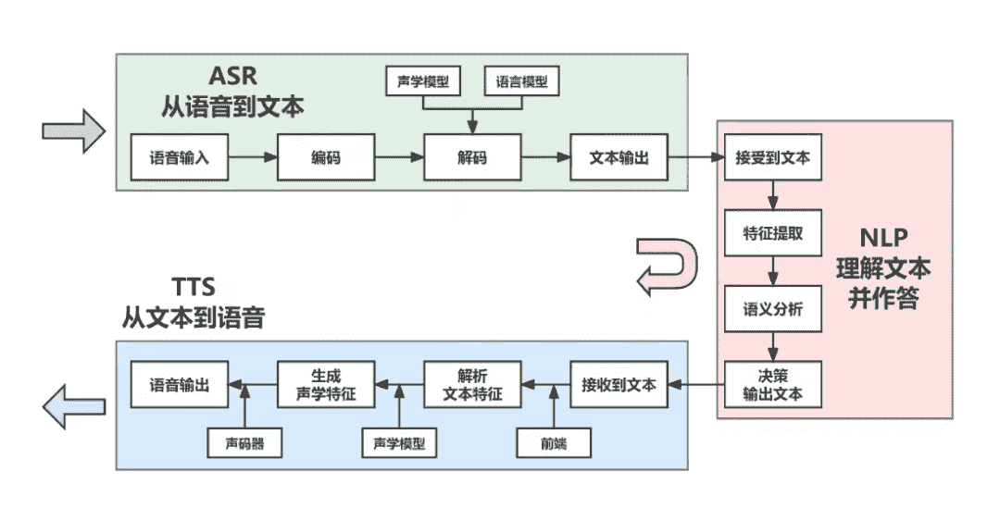
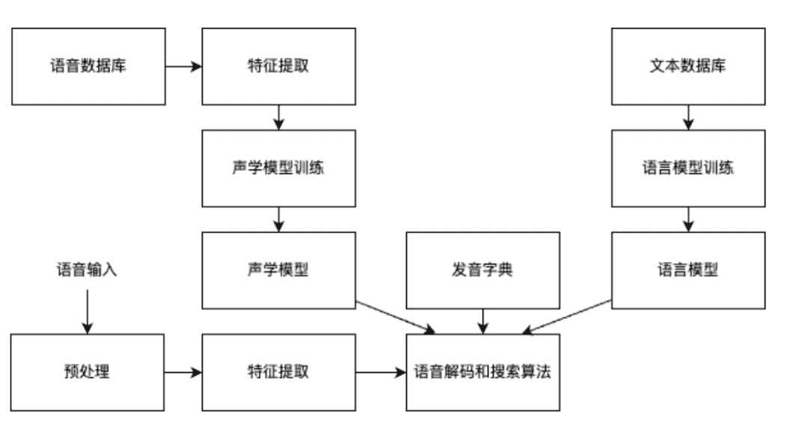
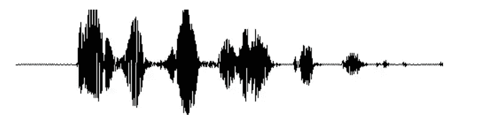
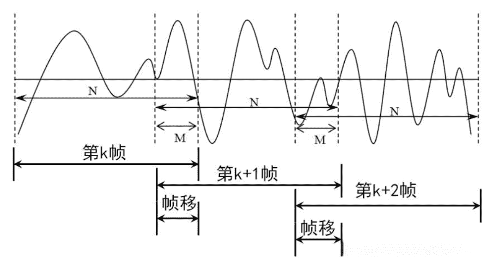
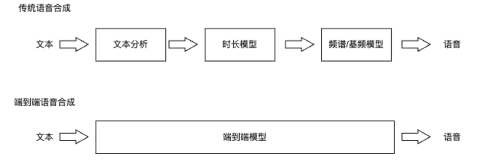

# AI说的每⼀句话，都离不开这三项 技术

> 来源：[https://agijuejin.feishu.cn/docx/IGugdXzPKoeWWIxjmgLcLueonyz](https://agijuejin.feishu.cn/docx/IGugdXzPKoeWWIxjmgLcLueonyz)

> Zane 智见AGI｜[阅读原文](https://mp.weixin.qq.com/s/IVz5dWALWTvJk3JVWG8j3A)

> 转载请联系原作者取得授权

> 语音助手的智能秘诀：深入探索NLP、ASR和TTS

**©作者 | **Zane

**来源 | **神州问学

# **引言**

在我们日常生活中，语音助手已经变得越来越普遍。无论是苹果的Siri还是小米的小爱同学，它们都在以惊人的速度渗透到我们的日常生活中。这些语音助手不仅能够帮我们查询天气、设定闹钟，还能与我们进行对话，提供个性化的建议和服务。我们不禁要问，这些智能语音助手是如何做到如此智能、自然地与我们交流的？

实际上，Siri和小爱同学的每一句话背后都依赖于三项核心技术：自然语言处理（NLP）、自动语音识别（ASR）和文本到语音转换（TTS）。这三项技术共同作用，使得语音助手能够理解我们的语言，进行有效的对话，并用自然的语音进行回应。接下来将详细介绍这三项技术，揭示它们如何协同工作，为我们带来便捷而智能的语音助手体验。

# **自然语言处理（NLP）**

自然语言处理（Natural Language Processing，简称NLP）是人工智能的一个重要分支，它致力于让计算机能够理解、解释和生成人类语言。NLP结合了语言学和计算机科学的知识，旨在使计算机能够像人类一样处理和分析大量的自然语言数据。

近些年来随着LLM的火爆以及LLM能力的增强使得NLP技术在处理复杂语言任务时更加游刃有余。那么，LLM和NLP之间有什么联系呢？简单来说，LLM是NLP领域的一种技术手段，而NLP则是LLM应用的一个广泛领域。LLM通过深度学习技术，对海量文本数据进行训练，从而使得模型具备理解和生成人类语言的能力。而NLP则将这些能力应用于各种实际场景，如机器翻译、语音识别、情感分析等。举个例子，当我们使用机器翻译功能时，LLM技术可以帮助我们训练出一个能够理解源语言和目标语言的模型。而NLP技术则负责将这个模型应用于实际的翻译任务，使得机器翻译更加准确和自然。而现在LLM能力的增强，则直接影响了NLP能力的增强，这也直接影响了AI在进行语音问答等方便的能力。

# **自动语音识别（ASR）**

自动语音识别（Automatic Speech Recognition，ASR）是一种能够将人类的语音转换为计算机可以理解和处理的文本的技术。它通过分析和处理音频信号，识别其中的语音内容，并将其转化为文字输出。

ASR的核心功能是将语音转换为文本。具体过程包括以下几个步骤：

**1. 语音信号捕获： **通过麦克风或其他音频输入设备捕获用户的语音信号。

**2. 预处理： **对语音信号进行噪声抑制、语音增强等预处理，以提高识别的准确性。

**3. 特征提取： **将预处理后的语音信号转换为特征向量，这些特征向量能够反映语音信号的声学特征。

**4. 声学模型： **利用声学模型将特征向量映射到语音单元（如音素）。

**5. 语言模型： **利用语言模型将识别的语音单元组合成连贯的文本。

**6. 后处理： **对初步识别的文本进行拼写校正、标点符号添加等处理，以提高文本的可读性。

首先我们知道，声音的本质是一种波。我们比较熟知的mp3格式的文件则都是压缩格式，在asr中我们往往需要转成非压缩的纯波形文件来处理，如wav文件，wav文件中存储的除了一个头文件以外就是声音的波形。

声音波形图案

往往在处理一个一段声音的波形的时候需要切除波形的首段和尾端的静音部分，降低对后续步骤的干扰，这个静音切除的操作我们称之为VAD，在对声音的波形进行分析的时候需要对声音进行分帧，在分帧之后我们需要进行特征提取，组成一个矩阵，然后通过声学模型将矩阵映射到一个个音素及语音单元（对英语，一种常用的音素集是卡内基梅隆大学的一套由39个音素构成的音素集，汉语一般直接用全部声母和韵母作为音素集，另外汉语识别还分有调无调等等）然后利用语言模型将一个个单元组合成一个连贯的文本。

语音分帧

而在我们的日常生活中ASR技术在许多实际应用中发挥着重要作用，如语音输入法，就是一种利用ASR技术的输入方式，用户可以通过语音输入文字，而不需要使用键盘进行打字。在手机、平板等移动设备上，语音输入比手动打字更加快捷方便。对于有视力障碍或行动不便的人群，语音输入提供了更便捷的操作方式。

而语音搜索是另一种常见的ASR应用，用户可以通过语音查询信息，而不需要手动输入搜索词。比如在智能音箱、智能电视等设备中，语音搜索提供了一种自然的交互方式，用户只需说出查询内容，设备就能进行响应。在驾驶过程中，语音搜索能够帮助驾驶员获取导航、天气等信息，而不需要手动操作，提升驾驶安全性。

# **当文本到语音转换（TTS）**

文本到语音转换（Text-to-Speech，TTS）是一种技术，可以将书写的文本转换成自然、流畅的语音。TTS系统通过分析输入的文本内容，合成对应的语音，从而使计算机可以“读出”文本内容。

TTS的核心功能是将文本转换为语音。具体过程包括以下几个步骤：

**1. 文本分析： **对输入文本进行预处理，包括分词、词性标注、句子解析等，以便后续处理。

**2. 文本标注： **根据语法和语义分析的结果，对文本进行标注，例如标记重音、停顿等信息。

**3. 语音合成： **根据标注好的文本，利用声学模型和语音库合成语音信号。

**4. 后处理： **对合成的语音进行平滑处理，以提高语音的自然度和流畅性。

传统TTS在实现上往往使用2种方法，分别是“拼接法”和“参数法”，而拼接法是从事先录制的大量语音中，选择所需的基本单位拼接而成而其优点就是最终得到而语音质量较高，但是其确定也很明显就是成本较高，而参数法则是根据统计模型产生时时刻刻的语音参数然后把这些参数转为波形，其优点就是所需的数据会对比拼接法大大减小，但是在质量方面则低于拼接法。

而近些年来基于神经网络架构的深度学习方法崛起，使得TTS技术新增了一种端到端的合成技术，端到端的合成技术相比于传统的语音合成技术而言降低了对语言学只是的要求，可以方便在不同语种上进行复制，批量实现几十种设置更多语种的语音合成系统。目前端到端的语音合成技术主要分为两类”统计参数合成”和“神经网络生码器”。其中，统计参数合成是一种基于统计模型的语音合成方法，通过建立文本特征到语音参数的映射关系来生成语音，而神经网络声码器则是一种基于深度神经网络的语音合成方法，通过训练神经网络模型将文本特征直接转换为语音波形。而端到端的合成技术优缺点也十分明显，其中优点就是可以直接合成语音，无需中间步骤，训练数据量小，训练速度快，合成效果自然，接近真人发音，而缺点则是模型训练难度较大，需要大量的计算资源，模型的泛华能力有限，并且合成的效果收到训练数据质量的影响，可能存在发音不准确等情况。

而当前的TTS技术则主要分为3个水平，分别是通用TTS，个性化TTS和情感TTS，通用TTS指的是在用户预期不苛刻的情况下，满足商业化需求，比如语音助手，智能音箱，机器人等情况，但是如果用户的预期很高的情况下还是比较难以满足，因为声音还是会存在机械感不能非常自然的模拟人声，而个性化的TTS则主要针对特定的场景中，生成特定的角色进行使用，而情感TTS，则要求声音中包含更多的情感语调，比如很火的ChatTTS就是一个情感TTS，而情感TTS则非常依赖于“情感意图识别”，“情感特征挖掘”，“情感数据”和“情感声学”技术等。

在许多实际应用中TTS技术发挥着重要作用，比如通过语音导航，用户可以在驾驶或步行时获取实时的导航指示，而不需要低头查看屏幕，提升了出行的便捷性和安全性。在GPS导航设备或手机导航应用中，TTS可以为用户提供转弯、道路变化等语音提示，确保用户能够专注于驾驶或步行。在公交车、地铁等公共交通工具上，TTS可以用来广播站点信息、服务公告等内容，方便乘客了解实时信息。

而有声读物是利用TTS技术将书籍、文章等文本内容转换为语音形式的数字产品。通过有声读物，用户可以在不便阅读的情况下（如开车、运动时）享受书籍内容，提升阅读体验。在电子书应用中，TTS可以将文本内容转换为语音，提供听书功能，满足用户的多样化需求。在教育领域，TTS可以用来制作有声教材、讲解资料等，帮助学生通过听觉进行学习，特别是对有视觉障碍的学生尤为重要。

# **结论**

AI的每一句话都依赖于三项核心技术：自然语言处理（NLP）、自动语音识别（ASR）和文本到语音转换（TTS）。这些技术共同协作，使机器能够理解、生成和转换人类语言，实现更自然和高效的人机交互。NLP通过理解和生成自然语言，使机器能够处理和理解文本输入，并生成合理的文本输出。ASR将语音转换为文本，使机器能够听懂人类的语言，为语音输入提供基础。TTS将文本转换为语音，使机器能够以自然的语音形式输出信息，为语音输出提供基础。

然而，尽管大模型在NLP领域取得了突破性进展，将ASR和TTS能力整合进去仍然面临挑战。首先，ASR和TTS是两个不同的技术领域，它们在处理语音和文本方面有着不同的算法和优化目标，需要专门设计以提高准确性和自然度。其次，ASR和TTS技术在处理语音信号和文本数据时，需要考虑噪声、口音、语速等多种因素，这些都会影响性能。此外，ASR和TTS的实现需要大量语音和文本数据进行训练，这些数据需要清洗、标注和预处理，数据质量、隐私和标注成本等问题也需解决。

在当前市场环境下，大模型正引领自然语言处理技术的突破性进展。通过深度学习，大模型显著提升了语言理解、生成、多任务学习、推理、泛化和隐私保护的能力。这些模型不仅能够处理复杂的语言结构和丰富的语义信息，还能生成流畅、自然且多样化的语言输出，使聊天机器人和虚拟助手提供更加自然和个性化的对话体验，并提高了TTS的自然度和真实感。

大模型的多任务学习能力使其能够灵活应用于不同场景，从而提高系统的整体性能。通过学习大量文本数据，这些模型能够更好地理解人类的思维模式和推理过程，在需要推理能力的任务中表现出色。面对未见过的语言数据时，大模型展现出强大的泛化能力，能够快速适应新环境并保持良好性能。此外，通过对语言数据的深入学习，大模型在处理涉及隐私保护的任务时更加谨慎，能够更好地理解和保护人类的隐私需求和敏感信息。

尽管目前整合ASR和TTS仍有挑战，随着技术的发展和优化，未来有望实现这两项能力与大模型的无缝整合，从而进一步提升自然语言处理技术的性能和应用范围。大模型的这些能力正推动自然语言处理技术迈向更高水平，为人类社会带来更多便利。