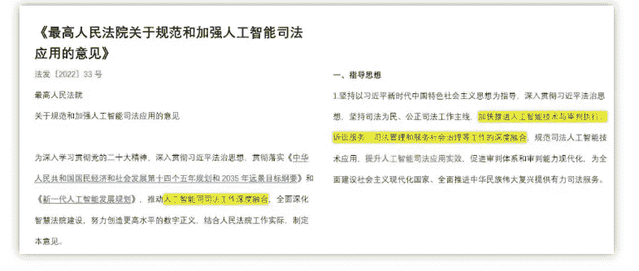
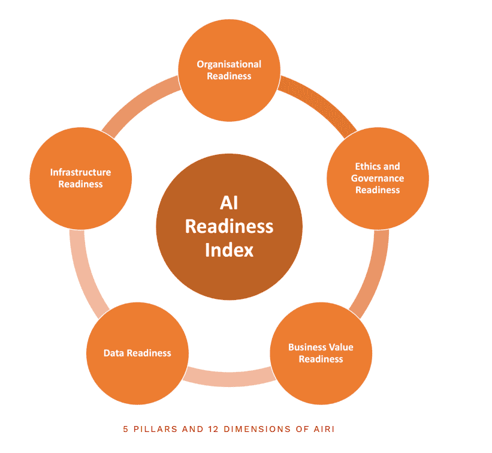
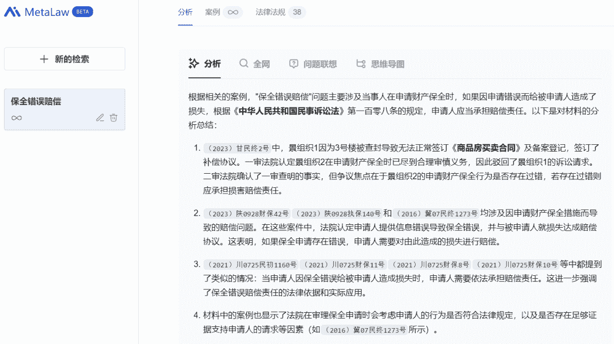
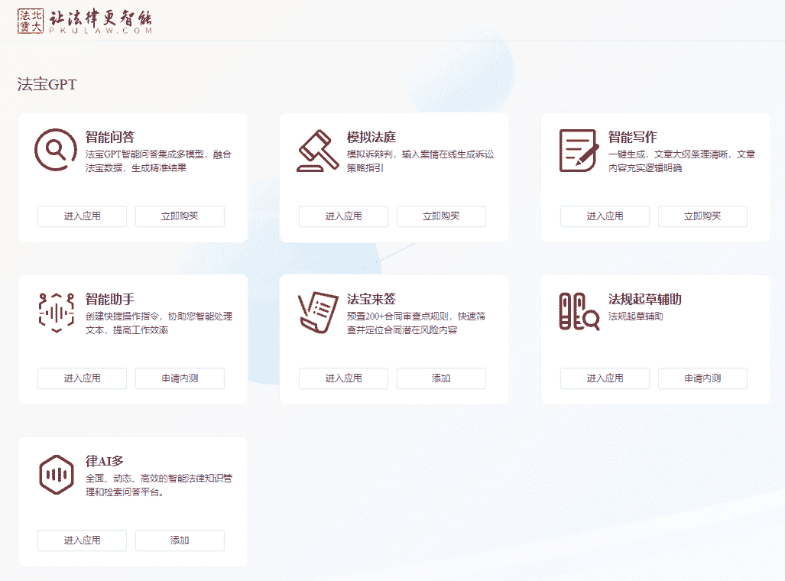
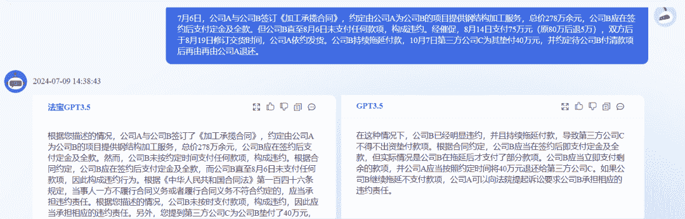

# AI为什么无法替代律师？

> 来源：[https://agijuejin.feishu.cn/docx/GTvMdy8X0onoytxY5uWcrDH3nhe](https://agijuejin.feishu.cn/docx/GTvMdy8X0onoytxY5uWcrDH3nhe)

> LuMiQ 智见AGI｜[阅读原文](https://mp.weixin.qq.com/s/VptG4NVf1RsTEXOewPDiEg)

> 转载请联系原作者取得授权

> AI能否真正取代律师？一探究竟！

**©作者 | **LuMiQ

**来源 | **神州问学

# **引言**

数字化时代，AI技术正如催化剂般加速各行业的变革：在医疗界，它犹如医生的“第二双眼睛”，精准分析影像；制造业里，“智慧无人工厂”因机器学习的融入而生；社交平台上，语言不再是障碍，自然语言处理（NLP）技术架起不同国家间人们沟通的桥梁。在此背景下，大语言模型（LLM）以其独特魅力，正逐步革新法律服务领域。通过LLM，我们得以窥见生成式人工智能技术（GenAI）如何在助力法律从业者提升工作效率、优化服务质量等方面的巨大潜力。

然而，尽管未来AI可能在法律服务行业扮演着越来越重要的角色，它们依然无法取代律师的工作。相对于人类理解语言的能力，机器在自然语言理解方面还有很长的路要走，而AI法律应用也只能作为强大的辅助工具，帮助法律从业者在数字化转型的浪潮中更加从容地应对各种挑战。本文将细致考察目前在NLP领域有不俗表现的LLM在法律服务行业中的优势与局限性，解析当前国内外已有的AI法律应用，并展望未来共绘法律服务的新篇章。

# **LLM的技术优势**

语言作为人类高度复杂的交流体系，长久以来在NLP方面对人工智能技术构成严峻考验。它不仅仅是语法规则的堆砌，更是文化、情感与逻辑的交织体。对人类来讲轻而易举就能理解的话语，对算法来说则异常艰难。对于AI而言，即便是简单的日常对话，背后也隐藏着理解词汇、把握句法、领悟语境的重重难关：

● **词法： **理解不同词汇的类型，例如名词、动词、形容词等

● **句法： **理解句中词汇之间的逻辑关系，例如主谓宾的区分

● **词义： **理解词汇的具体含义，对于多义词，具体词的含义还需要依据使用的语境来判断

● **语境： **理解语境对语言的影响，捕捉特定情境下的深层含义和隐含信息

以往传统神经网络在NLP上的努力，常常受限于这些复杂性。直至预训练语言模型（PLM）的兴起，通过使用Transformer架构在海量文本中进行预训练才在NLP领域实现显著突破。而随着模型参数规模的急剧扩大，从数十亿乃至数万亿，这些被称之为大语言模型的PLM，能够在多个NLP任务中表现出比小型模型更优越的能力；具体表现为

● 上下文学习（In-context Learning）能力： LLM能够仅基于少量实例或提示，在无需额外训练的前提下，在推理阶段掌握并执行新的任务要求

● **语言理解与生成能力： **在大规模语料上进行的预训练，促进了LLM在理解给定语境中的对话内容及生成相关、连贯的回复方面的能力。而这一能力也与LLM能够接收和处理的上下文长度息息相关：通常来讲，LLM的上下文长度越长，可参考更多的前后文信息更多，模型的上下文理解能力也就越强。对于例如法律文档分析和长文本生成等需要广泛参考前后信息的任务，长上下文长度是极其必要的

● **广泛的适用性与迁移学习能力： **由于在大规模多样数据集上的预训练，LLM内化了丰富的语言结构和知识，使其能够跨越到诸如文本问答、摘要生成等不同任务领域。如果针对法律专业文本对模型进行小规模微调训练，LLM就能够快速理解和准确使用诸如法律专业术语及复杂条款，更有效地服务于法律实践

# **AI法律应用无法替代律师的原因**

**AI法律应用的技术挑战**

尽管LLM在法律服务领域展现出广阔的应用前景，它的实践之路并非坦途，其应用仍需跨越几个关键的技术障碍：

● **法律语言的深度理解问题： **法律语言的精密与复杂，特别是其独特的术语体系和环环相扣、高度严谨的逻辑性，要求LLM具备更为深入的语境感知与推理能力，即使是在法律文本数据集上微调过的LLM也难以保证对所有信息的精确解析与应用，而这对模型的语义理解和逻辑推理能力提出了极高要求

● **确保输出的准确度和信赖度： **在法律领域，如何让LLM精确引用法条及准确把握案件事实是LLM法律应用成功的决定性因素。LLM可能产生的“幻觉”效应——即生成貌似合理实则偏离法律依据的输出，会对其生成的法律建议的准确度和可靠性构成威胁。这种现象不仅可能导致法律建议的误导，也会在实际应用中产生更严重的后果。在2023年，纽约的两名律师就因在辩护状中使用了由ChatGPT生成的六个虚构的案例引文，而受到了法官的制裁，并被处以5000美元的罚款

● **数据处理的隐私安全困境： **在法律数据处理中，维护自身与客户的隐私以及保障数据安全至关重要，如何妥善处理数据中的敏感信息，执行有效的脱敏策略，也成为了实施过程中的一个严峻考验

● **决策透明度和可解释性： **在法律服务中，决策的透明度和可追溯性对于建立客户信任至关重要。LLM及绝大部分涉及神经网络的模型，它们的决策过程往往缺乏透明度，难以为律师所理解和验证。这种"黑箱"特性可能影响基于LLM的AI法律应用在需要详细解释法律推理和决策依据的服务中的可信度和接受度

**AI无法替代的工作内容**

律师在实际处理案件时，必须进行深入的法律分析：这不仅包括对法律原理、先例以及案件特定的事实进行综合考量，也包括对证据的整理和把握。在独立完成法律任务中，LLM和其他AI技术的应用仍存在相当的局限性。

● **证据整理： **证据整理是案件处理过程中的关键一步，证据整理的角度不同，依靠证据还原的事实就不同，由此制定的诉讼策略也就不同。同时，律师打官司的关键也在于证据，证据经庭审质证：如果证据真实合法，则能证明案件事实；而如果证据来源或形成方式等存在缺陷，则不具备证明案件事实的资格，案件必然会败诉。现在AI技术对事实进行的法律分析也是建立在证据整理完成之后，假定事实都存在证据的基础上进行的；目前无论是LLM或是其他AI技术，都无法完成证据整理的工作。

● **诉讼策略制定： **律师在制定法律策略时，往往需要运用创造性思维，基于案件事实、法律规定及历史案例结果，提出新颖的论点和解决方案。这种创造性不仅基于对法律知识的深刻理解，还涉及到对案件情境的敏感把握。LLM在模拟这种基于经验的创造性思维方面存在局限，可能无法提供与人类律师同等水平的策略建议

● **合同条款制定： **尽管在上文我们讨论过LLM在合同审核与分析任务的可行性，LLM在制定合同条款时如何维护委托人利益，并为委托人进行利益最大化争取仍存在不足。满足这一点需求需要LLM更深入地理解商业背景和委托人的长期战略目标：不仅能够解析法律条文的技术细节，还要能够分析合同条款对委托人业务运营的潜在影响，发掘可能被忽视的增值点，确保每一条款都与委托人的市场定位、风险偏好和发展规划相契合。

**法律从业人员的AI素养**

法律从业人员的 **AI素养 **，即法律**工作者对人工智**能的认知**、接纳及应用能力，直**接关系到AI技术在法律服务行业的普及与实效。以新加坡AI Singapore推出的AI Readiness Index（AIRI）框架为例，这个框架是AI Singapore通过数百次与不同行业、不同规模公司的互动，总结的用于评估一个组织对AI技术接受程度的框架。它指出“ 人工智能素养 ”与“ 员工对AI的接纳度 ”是对AI技术接受程度的两个重要指标。前者衡量员工能否识别AI应用场景并选择使用AI解决方案，后者则反映了员工对AI系统的信任与接纳意愿。

图1. AIRI的五个维度

不仅仅是在法律服务行业，各个行业的从业人员对AI的误解或抵触情绪，常源自对AI技术的不信任或对既有工作模式的依赖；而组织管理层也可能出于类似的考虑，或是对数据隐私及安全的保障，限制组织员工使用AI应用。因此，在保障LLM技术对法律语言的深入理解与准确生成能力等前提下，提升法律人的AI素养，不仅关乎技术的有效采纳，更在于确保法律服务能灵活适应技术发展，持续强化行业竞争力，领跑行业前沿。

# **LLM在法律服务行业的辅助作用**

LLM在法律服务行业可行的应用场景

**法规法条与案例检索**

在法律实践中，律师在完成诸如提供法律咨询服务、撰写法律文书的任务时，时常需要搜寻最新最合适的法规法条。对于新手律师，如何准确、快速找到相关且最新的法规法条是个不小的难题。案例检索可以返回相似的历史案例，律师可以基于历史案例判决结果制定策略。在这个场景下，LLM可以对律师输入的自然语言查询句进行有效重构，返回大量相关案例的同时提供基于案例的分析总结，这种能力能够大幅减少律师的研究时间，并且为策略制定提供初始方向。

图2. MetaLaw提供的类案检索功能

**文书自动化生成**

包括起诉状或是专利申请在内的各类法律文书撰写是法律工作的核心部分，通常需要律师根据案件事实、法规法条以及相关证据完成写作任务。对于这种存在一定套路的文本生成任务，可以利用LLM的能力，基于预设模板和律师输入的案件细节，自动生成结构完整、表述准确的法律文书：对于起诉状生成，LLM可以根据案情摘要自动生成起诉理由、事实陈述及请求事项等内容；而对于专利申请生成，LLM可以准确理解技术细节，结合专利法规定，产出符合格式要求的申请文本。

**客户服务与法律咨询**

客户服务与法律咨询是建立律师与客户信任关系地重要环节，包括解答客户法律疑问以及向客户提供初步的法律意见。在这项任务里，LLM或任何AI法律应用最大的优势在于能够提供24/7的即时响应服务：它们可以利用自身的自然语言理解与生成能力，结合数据或知识库的内容，快速准确地回答用户常见的法律问题，并提供初步法律意见。

**合同审核与分析**

合同审核与分析任务涉及检查合同条款的逻辑性、合法性和检查其中存在的风险点，是一项考验律师细心与耐心的任务。通过模式识别与语义分析，LLM能够阅读并理解合同条款，并且识别合同潜在的法律风险以及不一致性，辅助律师完成合同初步审核的工作。

**法律判决预测**

法律判决预测指的是根据法律案件的事实描述，法律规定以及大量的历史案例数据，预测判决的可能结果，包括法条推荐、罪名预测和刑期预测。现有的基于深度学习的法律判决预测方法通常选择通过建立案件描述与法条之间的注意力机制来提高模型的预测能力，或利用子任务之间的关系来提高模型的整体性能， 从而能够为律师制定诉讼策略提供数据支持。

**国内外的AI法律应用**

**法宝GPT**

一些法律人对北大法宝可能并不陌生，它是由北京大学法律人工智能研究中心与北京北大英华科技有限公司联合打造的智能型法律大数据检索系统，覆盖中央及地方的法规、司法解释、中外条约、合同范本及法律文书等关键资源。

图3. 法宝GPT应用界面图

在此基础上，法宝GPT应运而生：作为一款集成了从辅助检索到辅助庭辩，再到智能写作和文书生成等多元功能的产品，它不仅承袭了北大法宝的海量专业数据的优势，还深度融合LLM技术，进一步拓展了法律服务的边界。

**● 模拟法庭： **通过GenAI驱动的模拟法庭功能，法宝GPT不仅支持模拟真实的诉辩审判流程，还提供智能控辩策略、模拟判决及精准法条引用，为法律实践者打造前所未有的实战演练平台

**● 法宝来签： **“法宝来签”，依托于海量合同模板及涵盖法律法规、司法案例、合同务实等的合同知识库，则致力提高用户的合同工作效率。通过提供专业合同审查、定制化智能合同起草、合作方风险评估等功能，“法宝来签”成功全面覆盖合同全生命周期管理的各个环节

**● 智能问答： **通过集成多个LLM与北大法宝的数据库，法宝GPT的智能问答功能可以对用户提出的法律问题，提供精确答案及权威引用。与此同时，法宝GPT生成的回答也提供了多个LLM的横向对比，用户可以自行选择最优的回答

图4. 法宝GPT的智能问答

在这里我们尝试向法宝GPT3.5提出一个合同纠纷的问题，法宝GPT3.5和GPT 3.5都能够指出公司B的违约行为及其应承担的责任，但相较于GPT 3.5，法宝GPT3.5更侧重于法律条款的引用与解释，并且在回答的最下方附带了回答参考的案例来源。其中一个法宝GPT3.5不足的点在于法条的引用，随着《中华人民共和国民法典》的出台，《中华人民共和国合同法》已经被废止；因此这里引用的不应该是《合同法》的第一百四十六条，而是《民法典》的第一百四十二条。

**ROSS**

ROSS Intelligence，作为全球首家专注于法律服务的人工智能创业公司，推出了世界上第一个人工智能律师——ROSS。公司CTO Jimoh Ovbiagele在与机器之心的专访中简单讲解了ROSS背后的技术，包括深度神经网络（DNN）、语言模型（Language Models），以及通过数百万计的法律案例训练出的词向量模型（Word Embedding）。截至2016年的专访，ROSS已经能够根据用户的自然语言问题，如“过去5年内，在纽约，破产后学生贷款债务可以被清偿吗？”，去进行精确的时间和地区范围内的案例检索，并从案例中提取相关段落以回答问题。尽管ROSS已经在自然语言理解方面取得了显著进展，Ovbiagele指出ROSS在技术方面遇到的最大的挑战依然是自然语言理解，如准确的理解不同语境下同个词的含义。

图5. ROSS Intelligence与Thomson Reuters

然而，ROSS Intelligence在2020年5月遭到了Thomson Reuters的起诉，指控的理由是其非法复制Thomson Reuters旗下Westlaw法律研究平台的内容，以训练自己的人工智能系统。时至今日，这场诉讼至今仍在进行中。ROSS Intelligence曾向Thomson Reuters请求使用Westlaw的法律材料进行模型训练，但遭到了对方的拒绝，理由是不允许Westlaw的用户利用其开发竞品平台。ROSS Intelligence转而聘请了一家第三方法律研究公司LegalEase Solutions，后者通过Westlaw生成了约25000套法律问题和答案的备忘录并提供给了ROSS Intelligence。Thomson Reuters据此认为ROSS Intelligence侵犯了其版权，并提出了版权索赔。ROSS Intelligence对此的抗辩则包括对Westlaw版权的范围和有效性的质疑，以及认为其将Westlaw的案例用于机器学习算法的训练属于对Westlaw平台的合理使用。

随着人工智能在各个领域的应用日益广泛，如何界定训练数据的合法合规使用，以及在收集和使用数据集进行训练时应当注意的版权问题，成为了我们必须面对的重要议题。ROSS Intelligence与Thomson Reuters之间的法律争议让我们再次反思人工智能发展与现有法律框架之间的关系，同时也提醒我们，在推动技术创新的同时，必须确保对知识产权的尊重和保护。

# **AI法律应用+律师 > 2**

法律从业者挑选AI工具可以遵循哪些标准？

在为法律工作挑选合适的AI辅助工具时，Thomson Reuters首席执行官Steve Hasker的见解为我们提供了一个宝贵的起点。他指出了三项关键评估标准：

1. 法律专业深度（Domain Expertise） ：AI工具应深度融合法律专业知识，这不仅体现在对术语和概念的精准掌握，还包括对法律文献结构的深刻理解及案例分析能力。法律AI工具还需根植于法律精髓，由法律专家指导开发，以确保术语理解无误、文档解析精准，且AI工具从设计之初就贴近法律从业者的实践需求。

2. 数据的权威性（Quality Data）： 数据的品质是AI效能的命脉。优秀的法律AI工具依赖于全面、最新且准确无误的数据集，而这些数据应来源于专业的法律数据库，而非简单的互联网搜索聚合。只有基于权威、全面、具有时效性的法律数据库的AI工具，才能向用户提供可信赖的服务

3. AI工具的技术团队（AI Experts）： 强大的技术支撑是AI工具稳定性和创新性的保障，因此AI工具背后的技术团队是否具备开发、集成和维护AI算法与模型的能力至关重要。团队的专业知识深度直接影响AI工具能否提供值得信赖的一流用户体验；这里的专业知识不仅包括对技术的掌握、对算法原理的深入理解、在项目方面丰富的工作经验，也包括公司对技术堆栈的持续投资和创新

除此之外，数据安全和隐私保护虽未被Hasker提及，却是不容忽视的第四大标准。鉴于法律工作的敏感性，尤其是合同审核与分析类任务，确保自身及客户数据的严密保护，避免信息泄露，是评估AI法律工具时的必备考量。在上述基础上，还可以考虑工具的用户友好性（使用界面是否直观易用）、服务响应速度，以及能否提供定制化解决方案，以充分满足特定工作场景的需求等等。

# **未来展望**

AI在法律领域的应用预示着一个新时代的到来，其中“AI法律应用 + 律师 > 2”的理念不仅仅是一个数学上的加法，更是代表了一种协同增效的模式，预示着法律服务的质变。

**1. 加强法律从业者的AI素养**

正如前文所提到的，为了确保AI法律应用的有效采纳，法律从业者必须提升自身的科技素养。这既包括对AI应用潜力的了解，也应该包括对AI在法律任务中的局限性的了解，使律师们不仅掌握如何最大化利用AI技术辅助工作的知识，也对AI技术可能带来的偏见或是幻觉有所了解，从而能够正确看待和使用AI法律应用的输出内容。

2. 利用GenAI应用专注更高层次的法律服务

不需要再从头起草一份起诉状，而是在GenAI法律应用生成的起诉状的基础上，对其进行修改。LLM技术的成熟意味着律师可以将更多基础的文档审查、案例检索、文书生成等工作交给AI处理，自己则能腾出时间专注于更具策略性、创造性的工作，比如证据整理、法庭辩论准备、法律咨询服务等等。GenAI法律应用在保证法律服务的质量与准确性的同时，显著提高律师工作效率，减少重复劳动，在未来将成为可能。

3. 增强LLM在法律服务领域的精准解析力

从技术层面来看，如果能够将LLM与专业的法律专家系统相结合，就可以进一步提升LLM在法律服务领域的理解和应用能力。这种结合不仅能够确保模型深入理解复杂的法律条款和先例，还能在处理高度专业化的法律问题时提供更为精准的建议。例如，在民法典、知识产权法、商法等领域，结合专家系统的LLM能提供更为定制化和深度的法律解析。

未来法律行业的图景将是由技术赋能的法律实践，其中AI技术与律师的结合将开创一种超越传统服务模式的新格局，不仅提高了效率和精确度，还扩展了法律服务的深度和广度，同时确保了服务的安全与隐私。这一变革要求法律人不断提升自身，与技术同步发展，共同塑造一个更加智能、高效的法律服务生态。

**参考****：**

https://www.jiqizhixin.com/articles/2016-11-27-3

https://aisingapore.org/innovation/airi/

https://www.secrss.com/articles/65016