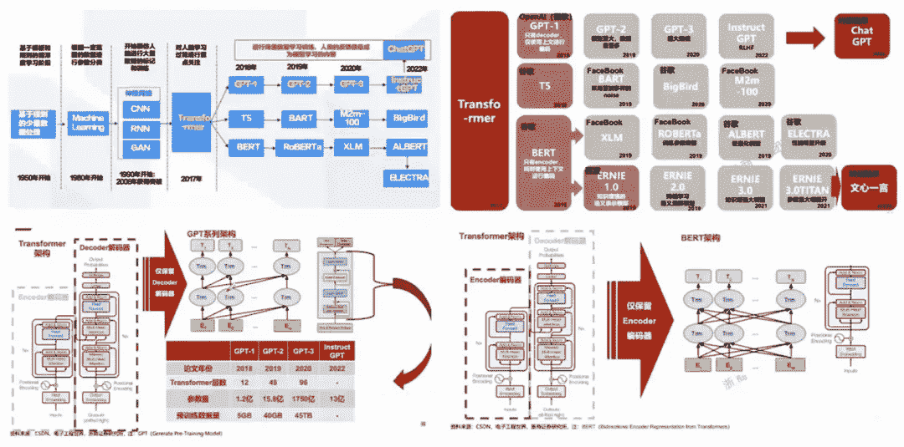
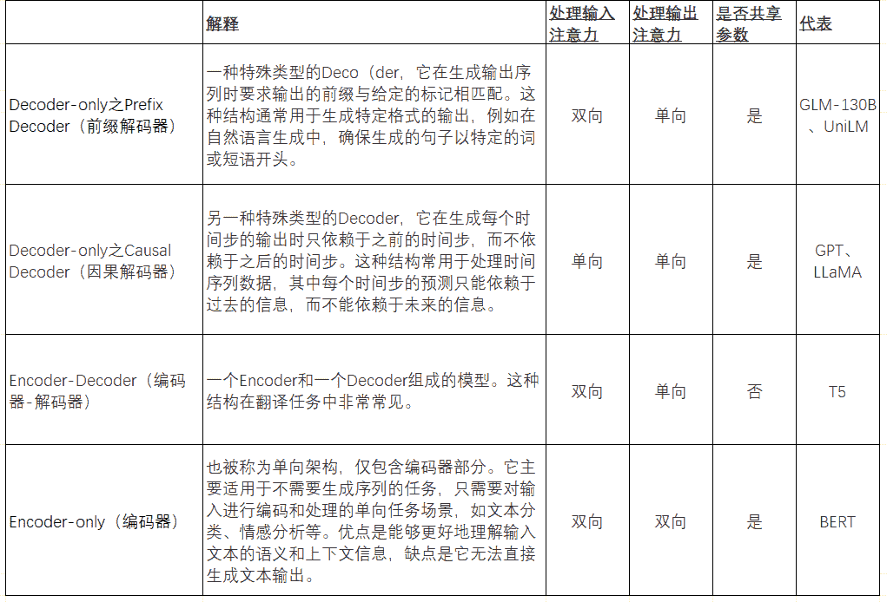
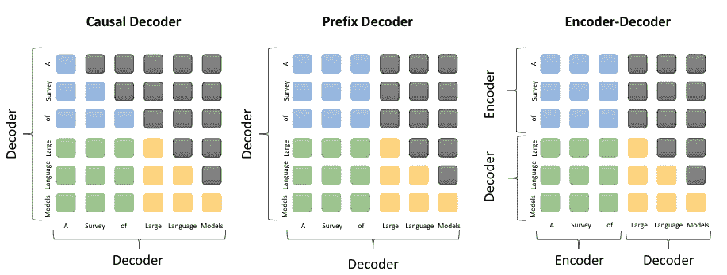
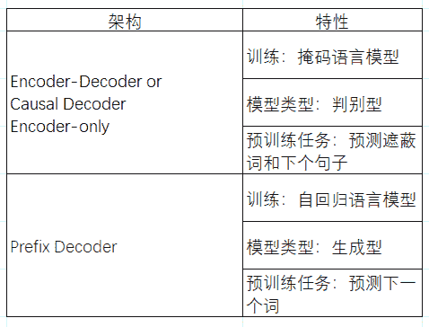
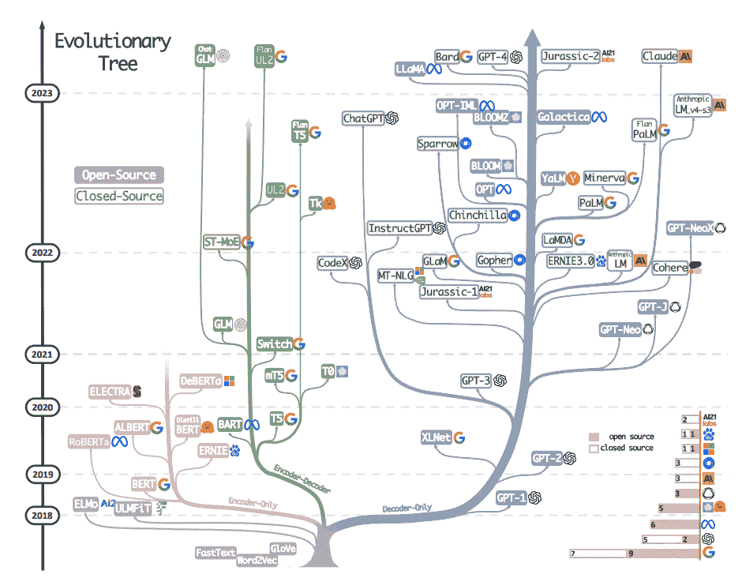
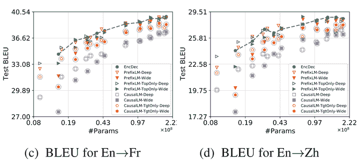

# Why decoder-only? LLM架构的演化之路

> 来源：[https://agijuejin.feishu.cn/docx/Won8dRcHDovuVDxbo63cLTBJnub](https://agijuejin.feishu.cn/docx/Won8dRcHDovuVDxbo63cLTBJnub)

> Zhongmei 智见AGI｜[阅读原文](https://mp.weixin.qq.com/s/Zrq1WvfbLgsNMJOVLBA2Kg)

> 转载请联系原作者取得授权

> 如何根据大模型架构进行选型

**©作者 | **Zhongmei

**来源 | **神州问学

# **引言**

本文**想为大型语言模型（LLMs）及其下游自然语言处理（**NLP）任务的实践者和用户提供一份全面且实用的指南。将从模型架构的角度出发，对比不同架构的特点，希望可以从最底层给大模型选型一些参考意见。 以及针对大模型架构的演变过程做出探究，分析decoder-only成为主流架构背后的原因。

# **大模型常见架构**

> LLM（大型语言模型）的架构命名某种程度上是混乱而反常的。所谓的“decoder-only（仅解码器）”实际上意味着“自回归编码器-解码器”。“encoder only（仅编码器）” 实际上包含一个编码器和解码器（非自回归），而所谓的“encoder-decoder（编码器-解码器）”真实含义是”自回归编码器-解码器“

> —— Yann Lecun

这个小节会简**要介**绍常见的不同的大模型的模型架构和用例。目前比较常见的是将其分类为：encoder-only, decoder-only以及encoder-decoder。但是正如杨立昆推特帖子中说的，其实这些名称比较难理解。个人觉得最好理解的方式如下：机器学习模型都是根据给定的输入来预测输出，在NLP模型中把出处理输入的组件叫做Encoder，它负责将输入的文字序列转化为一种隐藏表示（语义上丰富表示的特征向量）；而生成输出的组件叫做Decoder，负责试用隐藏表达来生成目标文字序列。 所以从这种角度讲所有的模型都可以从”Encoder-decoder“的角度来理解，差异在于Encoder、Decoder的注意力模式以及如何共享参数。所以个人觉得更直观的方法是上表格。

表一：模型架构

图1. 不同语言模型的注意力掩码设计不同，掩码全部取1为双向注意力，掩码下三角矩阵为单向注意力。图中蓝色指处理输入时前缀token彼此的注意力，绿色指输入token和输出token间的注意力，黄色则指的是输出token和掩码token间的注意力

# **架构特性**

近年来，大型语言模型（LLM）的快速发展正在彻底改变自然语言处理(NLP)领域。但是，有效且高效地利用这些模型需要对其能力和局限性有实际的了解。

由**于**自然语言数据易于获得，且已提出了更好地利用极大数据集的无监督训练范式，这促进了自然语言的无监督学习。 但NLP领域要求模型不仅能理解语言（NLU），还要能生成语言（NLG），不同架构在平衡这两方面的能力上存在显著差异。

表2：架构特性

1. Encoder-only：

一种常见的训练方法，是在考虑周围上下文的情况下预测句子中的遮蔽词。这种训练范式被称为掩码语言模型（Masked Language Model）。这种类型的训练通过Masked LM和Next Sentence Prediction的学习目标，使模型能够更深入地理解单词之间及其使用上下文中的关系。这类模型在语义理解上展现出强大的能力，在如情感分析和命名实体识别的NLP任务中取得很好的效果。然而，其完形填空式的训练目标与文本生成任务并不直接相关，且这种架构难以直接应用于从头到尾依次基于上文预测下一个token的标准语言模型目标。最著名的掩码语言模型是BERT，同时，国货之光GLM-130B也属于带掩码处理的这一类型。

2. Encoder-decoder：

当处理输入和输出的参数不共享时，模型在理解输入和据此生成特定输出方面表现出色。因此，非常适合于机器翻译、文本摘要等需要精确映射的任务。这种精确的映射关系虽然在特定应用中非常有效，但同时也使模型的通用性和灵活性受限，这意味着，费力训练得到的模型，仅对特定类型的任务表现良好。比如谷歌做翻译的模型就不能用于进行语音识别，每涉及到一种新的功能，便需要重新训练一个模型，耗时耗力，很不灵活。代表性的模型是T5。

3. Decoder-only:

这类模型通过生成给定的前缀单词序列中的下一个单词来训练，这种自回归语言模型被发现在少样本和零样本性能方面最成功。基于这种架构训练得到的模型能够处理广泛的文本生成任务，还能通过无监督学习理解文本内容不需要针对每一种任务进行专门的训练或调整，展现出极大的灵活性和广泛的应用潜力。非常适合内容创作、问答等下游任务。自回归语言模型的例子包括GPT-3、LLaMA等等。

# **观察：演化过程**

图2. LLM进化树（来自论文[2304.13712] Harnessing the Power of LLMs in Practice: A Survey on ChatGPT and Beyond）

著名的进化树图出处论文的作者，总结了以下关于大模型演进的观察：

1. 在LLM发展得早期阶段，encoder-only和encoder-decoder模型更受欢迎。然而，自2021年起，随着游戏规则改变者GPT-3入局， decoder-only经历了显著的增长并逐渐主导LLMs的发展 ，于此同时在BERT带来的初期爆炸式增长之后，encoder-only模型逐渐开始淡出。

2. encoder-decoder模型仍具有前景，因为这种类型的架构仍在积极探索中，而且大多数都是开源的。Google对开源该架构做出了重大贡献。然而，decoder-only模型的灵活性和多功能性似乎使得Google坚持这一方向的前景不太乐观。

3. LLMs展现出向封闭源代码的趋势。在LLM开发的早期阶段（2020年之前），大多数模型是开源的。然而，随着GPT-3的引入，公司越来越倾向于闭源，如PaLM、文心一言、Claude2和GPT-4。因此，学术研究人员在进行LLM训练实验变得更加困，基于API的研究可能成为学术界的主流方法。

4. OpenAI在LLM领域始终保持领导地位，无论是目前还是未来。其他公司和机构正努力赶上OpenAI，开发与GPT-3和GPT-4相媲美的模型。这种领导地位可能归功于OpenAI对其技术路径的坚定承诺，即使最初并未广泛认可。

5. Meta在开源LLMs方面做出了重大贡献，并推动了LLMs的研究。在考虑对开源社区的贡献时，特别是与LLMs相关的贡献，Meta作为最慷慨的商业公司之一脱颖而出，因为Meta开发的所有LLM都是开源的。

# **为什么是decoder-only？为**什么尤其是Casual decoder?

首先，像之前提到的，BERT这种encoder-only，因为它用masked language modeling预训练，不擅长做生成任务，做NLU一般也需要有监督的下游数据微调，所以它很自然出局，接下来主要讨论的是剩下的encoder-decoder和Prefix-LM为什么即使也能兼顾理解和生成，泛化性能也不错，却没有被大部分大模型工作采用。

原因1：过往研究证明decoder-only泛化化性能更好

Google有两篇著名的发表于ICML’22的论文，一个是《Examining Scaling and Transfer of Language Model Architectures for Machine Translation》，另一个是《What Language Model Architecture and Pretraining Objective Work Best for Zero-Shot Generalization?》，两篇论文都是很实践性的分析论文，和常见的论文在模型做创新不一样，两篇论文都是针对现有NLP语言模型的架构和训练方法、探索其在不同场景下的优劣并总结出经验规律。？

第一篇主要探索语言模型在机器翻译任务上传统语言模型能有多好的表现，是否可以与主流的encoder-decoder匹敌。作者采用类似Transformer-base的架构做基线模型，在WMT14 英法、英德，WMT19 英中，以及自有英德数据集上做了主实验。以此来探索不同模型架构随着加大参数量在机器翻译上的影响。（图3）

图3.在两个数据集上，各种LM变体以及encoder-decoder的BLEU分数-参数量曲线图

（来自：[2202.00528] Examining Scaling and Transfer of Language Model Architectures for Machine Translation）

作者的主要结论如下：

1. Encoder-decoder架构在计算效率上（以FLOPs衡量）优于所有的LM架构，这或许就是为什么encoder-decoder占据了机器翻译的绝对主流

**2. 在模型参数量较小的时候，架构对性能的影响最大。不同的模型显示出不同的参数量特性，但这种差**距在都使用大规模参数时缩小了。而且句子序列长度对语言模型参数量特征的影响较小。 所以在模型参数量较大时，合理地设计语言模型可以使其与传统的encoder-decoder架构做机器翻译任务的性能不相上下

**3. 在机器翻译的zero-shot场景下， PrefixLM 有较好的表现，但是CausalL**M掩码看起来就没那么适合。不过，在小语种机器翻译上的迁移性能都优于encoder-decoder架构。而且在大语种翻译上也更少有off-target（翻错语种）的情况

第二篇则针对Zero-shot场景进行更深的研究，探索用什么架构、什么预训练目标最有效。

这篇论文将三种架构：causal decoder-only, non-causal decoder-only,和encoder-decoder和两种预训练目标：autoregressive（自回归语言模型训练）、masked language modeling（掩码语言模型训练）做排列组合测试性能。测试则是看各个模型+训练方式的组合在zero-shot和multitask prompted finetuning后，在新任务上的性能。

作者们发现：

1. **在**不做finetuning的情况下，Causal decoder+自回归训练，可以让模型具有最好的zero-shot泛化性能。 （这个结论其实符合目前GPT-3这类模型在zero-shot NLG上的突出表现）

2. 有multitask finetuning 的情况下，encoder-decoder+masked language modeling训练则具有最好的zero-shot泛化性能。而且单个任务finetune表现好的架构往往在multitask场景下泛化行也好。

3. **decoder-only架构的模型在做adaptation或者task tra**nsfer时，比encoder-decoder需要的开销更小、即更容易任务迁移。

**原因2. 成本**

Google这个论文大户又有两篇论文，一个是UL2的论文《UL2: Unifying Language Learning Paradigms》，另一个是T5的论文《Exploring the Limits of Transfer Learning with a Unified Text-to-Text Transformer》都拼了老命证明Encoder-Decoder架构相比于Decoder-only的优势，但是它们遭人诟病的在于，这两篇论文的模型尺度都还不算大，以及多数的LLM确实都是在做Decoder-only的，所以这个优势能否延续到更大尺度的LLM以及这个优势本身的缘由。因为如果看回表1，可以看见，如果GPT-3和T5这种模型比较，其实存在两个变量，一个是输入部分的注意力改为双向，另一个是由于输入输出的注意力不共享造成的参数翻倍。这就造成我们无法确定Encoder-Decoder架构的优势，究竟是输入部分改为双向注意力导致的，还是参数翻倍导致的。而如果我们严格控制变量，将GPT-3与仅输入注意力双向的UniLM对比，我们会发现UniLM相比GPT并无任何优势，甚至某些任务更差。如果我们假设这个结论是足够有代表性的，那么可以结论输入部分的注意力改为双向不会带来收益，Encoder-Decoder架构的优势很可能只是源于参数翻倍。如果同样参数量，decoder-only成本消耗类似时效果更好。

其次，Decoder only结构比Encoder-Decoder结构更加简单，训练中Decoder only结构只需要一次前向传播，而Encoder-Decoder结构则需要两次前向传播。所以对比之下，自然计算效率更高。同时，推理过程中，Casual decoder-only支持一直复用KV-Cache，对多轮对话更友好，因为每个token的表示只和它之前的输入有关，而encoder-decoder和PrefixLM就难以做到。

原因3. 训练目标已经奠定了模型能力上限

第一个是预训练的难度上讲，Casual decoder这种架构预训练时每个位置所能接触的信息比其他架构少，要预测下一个token难度更高，当模型足够大，数据足够多的时候，能学习通用表征的上限更高；与此同时，Casual decoder这种架构具有隐式的位置编码功能 ，打破了transformer的位置不变性，而带有双向attention的模型，如果不带位置编码，双向attention的部分token可以对换也不改变表示，对语序的区分能力天生较弱。再加上前人发 现的Casual decoder架构带来了更强的上下文学习能力，它自然而然成为在不同任务上泛化能力和学习上限最强的模型架构。

第二个是知乎上来自大佬苏剑林的高赞回答，我个人感到极其赞同。苏神提出的是注意力改为双向时的低轶问题带来效果下降。Attention矩阵一般是由一个低秩分解的矩阵加softmax而来，具体来说是一个 𝑛×𝑑 的矩阵与 𝑑×𝑛 的矩阵相乘后再加softmax（𝑛≫𝑑），论文《Attention is Not All You Need: Pure Attention Loses Rank Doubly Exponentially with Depth》指出这种形式的Attention的矩阵如果出现低秩情况就会带来表达能力的下降。而对于Decoder-only架构，Attention矩阵是一个下三角阵，注意力矩阵的行列式等于它对角线元素之积，由于softmax的存在，对角线必然都是正数，所以它的行列式必然是正数，即Decoder-only架构的Attention矩阵一定是满秩的，满秩意味着理论上有更强的表达能力。换句话说，Decoder-only架构的Attention矩阵在理论上具有更强的表达能力，建模能力更强。

原因4. 谁都喜欢走被验证过的路

首先OpenAI作为开拓者，用于探索踩坑，坚持用decoder-only架构，用一系列基础摸索验证了可行性。同时对Scaling Laws的研究，见证着GPT-1到GPT-2到GPT-3的行之有效的拓展性，而后对指令微调和RLHF的探索让大家看到了风靡全球的ChatGPT。即使OpenAI论文发的不多，开源项目没有，技术细节也很少披露出来，但大家看到行之有效的训练方法，考虑到找新架构的时间和试错成本，就不愿意做太多改动。另外，在工程上，很对加速推理的技术都是针对Casual decoder的，比如flash attention，我想这也是为什么RWKV这种模型，即使被验证效果不错，也可以scale up但也没什么人问津。

# **尾语**

机器学习模型其实就两个组成部分，数据和架构。通过对LLM架构演化的探讨，我们可以更好地理解不同架构的优劣，为实际应用中的模型选型提供科学依据。希望这篇文章能帮助广大NLP从业者和爱好者，在面对复杂多变的技术环境时，做出更加明智的决策。未来，随着技术的不断进步，我们期待见证更多创新型架构的诞生，推动自然语言处理领域的发展和变革。文章中内容可能和论文或其他博主的用词或理解不同，个人见解，期待大家评论区留言一起讨论或进行批评指正。