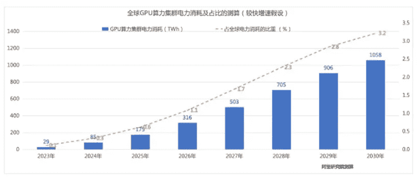
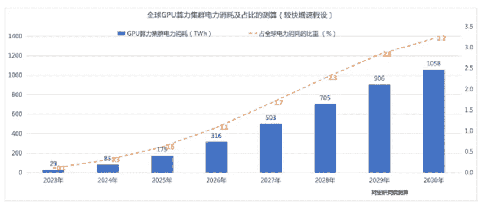
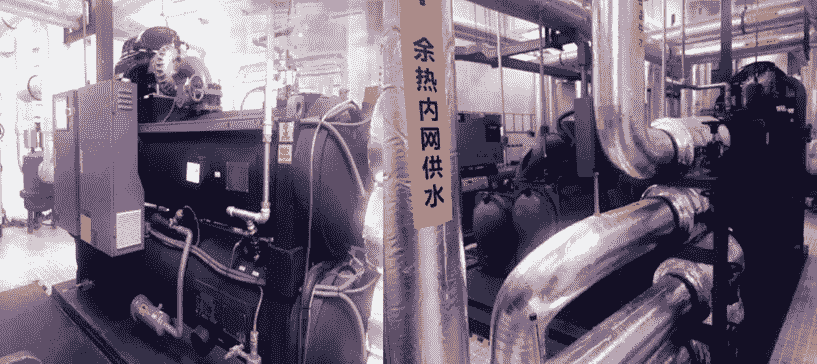
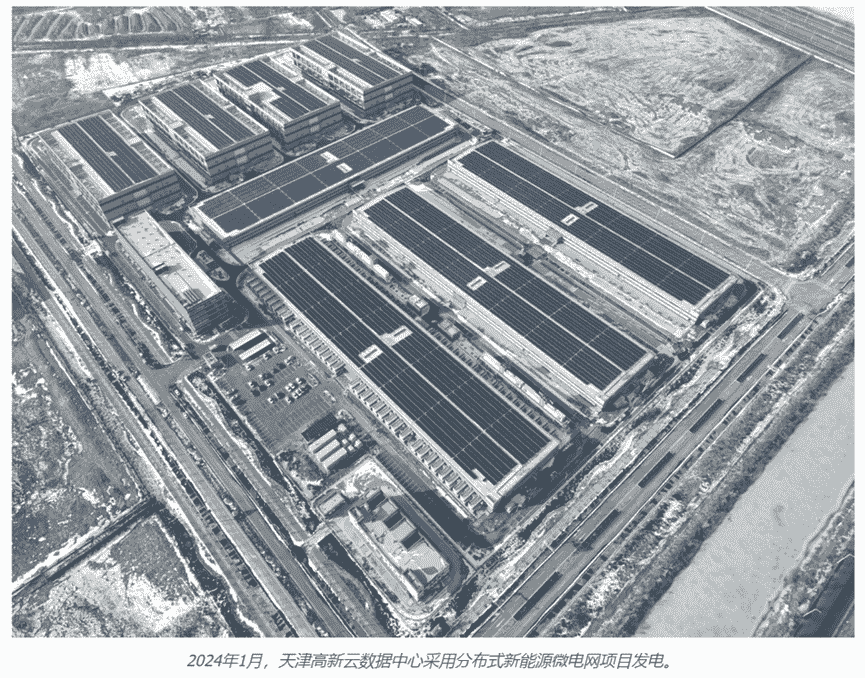
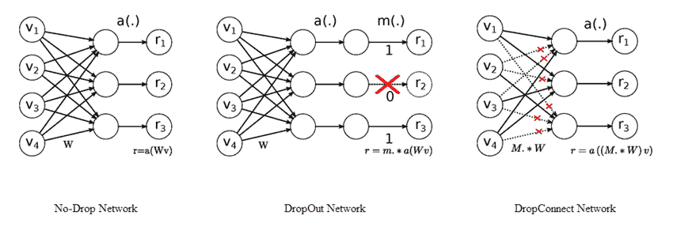
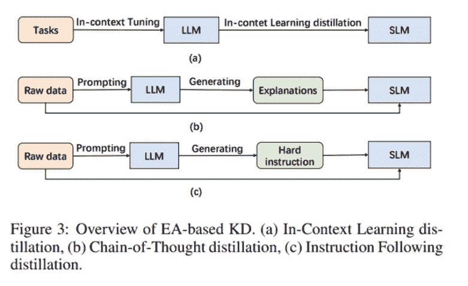
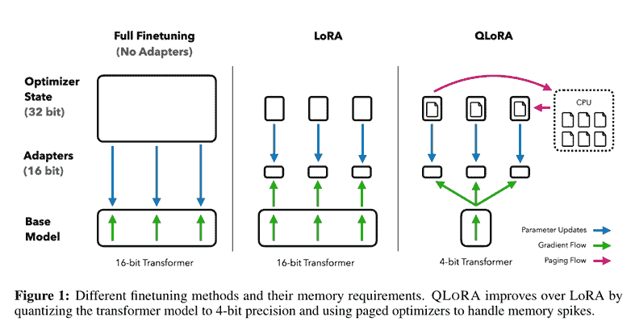
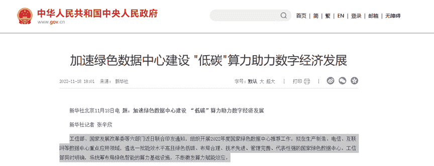
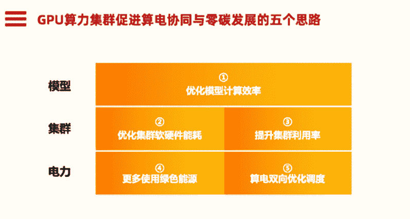

# 一次训练需要近3亿度电！揭秘“电老虎”AI

> 来源：[https://agijuejin.feishu.cn/docx/AHyAdSlKoo7Op6xsSRZclW1inIg](https://agijuejin.feishu.cn/docx/AHyAdSlKoo7Op6xsSRZclW1inIg)

> Steven 智见AGI｜[阅读原文](https://mp.weixin.qq.com/s/jdnZHu2VeGDLhgvVjDDq-g)

> 转载请联系原作者取得授权

> 从电老虎到绿色先锋：AI能耗问题引发行业绿色转型思考

**©作者 | **Steven

**来源 | **神州问学

# **引言**

自2022年末ChatGPT的爆火，生成式人工智能正以其独特的魅力风靡全球，从艺术创作到科学研究，从医疗法律到金融农业，各类大模型如雨后春笋般涌现，为我们的生活带来了前所未有的便利和惊喜。

然而，在这场AI盛宴的背后，却隐藏着一个不容忽视的问题——大模型训练对能源的巨大消耗。近期，有关AI训练耗电的讨论在社交媒体上引发了热烈关注，有报道称仅仅是 GPT-4 的 GPU，一次训练就会用去 2.4 亿度电，因而有人将之称作“电老虎”。那么，这个“电老虎”究竟是如何吞噬着庞大的电力资源？它对环境和社会又意味着什么？我们又该如何应对？今天，就让我们一起来揭开这个“电老虎”AI的神秘面纱。

# **为何如此耗电**

**计算资源的密集型需求**

大模型的训练，无疑是一项对计算资源要求极高的任务。在这个过程中，数千个GPU或TPU组成的计算集群必须协同工作，以处理庞大的计算负载。

例如，在 OpenAI 训练大语言模型 GPT-4 时，完成一次训练需要约三个月时间，使用大约 25000 块英伟达 A100 GPU。每块 A100 GPU 都拥有 540 亿个晶体管，功耗 400 瓦，每秒钟可以进行 19.5 万亿次单精度浮点数的运算，每次运算又涉及到许多个晶体管的开关。仅仅是这些 GPU，一次训练就用了 2.4 亿度电。这些电能几乎全部转化成了热能，这些能量可以将大约 200 万立方米冰水，大概是1000 个奥运会标准游泳池的水量加热到沸腾。

根据阿里研究院对全球GPU算力集群的电力消耗的测算，从2023年到2030年，GPU算力集群电力消耗将持续增长，从2023年的29 TWh占比0.1%，到2030年预计将达到1058 TWh占比3.2%。以2023年为例，我国人均年生活用电量在1000kwh左右，全球GPU算力集群消耗的29TWh的电量相当于2900万人一年的耗电量！

这种高强度的电力需求不仅体现在设备本身的运行上，还包括了数据中心的照明、安全监控等辅助设施的运行。此外，为了确保设备在长时间高负荷下稳定运行，需要配备高效的散热系统和降温措施，这些额外的能耗进一步加剧了整体的电力消耗。

**数据处理的能耗挑战**

在训练大规模模型的过程中，数据处理环节同样面临着巨大的能耗挑战。以GPT-4为例，其在训练过程中需要处理数万亿个单词，这些数据的存储、读取和传输都需要依赖于大量的硬盘和服务器。硬盘的频繁读写操作和服务器的高速数据处理，都会产生大量的热量，进而导致电力消耗的增加。同时，为了保证数据传输的效率和安全性，还需投入额外的电力资源用于网络设备的维护和升级。这些因素共同构成了数据存储与传输环节的能耗难题。

**算法优化与模型压缩技术的局限性**

尽管现有的算法优化和模型压缩技术在提高模型效率方面取得了一定的成果，但在面对大规模模型时，这些技术仍存在一定的局限性。例如，一些优化算法在处理大规模模型时，可能会面临收敛速度慢、计算复杂度高等问题。这些问题使得模型的训练过程需要更多的计算资源和电力，从而增加了整体的能耗。

此外，模型压缩技术虽然能在一定程度上减小模型体积，但压缩过程中可能损失部分性能，导致在特定任务上的表现不如原始模型。因此，如何在保证模型性能的同时，有效降低能耗，仍然是人工智能领域面临的一大挑战。

# **目前针对能耗问题主流的优化方向**

**硬件优化**

采用高能效计算设备，投资于最新一代的GPU或TPU，这些设备通常具有更高的能效比，能够在执行相同计算任务时消耗更少的电力。同时，选择低功耗的CPU和其他辅助硬件，以降低整体能耗。

以谷歌最近发布的第六代TPU芯片Trillium为我们提供了一个很好的例子。这款芯片在计算性能上比前一代产品提高了4.7倍，同时能效比也提高了67% 。这一显著的性能提升和能效比的提高，使得Trillium成为了一个高效能的计算设备，特别适用于执行人工智能和数据中心的计算任务。

**优化数据中心的能源管理**

**改进冷却系统 **，传统数据中心多采用空气作为冷却介质，这种方式较为成熟且应用广泛，但是缺陷也相当明显：当数据中心部署了高密度的服务器时，由于房间水平的空气循环，传统的空气冷却系统无法在垂直机架阵列的 IT 设备入口处提供均匀温度的空气；此外，空气冷却系统效率相对较低，特别是在机架中的高密度服务器运行时，满足散热需求的空气冷却系统的总功率常会达到 100kW 以上，这在经济性、供电、噪音等方面都会带来巨大的困扰。

相较于风冷，液冷更适合现在高密度的AI服务器集群，目前液冷技术主要有三种部署方式，分别是浸没、冷板、喷淋。

浸没式冷却通过将整个系统浸入环保冷却液中，散发的热量可以几乎 100% 由液体传导走，也方便了后期的热量回收。例如，英特尔与 Submer 在巴塞罗那合作的 AI 研究中心，部署了使用英特尔验证的特殊液体，服务器产生的热量被捕获并作为加热源被重新注入其供热系统中，热量得以循环利用。

冷板液冷，形象说就是给服务器铺上 “凉席”，把热传导出去。主要方法是组建冷却液回路，利用 CPU 分配冷却液。在通过冷板收集计算节点的热量后，冷却液不断流向另一个冷的 CPU，并通过另一个连接器离开服务器冷板管道，实现液冷计算节点的液冷循环。

**充分回收能源 **，利用数据中心产生的废热进行能源回收，例如跨季节蓄热分布式能源系统，针对北方严寒地区，提出了一种基于数据中心余热跨季节蓄热的分布式能源系统。这种系统通过与常规数据机房余热利用方案对比，预计约7年即可回收增量成本，且每年可降低二氧化碳排放约8700吨。这种余热利用模式适用于周边热用户需热量大于数据中心余热量的情况，为数据中心在北方严寒地区与城市供暖相结合提出了一种新的模式 。

例如位于天津的腾讯数据中心余热回收项目，项目利用机房冷冻水的余热二次提温替代市政供热，提取低品位热源，节省采暖费用的同时降低冷却水系统耗电量，且进一步增强机房冷却效果，减少煤炭或天然气能源的消耗。

腾讯天津数据中心余热回收现场运行图

**绿色能源**

**绿色能源的集成与优化 **，数据中心可以采用多种绿色能源相结合的方式，例如在风力资源丰富的地区，风力发电可以为数据中心提供稳定的电力，光照充足地区安装太阳能板，引入光伏发电。并通过智能管理系统优化能源使用，确保供电的稳定性和效率。

**算法改进**

**模型剪枝， **通过去除神经网络中不必要的或冗余的参数来减小模型大小和复杂性的技术。这种方法可以分为非结构化剪枝和结构化剪枝。非结构化剪枝针对单个参数，而结构化剪枝则剪掉基于特定规则的连接或分层结构。从而显著减小模型大小，降低存储成本和计算复杂度，且能保留模型的核心结构和连接，通常能保持较好的性能。

**两种典型的模型剪枝技术**

**知识蒸馏（KD） **，将知识从大型复杂模型（教师模型）转移到更小型模型（学生模型）的技术。这种方法可以有效地将大型模型的知识迁移到小型模型上，提高小型模型的性能和泛化能力。充分利用大规模预训练模型的丰富知识，提升小规模学生模型的性能。通过优化教师和学生模型的匹配度，有效缓解模型压缩带来的性能损失。

**基于EA的蒸馏概览**

**量化技术 **，通过将浮点数参数转换为低精度表示来压缩模型。这种方法可以显著减小模型大小和存储成本，同时提升模型的推理速度显著减小。

量化微调技术（QLoRA）

# **我国的应对策略**

**政策支持 **，我国政府高度重视人工智能和绿色数据中心的建设和发展，并发布了一系列支持政策。例如，2022年工信部、国家发展改革委等六部门近日联合印发通知，组织开展2022年度国家绿色数据中心推荐工作，拟在生产制造、电信、互联网等数据中心重点应用领域，遴选一批能效水平高且绿色低碳、布局合理、技术先进、管理完善、代表性强的国家绿色数据中心。工信部同时明确，将统筹布局绿色智能的算力基础设施，不断激发算力赋能效应。

**技术创新 **，在硬件和算法方面，企业和科研机构正在取得突破。例如，阿里研究院提出通过优化模型训练和推理的计算效率、降低GPU集群核心软硬件的能耗、提升GPU集群的利用率、使用更多的可再生能源和算电双向优化调度等措施，来应对AI大模型带来的能源挑战 。

**产业协同 **，跨行业合作正在共同推进绿色人工智能发展。例如，阿里云采购部碳管理与能源采购团队与其他机构合作，探讨了GPU算力集群的算电协同与零碳发展目标的可行路径 。

# **写在最后**

大模型训练的能耗问题，对环境和能源形成了巨大的压力和消耗，从而也带来了新的商业市场的变化，随着人工智能技术的不断发展，大模型训练的需求将持续增长，各方共同努力，推动绿色人工智能发展的重要性不言而喻。政府已在出台相关政策，鼓励和支持绿色数据中心建设，推动绿色能源在数据中心中的应用，并加强对AI训练能耗的监管和评估。一些相关企业也在积极进行技术创新，研发更高效、更节能的硬件和算法，并探索绿色能源与数据中心融合的路径。