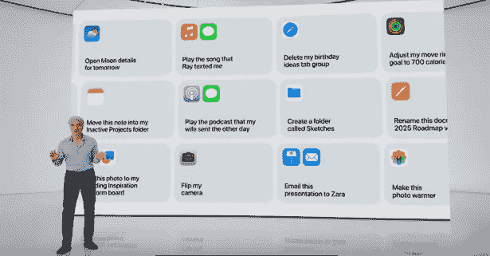
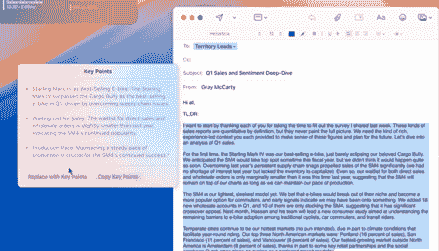
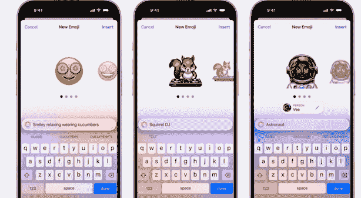
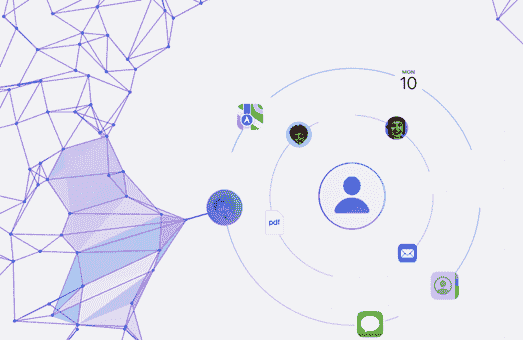
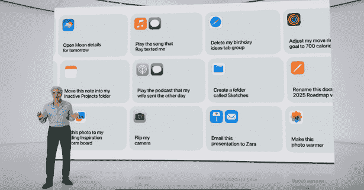

# 与OpenAI合作：期待已久的苹果AI战略

> 来源：[https://agijuejin.feishu.cn/docx/Vhe9dMcjjoCuthxQfSBctbP5n5g](https://agijuejin.feishu.cn/docx/Vhe9dMcjjoCuthxQfSBctbP5n5g)

> CodeDan 智见AGI｜[阅读原文](https://mp.weixin.qq.com/s/iBAh03ijQqjo7QIFrTAYDg)

> 转载请联系原作者取得授权

> 探讨 Apple 和 OpenAI 合作的AI战略

**©作者 | **CodeDan

**来源 | **神州问学

# **一．引言**

在当今科技发展日新月异的背景下，大型科技公司的合作与联盟日益成为关注焦点。在最近的2024苹果全球开发者大会上，苹果展示了最新苹果系统上搭载的大模型应用框架——Apple Intelligence（苹果智能）。

其中在Siri中内置ChatGPT成为了亮点， 也意味着两个科技界的重量级巨头——Apple和OpenAI正在进行重要的合作。这不仅仅是两家公司之间的合作，更是对未来科技趋势和市场变革的一次重要探索。

本文将深入分析Apple和OpenAI合作的技术进步、行业趋势和市场影响与战略意义的三个方面，旨在揭示这一合作对科技行业及其未来发展的深远影响。

# 二．Apple Intelligence

**2.1 苹果AI功能介绍**

我们来回顾一下本次WWDC 2024上有关于大模型架构——Apple Intelligence的内容。

邮件内容辅助（内容优化，内容总结）

Apple Intelligence能根据邮件内容进行优化和总结，帮助用户更高效地管理和回复邮件。

**根据文字生成Emoji表情**

Apple Intelligence能根据用户输入的文字信息，生成为对应的emoji表情，供大家选择。

**智能提示优先级排序**

通过分析用户的日常活动和优先事项，智能排序任务和提醒事项，帮助用户更好地管理时间。

Siri能够执行更加复杂的组合任务

正如WWDC举的例子，如果你有一个会议改了时间，那么你现在询问siri这个会议结束之后，我还能不能赶上女儿的演出。

那此时Apple Intelligence就会处理相关的个人数据，作为回答此问题的基石。它会知道我的女儿是谁、她几天前发来的演出详情消息以及推迟会议的时间和地点。根据上述消息去预估会议结束之后从会议地点到演出地点的交通情况并给出其生成的结果。

2.2 GPT-4o结合功能要点

Apple Intelligence大模型架构根据分析可以分为三个部分。自研端侧模型、自研云端模型以及内置GPT-4o模型。

由于本文主要是谈论Apple与OpenAI的合作，所以将着重于基于GPT-4o实现的功能之一 —— 加强版Siri。那么在这个加强版Siri中GPT-4o担任了什么角色呢？

1. 加强Siri的理解能力。根据自然语言大模型非常适合理解复杂自然语言的特性，可以从输入的自然语言中精准的进行用户意图识别，将任务拆分为多个任务。

2. 让Siri具备相似信息检索功能。根据上一步拆分的任务或者原始任务中思考到有可以检索的相似数据，比如女儿的名字，女儿演出的详细信息等等。将这些相似数据作为回答问题的基石。

3. 让Siri具备调用工具的功能。将海量app制作为可被Siri调用的工具，其分析出可以完成第一步中的子任务或者原始任务所需要的某种工具，甚至可以通过相似搜索出的数据作为工具参数去使用工具。比如将会议的时间和地点，女儿演出的地点和时间作为参数调用地图工具。那么siri就会得到对应的交通情况和到达时间，从而回答是否能赶上的问题。

# **三．行业趋势**

3.1 AI的加入会提高换机率？

来看一下2023年到2024年期间，国内手机厂商都在AI领域如何布局的吧。

**华为 **：HarmonyOS 4全面接入盘古大模型。

华为在2023年推出的HarmonyOS 4集成了自研的盘古大模型，旨在提供类似ChatGPT的服务，如自动消息生成和图像创作。数据反响显示，尽管华为面临美国制裁，但其在国内智能手机市场的份额持续稳定，

**小米 **：自研AI大模型“MiLM-6B”接入澎湃OS。

小米的“MiLM-6B”AI大模型集成到澎湃OS中。消费者和业内分析师对其在用户体验和智能服务方面的提升表示认可。小米通过这一策略，加强了其在智能设备生态系统中的竞争力，并获得了小米论坛中用户的积极反馈。

**vivo **：发布自研“蓝心”大模型。

vivo发布的“蓝心”大模型在其设备中的应用得到了市场的关注。消费者对该模型在拍照、语音助手等方面的应用体验尚可。

**oppo **：在ColorOS 14引入“安第斯大模型”。

市场调研表明，用户对ColorOS 14的更新反应积极，特别是在自然语言处理和多模态交互方面的改进备受好评。

**荣耀 **：发布自研70亿参数端侧AI大模型“魔法大模型”。

该大模型在提升设备智能化和响应速度方面表现出色，帮助荣耀在激烈的市场竞争中保持了良好的增长态势。

**Apple **：在WWDC上推出自研端云协同的大模型架构，并加入OpenAI。

苹果在WWDC上推出的自研端云协同大模型架构获得了开发者和用户的高度关注。通过与OpenAI的合作，苹果进一步提升了其AI能力，这将极大增强苹果设备的智能化水平和用户体验。

这么多手机厂商都在大力发展和AI的结合，但是目前手机和AI结构的功能主要体现在应用层，效果集中在提升个别功能的使用效率上，并不是说这些功能没有AI就无法实现。也就是有没有AI其实并不是刚需。

在提高效率上，实时通话翻译，会议录音总结等场景目前是AI应用发力的刚需功能。并且文字，图片，语言等没有一个模态所在的场景是在智能终端设备中找不到的，所以对于想要利用AI提高工作效率的人群是很有换机吸引力的。

3.2 大模型和手机厂商的结合方式

目前，OpenAI作为苹果手机的三方预置大模型提供商，一个手机厂商不能在一台手机中预置太多三方大模型，并且需要针对这些大模型调整系统以适应其运行。这意味着未来手机厂商和大模型的结合方式极有可能是一对一的强强联合。

但是对于AIGC厂商的大模型来说，这种结合方式也带来了新的挑战。各大厂商的应用程序（APP）可能会预置自己的大模型，这些大模型与手机系统内置的大模型可能会产生冲突。冲突的原因可能包括资源争夺、模型运行效率和数据处理方式的不同。手机系统需要在资源分配和计算能力方面进行优化，以确保各大模型能够高效运行且互不干扰。这些都是未来还不确定的问题。

# **四．市场影响与战略意义**

4.1 分析合作对市场竞争格局的影响

通过与OpenAI的合作，Apple在全球消费电子市场中的领导地位将得到进一步巩固。Opean AI全球顶尖大模型的引入和整合将使Apple产品在智能化和个性化方面实现显著提升，从而在市场上保持竞争优势。

例如，Siri通过Agent技术的增强，将能够提供更为智能和多样化的服务，这不仅能够吸引现有用户，还能吸引更多新用户。这种技术领先将使Apple在高端市场中继续占据主导地位，并进一步扩大其市场份额。

4.2 探讨合作可能带来的问题和挑战

Apple和OpenAI的合作在推动AI技术发展的同时，也带来了诸多数据安全和隐私保护的挑战。

Apple提出的Private Cloud Compute方案，结合了端侧和云侧的计算能力，通过设备内语义索引（on-device semantic index）和自研芯片优势，实现了高效且安全的数据处理。

当用户发出请求时，首先通过语义索引找出相关数据，评估能否在设备端处理，如果需要则将任务数据发送到云端进行推理。这样，苹果完全不需要存储推理任务数据，从根本上减少了数据泄露的风险。

但是还是会存在数据安全风险，比如

数据传输安全性： 尽管数据在传输过程中采用了加密技术，但依然存在被截获或篡改的风险。需要确保数据在设备端和云端之间传输的绝对安全性。

设备端处理能力： 对于复杂的AI任务，设备端处理能力有限，可能会影响用户体验。此外，确保设备端处理过程中的数据安全也是一个挑战。

# **五．总结**

综上所述，Apple和OpenAI的合作将对市场竞争格局产生深远影响。通过技术领先、创新驱动和市场整合，Apple将在全球消费电子市场中继续保持领导地位。同时，这种合作将推动整个科技行业的技术进步和创新发展，加速市场淘汰落后厂商的进程。在这种新的市场格局中，只有不断创新和提升技术水平的企业才能在激烈的竞争中生存和发展。