# 2D头像生成3D虚拟人开视频会，谷歌新作让人难绷

> 来源：[https://agijuejin.feishu.cn/docx/JwuVdzALkocpHoxAYv7cBMM9nzg](https://agijuejin.feishu.cn/docx/JwuVdzALkocpHoxAYv7cBMM9nzg)

> 机器之心｜[阅读原文](https://www.jiqizhixin.com/articles/2024-05-31-8)

> 转载请联系原作者取得授权

> 未来人与人的交流，难道是这个样？

开视频远程会议的时候，很多人都不喜欢打开摄像头。即使开了，在界面上大家也都被框在不同的窗口里。虽然这种形式操作起来很方便，但总是缺乏点临场感。

最近，谷歌提出了一项研究旨在解决这个问题，这个名叫 ChatDirector 的技术可以使用静态的 2D 头像生成 3D 虚拟人，让大家一同「坐在会议室里」开会，只是看起来样子有点夸张：

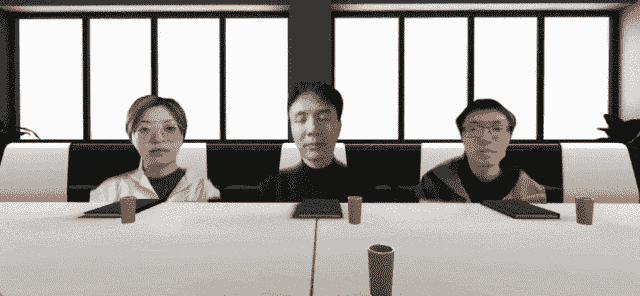

ChatDirector 通过空间化视频头像、虚拟环境和自动布局转换，构建了一个拟真的虚拟环境。

虽说只是早期研究，虚拟人物口型也能准确对上，但总觉得有一点喜剧效果。对此大片评论表示绷不住了：这或许能给在线会议创造出轻松的气氛。

ChatDirector 是一个研究原型，它将传统的视频会议转变为使用 3D 视频头像、共享 3D 场景和自动布局转换。

此前，谷歌展示的 Visual Captions 和开源的 ARChat，以促进实时视觉效果的口头交流为目标。在 CHI 2024 上展示的《ChatDirector: Enhancing Video Conferencing with Space-Aware Scene Rendering and Speech-Driven Layout Transition》中，谷歌介绍了一种新原型，通过在空间 感知 共享会议环境中为所有参与者提供语音驱动的视觉辅助，增强了传统的基于 2D 屏幕的视频会议体验。

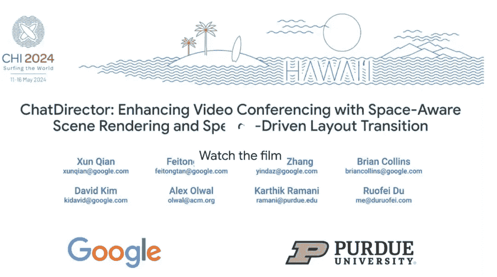

**设计思考**

谷歌研究人员邀请了来自公司内部不同岗位的十位参与者，包括软件工程师、研究人员和 UX 设计师，共同讨论影响虚拟会议质量的因素，分析视频会议系统和面对面互动的特点，最后将建议提炼为原型系统的五个基本考虑因素：

+   DC1、通过空间 感知 可视化增强虚拟会议环境。处于同一个空间对于改善视频会议体验来说至关重要。好用的系统应采用典型的面对面会议形式，将与会者安排在指定座位的桌子周围，构建切实的共同存在感和空间定位感。

+   DC2、不能简单复制现实会议，而需要提供语音驱动的协助。鉴于小组对话中发言人频繁更换、话题快速转换，系统应提供额外的数字功能，让参与者跟进对话流程并积极参与会议。

+   DC3、重现面对面互动的视觉效果。在开虚拟会议时，参与者通常在电脑前保持静止。系统应增强他们在屏幕上的动作，以模仿头部转动和眼神接触等动态身体动作，这些动作可作为更有效地跟进对话的提示。

+   DC4、尽量减少认知负荷。系统应避免同时显示过多信息，或要求用户频繁操作。这种方法有助于防止分心，并允许参与者更有效地专注于倾听和说话。

+   DC5、确保兼容性和可扩展性。系统应与标准视频会议设备（如带摄像头的笔记本电脑）兼容，以促进广泛采用。这种兼容性还将促进其他生产力功能和工具（如屏幕共享和其他应用程序）的无缝集成，以增强系统的整体效用。

空间 感知 的场景渲染 pipeline

为了解决 DC1（通过空间 感知 可视化增强虚拟会议环境）和 DC5（确保兼容性和可扩展性），谷歌首先设计了一个渲染 pipeline，以将人的视觉呈现重建为 3D 肖像头像。

谷歌在轻量级深度推理 神经网络 U-Net 上构建了此 pipeline，并结合了自定义渲染方法，该方法将 RGB 和深度图像作为输入并输出 3D 肖像头像网格。

该 pipeline 从 深度学习 (DL) 网络开始，利用该网络从实时 RGB 网络摄像头视频中推断深度。接着使用 MediaPipe 自拍分割模型分割前景，并将处理后的图像馈送到 U-Net 神经网络 。

其中，编码器逐渐缩小图像，而解码器将特征分辨率提高回原始分辨率。来自编码器的 DL 特征连接到具有相同分辨率的相应层，以帮助恢复几何细节，例如深度边界和薄结构。

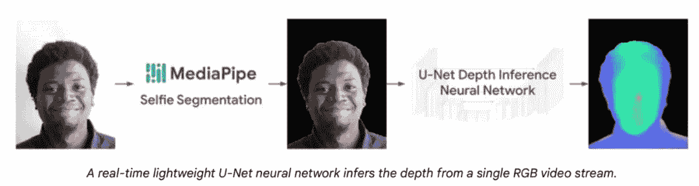

下图所示的自定义渲染方法将 RGB 和深度图像作为输入，并重建 3D 肖像头像。

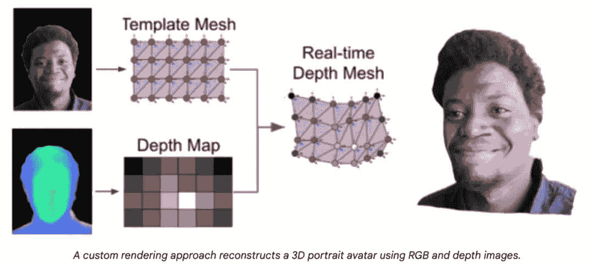

研究团队开发了一个空间 感知 的视频会议环境，可以在 3D 会议环境中显示远程参与者的 3D 肖像化身。

在每个本地用户的设备上，ChatDirector 会产生：

1.  附带由 Web Speech API 识别的语音文本的音频输入

1.  由 U-Net 神经网络 推断的 RGB 图像和深度图像。

同时，当系统接收到每个远程用户的数据后，会重建 3D 肖像化身，并在本地用户的屏幕上显示出来。

为了实现视差效果，该团队根据使用 MediaPipe 人脸检测 所检测到的本地用户的头部移动来调整虚拟渲染摄像机。音频会被用作输入到下一节中将要解释的语音驱动布局转换算法。

数据通信则通过 WebRTC 实现。

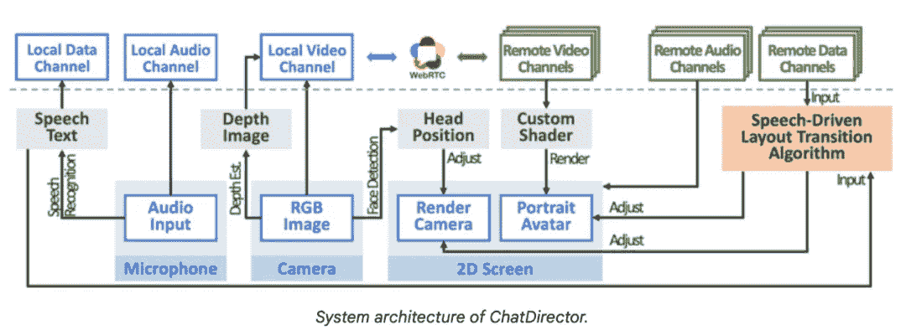

ChatDirector 的系统架构。

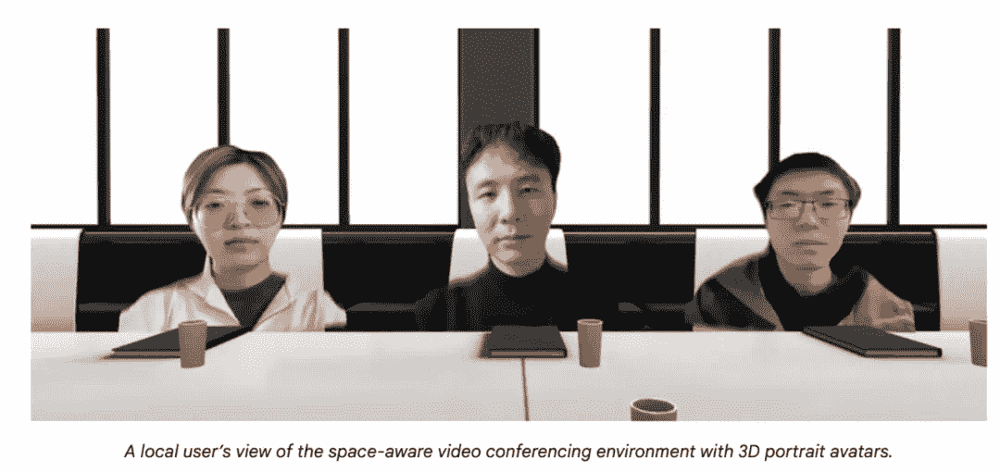

一个本地用户对具有 3D 肖像头像的空间 感知 视频会议环境的视角。

**语音驱动的布局转换算法**

为了解决 DC2（提供超越简单复制现实世界聚会的语音驱动辅助）和 DC3（重现面对面互动的视觉线索），研究者开发了一个决策树算法。

该算法根据正在进行的对话调整渲染场景的布局和化身的行为，允许用户通过接收自动视觉辅助来跟随这些对话，从而不需要在 DC4（最小化认知负荷）上额外浪费精力。

对于算法的输入，他们将群组聊天建模为一系列语音轮转。

在每个时刻，每个与会者都将处于三种语音状态之一：

1.  静默：与会者正在听取他人发言；

1.  与某人交谈（Talk-to）：与会者正在与特定人交谈；具体来说，通过侦测参与者的姓名（当他们加入会议室时所输入的结果）来检测使用是否在与某人交谈。

1.  宣布（Announce）：与会者正在向所有人发言。通过使用关键词检测（如「everybody」、「ok, everybody」），Web 语音 API 来进行识别此种类型的语音状态。

该算法产生了两个增强视觉辅助的关键输出（DC3）。第一个组件是布局状态，它决定了会议场景的整体可视化。

这包括几种模式：

+   「一对一（One-on-One」，仅显示一个远程参与者，以便与本地用户进行直接互动；

+   「两两对话（Pairwise）」，将两个远程参与者并排排列，表示他们的一对一对话；

+   「全景（Full-view）」，默认设置显示所有参与者，表示一般讨论。

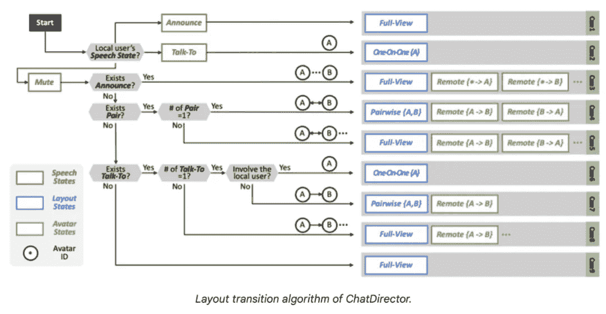

ChatDirector 的布局转换算法。

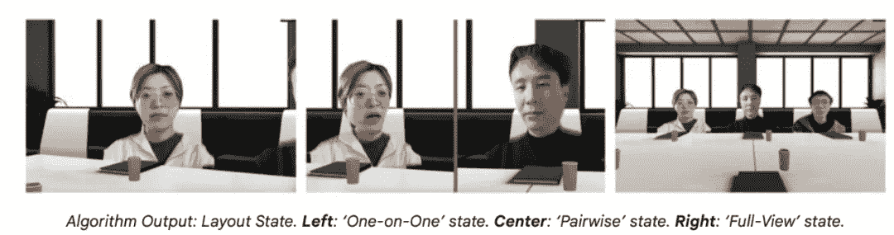

算法输出：布局状态。从左至右分别为：一对一（One-on-One）语音状态，两两对话（Pairwise）语音状态，全景（Full-view）语音状态。

网络视频开会这下更逼真了，领导和你可以交换眼神了。

研究团队基于 3D 肖像化化身渲染能力，通过操纵远程化身的行为来模拟类似于面对面会议中的眼神交流。

他们通过将化身状态（Avatar State）设立为算法的附加输出，以控制每个化身的方向。

在这种设置中，每个化身可以处于两种状态之一：「本地」状态，其中化身旋转面向本地用户，和「远程」状态，其中化身旋转与另一个远程参与者互动。

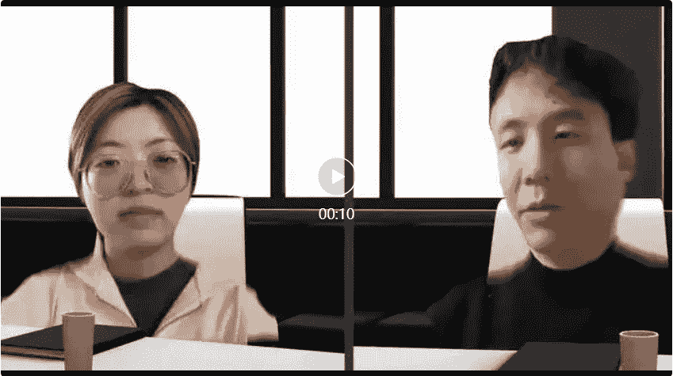

算法输出：化身（聊天室中代表使用者的形象）状态。当左侧用户与右侧用户交谈时，化身状态从「本地」状态转变为「远程」状态，此时左侧化身会转向右侧化身。

**定性表现评估：用户研究**

为了评估基于语音的布局转换算法的性能以及空间 感知 会议场景的整体有效性，研究团队进行了一项实验室研究，涉及 16 名参与者，分成四个团队。

与作为 基准 的传统视频会议相比，研究发现 ChatDirector 显著改善了与 语音处理 相关的问题，这表现在用户对注意力转移辅助的积极评价上。

此外，该团队对调查结果还进行了威尔科克森符号秩检验（Wilcoxon Signed-Rank Test ）。

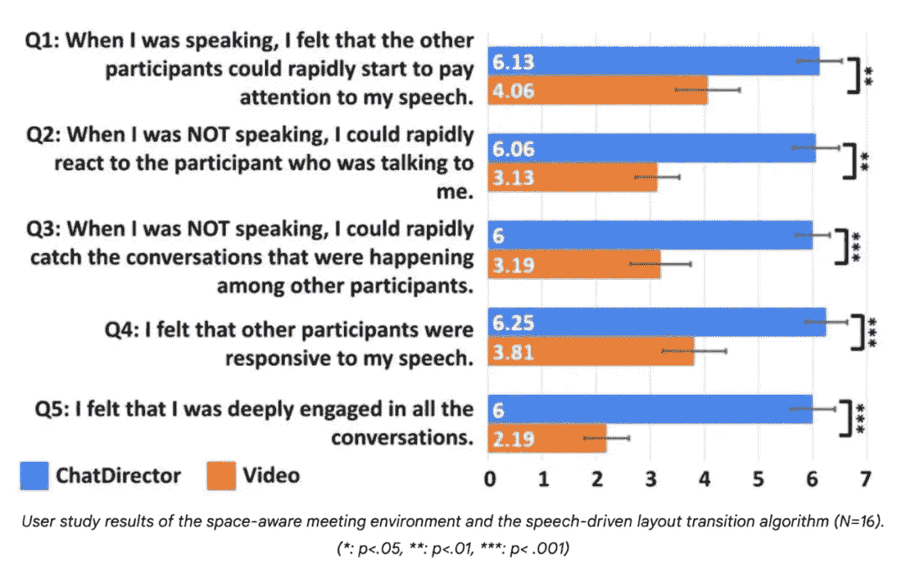

会议环境的空间 感知 和语音驱动布局转换算法的用户研究结果（N=16）。（ *：p<.05, **: p<.01, *** ：p< .001）

此外，根据 Temple Presence Inventory（TPI）评分，与标准的基于 2D 的视频会议系统相比，它提升了共存感和参与度。

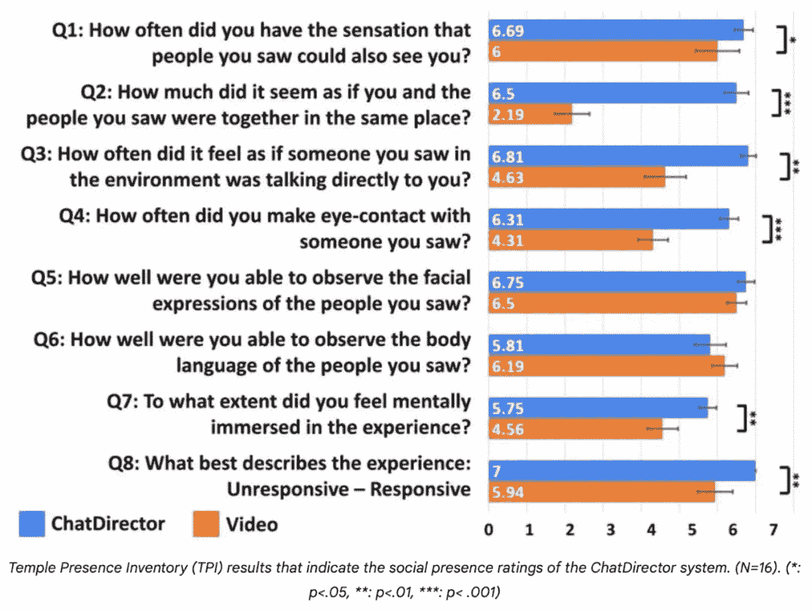

Temple Presence Inventory（TPI）结果显示了 ChatDirector 系统的社交存在评级（N=16）。（ *：p<.05, **: p<.01, *** ：p< .001）

由于 ChatDirector 基于视频会议室使用者的肖像化身，肖像安全的问题将成为未来研究发展的重中之重。

研究团队在最后表示，希望 ChatDirector 能够激发在利用先进的 感知 和交互技术来增加共同在场的感受和参与度日常计算平台上的持续创新。

研究人员同时指出，解决负责任的 AI 考虑及其数字相似性的含义是极其重要的。因为以这种方式转换「用户的视频」可能会引发关于他们对自身肖像控制的问题，所以需要进一步的研究和仔细考虑。

当这类工具部署时，至关重要的是需要基于用户的同意并遵守相关道德准则。

该团队还提供了一个 ChatDirector 的交互技术演示，在视频内容里展示了更多的 3D 视频示例。

视频链接：https://youtu.be/mO2rZL48C1Y

参考链接：https://research.google/blog/chatdirector-enhancing-video-conferencing-with-space-aware-scene-rendering-and-speech-driven-layout-transition/