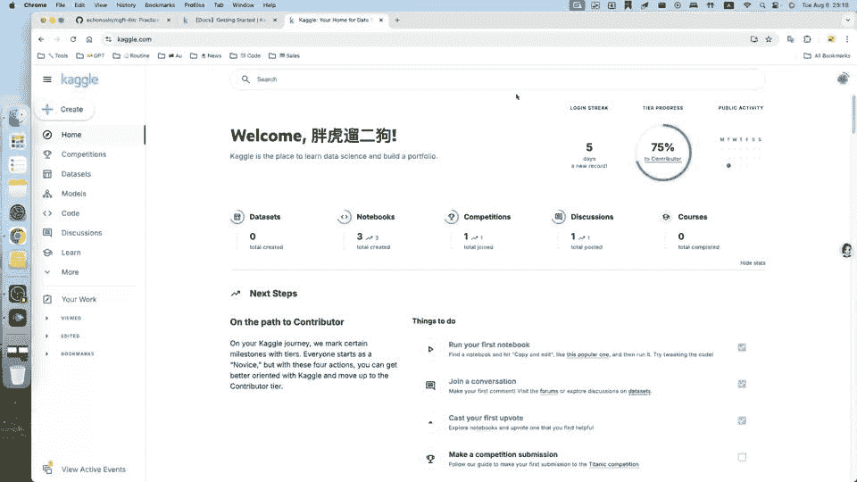

# 【kaggle大模型】快速上手kaggle平台

> 来源：[https://agijuejin.feishu.cn/docx/G3zGdecskoPS1nxuOcbcaN8vndb](https://agijuejin.feishu.cn/docx/G3zGdecskoPS1nxuOcbcaN8vndb)

# 👀快看👀

> **作者：**[**胖虎遛二狗**](https://space.bilibili.com/65742859)

> **原文链接：**【kaggle大模型】快速上手kaggle平台

---

# ⚡️作者有话说⚡️

> 🍏 这个系列将针对kaggle上的热门的LLM相关的竞赛进行介绍，主要内容包括数据清洗、模型训练、推理加速等。对于之前动手做大模型内容的一个完善和补充。

> 第一期视频将使用20多分钟介绍kaggle的平台以及主要的功能模块，后续将对每个竞赛内容进行分享。

---

# 🤖分集🤖

### 【kaggle大模型】快速上手kaggle平台

Kaggle平台的基本概念和竟赛类型,以及如何通过KO平台进行竞赛。KO平台是一个竞赛平台,包括具有工业案例的feature赛、具有学术研究性质的research赛以及入门级的gettinginstarted赛。视频还介绍了KO平台上的competition、dataset和model等功能,以及如何通过KO平台进行竞赛和获取数据。KO平台还提供了一些工具和硬件给参赛者使用。视频最后还介绍了KO平台的ranking功能。

[【kaggle大模型】快速上手kaggle平台.mp4](https://internal-api-drive-stream.feishu.cn/space/api/box/stream/download/all/NNXWbiJALooMJyxXEEFcIv0Hnxf)

---

# ✏️课代表✏️

+   Kaggle系列专题，主要讲解了如何训练好的模型以及KO竞赛平台的使用方法。

>

+   如何通过添加数据集和模型来参加比赛，并提供了一些注意事项和操作方法。

>

+   如何选择模型变种、下载代码、通过第三方API获取模型、使用notebook等内容。

>

+   Google推出的TPU训练机器和比赛形式，以及如何在内部社区组织比赛。