# Yann LeCun不看好强化学习：「我确实更喜欢 MPC」

> 来源：[https://agijuejin.feishu.cn/docx/Rjl5dYH04olnghx6Svnc9Lnqn7d](https://agijuejin.feishu.cn/docx/Rjl5dYH04olnghx6Svnc9Lnqn7d)

> 机器之心｜[阅读原文](https://www.jiqizhixin.com/articles/2024-08-26-15)

> 转载请联系原作者取得授权

> 五十多年前的理论还值得再研究一下？

「相比于 强化学习 （RL），我确实更喜欢模型预测控制（MPC）。至少从 2016 年起，我就一直在强调这一点。 强化学习 在学习任何新任务时都需要进行极其大量的尝试。相比之下，模型预测控制是零样本的：如果你有一个良好的世界模型和一个良好的任务目标，模型预测控制就可以在不需要任何特定任务学习的情况下解决新任务。这就是 规划 的魔力。这并不意味着 强化学习 是无用的，但它的使用应该是最后的手段。」

在最近发布的一个帖子中，Meta 首席 人工智能 科学家 Yann LeCun 发表了这样一番看法。

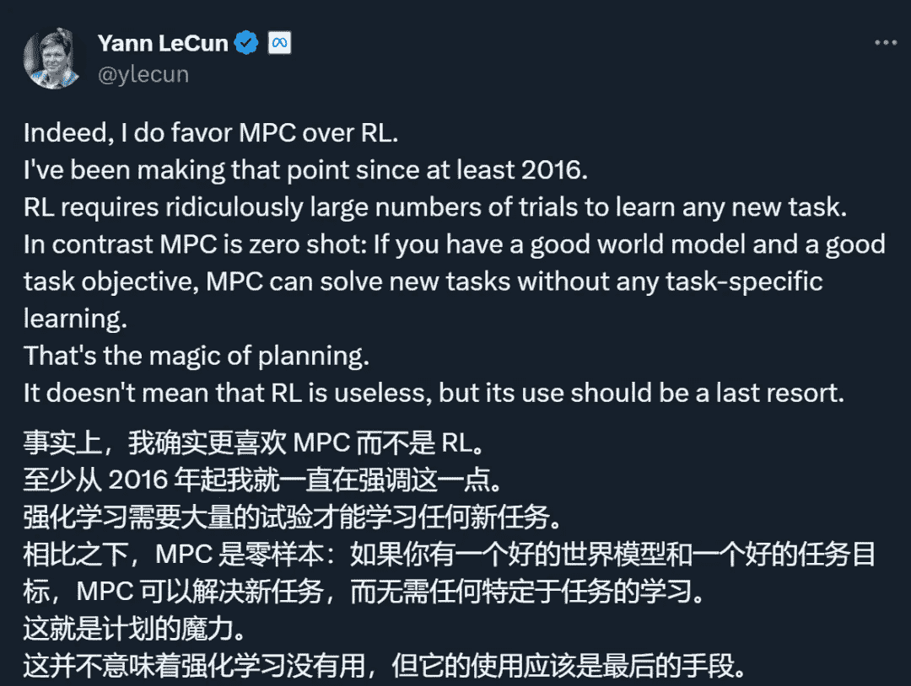

一直以来，Yann LeCun 都是 强化学习 的批评者。他认为， 强化学习 这种方法需要大量的试验，非常低效。这和人类的学习方式大相径庭 —— 婴儿不是通过观察一百万个相同物体的样本来识别物体，或者尝试危险的东西并从中学习，而是通过观察、预测和与它们互动，即使没有监督。

[在半年前的一次演讲中，他甚至主张「放](http://mp.weixin.qq.com/s?__biz=MzA3MzI4MjgzMw==&mid=2650871958&idx=2&sn=0464339517424e3a18041f265551f9f9&chksm=84e4dce8b39355fe327807f4e9cbc4ec7d1fac43a6e84894717ee47a9b53363d3f5da87c2ba1&scene=21#wechat_redirect)弃 强化学习 」（参见 《GPT-4 的研究路径没有前途？Yann LeCun 给自回归判了死刑》 ）。但在随后的一次采访中，他又解释说，他的意思并不是完全放弃，而是最小化 强化学习 的使用，训练系统的正确方法是首先让它从主要观察（也许还有一点交互）中学习世界和世界模型的良好表示。

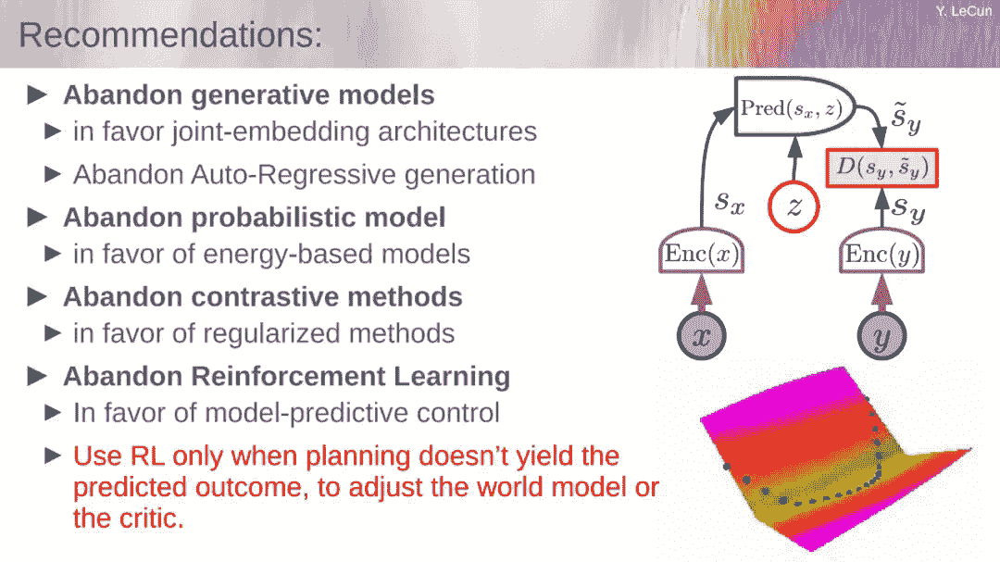

同时，LeCun 也指出，相比于 强化学习 ，他更倾向于 MPC（模型预测控制）。

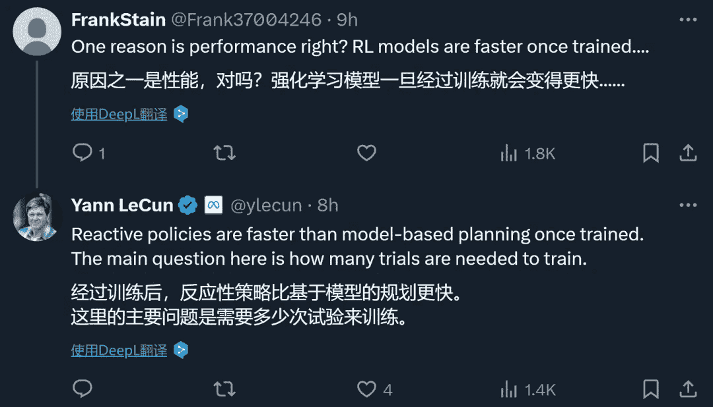

MPC 是一种使用数学模型在有限时间内实时优化控制系统的技术，自二十世纪六七十年代问世以来，已广泛应用于化学工程、炼油、先进制造、机器人和航空航天等各个领域。比如，前段时间，波士顿动力就分享了他们利用 MPC 进行机器人控制的多年经验（参见 《波士顿动力技术揭秘：后空翻、俯卧撑与翻车，6 年经验、教训总结》 ）。

MPC 的最新发展之一是与 机器学习 技术的集成，即 ML-MPC。在这种方法中， 机器学习 算法用于估计系统模型、进行预测和优化控制动作。 机器学习 和 MPC 的这种结合有可能在控制性能和效率方面提供显著的改进。

LeCun 的世界模型相关研究也用到了 MPC 相关理论。

最近，LeCun 对于 MPC 的偏爱又在 AI 社区引发了一些关注。

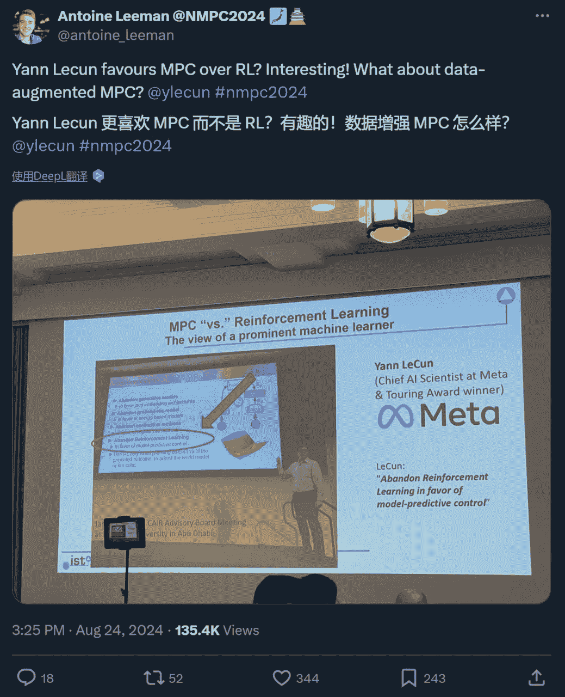

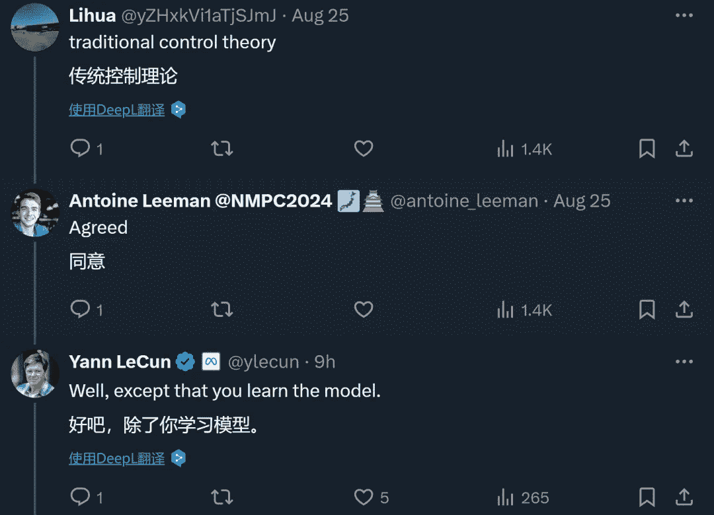

有人说，如果我们的问题能够很好地建模，并且具有可预测的 dynamics，MPC 就会很好地发挥作用。

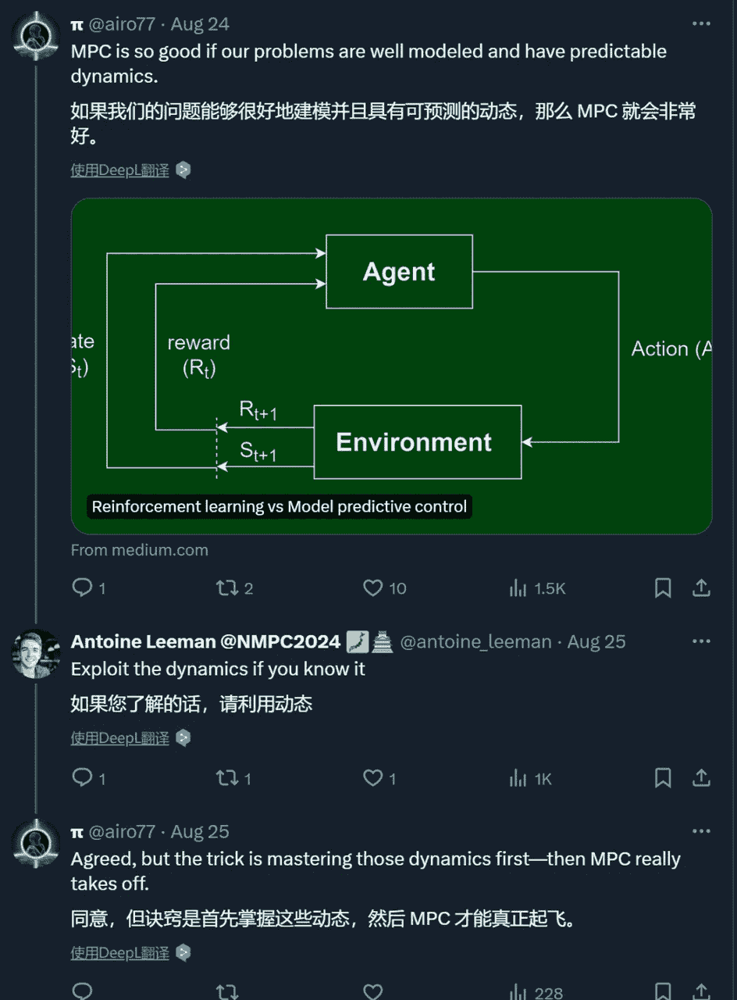

或许对于计算机科学家来说， 信号处理 和控制领域还有很多值得挖掘的东西。

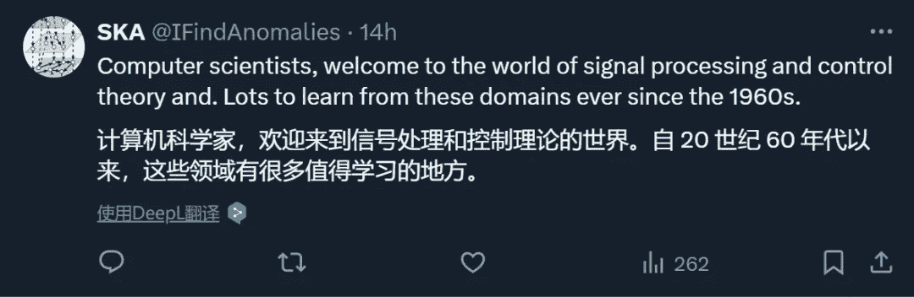

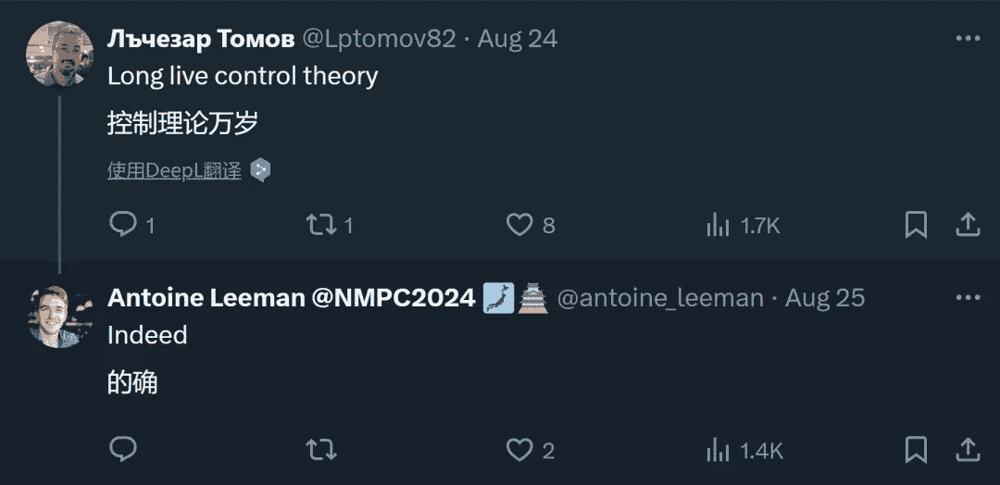

不过，也有人指出，求解精确的 MPC 模型是个很难的问题，LeCun 观点中的前提 ——「如果你有一个良好的世界模型」本身就难以实现。

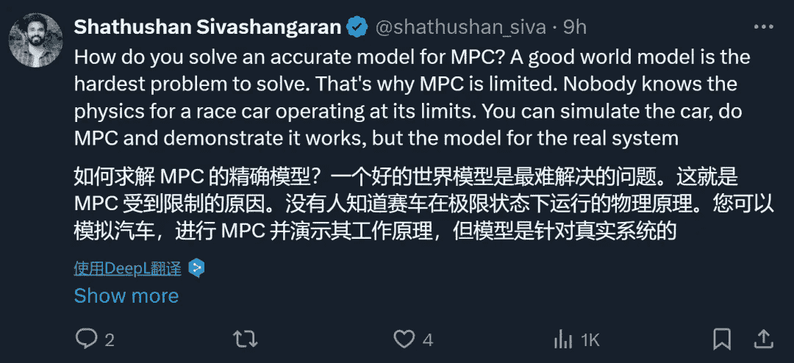

还有人说， 强化学习 和 MPC 未必是二选一的关系，二者可能有各自的适用场景。

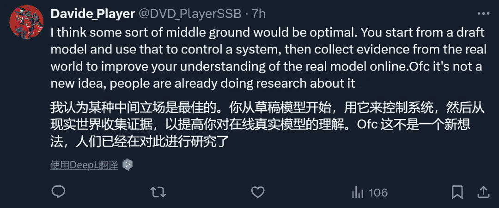

之前已经有一些研究将二者结合起来使用，效果很好。

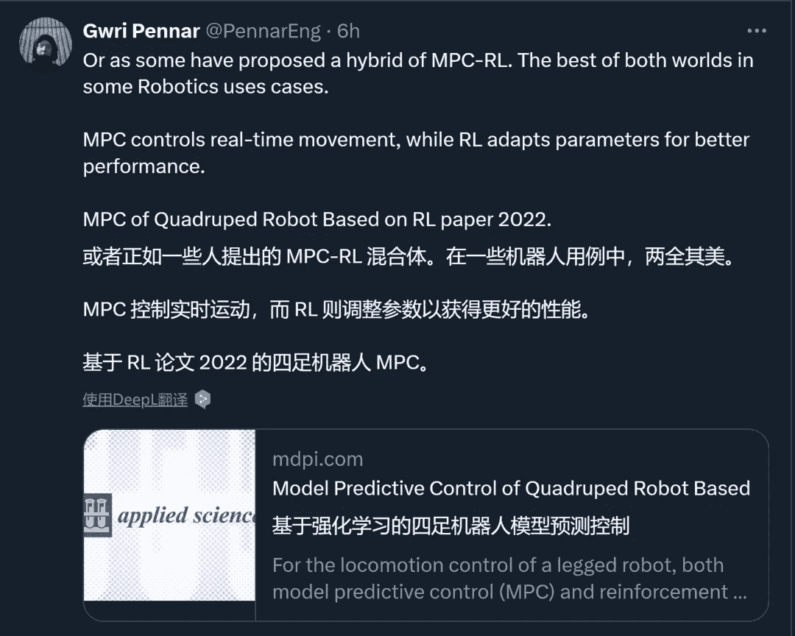

**强化学习 vs MPC**

在前面的讨论中，有网友推荐了一篇 Medium 文章，分析对比了 强化学习 与 MPC。

接下来，就让我们根据这篇技术博客，具体分析下两者的优缺点。

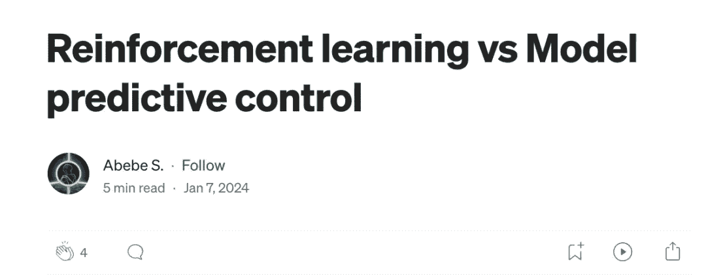

强化学习 （RL）和模型预测控制（MPC）是优化控制系统的两种强大技术。两种方法都有其优点和缺点，解决问题的最佳方法取决于特定问题的具体要求。

那么，两种方法的优缺点分别有哪些，又适用于解决哪些问题呢？

**强化学习**

强化学习 是一种通过反复试验来学习的 机器学习 方法。它特别适合解决复杂动力学或未知系统模型的问题。在 强化学习 中，智能体学习在环境中采取行动以最大化奖励信号。智能体与环境交互，观察结果状态并采取行动。然后根据结果给予智能体奖励或惩罚。随着时间的推移，智能体将学会采取能够带来更积极奖励的行动。 强化学习 在控制系统中有多种应用，旨在提供动态自适应方法来优化系统行为。一些常见的应用包括：

+   自主系统： 强化学习 用于自主控制系统，例如自动驾驶、 无人机 和机器人，以学习导航和决策的最佳控制策略。

+   机器人技术 ： 强化学习 使机器人能够学习并调整其控制策略，以完成复杂动态环境中抓取物体、操纵和运动等任务。

+   ......

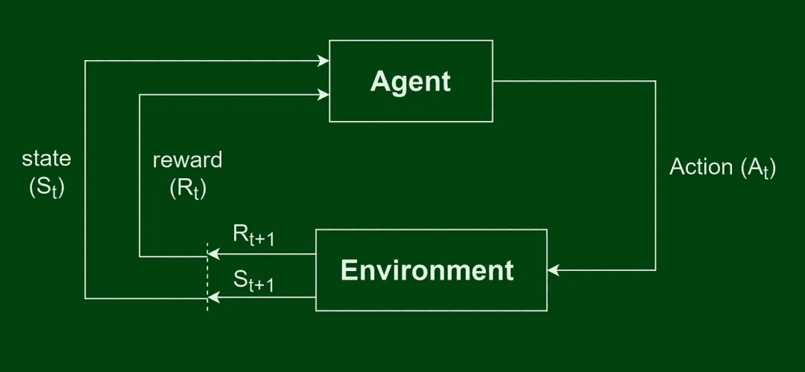

强化学习 （RL）工作流。

+   智能体：学习者和决策者。

+   环境：智能体与之交互的环境或实体。智能体观察并采取行动，影响环境。

+   状态：对世界状态的完整描述。智能体可以完全观察或部分观察状态。

+   奖励：指示智能体绩效的标量反馈。智能体的目标是最大化长期总奖励。智能体会基于奖励改变策略。

+   动作空间：智能体可以在给定环境中执行的一组有效动作。有限的动作构成离散的动作空间；无限的动作构成连续的动作空间。

**模型预测控制**

模型预测控制（Model Predictive Control，MPC）是一种广泛使用的控制策略，已应用于许多领域，包括过程控制、机器人、自主系统等等。

MPC 的核心宗旨是使用系统的数学模型来预测未来的行为，然后利用该知识来产生控制操作，以最大化某些性能目标。

经过多年的不断改进和完善，MPC 现在可以处理日益复杂的系统和困难的控制问题。如下图所示，在每个控制间隔，MPC 算法计算控制范围的开环序列，以优化预测范围内受控体（plant）的行为。

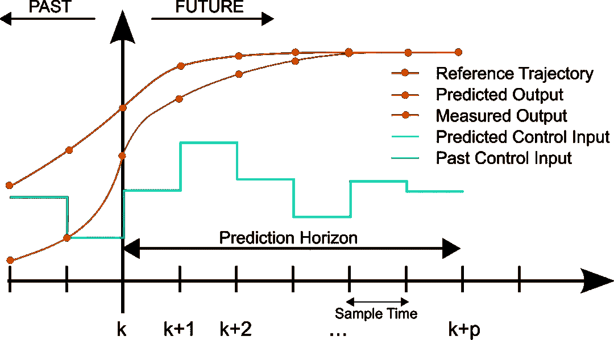

离散 MPC 方案。

MPC 在控制系统中的应用包括：

+   过程工业

+   电力系统

+   汽车控制

+   机器人技术

其中，MPC 在机器人系统中用于 规划 和优化运动轨迹，确保机械臂和机器人平台在各种应用（包括制造和物流）中平稳高效地运动。

下表列出了 强化学习 和 MPC 在模型、学习方法、速度、稳健性、样本效率、适用场景等方面的区别。一般来说，对于难以建模或具有复杂动态的问题， 强化学习 是合适的选择。对于建模良好且动态可预测的问题，MPC 是一个不错的选择。

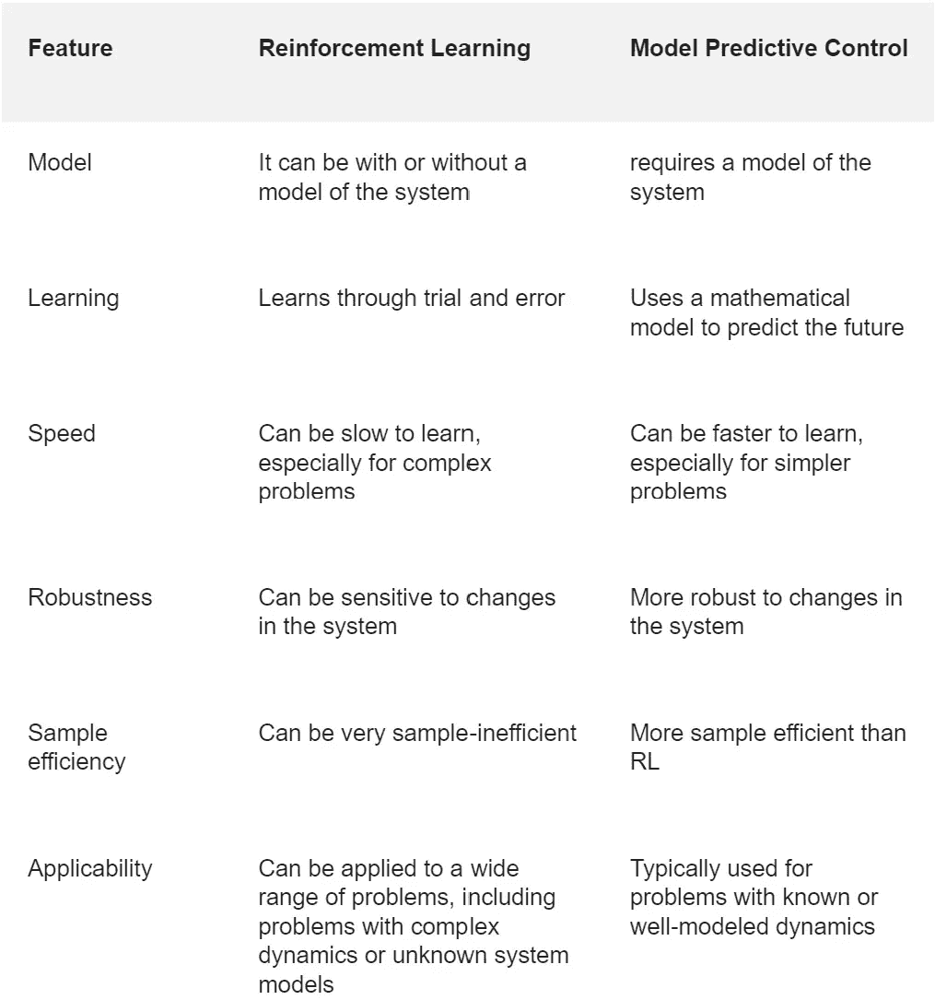

MPC 的最新进展之一是与 机器学习 技术的集成，即 ML-MPC。ML-MPC 采用和传统 MPC 不同的方法来进行控制，使用 机器学习 算法来估计系统模型、进行预测和生成控制动作。它背后的主要思想是使用数据驱动模型来克服传统 MPC 的局限性。

基于 机器学习 的 MPC 可以实时适应不断变化的条件，使其适用于动态和不可预测的系统。与基于模型的 MPC 相比，基于 机器学习 的 MPC 可以提供更高的准确性，尤其是在复杂且难以建模的系统中。

此外，基于 机器学习 的 MPC 可以降低模型的复杂性，使其更易于部署和维护。不过，与传统 MPC 相比，ML-MPC 也有一些局限性，比如需要大量数据来训练模型、可解释性差等等。

看来，要想真正将 MPC 引入 AI 领域，计算机科学家们还有很长的路要走。

参考链接：https://medium.com/@airob/reinforcement-learning-vs-model-predictive-control-f43f97a0be27