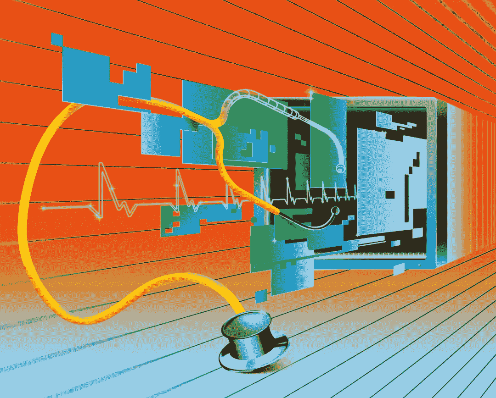
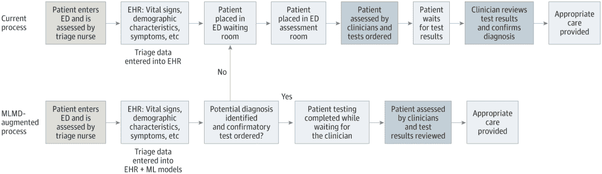
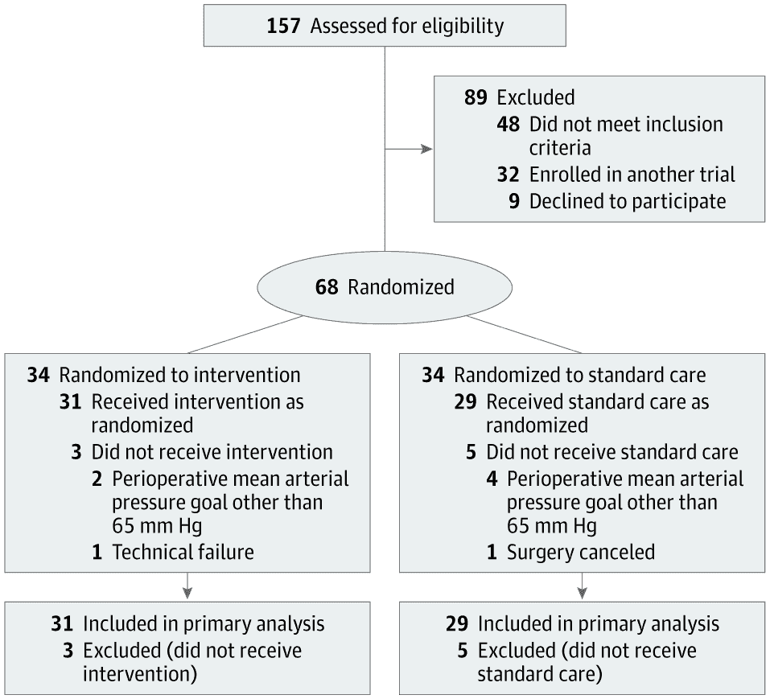
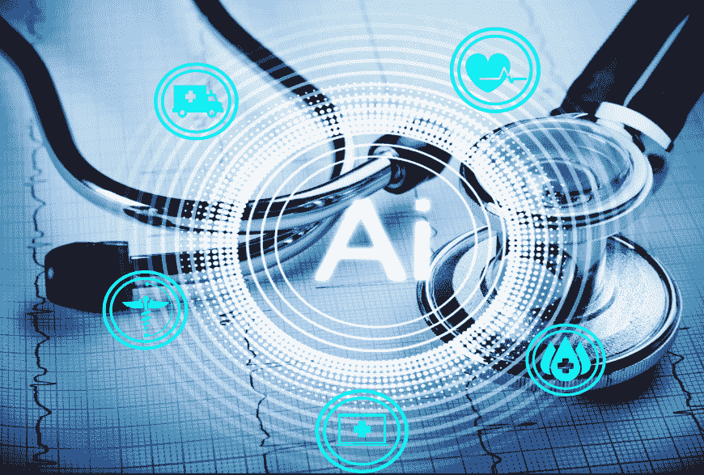

# Nature观点，人工智能在医学中的测试一片混乱，应该怎么做？

> 来源：[https://agijuejin.feishu.cn/docx/PtXud80e3oLXOAxkPUDclFkcnTb](https://agijuejin.feishu.cn/docx/PtXud80e3oLXOAxkPUDclFkcnTb)

> 机器之心 ScienceAI｜[阅读原文](https://www.jiqizhixin.com/articles/2024-08-22-2)

> 转载请联系原作者取得授权

编辑 | ScienceAI

基于有限的临床数据，数百种医疗算法已被批准。科学家们正在讨论由谁来测试这些工具，以及如何最好地进行测试。

当 Devin Singh 还是一名儿科住院医师时，他曾在急诊室照顾过一个因长时间等待救治而心脏骤停的儿童。「我记得，当时我给这个病人做心肺复苏，感觉那个孩子快要死了。」他说。Singh 对孩子的死感到十分伤心，他曾想过，如果能缩短等待时间，是否就能避免这种情况。

经历了这件事，他想，如果将自己的儿科专业知识与计算机科学结合起来，看看 人工智能 (AI) 是否有助于缩短等待时间。Singh 利用自己目前工作的加拿大多伦多儿童医院 (SickKids) 的急诊室分诊数据，他和同事们建立了一系列 人工智能 模型，这些模型可以提供潜在的诊断，并指出可能需要进行哪些测试。

「例如，如果我们能够预测一个病人很可能患有阑尾炎，需要进行腹部超声检查，那么我们就可以在患者到达后几乎立即自动安排检查，而不是让他们等待 6-10 小时才能就诊。」他说。

一项研究使用 SickKids 77000 多次就诊的回顾性数据，表明这些模型将加快 22.3% 的就诊速度，将每位需要进行医学检查的患者的结果处理速度加快近 3 小时。然而， 人工智能 算法在此类研究中的成功只是验证此类干预措施是否会在现实生活中帮助人们的第一步。

利用 机器学习 医疗指令（MLMD）在急诊科（ED）自主订购测试的方法。（来源：jamanetwork.com）

正确测试用于医疗环境的 AI 系统是一个复杂的多阶段过程。但发布此类分析结果的开发人员相对较少。一项综述显示，2020 年至 2022 年期间仅发表了 65 项 AI 干预的随机对照试验。与此同时，美国食品药品监督管理局 (FDA) 等监管机构已批准数百种 AI 驱动的医疗设备供医院和诊所使用。

「医疗保健机构发现许多获批的设备没有经过临床验证。」加利福尼亚州洛杉矶西达赛奈医疗中心 (Cedars-Sinai Medical Center) 的心脏病专家 David Ouyang 说。一些医院选择自己测试此类设备。

尽管研究人员知道理想的 AI 干预临床试验应该是什么样的，但在实践中，测试这些技术具有挑战性。实施取决于医疗保健专业人员与算法的互动程度：如果人类忽略了它的建议，一个完美的工具也会失败。AI 程序对它们所训练的人群和它们旨在帮助的人群之间的差异特别敏感。此外，目前还不清楚如何最好地向患者及其家属介绍这些技术，并征求他们的同意使用他们的数据来测试这些设备。

一些医院和医疗保健系统正在试验在医学中使用和评估 AI 系统的方法。随着越来越多的 AI 工具和公司进入市场，各组织正在聚集在一起，就哪种评估最有效、最严格达成共识。

# **谁在测试医疗 AI 系统？**

基于 AI 的医疗应用，例如 Singh 正在开发的应用，通常被药品监管机构视为医疗设备，包括美国 FDA 和英国药品和保健产品监管局。因此，审查和授权使用的标准通常不如药物标准严格。只有一小部分设备（可能对患者构成高风险的设备）需要临床试验数据才能获得批准。

许多人认为门槛太低了。当费城宾夕法尼亚大学的重症监护医生 Gary Weissman 审查其领域内 FDA 批准的 AI 设备时，他发现，在他确定的十种设备中，只有三种在授权中引用了已发布的数据。只有四个提到了安全评估，没有一个包括偏见评估，该评估分析该工具的结果是否对不同患者群体公平。「令人担忧的是，这些设备确实可以并且确实会影响床边护理。」他说，「患者的生命可能取决于这些决定。」

缺乏数据使得医院和医疗系统在决定是否使用这些技术时处于困境。在某些情况下，财务激励措施会发挥作用。例如，在美国，健康保险计划已经为医院使用某些医疗 AI 设备提供报销，这使得它们在经济上具有吸引力。这些机构也可能倾向于采用承诺节省成本的 AI 工具，即使它们不一定能改善患者护理。

Ouyang 说，这些激励措施可能会阻止 AI 公司投资临床试验。「对于许多商业企业来说，你可以想象，他们会更加努力地确保他们的 AI 工具可以报销。」他说。

不同市场的情况可能有所不同。例如，在英国，由政府资助的全国性健康计划可能会在医疗中心购买特定产品之前设置更高的证据门槛，英国伯明翰大学研究 人工智能 负责任创新的临床研究员 Xiaoxuan Liu 说，「这样，企业就有动力进行临床试验。」

一旦医院购买了 人工智能 产品，他们就不需要进行进一步的测试，可以像使用其他软件一样立即使用它。然而，一些机构认识到，监管部门的批准并不能保证该设备真正有益。所以他们选择自己测试。Ouyang 说，目前许多这样的努力都是由学术医疗中心进行和资助的。

阿姆斯特丹大学医学中心重症监护医学主任 Alexander Vlaar 和同一机构的麻醉师 Denise Veelo 于 2017 年开始了一项这样的尝试。他们的目标是测试一种旨在预测手术期间低血压发生的算法。这种被称为术中低血压的状况可能导致危及生命的并发症，如心肌损伤、心脏病发作和急性肾衰竭，甚至死亡。

该算法由位于加利福尼亚州的 Edwards Lifesciences 公司开发，使用动脉波形数据——急诊科或重症监护室监视器上显示的带有波峰和波谷的红线。该方法可以在低血压发生前几分钟预测到它，从而实现早期干预。

低血压预测（HYPE）试验中的参与者流量。（来源：jamanetwork.com）

Vlaar、Veelo 及其同事进行了一项随机临床试验，在 60 名接受非心脏手术的患者身上测试该工具。在手术期间使用该设备的患者平均经历 8 分钟的低血压，而对照组患者平均经历近 33 分钟。

该团队进行了第二次临床试验，证实该设备与明确的治疗方案相结合，在更复杂的环境中也有效，包括心脏手术期间和重症监护室。结果尚未公布。

成功不仅仅是因为算法的精确性。麻醉师对警报的反应也很重要。因此，研究人员确保医生做好充分准备：「我们有一个诊断流程图，上面列出了收到警报时应采取的步骤。」Veelo 说。另一家机构进行的临床试验中，同样的算法未能显示出益处。在那种情况下，「当警报响起时，床边医生没有遵从指示采取行动。」Vlaar 说。

# **人类参与其中**

一个完美的算法可能会因为人类行为的变化而失败，无论是医疗保健专业人员还是接受治疗的人。

明尼苏达州罗彻斯特的梅奥诊所（Mayo Clinic）测试了一种内部开发的算法，用于检测低射血分数的心脏病，该中心的 人机交互 研究员 Barbara Barry 负责弥合开发人员与使用该技术的初级保健提供者之间的差距。

该工具旨在标记可能患上这种疾病高风险的个人，这种疾病可能是心力衰竭的征兆，可以治疗，但经常无法诊断。一项临床试验表明，该算法确实增加了诊断率。然而，在与提供者的对话中，Barry 发现他们希望得到进一步的指导，了解如何与患者讨论算法的结果。这导致建议，如果广泛实施该应用程序，应包括与患者沟通的重要信息的要点，以便医疗保健提供者不必每次都考虑如何进行这种对话。「这是我们从务实试验转向实施策略的一个例子。」Barry 说。

另一个可能限制某些医疗 AI 设备成功的问题是「警报疲劳」——当临床医生接触到大量 AI 生成的警告时，他们可能会对它们变得麻木。梅奥诊所家庭医学部主任 David Rushlow 表示，在测试过程中应该考虑到这一点。

「我们每天都会收到很多次有关患者可能面临风险的疾病的警报。对于忙碌的一线临床医生来说，这实际上是一项非常艰巨的任务。」他说，「我认为其中许多工具将能够帮助我们。但是，如果没有准确地引入它们，默认情况将是继续以同样的方式做事，因为我们没有足够的带宽来学习新的东西。」Rushlow 指出。

**考虑偏见**

测试医疗 人工智能 的另一个挑战是临床试验结果很难在不同人群推广。「众所周知，当 人工智能 算法用于与训练数据不同的数据时，它们会非常脆弱。」Liu 说。

她指出，只有当临床试验参与者代表了该工具将要使用的人群时，才能安全地推断出结果。

此外，在资源丰富的医院收集的数据上训练的算法在资源匮乏的环境中应用时可能效果不佳。例如，Google Health 团队开发了一种用于检测糖尿病视网膜病变（一种导致糖尿病患者视力丧失的疾病）的算法，理论上 准确率 很高。但当该工具在泰国的诊所使用时，其性能显著下降。

一项观察性研究显示，泰国诊所的照明条件导致眼部图像质量低下，从而降低了该工具的有效性。

**患者同意**

目前，大多数医疗 人工智能 工具都可帮助医疗保健专业人员进行筛查、诊断或制定治疗计划。患者可能并不知道这些技术正在接受测试或常规用于他们的护理，而且目前任何国家都没有要求医疗服务提供商披露这一点。

关于应该告诉患者什么有关 人工智能 技术的争论仍在继续。其中一些应用程序将患者同意的问题推到了开发人员关注的焦点。Singh 团队正在开发的 人工智能 设备就是这种情况，该设备旨在简化 SickKids 急诊室对儿童的护理。

这项技术的显著不同之处在于，它将临床医生从整个过程中移除，让孩子（或者他们的父母或监护人）成为最终用户。

「该工具的作用是获取紧急 分类数据 ，做出预测，并让家长直接批准——是或否——是否可以对孩子进行检测。」Singh 说。这减轻了临床医生的负担，加速了整个过程。但也带来了许多前所未有的问题。如果患者出现问题，谁来负责？如果进行了不必要的检查，谁来支付费用？

「我们需要以自动化的方式获得家属的知情同意。」Singh 表示，而且同意必须是可靠和真实的。「这不能像你注册社交媒体时那样，有 20 页小字，你只需点击接受。」

在 Singh 和他的同事等待资金开始对患者进行试验的同时，该团队正在与法律专家合作，并让该国的监管机构加拿大卫生部参与审查其提案并考虑监管影响。计算机科学家、SickKids 儿童医学 人工智能 计划联合主席 Anna Goldenberg 表示，目前，「监管方面的情况有点像西部荒野」。

**寻找解决方案**

各机构正在齐聚一堂，讨论如何应对其中的一些挑战。一些专家表示，最好的方法是每个医疗机构在采用医疗 AI 工具之前进行自己的测试。另一些人则指出，由于成本原因，这是不可行的，因此研究人员和医疗组织正在探索其他选择。

「对于大型组织来说，这已经很困难了，对于较小的组织来说，难度会更大。」医疗 AI 专家 Shauna Overgaard 表示。Overgaard 是梅奥诊所 AI 验证和管理研究项目的联合负责人，该项目旨在以标准化和集中化的方式测试医疗 AI 工具，以便它们可以在梅奥诊所医疗系统下属的社区医疗机构中使用。

Overgaard 还是健康 AI 联盟的成员，该联盟的成员包括来自行业、学术界和患者权益组织的代表。该联盟由谷歌、亚马逊、微软和 CVS Health 等公司资助，提议建立一个健康 AI 保障实验室网络，该网络将使用一套商定的原则以集中方式评估模型。

北卡罗来纳州达勒姆市杜克健康创新研究所的临床 数据科学 家 Mark Sendak 表示，这种集中式方法并不理想。「每个机构都需要有自己的内部能力和基础设施来进行测试。」他说。

他是 Health AI Partnership 的成员，该组织由学术界和医疗保健组织组成。该合作组织已获得帕洛阿尔托 Gordon and Betty Moore 基金会的初始资金，旨在为任何组织建立能力并提供技术援助，使其能够在本地测试 AI 模型。

美国大型医学影像机构 Radiology Partners 的放射科医生兼临床 AI 副首席医疗官 Nina Kottler 也认为，本地验证至关重要。她希望这些研究得出的结论可以用来教育那些将要操作这些工具的专业人员。

Kottler 说，人为因素将是最重要的，「医疗保健领域几乎没有自主的 人工智能 。我们必须开始思考如何确保我们测量的准确性，不仅是 人工智能 ，还有 人工智能 和最终用户的准确性。」

参考内容： https://www.nature.com/articles/d41586-024-02675-0