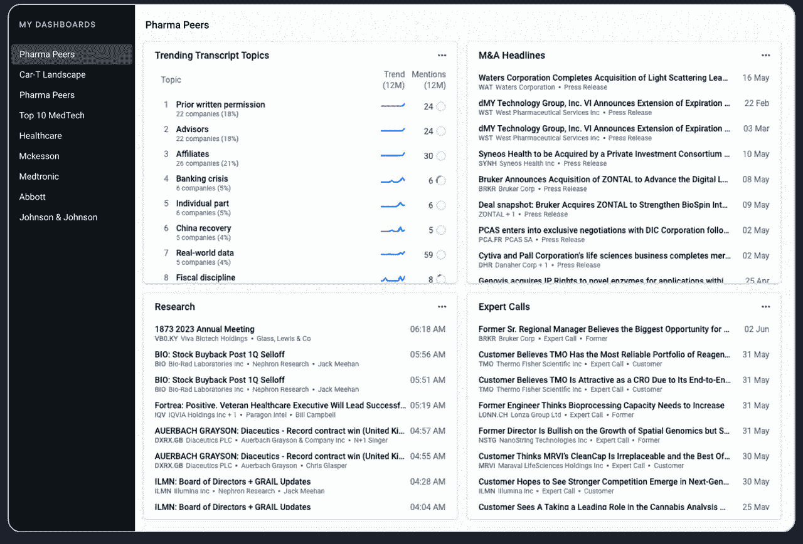
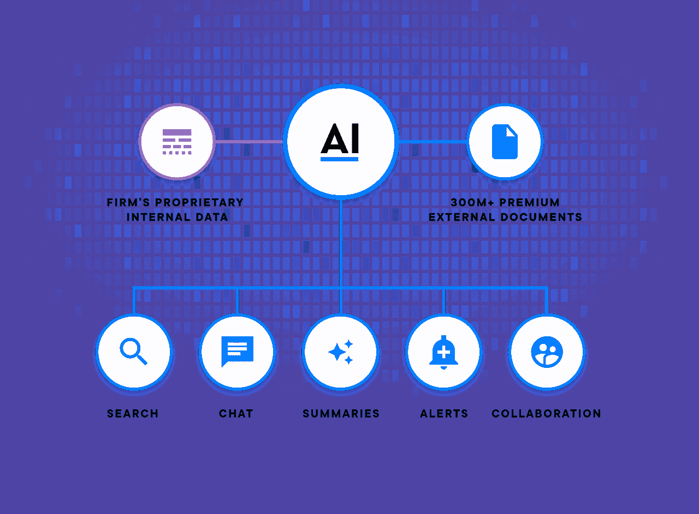
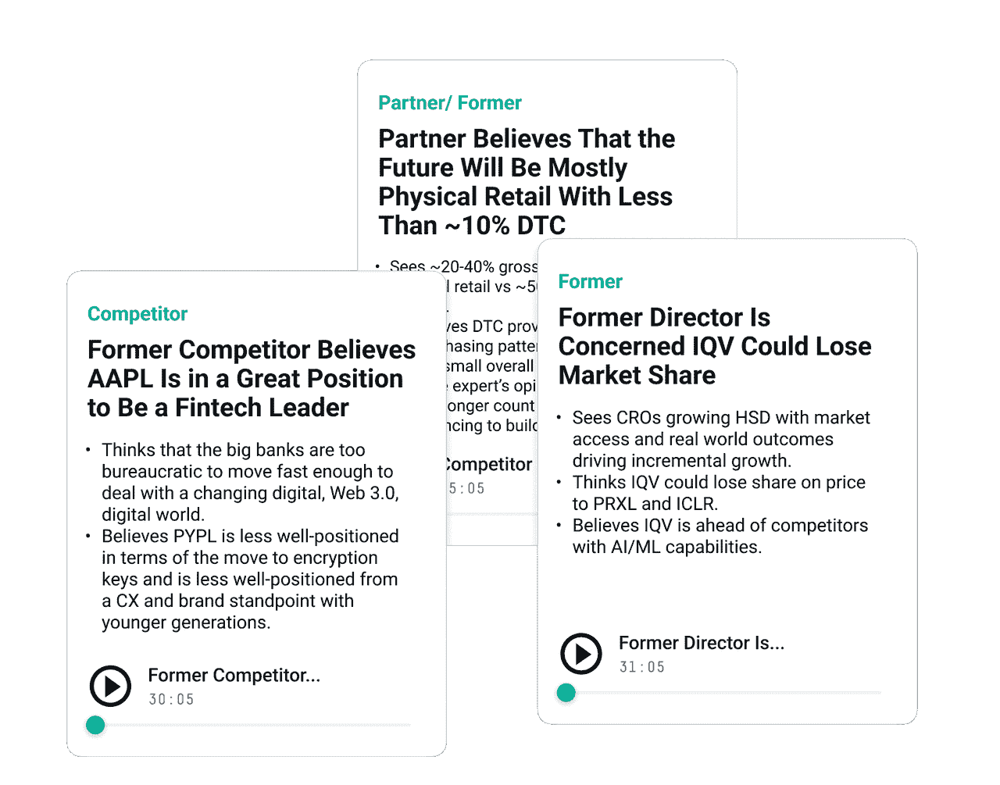
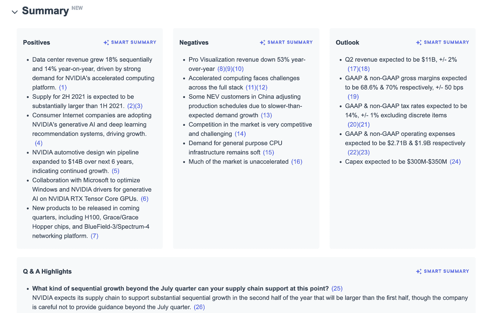
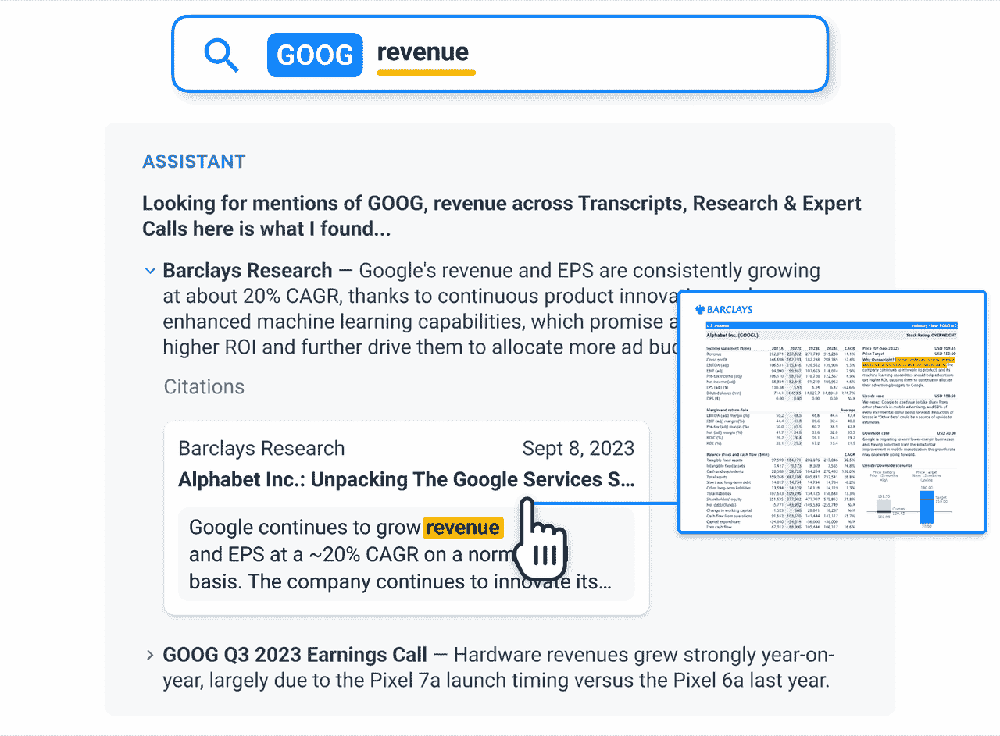
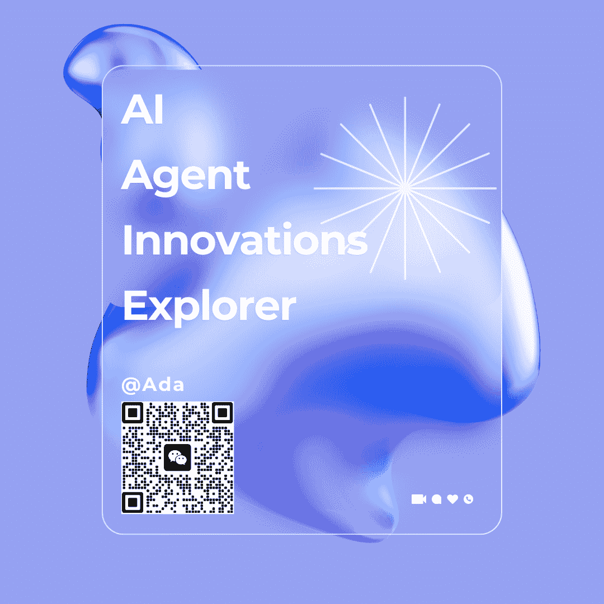

# AlphaSense - 高质量市场情报和AI搜索平台

> 来源：[https://agijuejin.feishu.cn/docx/XOYNdK0cEo3e8rxnnGZctriPnDd](https://agijuejin.feishu.cn/docx/XOYNdK0cEo3e8rxnnGZctriPnDd)

## 产品：AlphaSense

AlphaSense 是一个高质量市场情报和AI搜索平台。用户可以搜索和跟踪来自不同来源的市场信息。AlphaSense 并不是一个 AI 原生产品，最初是一个金融类信息的搜索引擎，搜索财务文件、研究报告、新闻文章等，并显示文件中重要的信息。2023 年开发了大语言模型 ASLLM，为客户提供基于生成式 AI 的智能服务。

### 产品信息一览

#### **产品价值**

**通**过对产品的初步了解，其产品价值的核心是对数据价值的深刻理解和充分应用。AlphaSense 高度重视数据的广度和深度，集成了多类型数据，这是他们的核心竞争力之一。在此基础上开发了自有模型 ASLLM，让数据分析的效率和质量大大提升。

#### 产品功能和应用场景

+   **产品形态**：SaaS 平台

+   **主要功能列表**：

1.  市场情报：通过分析财报电话会议、行业报告等，了解特定主题的市场前景、历史表现、行业热点以及竞争格局。

1.  公司资讯：挖掘公司财报、管理层指引、KPI 表现等信息。

1.  专家洞见：汇总经纪人、分析师、前员工、客户等的观点，全面了解他们对特定主题的意见及背后的原因。

**市场情报**

搜索公司、行业、趋势或主题

**企业智能**

访问 300M+的外部文档和内部内容

**华尔街洞察**

**专家见解**

+   **具体应用案例或场景，**根据公开的信息，可能的应用场景包括但不限于：市场研究，企业战略决策支持，竞争情报收集。

#### 大语言模型 AlphaSense LLM（ASLLM）

+   ASLLM 针对市场情报专业人士的常见用例进行了优化。ASLLM 在特定数据集上进行微调，深入理解市场情报的概念和语言细微差别，并利用检索增强生成（RAG）技术确保准确性。

+   **智能摘要**

可自动总结财报电话会议、公司 SWOT 分析、竞争格局等内容，准确率超过 99.9%，每月可为用户节省 5 小时以上

示例：电话会议 AI 摘要

整个文档的情感分析；生成总结摘要，按照重要性顺序排列；每段摘要引用原文链接。

+   **智能问答**

+   **智能搜索**

图片来源：https://www.alpha-sense.com/

#### AlphaSense 提供的市场情报包含了什么数据？

我对其网站上列出的 7 大数据源做个梳理。这样一个数据组合非常全面。AlphaSense 认为，只有整合了“公司、分析师、记者和监管、专家”这四个方面的观点，用户才能看到公司、行业、观察名单、市场或趋势的全貌。

表 1：数据类别和描述（根据AlphaSense网站整理）

#### **产品盈利方式**

订阅制。未公开具体定价信息。

#### 目标行业/市场/用户

+   **目标行业和特点**： 金融服务、企业管理、咨询行业等。

+   **目标市场和特点**： 全球市场，特别是大型企业和金融机构。

+   **目标用户群体**： 资产管理公司，对冲基金，投资银行，研究机构，金融分析师，投资经理，企业战略团队。

### 产品矩阵：借助资本强化数据、技术和客户优势

AlphaSense 除了自有搜索产品，近几年通过资本不断向外收购公司，形成一个“产品矩阵” - 丰富了产品的范围、提升了技术实力，也反映了其在垂直领域加速扩张的战略。这样的“产品矩阵”，可能以更灵活、智能的解决方案，撼动传统传统金融数据巨头的市场地位。更显而易见的是，有助于提升公司的市场估值。

+   **2021 年收购 Stream by Mosaic：增强内**容独特性，巩固其领先市场情报平台的地位。

Stream by Mosaic 拥有市场上最广泛和最高质量的专家访谈数据库。Stream 成立于 2010 年，其数据库包含超过 8,500 份深入的专家访谈（每天还会增加数十份）。这些访谈由投资分析师进行，是独特的数据来源，而且具有稀缺性，如果没有大量的初步研究工作，这些信息是无法获得的。

+   2022 年收购 Sentieo：在财务垂直领域建立了强大的专业能力。

Sentieo 成立于 2012 年，是一个专为投资管理行业设计的金融情报平台。收购 Sentieo 增加了 1,000 多个客户，其中包括 800 多家机构投资公司。

这一市场信号表明，传统的财务研究和分析正在向自动化、智能化的方向演进，而自然语言处理、机器学习等人工智能技术正在重塑财务工作的方式。

+   2022 年收购 Tegus：增加优质的企业内容

2024 年 6 月以 9.3 亿美元收购 Tegus，此次交易预计将于 2024 年第三季度完成。Tegus 成立于 2016 年，根据公开信息显示，其平台拥有超过 55,000 条专家通话记录，覆盖全球 35,000 多家上市和私营公司。

专业机构是 Tegus 的主要用户，这些用户对数据的深度、广度和质量要求很高。Tegus 能提供公司信息、专家研究、财务模型、公司和行业特定的 KPI 和数据。

**Tegus demo:**

图片来源：https://www.tegus.com

### AlphaSense 和 Glean 对比

前面已经了解过企业级 AI 搜索产品 Glean，于是对这两个产品做个对比。由于两个产品的定位、目标工作领域以及团队背景不同，所以两者的区别是比较明显的。我梳理了以下对比表格：

表 2：AlphaSense 和 Glean 对比

|  | **AlphaSense** | **Glean** |
| --- | --- | --- |
| 目标工作流程 | 主要市场研究工作 | 多类型工作流程 |
| 内容搜索功能 | 行业搜索 | 主题搜索 |
| 跨应用搜索 | 无 | 有 |
| 团队协作和知识管理 | 无 | 有 |
| 生成式 AI 功能工具 | 有 | 有 |
| 信息资源 | 有 | 无 |
| 在结构化和非结构化格式中查找数据和 KPI | 有 | 无 |
| 能够添加注释和注释 | 有 | 无 |
| 能够设置监视工具（如警报和仪表板） | 有 | 无 |

### 公司信息一览

+   **公司名称**：AlphaSense Inc。

+   **公司地址**：总部位于纽约

+   **网站地址**：www.alpha-sense.com

+   **创始人**：Jack Kokko 创始人兼 CEO，拥有赫尔辛基经济学院金融学学士学位、奥卢大学电气工程硕士学位和宾夕法尼亚大学沃顿商学院 MBA 学位，曾任摩根士丹利高级分析师。

+   **发展历程**

+   最初是为金融服务公司提供一个搜索引擎，帮助分析师快速梳理大量密集的文件。

+   近年来，AlphaSense 已将金融服务扩展到更多垂直领域的客户群，已经获得科技、医疗和工业等行业的客户。

+   AlphaSense 在生成式 AI 方面投入巨资，为客户提供智能服务。

#### 公司画像

以下数据根据公开信息获得。

#### 成立时间：2011 年

#### 估值：2024 年 6 月，40 亿美元

#### 正在准备 IPO

> IPO 最早可能在明年进行，确切时间取决于市场。

#### 企业特点

> 技术驱动型，高成长性，获得头部机构投资。

#### 收入：

> 2023 年实现年度经常性收入（ARR）超过 2 亿美元。Jack Kokko 告诉《财富》杂志公司在过去几年中一直保持现金流为正，并且正在 "朝着盈利的方向迈进"。

#### 员工：

> 2023 年，在北美、欧洲、中东和非洲和亚太地区发展到近 1,500 名员工。

> 加速在海外市场布局，将亚太总部设在新加坡，服务区域头部金融机构。

#### 企业使命：

> 帮助专业人士更快、更自信地做出更好的决策。

#### 现有客户信息：

> 拥有超过 4000 家企业客户，包括标普 500 强中的 85%公司，80%的顶级咨询公司和资产管理公司。

> 客户覆盖银行、投资机构、生命科学、能源、工业、消费品和科技等行业。

#### 入选榜单摘要：

> 入选 2023 年 CB Insights 第六届年度金融科技百强榜单。

#### 市场规模预估（参考数据）

**根据 future** market insight 公司金融分析市场的展望报告，市场价值从 2022 年的 77.003 亿美元跃升。从 2023 年到 2033 年，市场的复合年增长率预计将达到 11.5% 的强劲增长。到 2033 年，市场规模预计将激增至 252.084 亿美元。不同机构的测算口径和数字有一些差异，但总体来看，全球金融情报和分析市场目前的规模大约在 80-120 亿美元左右，未来几年有望保持 10%以上的高速增长。

### 个人观点：AlphaSense 产品设计始终围绕用户需求

AlphaSense 的目标用户是专业人员，从公司业务和客户信息来看，其产品已经获得了专业客户的认可。

#### 用高质量数据吸引专业人员

这些用户需要进行深入的市场研究。传统的市场研究依赖于人工搜集**和分析信息，效率低下且容易遗漏重要信息。企业需**要处理的信息和数据量日益增加，使用市场研究和财务分析获得竞争优势的需求日益增长。在这一方面，企业难以依靠自有数据和技术解决需求，必须寻求专业服务提供商的帮助。

高质量数据是吸引专业人员的核心要素。AlphaSense 通过提供全面、权威、独家的高质量数据，成功吸引了大量专业用户。为此，我制作了表 3 进行说明。公开数据虽然容易获取，但并不意味着价值有限。AlphaSense 对公开数据进行了智能化处理，如关键信息提取、数据结构化等，大大提升了数据的可用性和分析效率。专家访谈记录是 AlphaSense 最独特的数据源之一。这类数据通常难以获取，且非常稀缺。

表 3：数据类别，来源和独特性

**数**据是人工智能的燃料，数据的积累需要长期的时间和巨大的投入。AlphaSense 自成立以来，通过持续的数据采集和整合，形成了极高的数据壁垒。后来者很难在短时间内复制如此规模和质量的数据资源。

#### 异构数据智能处理，留住专业用户

除了有这些数据源，还需要专注于这些用户的使用痛点和工作流，留住用户。

用于市场研究的数据往往来自不同渠道、公司、业务系统和部门，这些数据在类型、格式、时间粒度等方面差异很大，AlphaSense 深谙数据整合和挖掘之道，解决这一专业领域中异构数据的管理和分析，获得了广泛的认可和信赖。

### 🌰 举几个例子

#### 市场研究需要的数据有哪些？举几个例子

1.  宏观经济数据，比如 GDP、CPI、汇率等。

1.  行业报告、行业发展趋势和关键驱动因素等洞见。

1.  竞争对手信息、官网介绍、宣传册、产品参数等。

1.  销售数据、订单明细、客户信息等。

1.  用户反馈、在线评论、社交媒体的用户帖子等。

#### 什么是异构数据？举几个例子

1.  结构化 vs 非结构化：

> 财务报表、交易记录是结构化数据；客服聊天记录是非结构化数据。

1.  数值数据 vs 文本数据

> 销量、金额数据是数值，可以直接计算；品牌新闻、研究报告、社交媒体上的用户评论是文本型的，需要进行语义分析。

1.  实时数据 vs 历史数据

> 物联网设备的传感器数据是实时的，股票价格是实时的；销售数据是静态的，用于事后分析。

1.  内部数据 vs 外部数据：

> ERP 系统中的供应商数据是企业内部数据；第三方市场研究报告是外部数据。

#### 什么是数据的时间粒度？举几个例子

1.  时点数据 vs 时段数据：

> 库存数据反映了特定时刻的状态；而流量数据记录了一段时间内（如每小时）的网站访问量。

1.  实时数据 vs 延迟数据：

> 股票价格是实时变化的；而上市公司的财务报表是延迟获得的数据。

1.  规律数据 vs 不规律数据：

> GPS 设备采集的货车位置数据每分钟采集一次；而社交媒体上的用户评论是随机发生的。

**数据是**记录和反映真实世界的，简而言之，最佳的数据状态是，可以形成一个动态的信息全景。AlphaSense 的产品启示是，在数字化时代，要为用户提供了更全面、实时、连续的洞察，使数据能够全景式的反映研究对象和对象的变化，让决策者能够更全面、更及时地洞悉机会和风险。

## **作者：Ada **

