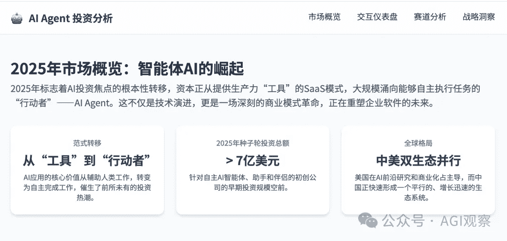
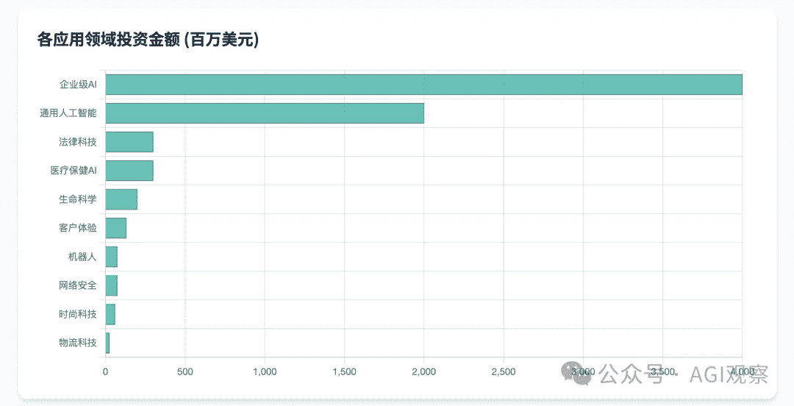
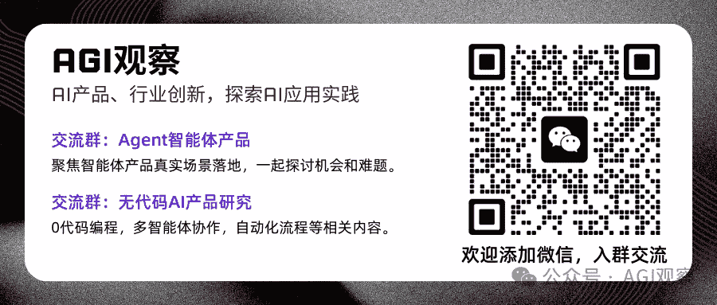

# AI Agent 2025上半年融资：看懂8个行业智能体应用，拆解新兴领导者的制胜之道 | AGI观察

> 来源：[https://agijuejin.feishu.cn/docx/A3zIdyCoao01V4xMCCVcpS1ynpg](https://agijuejin.feishu.cn/docx/A3zIdyCoao01V4xMCCVcpS1ynpg)

> **前言**

> 在上一篇文章中，[重](https://mp.weixin.qq.com/s?__biz=MzkxODcwNzIyMw==&mid=2247485402&idx=1&sn=7ecb6f8c14e9dc2a6a2c695c7e6dfd24&scene=21#wechat_redirect)读3年前红杉资本《生成式AI：一个创新的新纪元》：预测实现了多少？加速了还是滞后了？2030年前还有哪些预测？ | AGI观察，相信大家非常感慨技术发展和现实的碰撞

> 下一篇文章，我原计划关于”生成式AI的浪潮，恰恰是知识工作者和创意工作者的黄金时代。“，聚焦知识工作者这个议题。不过，昨天晚上一则新闻，让我把这篇文章的计划提前了。

## 写在前面

2025 年上半年，熟悉飞书“AGI 掘金”知识库的朋友可能会发现，我的“AGI 洞察”专栏文章更新频率很低，最近的一篇关于"Clay.AI"的产品洞察还是 4 月发布的。这并非“懈怠“，而是我将更多时间投入到各类 agent 产品以及在梳理一些结构化的方法论。

下半年开始，我打算聚焦"AI Agent 系列产品”，依然是我熟悉的企业级应用方面，恰好昨晚，一则消息令我觉得这个系列得加速了。看到斑头雁张总在朋友圈更新了一个消息：企业级AI智能体开发平台BetterYeah AI近日完成B轮融资，融资金额超亿元人民币。创下国内AI Agent领域公开的最大单笔融资纪录，市场的信心已展露无遗。

这是一个非常明确的市场信号，促使我立刻行动，昨晚发完朋友圈，就开始打开电脑整理 2025 年上半年的全球 AI Agent 领域的融资信息。最终，我和我的“AI 同事”一起完成了此文。同时，我将能公开搜集到的公司融资信息整理了一个表格，包括公司特点、团队、投资机构、客户、业务模式等 21 个字段的详尽表格。

## 2025年AI Agent智能体全球融资事件与新兴领导者分析

（根据公开信息 2025 年 1-6 月）

### 摘要

2025年上半年结束，人工智能（AI）领域见证了一次根本性的范式转移，投资焦点从提供生产力“工具”的软件即服务（SaaS）模式，转向了能够自主执行任务的“行动者” - 即AI Agent（智能体）。

本文旨在全面剖析2025年上半年全球AI Agent领域的投资动态，通过对关键融资事件、领军企业及其背后战略的深度分析，勾勒出这一新兴市场的竞争格局、核心技术驱动力以及未来发展趋势，指引你驶向 2025 下半年更广阔的大海。

### 第1部分：2025年市场分析：智能体AI的崛起

2025年上半年的AI Agent市场不仅是技术演进的延续，更是一场深刻的商业模式革命。这一转变正在重塑企业软件的未来，并可能定义了新一代科技独角兽的诞生土壤。

#### 1.1 从“工具”到“行动者”的范式转移

过去二十年，SaaS模式的核心是为企业提供增强生产力的“电动工具” - 人类是“操作工”。然而，2025年标志着一个新时代的到来，其核心是能够自主“完成工作”的应用程序 - 它正在成为人类的“AI 同事”。

这一理念的转变是当前投资热潮的根本驱动力。数据显示，投资者正在用真金白银为这一愿景投票。

这股浪潮的核心在于，AI Agent不再仅仅是处理信息，而是能够理解上下文、预测需求、协调复杂工作流并实时提供解决方案。它们正在从被动的聊天机器人，演变为能够代表员工主动采取行动、处理多步骤指令并与现有业务工具无缝集成的企业核心成员。

#### 1.2 2025年上半年的主导投资主题

根据公开资料披露，对2025年融资事件的分析揭示了几个明确的投资主题，这些主题共同构成了当前的市场格局。

##### 主题一：垂直化应用爆发

与2024年资本集中于通用水平平台不同，2025年初至今，专注于垂直行业的AI Agent公司，投资者开始寻求在数据丰富、问题明确且价值高的特定行业（如生命科学、物流、建筑、法律科技）中建立具有防御性护城河的公司。这些垂直应用能够更好地理解特定领域的术语、工作流程和监管要求，从而提供比通用模型更准确、更具价值的服务。

##### 主题二：Agent开发与协同平台受热捧

AI Agent的激增催生了对底层基础设施和工具的巨大需求，投资者正将资金投入到使能技术中，包括机器学习安全（ML Security）、AI可观测性与治理（AI Observability & Governance）以及模型与智能体编排（Orchestration）平台。市场正在从纯粹的研发阶段，转向企业级规模化部署，可靠性、安全性、合规性和成本控制已成为核心关切。

##### 主题三：从纯软件形态向物理世界延伸

物理AI将软件智能体与硬件相结合，使其能够在物理环境中执行任务。机器人技术、多模态模型、边缘计算和空间智能等领域的进步，为“物理AI”奠定了基础。虽然尚处早期，但工业人形机器人等已成为这一趋势的初步体现。

#### 1.3 多类型的商业化并行发展

2025年上半年的绝大多数超大规模的融资事件，如Thinking Machines Lab、Lila Sciences和Anthropic，都发生在美国，这反映了美国在AI前沿研究和商业化方面的主导地位。

与此同时，一个平行且快速增长的AI生态系统正在中国形成。以企业级AI智能体开发平台“斑头雁”（BetterYeah AI）为例，该公司在2025年完成了由阿里云领投的B轮融资。中国市场正受益于庞大的数据量、明确的商业化应用场景以及政府的战略推动，形成了与西方市场既有相似之处又具独特性的发展路径。

### 第2部分：2025年上半年全球AI Agent投资档案

本节将提供2025年全球AI Agent领域已披露融资事件的详细数据。这些数据是理解市场动态、评估公司潜力和识别新兴趋势的基础。

#### 2.1 方法论

下表数据综合整理自公开的新闻报道、公司新闻稿、官方网站以及多个市场情报平台。由于信息披露程度不同，部分字段可能显示为“信息未披露”。所有融资金额和公司估值均基于已报道的数字，可能随时间推移或后续融资而发生变化。本表格旨在提供一个截至文章发布时的市场快照，以供战略分析之用。

[全球AI Agent公司详情和融资信息（据公开资料）](https://agijuejin.feishu.cn/wiki/ChUIwHUhxinzA3kHv6KcZ4mynrF)细表格链接地址：文末阅读原文，前往飞书链接

#### 2.2 2025年全球AI Agent投资交易一览

（根据公开信息 2025 年 1-6 月）

上述数据的分析揭示了一个关键的市场驱动因素：创始团队的背景与公司的融资规模和估值之间存在着强烈的正相关性。在2025年的AI Agent赛道，来自顶级AI实验室（如OpenAI、Meta FAIR、Google DeepMind）的履历已成为吸引巨额资本的最有效“敲门砖”。

一个典型的例证是对几家初创公司融资情况的比较。前OpenAI首席技术官Mira Murati创立的Thinking Machines Lab，在尚未发布任何产品的情况下，便获得了高达20亿美元的种子轮融资，估值达到100亿美元。

### 第3部分：关键市场细分与公司画像深度剖析

本节将对多家关键公司及其所在细分市场进行定性分析，深入探讨这些公司的产品、技术和市场策略。

#### 3.1 新兴AI巨头：下一代通用人工智能

这一领域的公司目标宏大，旨在构建下一代通用或水平化的人工智能平台。它们的竞争核心在于模型能力、规模和生态系统。

##### ● Thinking Machines Lab

由前OpenAI首席技术官Mira Murati创立的Thinking Machines Lab，凭借其创纪录的20亿美元种子轮融资和100亿美元的估值成为市场焦点。由Andreessen Horowitz领投融资，该团队汇集了来自OpenAI、Meta、Google和Mistral的AI顶尖人才。公司的使命是构建“更易于理解、可定制和功能更强大”的多模态AI系统，强调与人类的协作。尽管产品细节仍处于保密状态，但其战略意图非常明确：直接挑战其创始团队的“母校”OpenAI，争夺通用人工智能的未来主导权。

#### 3.2 垂直领域冠军：解决高价值行业问题

这些公司不追求通用智能，而是将AI Agent技术作为“手术刀”，精准地切入特定行业的复杂问题。它们的成功之道在于深度领域知识、专有数据和定制化的工作流。

##### ● Anysphere (Cursor)

Anysphere凭借其AI原生代码编辑器Cursor，成功跻身独角兽行列，估值约为100亿美元，并获得了Thrive Capital和Andreessen Horowitz的支持。与通用聊天机器人不同，Cursor专注于一个极具价值的垂直领域-软件开发。它不仅仅是一个代码补全工具，而是一个旨在与开发者深度协作、理解整个代码库并自动化编程任务的智能体。Anysphere的成功证明，将AI Agent能力深度整合到专业人士的核心工作流中，可以创造出巨大的商业价值和强大的用户粘性。

（历史文章：“这个领域的天花板很高，有非常多的可能，值得长期投入。”）

##### ● Lila Sciences (生物科技/生命科学)

Lila Sciences以2亿美元的巨额种子轮融资震惊了生物科技领域，该轮融资由创造了Moderna的著名风投机构Flagship Pioneering领投。公司的创始团队堪称豪华，包括Flagship的CEO、Moderna联合创始人Noubar Afeyan，以及著名遗传学家George Church。Lila的愿景是构建一个“科学超级智能平台”，其核心是被称为“AI科学工厂”的自主化实验室。科学家们将信息输入到人工智能实验室，并通过“假设-实验-测试循环”的科学过程与其合作。

##### ● Augment (物流)

Augment以2500万美元的种子轮融资进入物流科技领域，由顶级风投8VC领投。其创始团队的构成是垂直AI公司的典范，来自物流科技公司以及物流行业拥有数十年经验的资深高管。这种“成功创业者 + 行业老兵”的组合，确保了公司既有技术创新能力，又对行业痛点有深刻的理解。Augment的独特之处在于，它旨在捕获和系统化物流行业中大量存在的“依赖个人经验的非结构化知识“，通过分析所有交互数据，建立一个不断学习和优化的组织知识库。

##### ● Decagon (客户体验)

Decagon在2025年以1.31亿美元的C轮融资和15亿美元的估值，成为客户体验（CX）领域的AI Agent领导者，获得了Accel和Andreessen Horowitz等顶级机构的支持。其产品是用于聊天、邮件和语音渠道的AI客服智能体。Decagon的关键创新在于其“智能体操作程序”（Agent Operating Procedures, AOPs）技术。这项技术允许客户体验团队使用自然语言来定义和调整AI智能体的行为逻辑，就像为人类员工编写标准操作流程（SOP）一样。这极大地降低了AI应用的门槛，使得非技术人员也能快速构建和迭代复杂的自动化工作流，从而实现了AI在客服领域的大规模落地。

##### ● Klutch AI (建筑)

Klutch AI以800万美元的种子轮融资进入传统的建筑行业，由Bain Capital Ventures和Bling Capital领投。其创始人同样具备“技术+行业”的双重背景：CEO Xu Rui成长于建筑工地，并经营过自己的房地产投资公司，而她和CTO Tanin Na Nakorn都曾在Stripe领导机器学习产品团队。Klutch AI的深刻洞察在于，建筑行业的数字化瓶颈在于现场团队。因此，他们的AI智能体（如Archie AI-负责区域和许可审查, Bob AI-负责数据记录和照片分析）被设计成通过现场人员习惯使用的工具（如短信、邮件、照片）来工作，自动完成许可证审查、工地文档记录等任务，而不是强迫他们学习使用复杂的软件。

##### ● Yutori (个人/Web自动化)

Yutori由三位前Meta AI的高级研究负责人创立，以1500万美元的种子轮融资进入公众视野，由Radical Ventures领投。这又是一个“全明星”AI研究团队，但他们选择了一个面向广大消费者和专业人士的赛道。Yutori的愿景是为每个人打造一个“AI幕僚长”，一个能够可靠地在网页上执行各种日常数字任务的智能体，从简单的订餐到复杂的旅行规划。

#### 3.3 赋能者：构建智能体基础设施

随着AI Agent应用的普及，为这些应用提供动力、安全和连接的基础设施变得至关重要。这一领域的公司是整个生态系统的基石。

##### ● Jozu (MLOps/编排)

Jozu以400万美元的种子轮融资，精准切入了企业AI部署中的一个关键痛点，由HalfCourt Capital领投。随着企业出于数据安全和成本考虑，从使用OpenAI等第三方API转向自托管开源模型，它们面临着巨大的运维挑战：如何安全、合规、高效地部署和管理这些模型。Jozu提供的正是一个可本地部署的安全模型注册中心和编排平台。

##### ● Phonic (语音AI)

Phonic以400万美元的种子轮融资，挑战语音AI领域长期存在的可靠性问题，由Lux Capital领投。当前许多语音AI应用因延迟高、无法理解复杂对话、容易出错而导致用户体验不佳。Phonic的解决方案是一个端到端的、语音到语音（speech-to-speech）的平台，用于构建高度可靠和逼真的对话式语音智能体。自研了一整套统一的、专有的音频基础模型，使其能够实现低于300毫秒的端到端延迟，并构建出能够动态适应对话变化的智能决策系统。

关键公司的案例揭示了一个共同的成功模式：

优秀的垂直领域和基础设施AI Agent初创公司，其创始团队都具备对问题领域的“原生理解”。他们是技术专家，更是其行业的资深专家。

这种技术能力与真实行业经验的深度融合，为投资者提供了强大的信心，也是预测这些公司未来能否在激烈竞争中脱颖而出的关键指标。

### 第4部分：战略洞察与竞争展望

综合以上分析，我们可以勾勒出2025年AI Agent市场的战略全景，并对未来的发展趋势和竞争做出展望。

#### 4.1 2025年制胜融资的关键要素

基于对成功融资案例的分析，可以总结出当前市场环境下三种最受资本青睐的创业模式：

1. “全明星”团队模式：

如Thinking Machines Lab所示，拥有来自全球顶级AI实验室（OpenAI, Meta FAIR, DeepMind）核心成员的创始团队，是获得巨额种子轮投资的最直接途径。在这种模式下，投资者押注的是团队再现甚至超越其过往辉煌成就的潜力。

2. “真实痛点”叙事模式：

如Augment和Klutch AI的案例，创始人对特定行业有着深刻、甚至是个人的理解，能够清晰地阐述该行业的关键痛点，并提出切实可行的AI解决方案。这种将深厚行业经验与强大技术能力相结合的模式，对寻求务实回报的投资者极具吸引力。

3. “不可或缺”的基础设施模式：

如Jozu和Phonic所展示的，这类公司专注于解决AI大规模应用过程中的瓶颈问题，如安全性、可靠性、部署效率等。它们不直接面向终端用户，而是为其他AI公司提供关键工具。这种“不可或缺”的定位，一旦其技术或标准被广泛采用，就能建立起极强的技术壁垒和市场地位。

#### 4.2 竞争舞台：一场多线"战争"

AI Agent领域的竞争正变得日益复杂，呈现出多条战线并进的态势：

##### ● 初创公司与科技巨头的阵地战：

来自科技巨头的威胁无处不在。AWS（Strands Agents](https://mp.weixin.qq.com/s?__biz=MzkxODcwNzIyMw==&mid=2247483897&idx=1&sn=e44a226be7c7971ec491f1072266830e&scene=21#wechat_redirect)）、Databricks（Agent Bricks）(历史文章：Databricks 数据与 AI 融合，自研模型 + 复合 AI 系统，应用质量和可靠性的最佳方式。）和Google（Gemini Agents）等平台级玩家都在构建自己的智能体框架和解决方案。初创公司必须通过构建深度的技术护城河、积累专有数据、打造独特的行业工作流或建立强大的开发者社区，来避免被巨头的产品“复刻”或边缘化。

##### ● 初创公司之间的垂直赛道巷站：

在各个垂直领域，竞争正在迅速加剧。例如，在AI医疗文书领域，Abridge、Suki和Augmedix等公司正在激烈争夺市场份额。比拼的是对行业工作流的理解深度、产品的易用性以及客户服务的响应速度。

##### ● 初创公司赢得用户的信任之战：

在AI法律领域，Harvey虽然获得在法律领域取得了进展，但是法律专业人士还是AI使用持谨慎态度。这是最关键，也是最艰难的一条战线。即使一家初创公司在“巷战”中击败了同行，在“阵地战”中暂时抵挡住了巨头，但如果它无法赢得用户的最终信任，前面所有的胜利都将毫无意义。

#### 4.3 未来轨迹：机遇与挑战并存

展望未来，AI Agent领域将迎来机遇与挑战并存的动态发展阶段。

##### ● 市场整合在所难免：

当前市场高度分散，充斥着大量初创公司。预计在2026至2027年，市场将迎来一波整合浪潮。大型基础模型公司可能会收购成功的垂直智能体公司，以快速获取行业知识和市场渠道。 同时，像企业软件领军者 ServiceNow 28.5 亿美金收购企业级 AI 助手提供商 Moveworks那样，传统企业软件巨头也会通过并购来增强自身的AI Agent能力。

##### ● 估值泡沫的风险：

像Thinking Machines Lab这样在产品问世前就获得百亿美元级别的估值，无疑给市场带来了系统性风险。如果这些“明星”公司未能兑现其宏大承诺，可能会引发市场情绪的逆转，导致资本从追逐概念转向寻求有实际收入和成熟产品的公司，从而引发一轮市场调整。

### 下一个前沿 - 跨智能体协作

当前多数智能体仍是“单兵作战”。下一个重大的技术挑战和投资机遇将在于多智能体系统（Multi-Agent Systems），即让来自不同供应商的专业智能体能够相互沟通、协调和合作，以完成更复杂的任务。这需要新的通信协议、编排平台和治理框架，为未来的创业公司开辟了广阔的“无人区”。

### 可靠性是终极考验

整个AI Agent行业的最终成败，取决于能否从令人惊艳的技术演示，走向在混乱的现实世界中真正可靠、自主的执行。那些能够有效解决实际应用中无数“长尾”边缘案例的公司，将成为最终的赢家。这也是Yutori和Phonic等公司将“可靠性”作为其核心技术使命的根本原因。

只有当AI Agent变得像电力一样可靠时，这场革命才能真正完成。我在 2024 年第一次智能体课程上就预言过“新的电费”即将产生，不可避免，只能全力拥抱变革。

## 下一篇文章预告

拉回到这场变革的核心，身处其中的每一个“你”-知识工作者与创意工作者。将深入探讨那个被反复提及、却又众说纷纭的议题：这是一个“个体崛起”的黄金时代的开端吗？

当AI Agent接管繁重的“执行”，我们人类真正的价值-判断力、品味和创造力-如何才能被放大到极致？

----近期更新文章：

[重](https://mp.weixin.qq.com/s?__biz=MzkxODcwNzIyMw==&mid=2247485402&idx=1&sn=7ecb6f8c14e9dc2a6a2c695c7e6dfd24&scene=21#wechat_redirect)读3年前红杉资本《生成式AI：一个创新的新纪元》：预测实现了多少？加速了还是滞后了？2030年前还有哪些预测？ | AGI观察

AI故事的常态，是那些过程中的繁琐，是“基石性工作”

---

## 📚 所有发布文件合集分类

### 观AI - 资讯类

[【1. AGI观察精选】](https://mp.weixin.qq.com/mp/appmsgalbum?__biz=MzkxODcwNzIyMw==&action=getalbum&album_id=3810925814373842945&scene=126#wechat_redirect)- 原创精华必读

[重](https://mp.weixin.qq.com/s?__biz=MzkxODcwNzIyMw==&mid=2247485402&idx=1&sn=7ecb6f8c14e9dc2a6a2c695c7e6dfd24&scene=21#wechat_redirect)读3年前红杉资本《生成式AI：一个创新的新纪元》：预测实现了多少？加速了还是滞后了？2030年前还有哪些预测？ | AGI观察

[用 AI 创造经营收入的方法 - 增](https://mp.weixin.qq.com/s?__biz=MzkxODcwNzIyMw==&mid=2247484623&idx=1&sn=311bc73abff5ade324c19ba4509cc0cc&scene=21#wechat_redirect)强现有业务，提供咨询，创建AI产品和企业

[看](https://mp.weixin.qq.com/s?__biz=MzkxODcwNzIyMw==&mid=2247484504&idx=1&sn=2baf10ef50f25e69f86d42a25bfba6cd&scene=21#wechat_redirect)DeepSeek生态群有感：今年是看大趋势，是生态加入，也是业务重塑的好机会！附一个AI智能客服示例说明

[围](https://mp.weixin.qq.com/s?__biz=MzkxODcwNzIyMw==&mid=2247484355&idx=1&sn=df4fff824d3de9cd5b0a35b5ee860c26&scene=21#wechat_redirect)观！我在直播里听到的一个 DeepSeek 小故事，可能更理解了他们如何同时“技术创新 + 降本增效”

[《AI工具赋能：Douglas Eng](https://mp.weixin.qq.com/s?__biz=MzkxODcwNzIyMw==&mid=2247483670&idx=1&sn=68cbdb7bf8888541ba141d3e3a0f19ff&scene=21#wechat_redirect)elbart增强人类智力框架的实践启示》

[【2. AI每日快报】](https://mp.weixin.qq.com/mp/appmsgalbum?__biz=MzkxODcwNzIyMw==&action=getalbum&album_id=3801337340467937281#wechat_redirect)- 实时行业动态-2025下半年   2025AI每日快报（上半年合集）

[【3. AI阅读盘点】](https://mp.weixin.qq.com/mp/appmsgalbum?__biz=MzkxODcwNzIyMw==&action=getalbum&album_id=3840540920355094530#wechat_redirect)- 定期信息整理

### 用AI - 产品洞察、实际应用类

[【4. Agent智能体】](https://mp.weixin.qq.com/mp/appmsgalbum?__biz=MzkxODcwNzIyMw==&action=getalbum&album_id=3807148687709503489#wechat_redirect)- 近期更新重点

[哈佛大学肯尼迪学院领导力测试论文：“带AI Agent好的](https://mp.weixin.qq.com/s?__biz=MzkxODcwNzIyMw==&mid=2247485330&idx=1&sn=6e0cb972325574d0479999dcfcb341e3&scene=21#wechat_redirect)人，带真人也好吗？”，是的，可能性挺大的

AI故事的常态，是那些过程中的繁琐，是“基石性工作”

[热](https://mp.weixin.qq.com/s?__biz=MzkxODcwNzIyMw==&mid=2247483991&idx=1&sn=54c71f8702d60bc01b0cef457d76759b&scene=21#wechat_redirect)点 | Anthropic团队最新年终总结，分享构建有效智能体(Agent)的7个最佳实践！明年智能体落地商用加速！

[【5. AI产品洞察】](https://mp.weixin.qq.com/mp/appmsgalbum?__biz=MzkxODcwNzIyMw==&action=getalbum&album_id=3572378704149856257#wechat_redirect)- 产品，团队和商业模式

#### 福布斯50强AI企业

[Clay - 用“100+数据源+AI+自动化”，销售客户线索](https://mp.weixin.qq.com/s?__biz=MzkxODcwNzIyMw==&mid=2247484993&idx=1&sn=7a8ca2fc3440aa461fe8b75b05822acc&scene=21#wechat_redirect)管理领域10倍速高速成长 | AGI观察

[Sierra 打造企业级Agent智能体客服，来](https://mp.weixin.qq.com/s?__biz=MzkxODcwNzIyMw==&mid=2247483901&idx=1&sn=630c693ae9f670b70cf0cc3cf8835a9d&scene=21#wechat_redirect)自Open AI董事长的智能体公司和产品

[Databricks 数据与 AI 融合，自研模型 + 复合 ](https://mp.weixin.qq.com/s?__biz=MzkxODcwNzIyMw==&mid=2247483897&idx=1&sn=e44a226be7c7971ec491f1072266830e&scene=21#wechat_redirect)AI 系统，应用质量和可靠性的最佳方式。

[这么多AI搜索工具，为什么Perplexit](https://mp.weixin.qq.com/s?__biz=MzkxODcwNzIyMw==&mid=2247483895&idx=1&sn=8332f8cd3509dde7314acdfaed26de22&scene=21#wechat_redirect)y AI备受瞩目？一文深度了解其典型功能

Glean - 企业级 AI 搜索和知识管理解决方案

“这个领域的天花板很高，有非常多的可能，值得长期投入。” Cursor产品

#### 企业应用垂直领域

[11x - 数字员工 Alice](https://mp.weixin.qq.com/s?__biz=MzkxODcwNzIyMw==&mid=2247483906&idx=1&sn=67bc442ff1e74534a3436e7637ab26ab&scene=21#wechat_redirect) 为客户们创造了超过 1 亿美元的收入?

AlphaSense - 高质量市场情报和AI搜索平台

#### C端产品

[C](https://mp.weixin.qq.com/s?__biz=MzkxODcwNzIyMw==&mid=2247483894&idx=1&sn=b7aa482b786e08b919f121b28eded5d9&scene=21#wechat_redirect)haracter AI的产品特点、用户数据、创始人和其在谷歌的故事，了解这个有1800万个Bot的产品。

备注：“AI产品洞察”专栏文章原文发布在"🏅AGI掘金知识库"（飞书账号：Ada）

[【6. AI实用贴】](https://mp.weixin.qq.com/mp/appmsgalbum?__biz=MzkxODcwNzIyMw==&action=getalbum&album_id=3840325788161146880#wechat_redirect)- 没有炸裂，重点是“做中学”

[实](https://mp.weixin.qq.com/s?__biz=MzkxODcwNzIyMw==&mid=2247485264&idx=1&sn=e9d7f45007f300884539833f2b7d3ac1&scene=21#wechat_redirect)用贴 | 写实风格 + 装饰文字-豆包图像生成Prompt提示词：一共四组，20个全部拿走 - 交大AI课程报名

[DeepSeek能实现文→图？Mermaid实操步骤 ](https://mp.weixin.qq.com/s?__biz=MzkxODcwNzIyMw==&mid=2247484311&idx=1&sn=c90bcb58eb6c9b9f842f1769a740cdc8&scene=21#wechat_redirect)+ 工具，解锁甘特图、流程图等19种图表

[用](https://mp.weixin.qq.com/s?__biz=MzkxODcwNzIyMw==&mid=2247484486&idx=1&sn=23d5ff25297b462c162ca6c7558192d5&scene=21#wechat_redirect)DeepSeek R1 创建自定义智能体+三种应用：1.浏览器助手，2.划词指令，3.语雀文档写作助手

[DeepSeek专区已更新【AGI 掘金知识库】2025目录](https://mp.weixin.qq.com/s?__biz=MzkxODcwNzIyMw==&mid=2247484391&idx=1&sn=9d7ae7ddec3ef666a673af5e4ca6b207&scene=21#wechat_redirect)第一波新增！给大家介绍 AI 学习宝藏！

## 🎯 服务简介和联系方式

如需AI项目演示或培训需求，请您联系上述🛰️或电话13611703891，将安排对接。更多信息，可访问网站：www.kciagent.com。

## 🎓 开课报名啦！

### 上海交通大学《上海交通大学 AI 经营创新领军人才精训营》

#### 📅 开课时间：2025年7月11日-13日（周五-周日）

#### 📍 上课地址：上海交通大学长宁校区，上海市法华镇路535号

#### 📞 报名联系

程老师电话：13611703891（这是我主讲的课程名称《数字员工与基于 AI 智能体的工作流程再造》，更](https://mp.weixin.qq.com/s?__biz=MzkxODcwNzIyMw==&mid=2247484693&idx=1&sn=8c09559aaae4e2d8510d7c4ca9552966&scene=21#wechat_redirect)多信息在这里：开课报名！AI 学习的黄金组合：经营实战+系统知识+组合路径+交大证书，上海交通大学 AI 经营创新课）杨老师电话：13671733577

