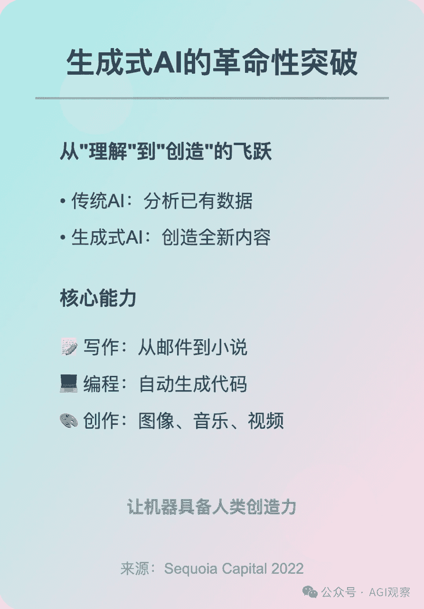
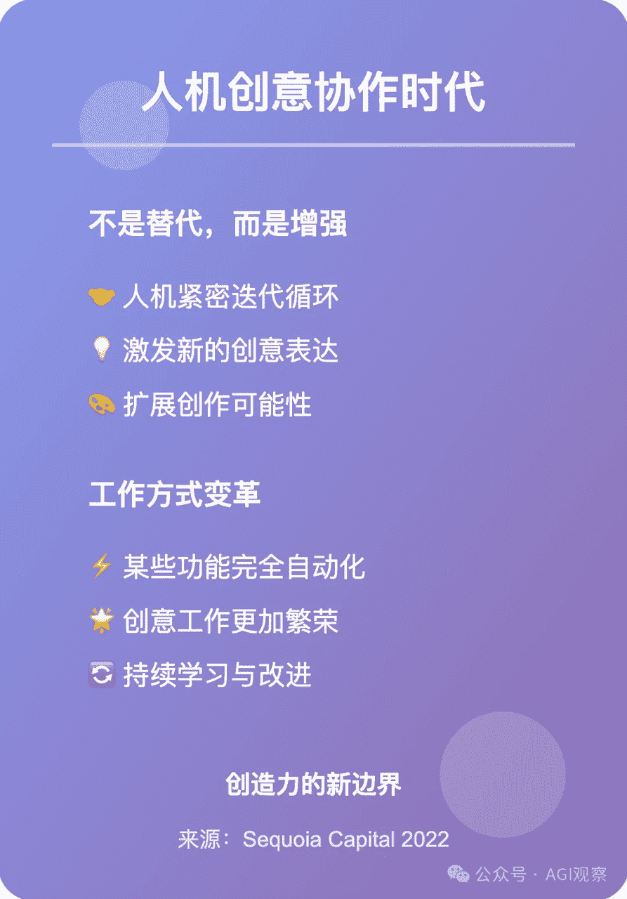
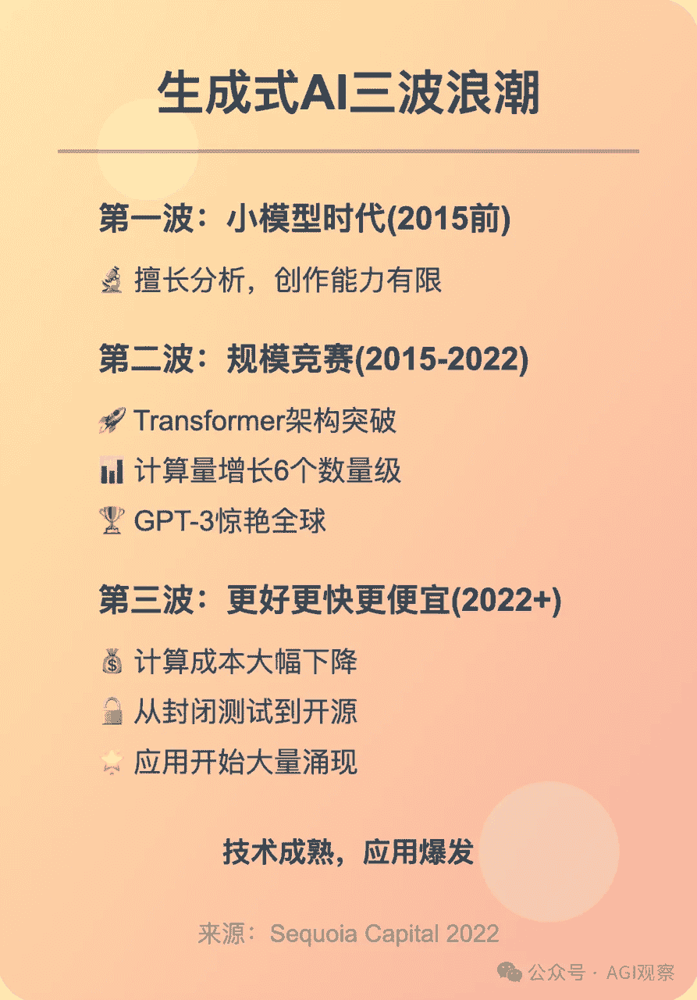
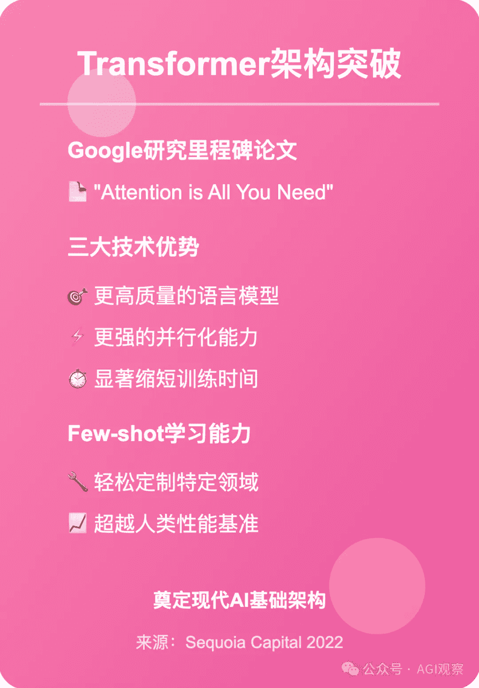
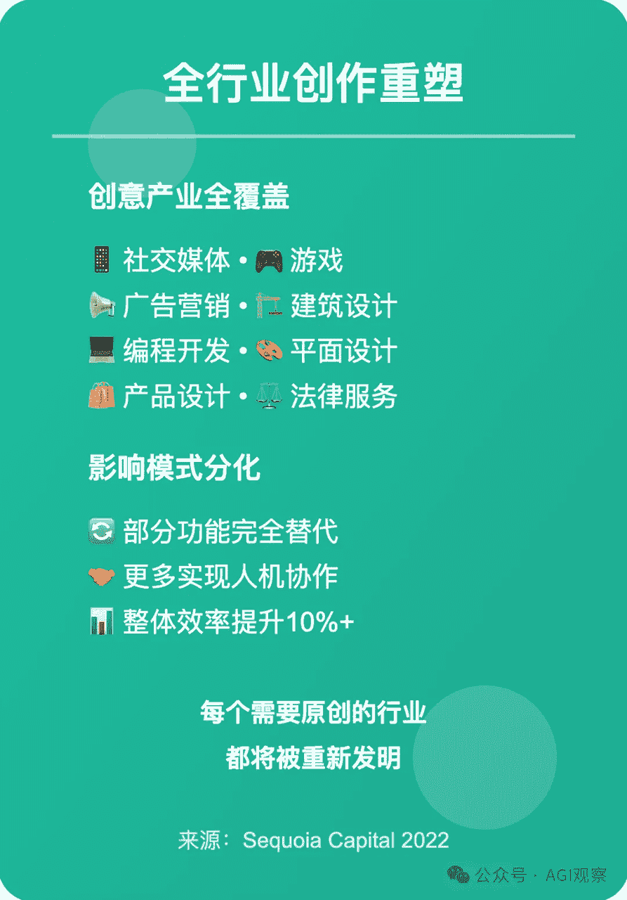
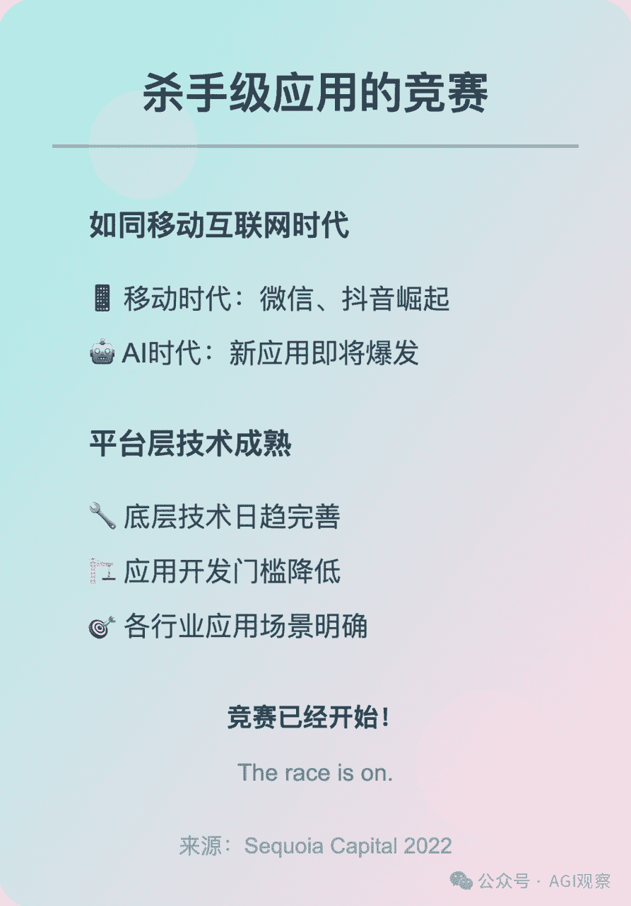
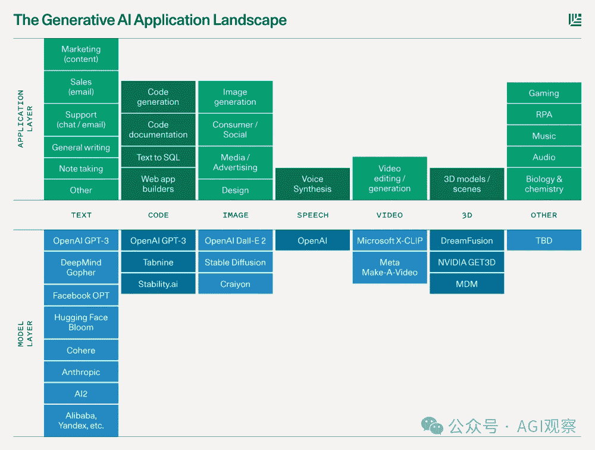
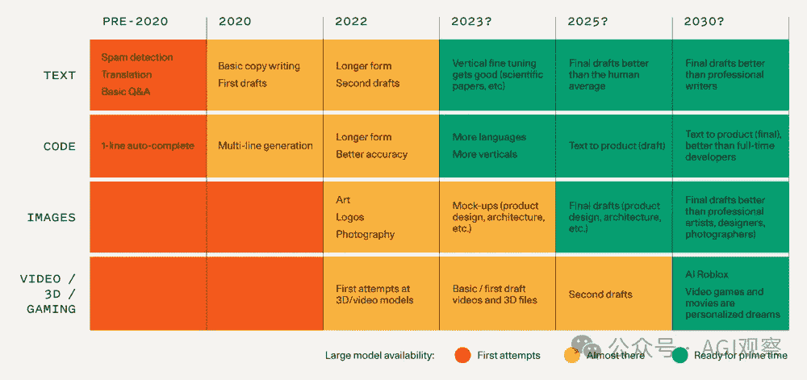
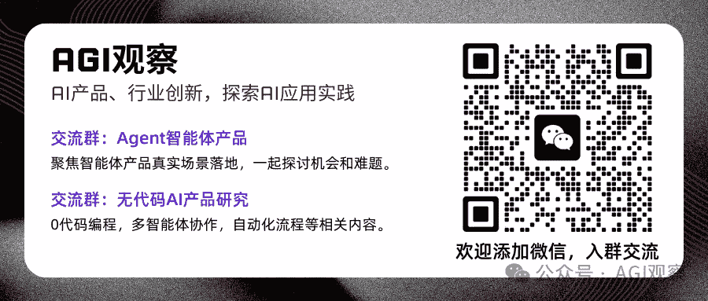

# 重读3年前红杉资本《生成式AI：一个创新的新纪元》：预测实现了多少？加速了还是滞后了？2030年前还有哪些预测？ | AGI观察

> 来源：[https://agijuejin.feishu.cn/docx/RvE9dHRgUoHE91xvgpvcSvhonpe](https://agijuejin.feishu.cn/docx/RvE9dHRgUoHE91xvgpvcSvhonpe)

欢迎关注，咨询和培训服务，联系电话13611703891

> **前言**

> 身处当下，我们常被“AI没变化”、“AI不行”等常见迷思所困。本文将带您首先戳破这些迷思，找到审视当下的稳固锚点，而后“考古”一份诞生于2023年ChatGPT前夜的关键报告《红杉资本2030年预测》（发布于2022年9月）。

> 通过回顾预测与现实的碰撞，我们将看到生成式AI技术演进的真实速度，并为理解即将到来的“智能体（Agent）时代”，奠定一个清醒且坚实的基础。最后，我的核心观点是，知识工作者“黄金时代”已经真正开启。

> 全文4000字左右，有插入4段文字的音频。

2**025 年初夏，上海梅雨季，连续一周多的阴雨天，这周终于短暂**放晴。但天气预报显示从本周末开始，新一轮的雨季即将到来。这像极了当下我们讨论AI时的心境：各种零碎的声音，如同淅淅沥沥的雨声，又仿佛身处迷雾之中，难辨方向。

在和许多企业家和朋友的交流中，常常听到一些对 AI 的讨论或者看到某些文章的观点。在展开正文之前，我想探讨几个真实的声音，也借此厘清我们的思考原点。

第一种，“AI 都火了好几年了，感觉没啥变化啊”：

以前看 AI 新闻还挺激动，现在看多了似乎有些疲劳了。是的啊，原本以为 “贾维斯”机器人即将到来，但现实是，AI似乎只是让我们的搜索方式变了，多了一些聊天工具。

“微变不觉，宏变惊人”。这是我的观点。

技术的演进并非线性，它更像地壳板块的运动：短期内只能感受到几次微弱的震动，但将时间拉长，足以看到一座座山脉的隆起。

第二种，“在中国做AI难，做AI Agent容易”：

这是看似有理有据的判断，实则是一种根本性的错误，它混淆了两者的本质。

我有一个比喻，这种“对比”就是将“研发并量产发动机（AI 大模型）”的难度，与“设计跑车并组建车队，最后赢得比赛（能真实工作的 AI Agent 软件） ”的难度混为一谈。

**前者是核心技术攻关；后者则是包含技术、产**品、市场、运营、用户在内的复杂系统工程。两者根本不是一回事。

**用这**个比喻也可以折射出一个短期的普遍困境：当企业重金将一个大模型本地部署，就好像是把一个昂贵的“发动机”搬回家，在没有合适的车体、也没有赛车场地和优秀赛车手的情况下，只是一堆昂贵且无用的零件。

**第三种：“让 AI 完成某项损坏图片识别工作，**它总是不能 100%正确，AI不行？”：

假设这句话里的 AI 具体指的是大语言模型，这里就是一个典型的能力错配问题。

这就好比，要求一个学校教授，立刻像资深外科医生那样工作，能够精准判读CT影像并定位病灶。教授很有智慧，但他的智慧不在这里。正确的结论是“我们用错了人”。对 AI，也是同理。让一个通用大语言模型，去完成一个高度精准的视觉任务，是能力错配。

第四种：“Agent技术现在是不是早期，感觉无法落地。”：

**今天的AI Agent，恰如2008年**的第一代iPhone。也许可以这样认为。

那时iPhone应用稀少、性能不稳，如果你用“诺基亚的续航时间、功能稳定”的标准去评判，结论必然是“很贵，不实用”。但今天我们回望才知道，iPhone不是对“打电话、发短信”等存量需求的替代，而是开启一个全新的“移动互联网”增量世界。Agent技术同样如此，它的早期探索必然是笨拙的，适合采用一种“发现新大陆”的视角。

这四种声音，看似是一种闲谈或者社交媒体上的碎片观点，但对身处变革时代的个人或企业而言，都可能是阻碍未来的某种误解。

**花费篇幅去辨析，并非为了统****一认**知，也不是文字游戏。我在本文开头提到，“借此厘清我们的思考原点”。“对变化无感”可能导致在 AI 布局上“错失窗口期”，当宏变来临时，将毫无还手之力，这对个人和对企业亦是如此。“技术本质混淆、应用范式误判”，可能导致资源错配，比如时间、金钱以及人才资源。以上种种迷思，都源于我们身处变革的迷雾之中，缺乏一些“稳定的认知锚点”。

那么，我们如何拨开迷雾呢？答案一定不是社交媒体的喧嚣，也不是我们日常的短暂讨论。我认为至少有两种视角可以作为“锚点”：

**一**是关注“从业者”，将目光从媒介各种“炸裂”噪音上移开，聚焦于真实的 AI 行业从业者，那些此刻在牌桌上的人；

二是回溯“来时路”，从技术的历史演进中中，寻找预示未来的可能规律。

而这，也正是本文的正式部分。首先，我们可以关注近期 AI 行业领军从业者的一场峰会。

2025 年 5 月 2 日，红杉资本（Sequoia）AI Ascent 2025 活动，汇集了 100 多位 AI 领域的领先创始人和研究人员，本次活动成为行业焦点。三位合伙人Pat Grady、Sonya Huang、Konstantine Buhler 与 AI 领导者进行了交谈，包括 OpenAI 的 Sam Altman、Nvidia 的 Jensen Huang 和 Jim Fan、Google 的 Jeff Dean、Anthropic 的 Mike Krieger、Sierra 的 Bret Taylor 等。演讲范围包括 AI 智能体的新业务模式、构建数据中心的竞赛、垂直应用程序的力量以及开源的重要性。

**本**次峰会揭示了一个处于转折点的技术生态系统：AI 从新奇到必需品，从助手到智能体，从孤立的工具到互联的 AI 经济。

the summit revealed a technology ecosystem at an inflection point: moving from novelty to necessity, from assistants to agents, and from isolated tools to an interconnected AI economy. by《Insights from AI Ascent 2025》from inferencebysequoia

**他们不再讨论 AI 能做什么，而焦点是智能体（AI Age**nt）的兴起，将创造一个全新的经济范式。这股浪潮并非一日之功。回溯到 AI Ascent 2024 活动，吴恩达分享的“智能体（AI Agent） 的四种常见设计模式”引发了广泛关注。时至今日，业界普遍将2025年视为"智能体（AI Agent）”的应用元年 - AI正加速从“聊天”，迈向真正的“工作”。

要真正理解这场由智能体引领的变革，我们不能只看当下，我们还要“考古”它的来时路。2022年9月，我们绝大多数人对大模型的感知还是一片空白。也正是在那时，红杉资本发表了一篇著名文章《生成式AI：一个创新的新世界》。这篇文章曾为我们勾勒出生成式AI应用全景和趋势预测。这篇预言“新世界”的文章，其作者就是 Sonya Huang 和 Pat Grady ，而他们当时的写作生成辅助，就是最前沿的GPT-3模型。仅仅数月之后，ChatGPT横空出世，我们在 2023 年初才真正触摸到大模型的魔力。

因此，我将“考古”这份诞生于“ChatGPT前夜”的文章。看看当初的洞见，有哪些已精准命中？又有哪些演进，完全超出了所有人的想象？这对于我们理解当下、展望由智能体定义的未来，至关重要。

### 我将首先简要概述本文的核心内容，并通过六幅图表进行直观且高效的阐释。

·生成式 AI 的革命性突破：让机器具备人类创造力

·人机创意协作时代：创造力的新边界

·生成式 AI 三波浪潮：技术成熟，应用爆发

·Transformer 架构突破：奠定现代 AI 基础架构

·全行业创作重塑：每个需要原创的行业都将被重新发明

·杀手级应用的竞赛：竞赛已经开始，the race is on！

### **这篇文章最有价值的部分，莫过于对生成式 AI 应用领域的全面梳理，以及接下**来的应用预测 20230。当初的洞见有多少已成现实，又有哪些演进完全超出了想象？

### （以下内容节选自课程《智能体设计师》

现在，我们来看屏幕上展示的“2020-2030预测生成式AI应用全景图”，这两张图来源于知名的风险投资机构红杉资本（Sequoia Capital）在2022年9月发布的一份资讯，它为我们描绘了生成式AI在不同应用领域从过去到未来的发展阶段和潜力。

左边这张图为我们揭示了生成式AI的市场格局，也就是“模型层（MODEL LAYER）”与“应用层（APPLICATION LAYER）”的关系。它清晰地揭示了在文本、代码、图像、语音、视频、3D等不同应用类别下，底层都有相应的AI模型（如OpenAI GPT-3, DALL-E 2, Stable Diffusion, Whisper等）作为支撑。这种‘模型层’和‘应用层’的对应关系，揭示了一个重要的产业趋势：强大的基础模型的出现，会催生出丰富多样的上层应用。

右边这个图表，则是“模型进展及相关应用的预测”，主要分为四个大的应用领域：文本（TEXT）、代码（CODE）、图像（IMAGES）、以及视频/3D/游戏（VIDEO / 3D / GAMING）。 对于每个领域，它都展示了 6 个时间节点，2020 年之前到 2023 预测、2025、2030年未来发展。生成式AI能力和应用的演进预测。图例说明颜色意义，不同颜色代表了不同的成熟度阶段：初步尝试、接近成熟、以及已准备好大规模应用。

**鉴于**我们现在已经身处2025年，在解读右边这张预测图时，我们不仅要看它当初的预测，更要结合近两三年来的实际发展，以一种回顾与验证的视角来看待它，同时也思考它对我们理解未来趋势仍有哪些启发。我们来进行回顾和解读：

**在文本领域，“文本生成更高质量、更长的内容和更好的垂直领**域应用，将会产生自动化和增强解决方案。”

预测到2025年，AI生成的最终稿件在平均水平上可能超越人类。回顾过去几年，特别是在GPT系列等大语言模型的驱动下，我个人认为，在AI生成的稿件平均水平方面，2024年甚至更早就已经接近或达到了当时对2025年的预测。目前，AI正在努力追赶顶尖专业作家的水平。

**在代码领域：“代码生成对开发人员产生重大影响**，使非开发人员更容易创造性地使用代码。”

预测到2025年，可以实现从文本描述到代码初稿的转换，进入“准备好大规模应用”的绿色阶段的早期。其对2030年的展望是，甚至可能实现从文本描述直接生成最终可用的产品级代码。实际上，正如您所知，过去一两年无代码和低代码开发平台发展非常迅速，技术也日趋完善。现在，利用自然语言文本描述需求，在几分钟内制作一个功能相对完整的网站或简单应用已不再是遥不可及的梦想，这印证了预测中提到的“使非开发人员更容易创造性地使用代码”的趋势。

**在图像领域：“图像生成将会创造‘艺术一代’，任何人都可以随意**探索以前需要一生才能掌握的主题和风格。”

**在视频/3D/游戏领域：“从文本到对象的设计，将会替代现有的数字产品和物理产品的原型设**计过程。使用自然语言创建可操纵的复杂场景或模型，这将是游戏领域的长期发展方向。”

总而言之，这张来自红杉资本的预测图，虽然发布于2022年，但它描绘了一个生成式AI在各个领域逐步渗透、能力不断增强并最终可能深刻改变我们工作、创造和娱乐方式的蓝图。

尽管部分预测的实现时间点已被我们今天的现实所超越，但它依然为我们提供了一个非常有价值的分析框架，帮助我们理解生成式AI在各个核心应用领域的能力演进路径和关键里程碑。更重要的是，通过回顾这些预测并对照现实，我们能更深刻地体会到技术发展的动态性和指数级潜力。它揭示的趋势是值得我们持续关注和深入思考的。当然，任何预测都带有不确定性，实际发展还会受到技术瓶颈、市场需求、伦理法规以及社会接受度等多种因素的影响。

技术的演进速度，已经远远超出了我们“目不暇接”的形容能力。这张“全景图”的前瞻性和准确性令人赞叹，在今天看来依然极具价值。“生成式AI的市场格局”主要揭示了价值创造的空间结构，而“2030 趋势预测图”说明了价值创造的时间序列。通过这次“考古”，可以看到当初的“趋势预判”已成今日的“实际应用”。现实世界沿着这条路奔跑的速度，远远超出了当时大胆的想象。

当机器在文本、代码、图像等领域的能力越来越强**，**一个更深刻、更无法回避的问题浮出水面：人该怎么办？我的观点是：生成式AI的浪潮，恰恰是知识工作者和创意工作者的黄金时代。下一篇文章，我们将深入更多关于知识工作者。

原文地址：

https://www.sequoiacap.com/article/generative-ai-a-creative-new-world

https://www.sequoiacap.com/article/ai-ascent-2025/

**------------- 📚 所有发布文**件合集分类 -------------

**观AI - 资讯类**

[【1. AGI观察精选】](https://mp.weixin.qq.com/mp/appmsgalbum?__biz=MzkxODcwNzIyMw==&action=getalbum&album_id=3810925814373842945&scene=126#wechat_redirect)- 原创精华必读

[重](https://mp.weixin.qq.com/s?__biz=MzkxODcwNzIyMw==&mid=2247485402&idx=1&sn=7ecb6f8c14e9dc2a6a2c695c7e6dfd24&scene=21#wechat_redirect)读3年前红杉资本《生成式AI：一个创新的新纪元》：预测实现了多少？加速了还是滞后了？2030年前还有哪些预测？ | AGI观察

[用 AI 创造经营收入的方法 - 增](https://mp.weixin.qq.com/s?__biz=MzkxODcwNzIyMw==&mid=2247484623&idx=1&sn=311bc73abff5ade324c19ba4509cc0cc&scene=21#wechat_redirect)强现有业务，提供咨询，创建AI产品和企业

[看](https://mp.weixin.qq.com/s?__biz=MzkxODcwNzIyMw==&mid=2247484504&idx=1&sn=2baf10ef50f25e69f86d42a25bfba6cd&scene=21#wechat_redirect)DeepSeek生态群有感：今年是看大趋势，是生态加入，也是业务重塑的好机会！附一个AI智能客服示例说明

[围](https://mp.weixin.qq.com/s?__biz=MzkxODcwNzIyMw==&mid=2247484355&idx=1&sn=df4fff824d3de9cd5b0a35b5ee860c26&scene=21#wechat_redirect)观！我在直播里听到的一个 DeepSeek 小故事，可能更理解了他们如何同时“技术创新 + 降本增效”

[《AI工具赋能：Douglas Eng](https://mp.weixin.qq.com/s?__biz=MzkxODcwNzIyMw==&mid=2247483670&idx=1&sn=68cbdb7bf8888541ba141d3e3a0f19ff&scene=21#wechat_redirect)elbart增强人类智力框架的实践启示》

[【2. AI每日快报】](https://mp.weixin.qq.com/mp/appmsgalbum?__biz=MzkxODcwNzIyMw==&action=getalbum&album_id=3801337340467937281#wechat_redirect)- 实时行业动态-2025下半年   2025AI每日快报（上半年合集）

[【3. AI阅读盘点】](https://mp.weixin.qq.com/mp/appmsgalbum?__biz=MzkxODcwNzIyMw==&action=getalbum&album_id=3840540920355094530#wechat_redirect)- 定期信息整理

用AI - 产品洞察、实际应用类

[【4. Agent智能体】](https://mp.weixin.qq.com/mp/appmsgalbum?__biz=MzkxODcwNzIyMw==&action=getalbum&album_id=3807148687709503489#wechat_redirect)- 近期更新重点

[哈佛大学肯尼迪学院领导力测试论文：“带AI Agent好的](https://mp.weixin.qq.com/s?__biz=MzkxODcwNzIyMw==&mid=2247485330&idx=1&sn=6e0cb972325574d0479999dcfcb341e3&scene=21#wechat_redirect)人，带真人也好吗？”，是的，可能性挺大的

AI故事的常态，是那些过程中的繁琐，是“基石性工作”

[热](https://mp.weixin.qq.com/s?__biz=MzkxODcwNzIyMw==&mid=2247483991&idx=1&sn=54c71f8702d60bc01b0cef457d76759b&scene=21#wechat_redirect)点 | Anthropic团队最新年终总结，分享构建有效智能体(Agent)的7个最佳实践！明年智能体落地商用加速！

[【5. AI产品洞察】](https://mp.weixin.qq.com/mp/appmsgalbum?__biz=MzkxODcwNzIyMw==&action=getalbum&album_id=3572378704149856257#wechat_redirect)- 产品，团队和商业模式

**福布斯50强AI企业**

[Clay - 用“100+数据源+AI+自动化”，销售客户线索](https://mp.weixin.qq.com/s?__biz=MzkxODcwNzIyMw==&mid=2247484993&idx=1&sn=7a8ca2fc3440aa461fe8b75b05822acc&scene=21#wechat_redirect)管理领域10倍速高速成长 | AGI观察

[Sierra 打造企业级Agent智能体客服，来](https://mp.weixin.qq.com/s?__biz=MzkxODcwNzIyMw==&mid=2247483901&idx=1&sn=630c693ae9f670b70cf0cc3cf8835a9d&scene=21#wechat_redirect)自Open AI董事长的智能体公司和产品

[Databricks 数据与 AI 融合，自研模型 + 复合 ](https://mp.weixin.qq.com/s?__biz=MzkxODcwNzIyMw==&mid=2247483897&idx=1&sn=e44a226be7c7971ec491f1072266830e&scene=21#wechat_redirect)AI 系统，应用质量和可靠性的最佳方式。

[这么多AI搜索工具，为什么Perplexit](https://mp.weixin.qq.com/s?__biz=MzkxODcwNzIyMw==&mid=2247483895&idx=1&sn=8332f8cd3509dde7314acdfaed26de22&scene=21#wechat_redirect)y AI备受瞩目？一文深度了解其典型功能

Glean - 企业级 AI 搜索和知识管理解决方案

“这个领域的天花板很高，有非常多的可能，值得长期投入。” Cursor产品

**企业应用垂直领域**

[11x - 数字员工 Alice](https://mp.weixin.qq.com/s?__biz=MzkxODcwNzIyMw==&mid=2247483906&idx=1&sn=67bc442ff1e74534a3436e7637ab26ab&scene=21#wechat_redirect) 为客户们创造了超过 1 亿美元的收入?

AlphaSense - 高质量市场情报和AI搜索平台

**C端产品**

[C](https://mp.weixin.qq.com/s?__biz=MzkxODcwNzIyMw==&mid=2247483894&idx=1&sn=b7aa482b786e08b919f121b28eded5d9&scene=21#wechat_redirect)haracter AI的产品特点、用户数据、创始人和其在谷歌的故事，了解这个有1800万个Bot的产品。

备注：“AI产品洞察”专栏文章原文发布在"🏅AGI掘金知识库"（飞书账号：Ada）

[【6. AI实用贴】](https://mp.weixin.qq.com/mp/appmsgalbum?__biz=MzkxODcwNzIyMw==&action=getalbum&album_id=3840325788161146880#wechat_redirect)- 没有炸裂，重点是“做中学”

[实](https://mp.weixin.qq.com/s?__biz=MzkxODcwNzIyMw==&mid=2247485264&idx=1&sn=e9d7f45007f300884539833f2b7d3ac1&scene=21#wechat_redirect)用贴 | 写实风格 + 装饰文字-豆包图像生成Prompt提示词：一共四组，20个全部拿走 - 交大AI课程报名

[DeepSeek能实现文→图？Mermaid实操步骤 ](https://mp.weixin.qq.com/s?__biz=MzkxODcwNzIyMw==&mid=2247484311&idx=1&sn=c90bcb58eb6c9b9f842f1769a740cdc8&scene=21#wechat_redirect)+ 工具，解锁甘特图、流程图等19种图表

[用](https://mp.weixin.qq.com/s?__biz=MzkxODcwNzIyMw==&mid=2247484486&idx=1&sn=23d5ff25297b462c162ca6c7558192d5&scene=21#wechat_redirect)DeepSeek R1 创建自定义智能体+三种应用：1.浏览器助手，2.划词指令，3.语雀文档写作助手

[DeepSeek专区已更新【AGI 掘金知识库】2025目录](https://mp.weixin.qq.com/s?__biz=MzkxODcwNzIyMw==&mid=2247484391&idx=1&sn=9d7ae7ddec3ef666a673af5e4ca6b207&scene=21#wechat_redirect)第一波新增！给大家介绍 AI 学习宝藏！

**------------- 🎯 服务简介**和联系方式 -------------

如需AI项目演示或培训需求，请您联系上述🛰️或电话13611703891，将安排对接。更多信息，可访问网站：www.kciagent.com。

**------------- 🎓 **开课报名啦！-------------

### 上海交通大学《上海交通大学 AI 经营创新领军人才精训营》

**📅 开课时间：2**025年7月11日-13日（周五-周日）

#### 📍 上课地址：上海交通大学长宁校区，上海市法华镇路535号

#### 📞 报名联系

**程老师电话：13611703891（这是我主**[讲的课程名称《数字员工与基于 AI 智能体的工作流程再造》，更](https://mp.weixin.qq.com/s?__biz=MzkxODcwNzIyMw==&mid=2247484693&idx=1&sn=8c09559aaae4e2d8510d7c4ca9552966&scene=21#wechat_redirect)多信息在这里：开课报名！AI 学习的黄金组合：经营实战+系统知识+组合路径+交大证书，上海交通大学 AI 经营创新课）杨老师电话：13671733577

