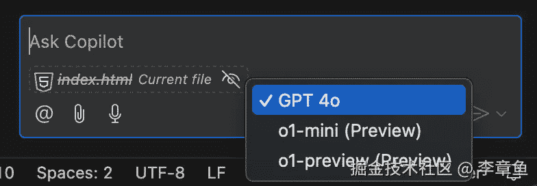
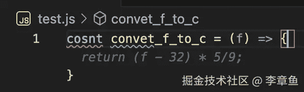
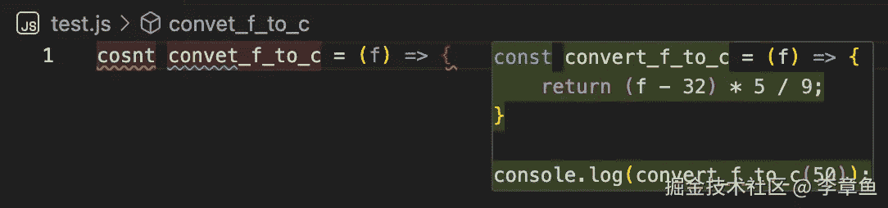
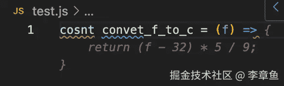
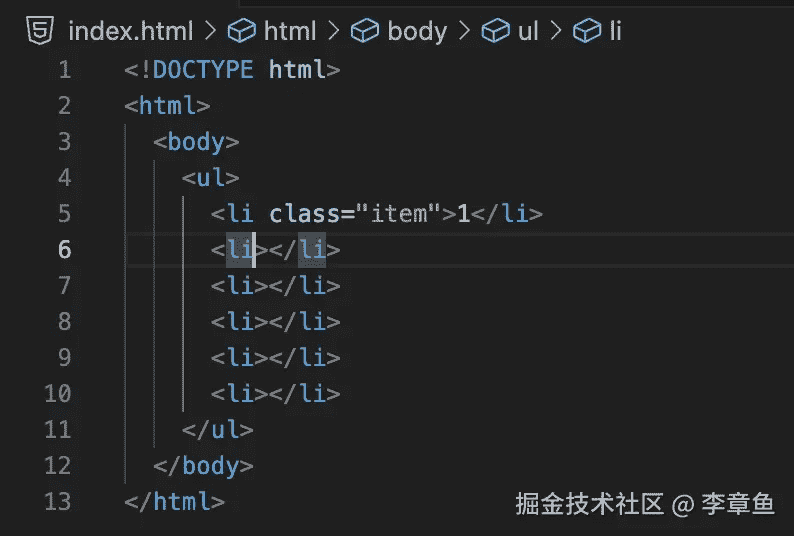
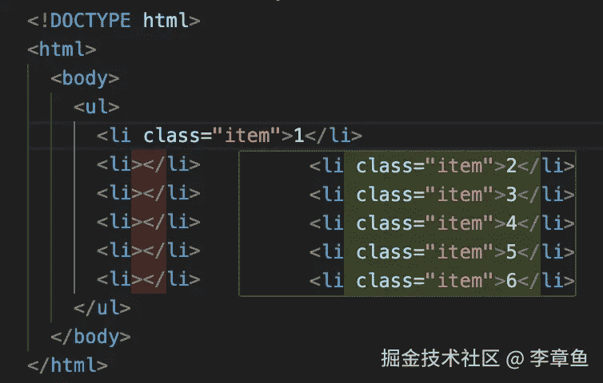
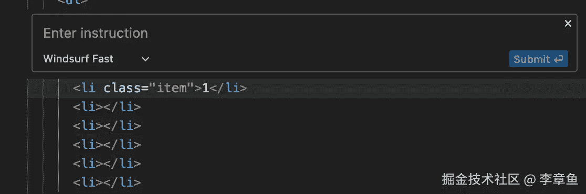
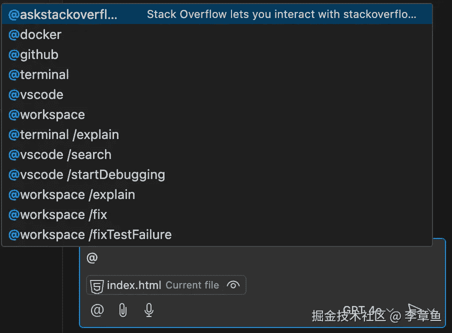
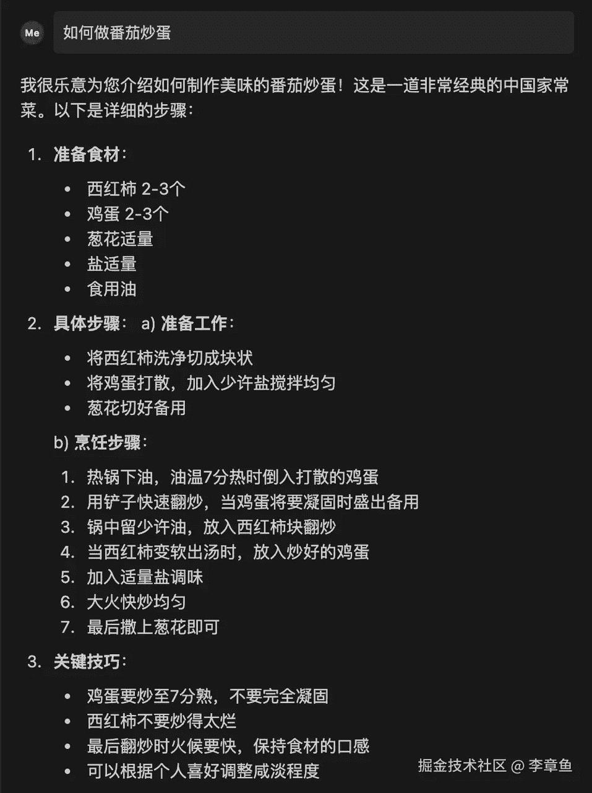
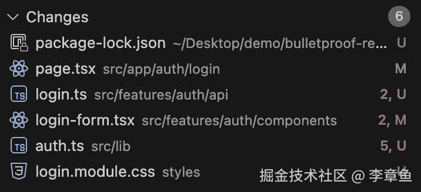

# github copilot / cursor / windsurf AI 编辑器横评

> 来源：[https://agijuejin.feishu.cn/docx/FeGSd14gKo5shDxdDzXckaCVn6b](https://agijuejin.feishu.cn/docx/FeGSd14gKo5shDxdDzXckaCVn6b)

> 作者：李章鱼

> 链接：https://juejin.cn/post/7448440471012212746

> 来源：稀土掘金

> 著作权归作者所有。商业转载请联系作者获得授权，非商业转载请注明出处。

> 今年 AI + 代码编辑器这个赛道异常的卷，各家产品迭代的非常快。本文不是那种教你“几小时通过 AI 编辑器实现一个 App”的文章，而是从一个开发者的实际日常工作体验出发，对比几款主流的 AI 编辑器产品，帮助大家找到最适合自己的工具。

> 本文所用到的产品版本如下：

+   github copilot 1.2.0 + vscode 1.93.1

+   Cursor 0.43.6

+   windsurf 1.0.0

> 请结合自己实际情况食用本文。我们开始吧。🤟

## 模型

#### github copilot

[gi](https://link.juejin.cn?target=https%3A%2F%2Fgithub.com%2Fsettings%2Fcopilot)thub copilot 默认使用 gpt-4o 模型，目前在后台可以看到有一项 Preview 功能，打开后可以支持 claude 3.5 sonnet 模型。

我在我的账号下打开了 claude 3.5 sonnet 模型，但是在 github copilot 没有看到 copilot 的模型切换选项。不知道是不是因为我的账号是试用期的缘故。

其他可使用的模型还有：

+   o1-mini

+   o1-preview

#### Cursor

cursor 默认使用 claude 3.5 sonnet 模型。 其他可使用的模型还有：

+   openAI 家的几乎所有模型

+   Anthropic 家的几乎所有模型

你也可以通过填写 api key 的方式使用其他模型，需要注意的是，像 cursor 中的 composer 功能，只能使用 claude 3.5 sonnet 模型。

#### windsurf

windsurf 默认使用 claude 3.5 sonnet 模型。 其他可使用的模型还有：

+   gpt-4o

+   cascade-base

其中，cascade-base 是 windsurf 的专属模型，基于  Llama 3.1 70B 模型微调而来，所有用户可以免费使用。

### 总结

目前看 Cursor 是可选模型最多的，在主流的模型中，目前 claude 3.5 sonnet 模型在编程领域表现最好。在选择 AI 编程助手时，可以优先考虑支持 claude 3.5 sonnet 模型的产品。

## 自动补全

> tab 键取代了 ctrl + c / ctrl + v，成为了程序员最好的编程伴侣🫰

自动补全是 AI 编辑器最基础的功能，也是最常用的功能。

### 编写一个摄氏温度转换器

#### github copilot

编写了函数名字，可以看到 copilot 自动补全了函数体，我在这里写错了 const 关键字，拼错了单词 convert，但是 copilot 没有纠错，而是继续补全了函数体。

#### Cursor

不得不说，Cursor 的自动补全体验非常丝滑，我写错了 const 关键字，Cursor 自动纠错，并补全了函数体。

#### windsurf

windsurf 的体验类似于 github copilot。

### 编写一个 html 列表

#### github copilot

我编写了一个 html 列表，期望是 AI 帮我补全剩下的 class 和文字，但是 copilot 没有给出任何提示。看来是在这种光标在行内的情况，和跨行的情况，copilot 会无动于衷。

#### Cursor

cursor 直接猜到了我想要什么，并补全了剩下的代码。cool！

#### windsurf

windsurf 的体验类似于 github copilot，不再赘述。

### 总结

自动补全是 AI 编辑器最基础的功能，也是最常用的功能。在体验上，Cursor 可以说是完胜。

## chat

这三家在对话能力上都大同小异，你可以通过侧边面板唤起 chat 功能，和 AI 对话。

也可以通过快捷键在代码内唤起 chat 功能。

甚至可以在终端通过快捷键唤起行内 chat 功能。

#### github copilot

copilot 在交互上可能是做的最丰富的，比如你可以通过 / 快捷键使用 /fix, /explain 等快捷命令。以及 @ 快捷键使用 @github, @vscode 等命令询问具体领域内的内容。

> copilot 还有自己的插件市场，你可以安装像 docker，stackoverflow 这种第三方插件。

#### Cursor

cursor 的交互体验也非常丰富，比较好用的是像 @doc 可以添加具体文档作为 cursor 的上下文，比如在使用某些 cursor 不知道的冷门库时，可以主动添加文档作为上下文。还有像 @web 可以让 cursor 访问互联网，获取最新的信息。

#### windsurf

windsurf 的交互体验是最简洁的，没有什么特别的亮点，不再赘述。

### 总结

对话能力主要还是依赖背后的模型，三家主要是在交互体验上做了一些优化。值得一提的是，copilot 的对话限制比较严格，只能询问编程相关的知识，而 cursor 和 windsurf 则很乐意回答我的任何问题，比如我在写这篇文章时，正好也在做饭，cursor / windsurf 很乐意告诉我西红柿炒鸡蛋的做法。

## composer

Composer 最开是 cursor 推出的功能，简单来说就是支持通过自然语言指挥 AI 做多文件的修改，甚至于生成一个完整的项目。

以下实验来自于 github 上的一个项目，我通过自然语言指挥 AI 修改了项目中的代码。

prompt：

**新加功能：使用 tab 栏切换登录方式，当前项目已经支**持邮箱和密码登录，新增加账号密码登录功能

#### github copilot

+   github copilot 一开始没有搞清楚在哪里写代码，在项目中创建了一个 pages 文件夹，然后开始写代码。

+   我指正后，我手动把实际应该修改的文件目录 src/app 添加到 github copilot 的上下文后，github copilot 开始修改代码，但还是没有成功，仍然在 pages 文件夹中写代码。

#### Cursor

+   cursor 也是一开始就没搞清楚在哪里写代码，在项目中创建了一个 pages 文件夹，然后开始写代码。

+   我指正后，手动把实际应该修改的文件目录 src/app 添加到 cursor 的上下文后，cursor 开始修改代码，这一次 cursor 理解了我的意思，代码在正确的地方修改了。

+   我发现 cursor 新写的代码引用了 antd，我告诉它不要用组件库，直接使用 tailwindcss 写样式，cursor 也照做了。

+   最后，cursor 生成了一个完整的项目，包括了登录和注册功能，简单看了其修改的内容，包括了我想要的样式和交互，以及使用 zod 做了一些简单的表单验证。

#### windsurf

由于 windsurf 主要的功能是 agent，我们将在下一节详细介绍。这里就不再赘述。

### 总结

在 composer 能力上，相比 github copilot，cursor 胜出。

## agent

agent 是 windsurf 的核心功能，很像是 composer 的增强版。在和 agent 的对话中，能感知到 agent 更像是一个人类的行为模式，agent 会一步一步思考，如果出错了，还会尝试纠正错误，直到完成任务。

在 windsurf 推出 agent 后，cursor 也推出了自己的 agent 功能，这一部分主要是对比 windsurf 和 cursor 的 agent 能力。 以下是我让 windsurf 和 cursor 分别要生成的一个计算器项目，由于两家现在都支持上传图片，所以我就上传了一张 macOS 上的计算器图片作为参考：

#### windsurf

+   windsurf 接收到指令后开始请求我使用 npx create-next-app 命令，创建一个 next.js 项目，我点击 accept；

+   创建项目时有一个要不要使用 turbopack 的选项，windsurf 没有办法处理, windsurf 没有管开始继续写代码；

+   windosurf 过了一会儿写完代码了，请求我运行代码，我点击了 accept；

+   由于上一步卡在了要不要使用 turbopack 的选项，nextjs 项目没有创建成功。在 windosurf 写完代码让我运行时报错了；

+   windsurf 请求删掉代码重新开始生成，我点击了 accept；

+   这一次 windsurf 没有再卡在要不要使用 turbopack 的选项，通过 npx create-next-app@latest . --tailwind --typescript --eslint --app --src-dir --use-npm --no-turbo --yes 命令创建了项目；

+   windsurf 又一次写完了代码，请求我运行代码，我点击了 accept；

+   这一次的结果中，样式代码没有被引入，我文字提醒 windsurf 需要引入样式，windsurf 开始修改代码，并写完了代码。

最终效果还是相当不错的：

#### cursor

+   cursor 接收到指令后开始请求我使用 npx create-next-app 命令，创建一个 next.js 项目，我点击 run command;

+   cursor 遇到了同样的问题，创建项目时有一个要不要使用 turbopack 的选项，cursor 没有办法处理, cursor 没有管开始继续写代码；

+   cursor 过了一会儿写完代码了，请求我运行代码，我点击了 run command;

+   由于上一步卡在了要不要使用 turbopack 的选项，nextjs 项目没有创建成功。在 cursor 写完代码让我运行时报错了；

+   cursor 请求删掉代码重新开始生成，我点击了 run command;

+   这一次 cursor 和 windsurf 不一样，还是卡在了要不要使用 turbopack 的选项；

+   没有办法，我还是手动执行了 npx create-next-app@latest . --tailwind --typescript --eslint --app --src-dir --use-npm --no-turbo --yes 命令创建了项目；

+   cursor 开始继续写代码，请求我运行代码，我点击了 run command;

+   第一次生成的样式有点奇怪，我截图发给 cursor，cursor 又一次修改了代码。

最终效果还是有一些瑕疵，但是整体上功能都还算正常。

### 总结

在 agent 能力上，windsurf 看起来比 cursor 更智能一些，这一次 windsurf 胜出。

## 自定义规则

#### github copilot

可以使用 .github/copilot-instructions.md 文件设置自定义规则。

#### cursor

可以使用 [.cursorrules](https://link.juejin.cn?target=https%3A%2F%2Fdocs.cursor.com%2Fcontext%2Frules-for-ai) 文件设置自定义规则。

#### windsurf

可以使用 [.windsurfrules](https://link.juejin.cn?target=https%3A%2F%2Fdocs.codeium.com%2Fwindsurf%2Fcascade%23workspace-rules) 文件设置自定义规则。

## 语言

这里的语言指的不是编程语言，而是自然语言。

作为一个中文作为母语的开发者，我更倾向于使用中文和 AI 对话，在这一点上，cursor 做的最好。

windsurf 有时候我的中文问题会用英文回复我。

而 copilot 在自动生成代码注释之类的工作时更倾向于使用英文，哪怕我使用了 .github/copilot-instructions.md 文件设置自定义规则请优先使用中文，也仍然会使用英文。

## 价格

由于大模型的成本，这三家都是付费订阅模式。

#### github copilot

最便宜的方案是 10 美元/月，可以免费试用 1 个月。

#### cursor

最便宜的方案是 20 美元/月，可以免费试用两星期。

#### windsurf

最便宜的方案是 15 美元/月，可以免费试用两星期。（windfsurf 在刚上市的时候是 10 美元/月，但是后来涨价了, 如果你在刚上市时就注册了，那么你仍然可以享受 10 美元/月的优惠）。

#### 总结

价格上来看，最实惠的还是 github copilot，如果比较在意价格，那么可以优先考虑 github copilot。

## 总结

在我的体验中，最适合我的还是 cursor，其次是 windsurf，最后是 github copilot。

cursor 更好的扮演了一个编程助手的角色，他的代码补全能力让我感到非常惊艳。

windsurf 的 agent 做的确实很棒，很适合用来生成项目，对于没有太多编程经验，但是需要通过 AI 生成项目的人来说，windsurf 是一个不错的选择。

github copilot 经常被批评为最不思进取的一个，在和 cursor / windsurf 的对比中，很多地方都不如这两家，但是最近两个月明显能看到 github copilot 开始频繁的更新，由于 github copilot 背靠微软 和 github，我对 github copilot 的未来还是很看好的，而且 github copilot 的价格也是最便宜的。对于在意性价比的开发者，github copilot 是一个不错的选择。