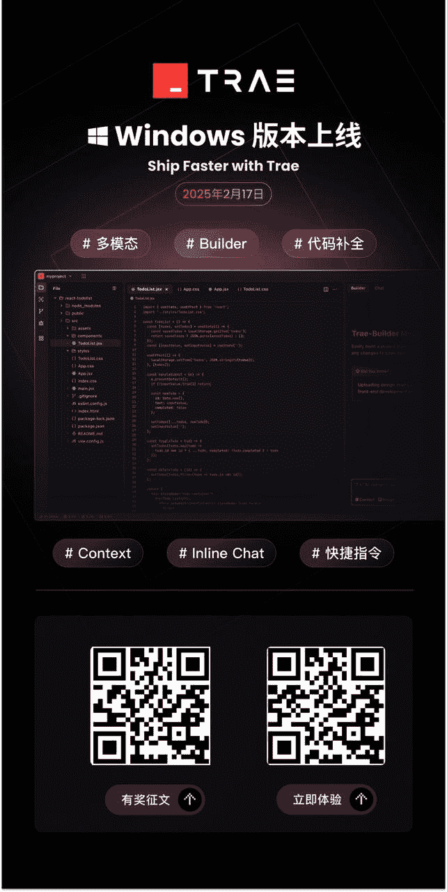

# 2月20日 (周四) 快速体验AI编程 - Trae直播讲解

> 来源：[https://agijuejin.feishu.cn/docx/U0A5dp95foGHV7xlsm2cxifbn96](https://agijuejin.feishu.cn/docx/U0A5dp95foGHV7xlsm2cxifbn96)

> 作者：Ada (AGI 掘金社区共建者 | 公众号AGI观察）

> 链接：https://mp.weixin.qq.com/s/stm7bu7aQjAFHC0c0dhkEw

我有两个特别关注的领域：

去年开始始终关注着** Agent 智能体产品**的发展，并且为此做了一些产品研究，同时我也为智能体课程的持续充实，每期课程都必定迭代40%的课件。

AI 编程方面，去年9月我写过一篇关于 Cursor 的文章（Cursor｜软件开发行业新变革），深入挖掘后发现，这一领域正以惊人的速度改变着软件开发的格局。AI 编程和无代码 AI 均属于人工智能技术驱动的开发方式，但两者在技术实现、用户群体和应用场景上存在显著差异。目前，两者在定义和用户方面有着明显的区别：

作为非技术人员，去年开始**重点关注无代码 AI 产品**。昨天晚上才和安老师聊到这个，今天安老师就更新的这个工具，所以邀请他给我们做一次直播。

当我在群里发出这个话题的时候，有很多回复，比如：

“今天上午开始，试用了一天。对文科生真的非常友好。可惜我卡死在底层的那些软件安装上”

“可以讲讲咋写一个网站代码 and 最终部署网站吗？就是这块儿完全不懂耶！有刷到一些教程是用什么 cloud 什么解析域名什么看得我一脸懵”

“反正我整了一天，心态基本崩了。确定一件事儿，程序员是绝对不会失业的，毕竟教小白们设置环境变量，也能月入过万”

“我试着搞个网页，全部文件它已经搞好了，运行时要设置本地环境，然后，就没有然后了”

## 周四晚上，来学习！全部给大家解决

> 直播内容： Trae - 划重点：

> 用 Trae 可以零代码可以生成软件！

> 不会代码，也能开发小游戏或者日常提效工具，只要你有想法！

> **人人都是 AI ****程序员**

> 用 Trae！人人都 可以是产品经理！

### 今天直播内容速览：

#### 详细介绍Trae，从第一步安装开始，讲解Windows 和MacOS 安装步骤。

#### 演示如何使用Trae进行基本操作，

#### 带你快速上手“贪食蛇游戏”，遇到卡点怎么办？总结新手学习技巧给你。

#### 零代码开发实战，复刻Trae文档网站，讲解快速发布到互联网的方法

#### 解答疑问

# 直播链接

会议主题：快速体验AI编程 - Trae直播讲解

**会议时间：2月20日 (周四) 2**0:00 - 21:30 (GMT+8)

**官网直播链接：****https://juejin.cn/li**ve/aiforcode2025vol1

**直播过程中可参与抽奖，荣事达早餐机、小熊电烧烤炉、抖**音文创水晶球马克杯等精美好礼等大家来拿～

# 直播嘉宾：

> 安仔，一个热爱分享、致力于用最浅显易懂的大白话传播 AI 知识的程序员。以下是我的一些个人标签：

+   AGI 掘金社区共建者

+   《Coze 从入门到实践：全面掌握 AI 智能体》掘金小册作者

+   创业者，技术架构师

+   海外公司技术顾问

> 安老师掘金平台直播历史：https://juejin.cn/live

