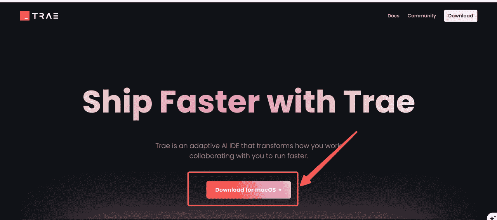
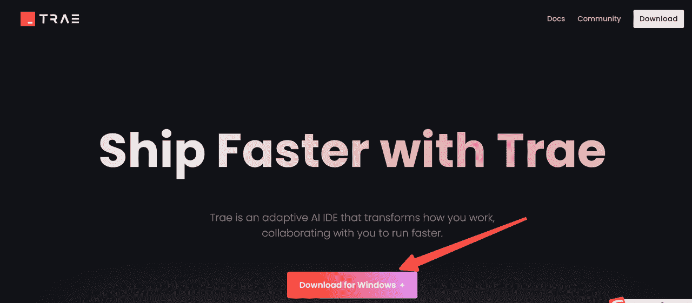
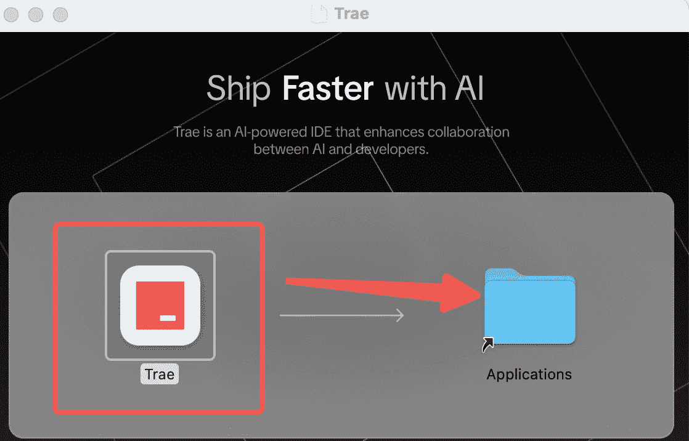
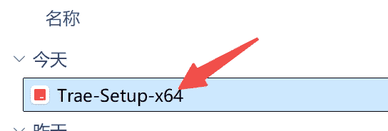
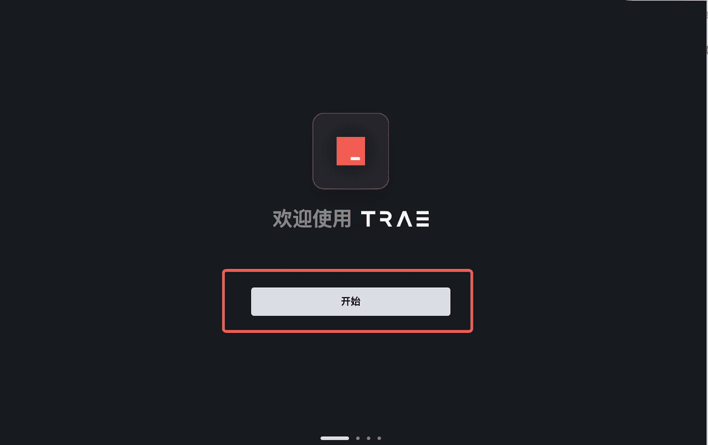
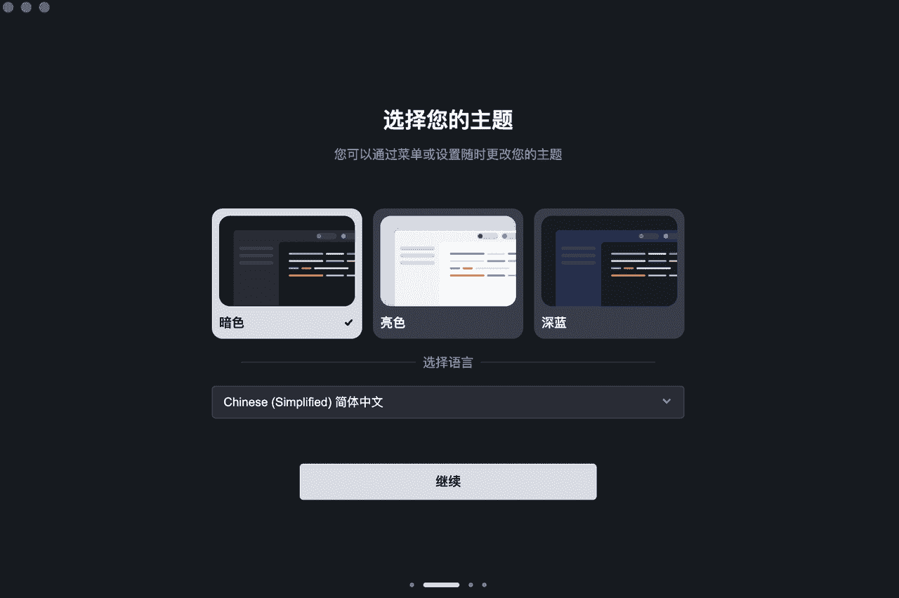
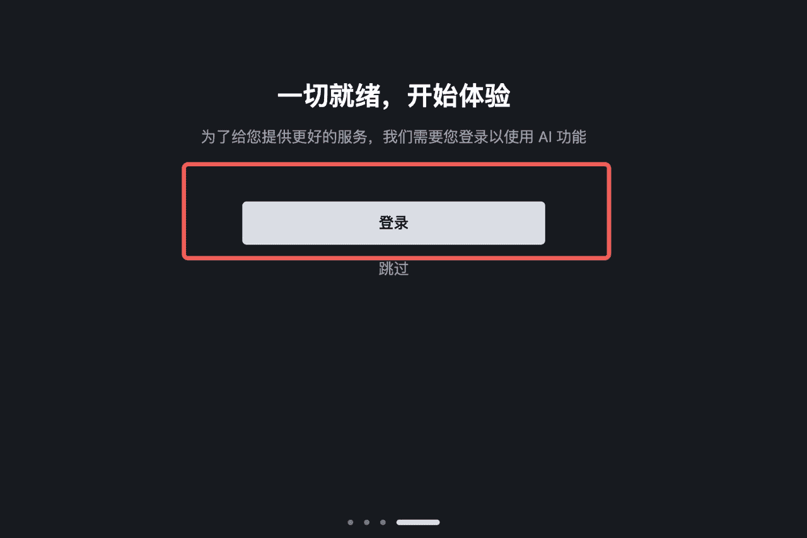

# AI For Code 工作坊-锦囊记录

> 来源：[https://agijuejin.feishu.cn/docx/QoEbdkI34oEc3axyxB7czVfYnEU](https://agijuejin.feishu.cn/docx/QoEbdkI34oEc3axyxB7czVfYnEU)

> 最新直播直通车>>>https://live.juejin.cn/5982/aiforcode2025vol10

# 今天晚上的直播：

# 用Trae玩转多维表格插件｜AI for Code工作坊 Vol.10

https://live.juejin.cn/5982/aiforcode2025vol10

# **Trae 下载链接**

* 国内版：https://www.trae.com.cn/?utm_source=juejin&utm_medium=juejin_trae&utm_campaign=aiforcode2025vol10

* 海外版：https://www.trae.ai/?utm_source=juejin&utm_medium=juejin_trae&utm_campaign=aiforcode2025vol10

## **国内版下载二维码**

## **海外版下载二维码**

# **创意挑战赛🛰️群**

# **提问问卷收集**

# [第九期直播回放](https://juejin.cn/live/aiforcode2025vol9)

直播回放：https://juejin.cn/live/aiforcode2025vol9

直播讲义：https://tcnwqjuuv80v.feishu.cn/wiki/TsmZwvajligZo2kPnBJc0SoDn0b

# 工作坊社群

🔥如有问题欢迎加群咨询🔥

# [第八期直播回放](https://juejin.cn/live/aiforcode2025vol8)

直播回放：https://juejin.cn/live/aiforcode2025vol8

直播讲义：[答案之书全平台App（IOS+Android+Web）](https://zcnpwpr71iu9.feishu.cn/wiki/VXehwQlrsiUOpRkuzsvcZ1eYnUh)

# 工作坊社群

🔥如有问题欢迎加群咨询🔥

# [第七期直播回放](https://juejin.cn/live/aiforcode2025vol7)

直播回放：https://juejin.cn/live/aiforcode2025vol7

# 工作坊社群

🔥如有问题欢迎加群咨询🔥

# [第六期直播回放](https://juejin.cn/live/aiforcode2025vol6)

直播回放：https://juejin.cn/live/aiforcode2025vol6

直播记录：https://bytedance.larkoffice.com/docx/DZoqdHtokoNj04xHLwxcgJqenwd

# 工作坊社群

🔥如有问题欢迎加群咨询🔥

# [第五期直播回放](https://live.juejin.cn/5982/aiforcode2025vol5)

本期直播嘉宾江昪带来了使用 Trae 挑战不碰代码上线一个订阅服务管理工具，欢迎大家观看学习！

感兴趣的小伙伴欢迎扫描下方二维码进入AI FOR CODE 工作坊交流讨论。

[3月12日.mp4](https://internal-api-drive-stream.feishu.cn/space/api/box/stream/download/all/AUqtbC3c1oRSsGxFsLJcAodWnAd)

# 工作坊社群

🔥如有问题欢迎加群咨询🔥

# [第四期直播回放](https://live.juejin.cn/5982/aiforcodeVol4)

本期直播月影（吴亮）带来了用 Trae 做个抽奖软件，欢迎大家观看学习！

感兴趣的小伙伴欢迎扫描下方二维码进入AI FOR CODE 工作坊交流讨论。

[3月7日.mp4](https://internal-api-drive-stream.feishu.cn/space/api/box/stream/download/all/R2OcbyVuConnWMxjK9BcmtyqnGx)

# 工作坊社群

🔥如有问题欢迎加群咨询🔥

# AI FOR CODE工作坊创意挑战赛暨Trae国内版发布

> AI FOR CODE工作坊创意挑战赛暨Trae国内版发布

本期直播宣告了「AI FOR CODE创意挑战赛」的启动，同时宣布了 Trae 国内版的上线，欢迎大家观看！

感兴趣的小伙伴欢迎扫描下方二维码进入AI FOR CODE 工作坊交流讨论。

[3月4日.mp4](https://internal-api-drive-stream.feishu.cn/space/api/box/stream/download/all/GfSab1x9voO7jDx2Ue0cN1DFn2U)

# 工作坊社群

🔥如有问题欢迎加群咨询🔥

# [第三期直播](https://live.juejin.cn/5982/aiforcode2025vol3)[回放](https://live.juejin.cn/5982/aiforcode2025vol3)

> **第三期直播讲义**

> 直播讲义: https://bytedance.larkoffice.com/docx/ZtO3dK0AqoKhjhxT0K4c5UJEnoJ

本期直播嘉宾Marscode 技术团队的孙宁远和刘夏带大家了解 DeepSeek 原理，玩转 AI 编程 Chat 场景，欢迎大家观看学习！

感兴趣的小伙伴欢迎扫描下方二维码进入AI FOR CODE 工作坊交流讨论。

[2月28日.mp4](https://internal-api-drive-stream.feishu.cn/space/api/box/stream/download/all/ERE4bwjlCoSB1txpbGBcmWMdn3f)

# 工作坊社群

🔥如有问题欢迎加群咨询🔥

# [第二期直播回放](https://live.juejin.cn/5982/aiforcode2025vol2)

> **第二期直播讲义**

> 讲义1:[未命名文档](https://pcailn1nxq.feishu.cn/docx/F43DdCjhIogn6yxR85MceRttnmh)

> 讲义2:[Trae编程工具上下文使用及代码补全的实用技巧](https://pcailn1nxq.feishu.cn/docx/OyASduomro2CtLxbP1Bc8WlKnAg)

本期直播嘉宾坚果带来用 Trae 重构 PicGo 插件，Gitcode 图床一键搞定，欢迎大家观看学习！

感兴趣的小伙伴欢迎扫描下方二维码进入AI FOR CODE 工作坊交流讨论。

[2月28日 (3).mp4](https://internal-api-drive-stream.feishu.cn/space/api/box/stream/download/all/FScdbJdyEo4RLHxCgDMcYQdLnYe)

# 工作坊社群

🔥如有问题欢迎加群咨询🔥

# [第一期直播回放](https://live.juejin.cn/5982/aiforcode2025vol1)

> 第一期直播讲义：[Trae - 保姆级零代码交互开发你的第一个工具](https://agijuejin.feishu.cn/docx/PeH3dWrgBoMUjnxDOsochfqynLb)

本期直播嘉宾安仔带来快速体验AI编程——Trae直播讲解，欢迎大家观看学习！

感兴趣的小伙伴欢迎扫描下方二维码进入AI FOR CODE 工作坊交流讨论。👇

[2月24日(1).mp4](https://internal-api-drive-stream.feishu.cn/space/api/box/stream/download/all/Nn6ebJOh2ohzwDxqr2tceua8nsc)

# 工作坊社群

🔥如有问题欢迎加群咨询🔥

# ⭐️Trae的安装与注册⭐️

1.  访问地址：[Trae.ai](https://www.trae.ai/?utm_source=juejin&utm_medium=juejin_trae&utm_campaign=aiforcode2025vol2)

1.  下载（分Mac &Win 版）

| 下载Trae -点击下载（Mac版） | 下载Trae -点击下载（Win版） |
| --- | --- |
|  |  |

1.  装机（分Mac &Win 版）

| 【Mac版】将trae图标拖入applications（中文名：应用程序）文件夹进行装机 | 【Win版】在下载文件夹中点击安装包 |
| --- | --- |
|  |  |

1.  【从此步骤开始不区分Mac/Win，即两种版本帐号注册方式一致】软件装机完成后，按软件引导提示进行注册

1.  可以根据个人喜好选择主题颜色和语言

1.  可以自主选择是否配置命令，如不需要，可以点击跳过，进入账号登录页面

1.  账号登录页面——选择登录按钮进行初次注册

1.  三种注册方式（分账号授权以及直接注册）

此环节开始有部分步骤需要配置🛜环境，可根据步骤提示进行配置

| **账号授权1:Github 授权** | **账号授权2:Google 授权** | **直接注册** |
| --- | --- | --- |
| 选择Github授权登录 | 选择Google授权登录 | 个人邮箱直接注册 |

1.  **✅无论是git**hub账号还是google账号，授权成功后，会跳转回Trae页面，则为注册成功。

⚠️注册完成后的两种情况：

| **ip在国内** | **ip在国外** |
| --- | --- |
| 此处跳转回Trae官网页面，Trae页面会显示App Unavailabe，此时需要手动配置全局🛜环境至软件可用的国家或地区，清单在此文档最后的链接。 | 首先会显示login  successful 角标，其次跳转软件使用以及下载页面 |

💡注册完成后，不会自动登录，登录以及使用需要可以访问谷歌的🛜环境，如果登录后退出，也需要重新配置🛜环境进行登录。

白话：不注册不登录可以用ide但用不了 AI 功能（chat&builder），只要登录了就可以无限制使用功能。并且完成登录后，没有谷歌🛜环境也可以正常使用全部功能。

目前可支持的国家或地区详见：

https://docs.trae.ai/docs/supported-countries-and-regions?_lang=zh

🔥如有问题欢迎加群咨询🔥（同上）

# 🎁问卷抽奖🎁

每人仅限填写一次，若不符合资格，活动方有权取消获奖资格。

活动规则&时间详见问卷细则，最终解释权归掘金侧所有。

https://bytedance.larkoffice.com/share/base/form/shrcnfqcvwx51ESkVwuPrJK7ofh