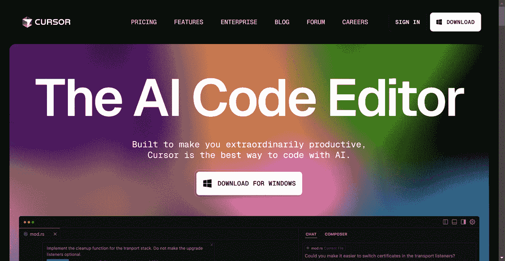
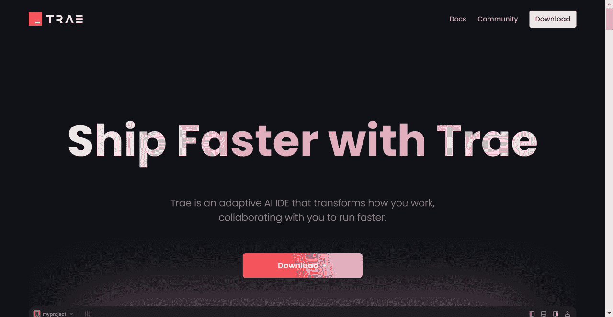

# 前言

> 来源：[https://agijuejin.feishu.cn/docx/Ex7BdtoaZoI7Sgxm5X0c9W8InNf](https://agijuejin.feishu.cn/docx/Ex7BdtoaZoI7Sgxm5X0c9W8InNf)

# 你将获得

+   开篇：了解业内 AI 编码的发展以及 Trae AI 与其他产品的异同

+   基础篇：Trae AI 的基础用法，Chat、补全、基础设置

+   进阶篇：Trae AI 的进阶用法，语境、Fast Apply、Builde 及 Git 补救手段

+   实践篇：基于 Trae AI 搭建常见的前端应用，SSR、CSR、SSG

# 作者介绍

祯民，字节跳动前端开发工程师，字节跳动青[训营讲师，曾在](https://www.trae.ai/?utm_source=juejin&utm_medium=juejin_trae&utm_campaign=trae_book)抖音团队支持安全业务，现 Trae AI 成员。掘金小册《SSR实战：官网开发指南》、《前端自动化测试精讲》、清华大学出版社 《生成式AI应用开发：基于OpenAI API实现》作者。

# 小册介绍

> 笔者虽然为 Trae AI 开发成员，但该小册仅代表笔者作为 IC 的个人实践体验和看法，并不代表 Trae AI 团队的任何观点和长期规划，更多与 Trae AI 的相关信息请以 Trae AI 官网描述为准。

> Trae 下载地址：https://www.trae.ai

自从 2023 年初 GPT-3.5 掀起 LLM 热潮后，每个行业都因为 AI 产生了翻天覆地的变化，AI 开始融入各行各业并产生效率和工作形态的改变。以互联网领域为例，就包含但不限于以下变化：

首先是基建层的逐步完善，各类基础** LLM 模型服务被推出，**它们可以类比为操作系统或者各类云厂商平**台，大趋势将逐步作为基**座形态稳固并开源，随着赛马竞争的产生，最后获胜的几家将成为未来模型行业的底层基座。前几年从零训练模型的工作模式将越来越少，未来更多将是基于这些基础 LLM 模型的微调与扩展。

除模型服务外的基建层，还有多种检索增强的方式用来扩展模型的上下文，使得模型可以更加了解用户，做到真正意义的个性化推荐。就像几年前的今日头条和抖音，之所以能脱颖而出，并不完全是因为技术实现层面多牛逼，而是它在正确时间做出了正确的决策，对用户的个性化视频推荐是最大的卖点。检索增强使得模型可以在各种垂类场景针对用户的习惯、场景进行更精准地答复，未来个性化的模型服务将会成为大的趋势。

而基建层的逐步完善将加速应用层的接入，并从各个层面提高应用层的能力。以 AI 编码为例，在几个月前 Cursor、Windsurf 的出世惊艳了很多开发者，与常规的 AI Extension 不同，Cursor 将 AI 能力集成到 IDE 中，AI 将对用户在 IDE 中所有的操作和行为路径都具备掌控力。

大量的用户路径、代码信息等内容的检索增强下，再配合能力在线的基础能力模型（例如 Cursor 3.5），创造了很多代码编程的奇迹，包含但不限于代码补全、个性化 Chat、问题修复、AI Agent 等多个能力，真正意义上地降低了编程门槛和提高了代码开发的效率。

虽然 Cursor 的能力足够惊艳，但它毕竟是一款由海外开发的应用产品。不考虑 VPN 等海外访问使用难度，收费各方面也是比较昂贵的，同时核心技术在海外会导致国与国竞争的垄断，像 ChatGPT 等应用一直有对中国地区的封闭。但因为 IDE 的开发门槛和技术难度都非常高，所以国内一直没有类似的竞品项目可以发布。

而 [Trae AI](https://www.trae.ai/) 就是为了解决这个问题，由字节跳动 IDE 团队开发的对**标 Cursor 的 AI IDE，它是**第一款由中国团队开发的基于 VSCode 内核的自研 AI IDE 桌面端产品。Trae AI 团队有大量业内知名专家，比如大家耳熟能详的天猪、死月，技术氛围浓厚平等，而且经过整个团队较长时间周期的研发、测试和严格的功能验证后才正式推出，欢迎大家的试用!

本小册将从 Trae AI 开发者及社区 IC 的角度为大家介绍 Trae AI 提供的功能以及它与其他竞品的异同，由浅入深，由理论到实践地引导大家使用 Trae AI 对开发进行提效。

# 目标用户

所有的计算机从业者都值得一试，不限于技术栈、工种类别。

# 课程介绍

2023年，GPT-3.5掀起了LLM（大语言模型）热潮，最近国产模型 DeepSeek 将热潮推到了顶峰，引起了世界的轰动，AI正深刻改变各行各业。从基建层的完善到应用层的创新，AI 重塑了工作方式，创造了新的协同行为，效率和质量都在以新的维度快速提高。对于编程领域，字节跳动推出了 AI IDE 产品 Trae AI，让 AI 真正融入到了编码阶段中，掌握AI编程技能，不仅能够应对未来的技术变革，还能在竞争激烈的市场中脱颖而出。学习 AI 编码势在必行，一起拥抱新的 AI 工业革命变化！