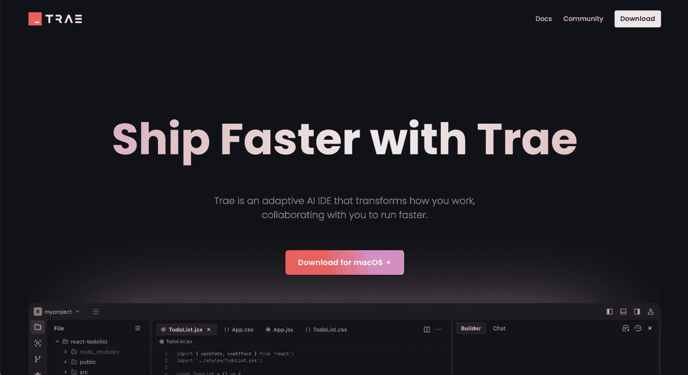
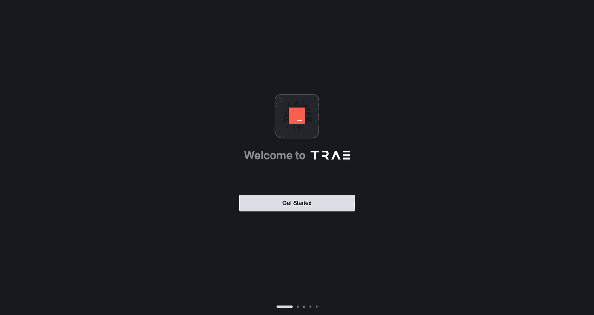
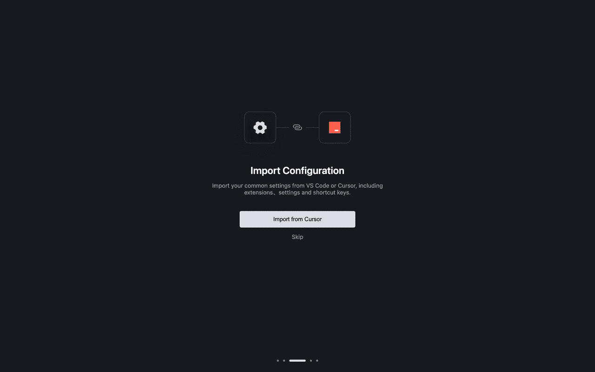
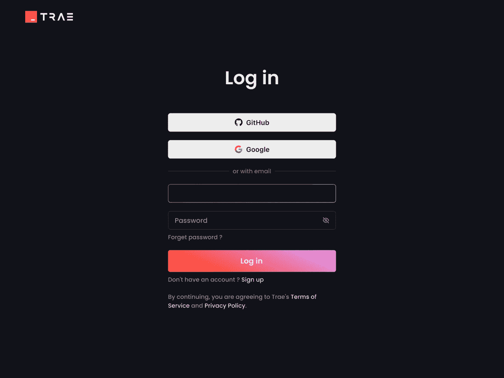
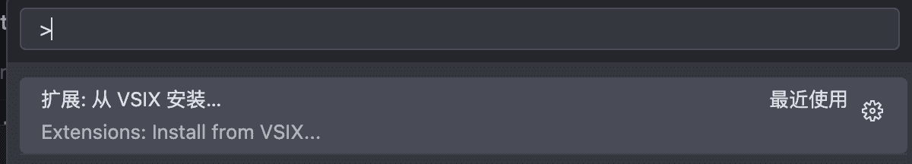
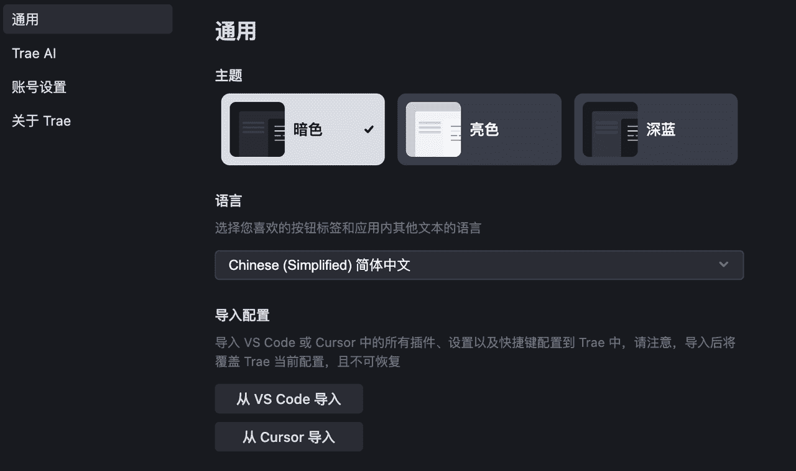

# 基础篇 | 安装使用：对齐 VSCode 的低成本迁移

> 来源：[https://agijuejin.feishu.cn/docx/VFrCdpHCXoRartxdoF7cMTyrnqe](https://agijuejin.feishu.cn/docx/VFrCdpHCXoRartxdoF7cMTyrnqe)

> 该模块使用的示例图取自 [Trae AI](https://www.trae.ai/?utm_source=juejin&utm_medium=juejin_trae&utm_campaign=trae_book) 官方文档

> 🚀 Trae 下载地址：https://www.trae.ai

前文我们了解了 Trae AI 的相关信息，以及它与其他竞品之间的差异，本文我们将了解 Trae AI 的安装使用以及对齐 VSCode 的低成本迁移。

值得一提的是，Trae AI 之所以能够针对 VSCode 做到低成本迁移，得益于 Trae AI 基于 VSCode 内核开发，虽然在 UI 和功能上有一些特异化的调整，但 IDE 的大局架构仍然是保持的，例如 settings、快捷键、插件生态等都可以做到高度兼容，所以在用户习惯和配置迁移等方面对以 VSCode 对常用 IDE 的用户会非常友好。

# 安装和配置迁移

安装和配置迁移的步骤可以基本参考 Trae AI 官方文档：

1.  访问 [Trae.ai](https://www.trae.ai/) 官网安装，值得一提的是，因为官网部署在海外，需要通过 VPN 等方式更换本地 IP 访问。目前  Trae AI 已支持 Mac 和 Windows 版本的下载使用。。



1.  安装完成后，点击 Trae 图标打开，按照指引完成背景主题、语言的设置即可。




1.  有意思的是，Trae 提供了配置迁移和插件迁移的能力，只要你在基于 VSCode 内核开发的 IDE 中使用中，例如 VSCode 和 Cursor 的配置项都可以直接一键迁移过来



1.  在 VSCode 中我们常常会使用 code xx来打开指定的目录，Trae 也提供了类似的功能来设置命令行执行


这一步完成后，我们将可以使用下面的命令方式打开需要的 app 应用

```
trae my-react-app
```

1.  到这里基础的配置就完成了，我们可以按照指引完成登录后使用。目前支持 Github 和 Google 两种登录方式，大家可以使用自己常用的方式登录。



完成登录后，就可以开始体验 Trae 了，下文我们将开始具体了解 Trae AI 提供了哪些有意思的 AI 功能。

# 插件迁移

虽然 Trae AI 基于 VSCode 内核开发，但是 Trae 插件市场并没有直接获得 VSCode 授权，这也导致 Trae 目前无法拉到 VSCode 插件市场中的全部插件，可能会遇到插件搜不到的情况。

以前 VSCode 官方市场可以支持下载插件的 vsix 包，我们可以通过下载 vsix 包的方式直接引入到 Trae 中，如下图。



不过目前已经不支持下载对应插件的 vsix 离线包了，但仍有快速引用的方式，我们可以先在 VSCode 或者 Cursor 中下载对应的插件，然后在 Trae 的设置页中点击同步按钮同步插件即可，如下图。

