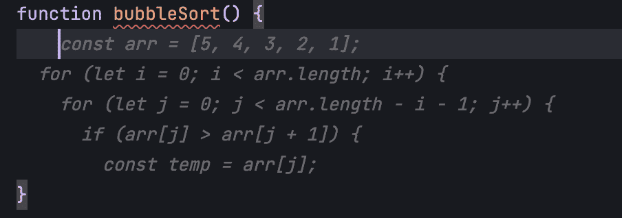
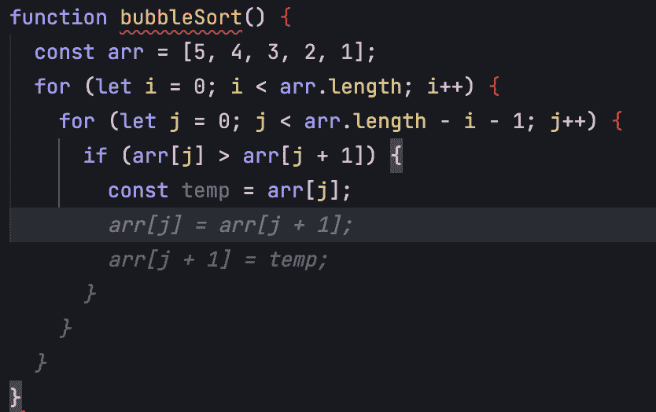
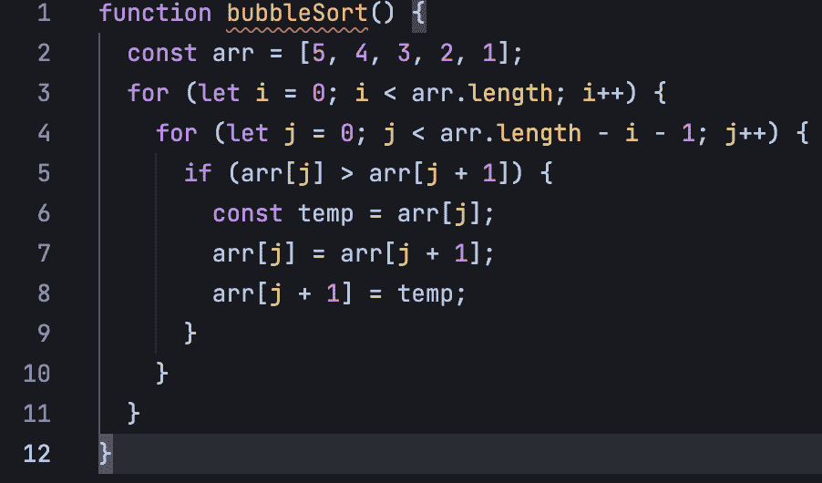
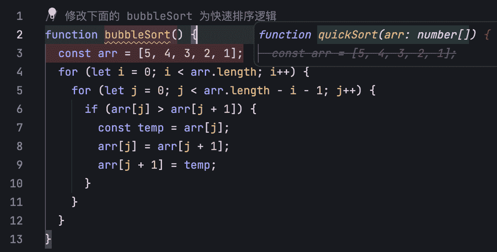

# 基础篇 | 补全：编码的静默辅助能力

> 来源：[https://agijuejin.feishu.cn/docx/Ne4sdjfWeo4l12xCZd7c0uoonsb](https://agijuejin.feishu.cn/docx/Ne4sdjfWeo4l12xCZd7c0uoonsb)

> 🚀 Trae 下载地址：https://www.trae.ai

上文我们了解了 Trae AI 提供的问答功能，它利用对 IDE 的掌控力对用户的问答进行了检索增强，使得 Trae 可以根据用户的需求进行精准度更高的答复，真正成为一个懂用户的 AI。

除问答功能外，Trae AI 还提供了一个非常有用的基础功能，也就是补全功能。当我们在代码编辑区写了一些逻辑后，并停留一段时间，Trae AI 会自动为已经生成的代码提供下一段提示，例如下面的case：

> 我们在编辑区中写一个函数定义 function bubbleSort() {}

Trae 会自动对当前的代码内容进行识别补全，我们可以通过不停地按 Tab 键接收当前给出的提示内容

最终拿到的冒泡代码效果如下。

如果给出的补全内容不满意，我们也可以后退一个字符再加上，等一会儿刷新最新的补全内容，或者通过增加一些注释来对补全的内容进行增强，同样如果要接收这段代码，也使用 Tab 进行接收。

到这里补全的功能就介绍完了，这是一个非常有用的功能，可以帮助大家更快高效地完成代码的迭代和更新。下一节我们来具体了解 Trae AI 提供了哪些个性化的设置功能，来帮助用户个性化 AI 功能。