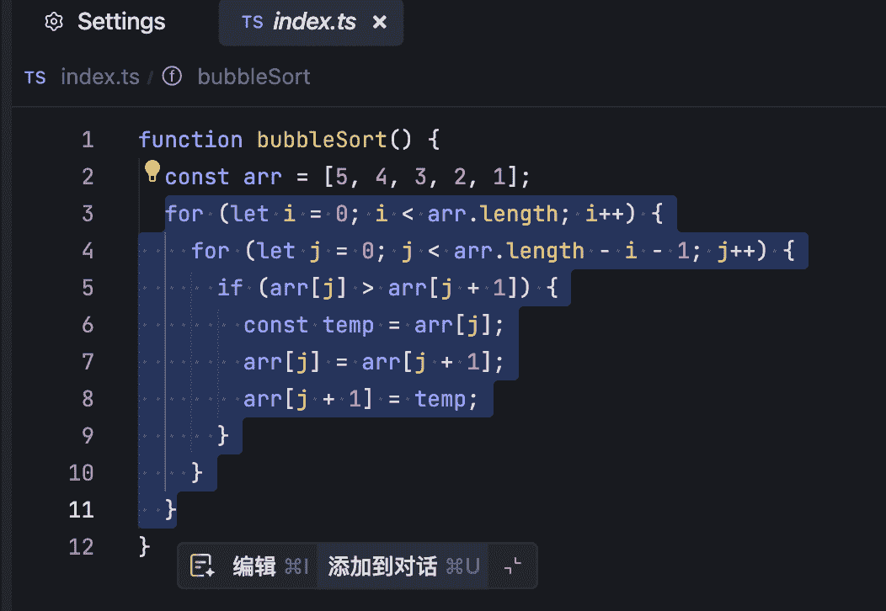
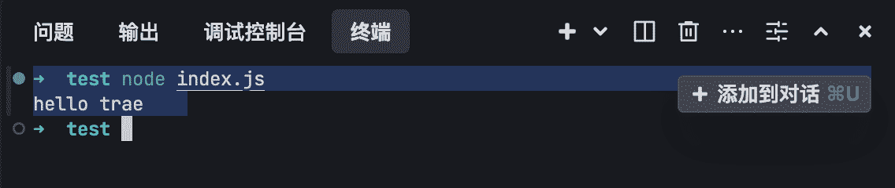
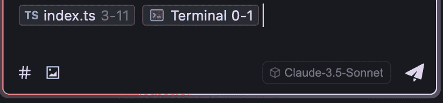
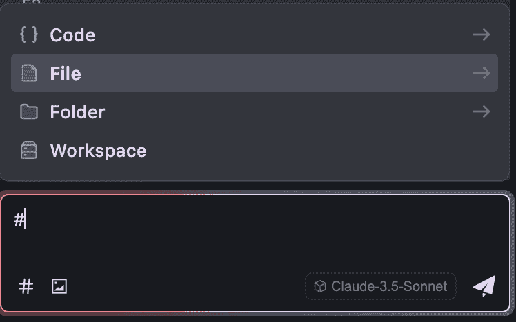

# 进阶篇 | 语境：额外的上下文信息扩展支持

> 来源：[https://agijuejin.feishu.cn/docx/J0iodVgsro4gcbx3B2Ecc8oRnxe](https://agijuejin.feishu.cn/docx/J0iodVgsro4gcbx3B2Ecc8oRnxe)

> 🚀 Trae 下载地址：https://www.trae.ai

前文我们提到 Trae 中有许多上下文信息，这些上下文信息会根据用户的意图进行不同权重的 Prompt 补充，来增强 AI 的功能。但 Trae 默认设置的上下文信息辅助未必是全面且完美符合用户预期的，所以 Trae 也支持用户主动提供一些信息作为 AI 功能的上下文。

上下文的添加有两种方式，一种是在用户交互界面，另一种是通过 # 的方式快速添加，我们来分别介绍。

# 用户交互界面

Trae 的用户交互界面中，提供了快速作为引用的方式，支持添加的位置包含代码编辑区和终端区。在代码编辑区中我们可以 hover 任意一段代码点击添加到对话，这样这段代码就会作为一段上下文引用被放置到 AI 功能中。

可以看到问答框中将会出现一个对 index.ts 的引用，单击对话框中的指定引用区也会跳转到对应的代码内容。

除代码块外，**终端的引用也是一个常见的操作**。我们经常会在终端中执行一些i编译或者构建的脚本，这些脚本可能会出现依赖版本或者冲突的一系列问题，就可以通过语境的方式快速添加指定的报错信息引用到对话框中，添加的方式同样是 hover 点击“添加到对话”。

# # 快速添加语境

Trae 也提供了快速添加语境的方式，在问答框中输入 # 号， 将可以调起语境的悬浮弹窗。

除了便捷外，这个功能其实相比用户交互界面的手动添加，其实还有一个额外的好处是，可以支持非单例文件的添加，例如文件夹和工作空间。

**毕竟，有的时候作为用户，也不想**问个问题前都绞尽脑汁想它的上下文语境是什么，对吧～

这种情况下，如果 AI 功能效果不好，不妨试试主动加一个 #workspace 或者 # folder。当然如果大家心情不错，有耐心的话，# folder 的效果会更好，因为 # workspace 可能会添加过多的无效信息干扰到 AI 需要的重要信息。

**至于单文件语境的添加，我**还是建议大家用用户交互界面的方式添加的。个人认为，对于大文件使用 # 添加单文件真的是一个低效的交互，一个大型项目用 # 选到某个文件某几行，我真的会谢 TT