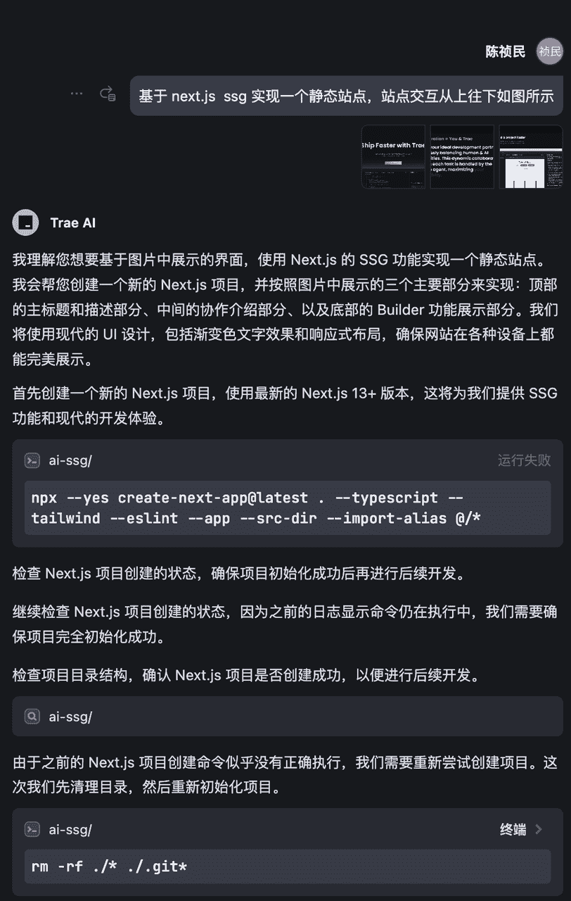
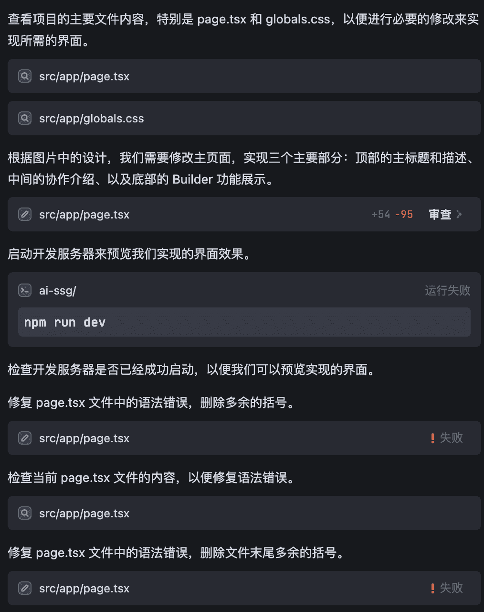
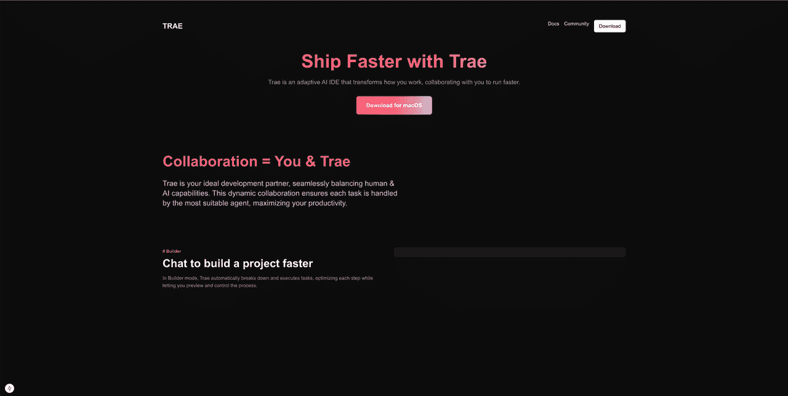
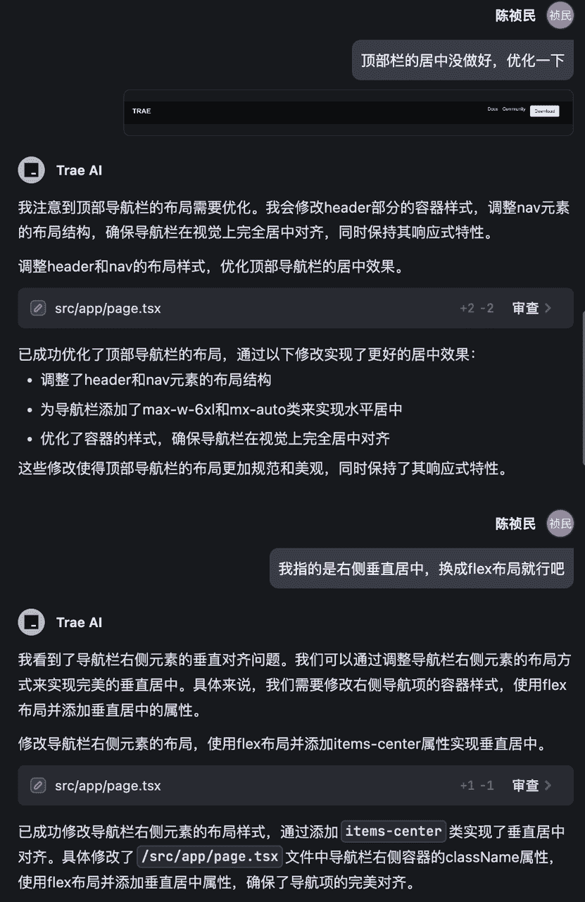
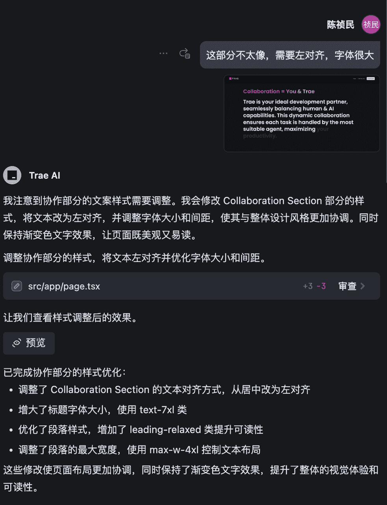
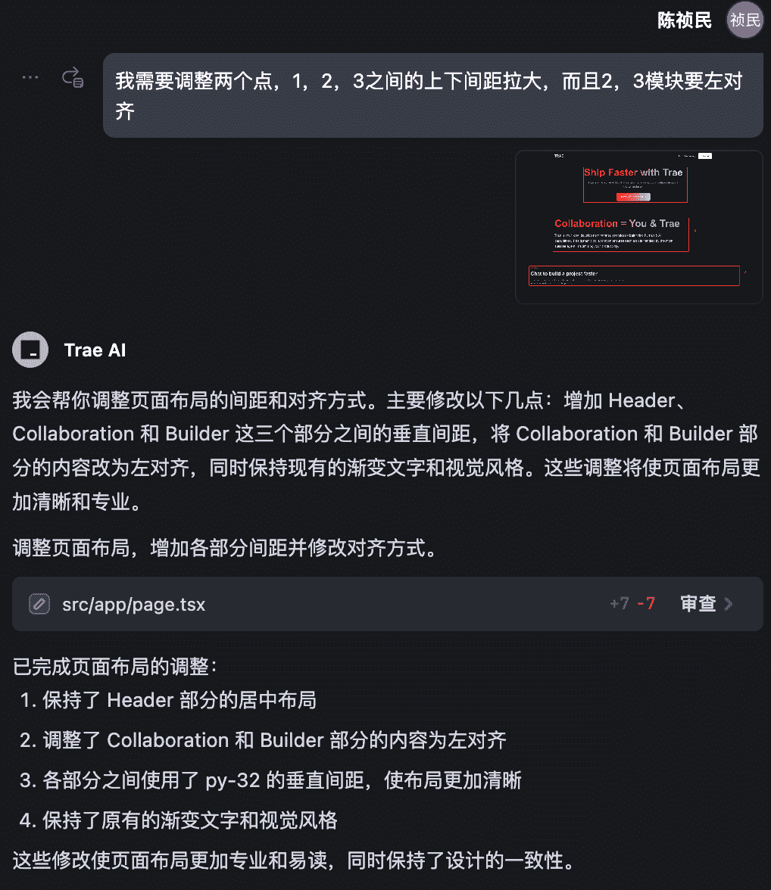
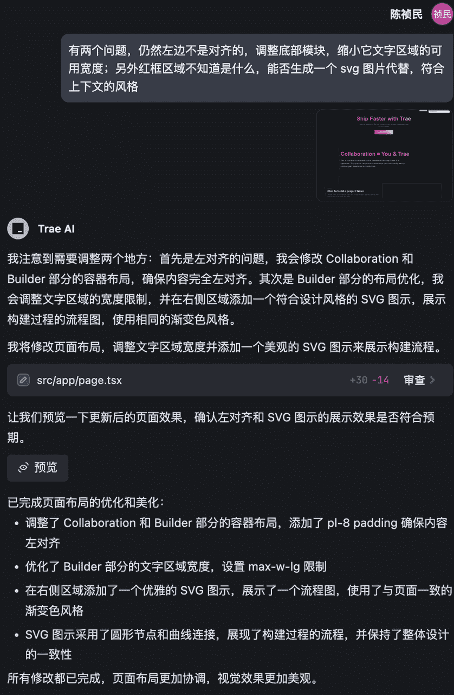
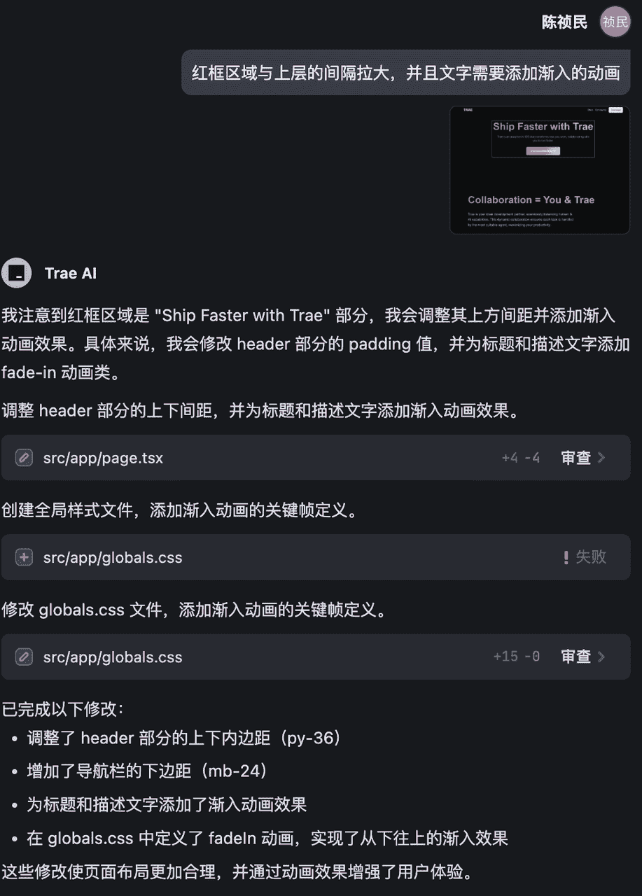
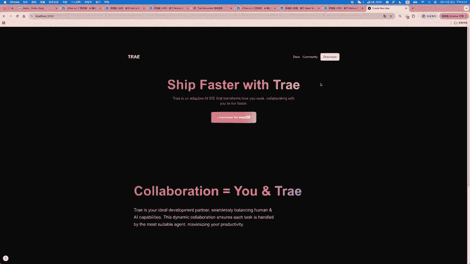

# 实践篇 | SSG：基于 Next.js 的仿 Trae AI 静态官网

> 来源：[https://agijuejin.feishu.cn/docx/PVYSds2jNoz3WCxjPnociqjDn6b](https://agijuejin.feishu.cn/docx/PVYSds2jNoz3WCxjPnociqjDn6b)

> 🚀 Trae 下载地址：https://www.trae.ai

在现代 Web 开发中，渲染技术是决定应用性能、用户体验和 SEO（搜索引擎优化）的关键因素之一。目前最常见的三种渲染技术分别是 SSR（服务器端渲染）、CSR（客户端渲染） 和 SSG（静态站点生成）。

前文我们使用 Trae Builder 分别实现了 SSR 和 CSR 的渲染应用。这两种渲染技术形态的应用被广泛应用在 C 端和 B 端场景下， 除此之外还剩最后一种常见的渲染技术 —— SSG 。SSG 是一种结合了 SSR 和 CSR 的折中方案。它通过在构建阶段提前生成静态 HTML 文件，并将这些文件部署到 CDN 或静态服务器上。当用户访问时，直接从静态文件中获取内容，常用于对 SEO 要求较高的 to C 场景。

这节我们就来使用 Trae Builder 搭建一个 SSG 的应用， 做一个仿 Trae AI 首页的静态的官网。

# 项目初始化（10分钟）

老规矩，我们还是使用 Builder 先生成一版初稿，描述清楚希望使用的技术栈、项目背景，补充适当的语境以及截图来扩充效果。

生成的效果如下，可以看到除一些图片视频没有外，大体的结构已经完成了，整体的完成度还是偏高的。

# 交互优化（40分钟）

虽然交互大部分都完成了，但是还是有很多小细节需要优化的，比如：

+   顶部栏的居中对齐做得不够好；

+   主体部分的交互残缺；

+   缺少入场动画；

我们下面来一一进行优化，首先先调整一下顶部栏的居中问题。

虽然顶部栏的垂直居中调整好了，但上下文的间隔细节不太好看，而且底部的那一栏右侧区域是残缺的，我们让 Builder 补全一下 svg。

最后再让 Builder 给文字添加渐变动画就完工了。

到这里静态站点就实现完成了，我们来看看效果。

[录屏2025-02-12 下午8.14.08.mov](https://internal-api-drive-stream.feishu.cn/space/api/box/stream/download/all/TAGAbDu7goOs9BxSLUKcColnnDa)

经过这章节的学习，我们不难发现，Trae AI Builder 对于初步的 UI 搭建是非常合适的，有几个小技巧：

+   善于使用图片截图来补充信息；

+   设计图可以选取单一元素，来进行强化，比完整的设计图来补全完整元素效果会更好；

+   不好描述一些细节点的时候，可以用画笔进行红框标注，并且新增一些标注数字，来帮助 Builder 确认想新增的元素区域；

感兴趣的同学可以进一步尝试，有新的心得技巧可以在评论区交流！