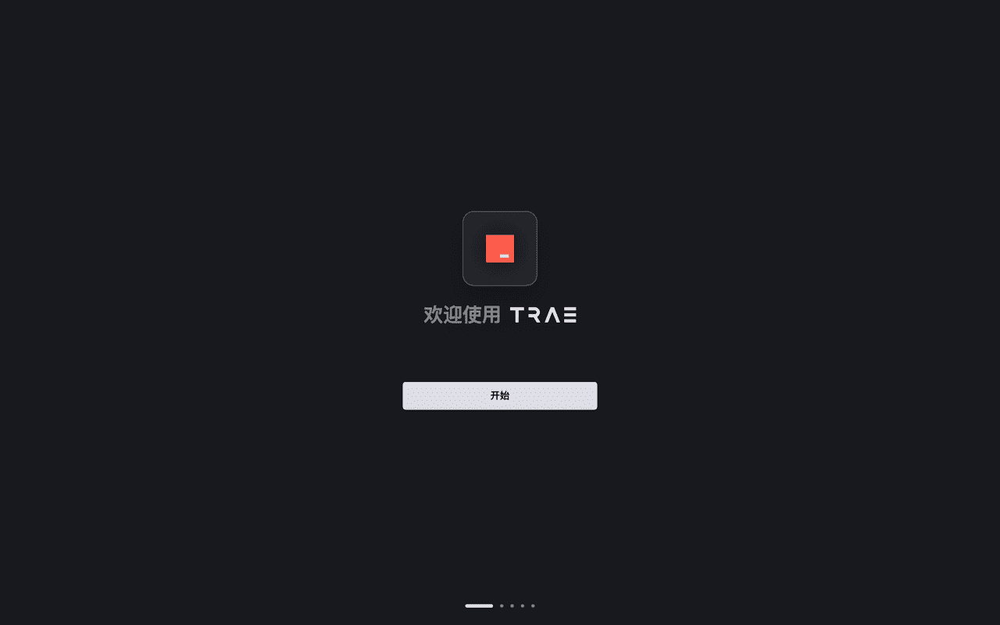
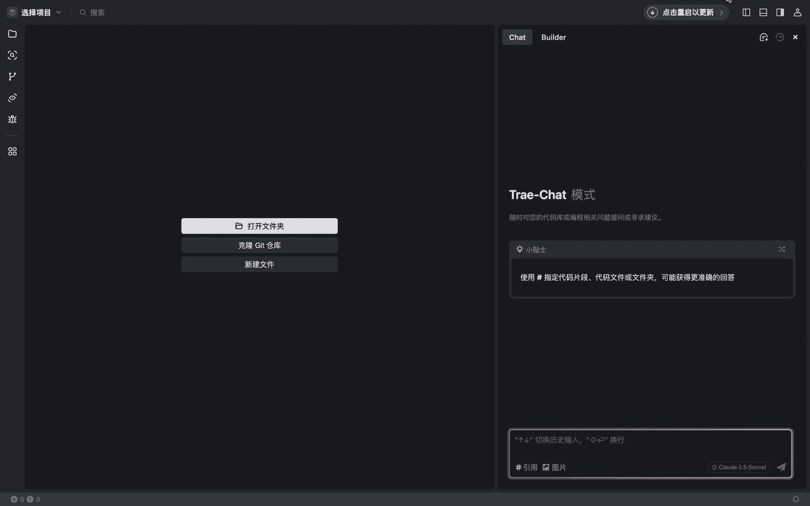

# 安装 Trae 并完成初始设置

> 来源：[https://agijuejin.feishu.cn/docx/AWH9dlaGKovXrAx0axaceBN9ntf](https://agijuejin.feishu.cn/docx/AWH9dlaGKovXrAx0axaceBN9ntf)

> 链接：https://docs.trae.ai/docs/set-up-trae?_lang=zh

本文档介绍如何安装 Trae 并完成基础配置。

## 第一步：安装并启动 Trae

1.  前往 [Trae 的官网](https://www.trae.ai/?utm_source=juejin&utm_medium=juejin_trae&utm_campaign=AGI_article)，将 Trae 安装至电脑。

1.  启动 Trae。

Trae 首次启动时，你会进入以下页面。

1.  点击 **开始** 按钮。

Trae 初始配置流程开始。

## 第二步：选择主题和语言

1.  选择主题。可选项为 **暗色**、**亮色** 和 **深蓝**。

1.  选择显示语言。可选项为 **简体中文** 和 **English**。

> **提示**

> 若有需要，后续可以在设置中心修改主题和语言。

1.  点击 **继续** 按钮。

## 第三步：从 VS Code 或 Cursor 中导入配置

若你的电脑中已安装并配置 VS **Code 或 Curso**r，你**可以点击 从 VS C**ode 导入 或 从 Cursor 导入 按钮。系统将会从对应的 IDE 中获取插件、IDE 设置、快捷键设置等信息并一键导入到 Trae 中，帮助你快速从其他 IDE 切换到 Trae。

## 第四步：添加 Trae 相关的命令行

添加 Trae 相关的命令行后，你可以在终端中使用命令行更快速地完成 Trae 相关的操作。例如：

+   使用 trae 命令快速唤起 Trae。

+   使用 trae my-react-app 命令在 Trae 中打开一个项目。

点击 **安装 ****trae**** 命令** 按钮，然后完成授权流程。

## 第五步：登录账号

你需要登录 Trae 以使用 AI 能力。Trae 提供了三种登录方式，分别为 Google 账号登录、Github 账号登录、邮箱登录。若你没有账号，也可以新注册一个账号。

点击 **登录** 按钮，然后根据页面引导完成登录流程。登录后，你将进入 IDE 界面，如下图所示。

## 第六步：开始使用 Trae

在 Trae 中，开发你的项目，例如：

+   打开已有的项目或克隆 Git 仓库。详情参考《管理项目》。

+   使用 AI 助手从 0 到 1 创建一个新项目。详情参考《Builder》。