# 管理项目

> 来源：[https://agijuejin.feishu.cn/docx/EUyUdOXEvox3wVxDJc3cLueHnuh](https://agijuejin.feishu.cn/docx/EUyUdOXEvox3wVxDJc3cLueHnuh)

> 链接： [https://docs.trae.ai/docs/mana](https://docs.trae.ai/docs/manage-projects?_lang=zh)ge-projects?_lang=zh

你可以管理 Trae 中的项目，包括创建项目和切换项目。

## 什么是 “工作空间”？

“工作空间” 通常为一个在 Trae 中打开的文件夹。若你的项目较为复杂，也可以将多个文件夹添加至一个 “工作空间”。

## 创建项目

Trae 提供三种创建项目的方式：导入本地文件夹、克隆 Git 仓库。

### 方式一：导入本地文件夹

1.  点击左侧面板中央的 **打开文件夹** 按钮，或在界面左上角点击 **选择项目** > **打开文件夹**。

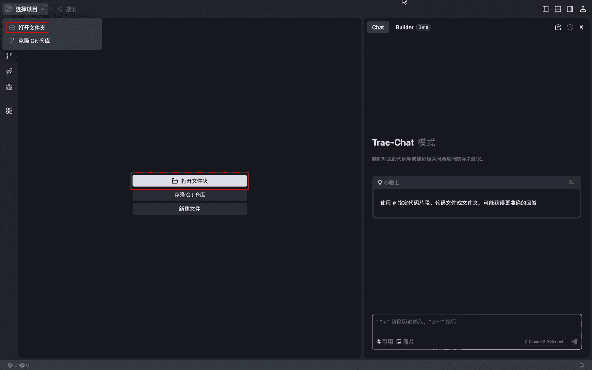

1.  选择文件夹并在 Trae 中将其打开。

你将看到以下授权弹窗：

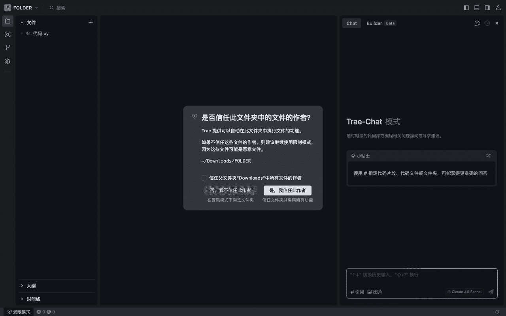

1.  在 是否信任此文件夹中的文件的作者？ 弹窗中：

+   (可选) 勾选 信任父文件夹“Downloads”中所有文件的作者。

此后，在 Trae 中打开任何 “Downloads”（下载） 目录下的文件夹将不再弹出该授权窗口。

+   点击 **是，我信任此作者**。

文件夹已在 IDE 中打开。你可以开始编辑项目。

### 方式二：从 GitHub 克隆仓库

1.  点击左侧面板中央的 **克隆 Git 仓库** 按钮，或在界面左上角点击 **选择项目** > **克隆 Git 仓库**。

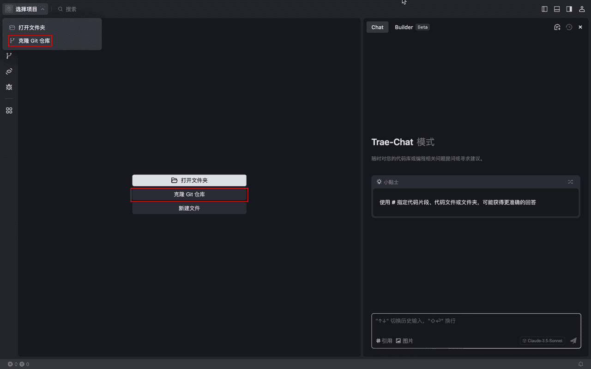

1.  点击 **从 GitHub 克隆** 。

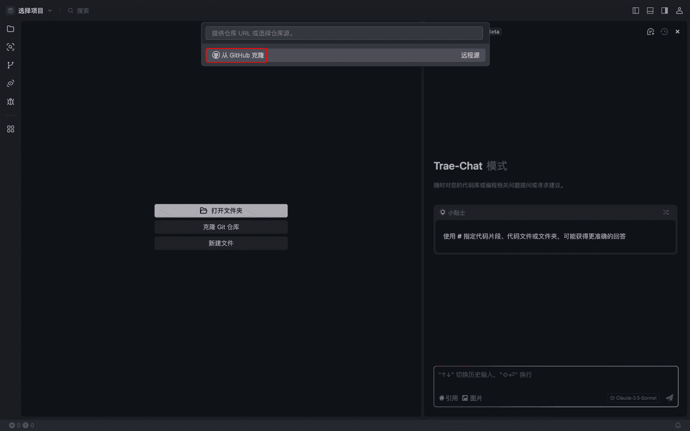

+   你将看到以下授权弹窗。

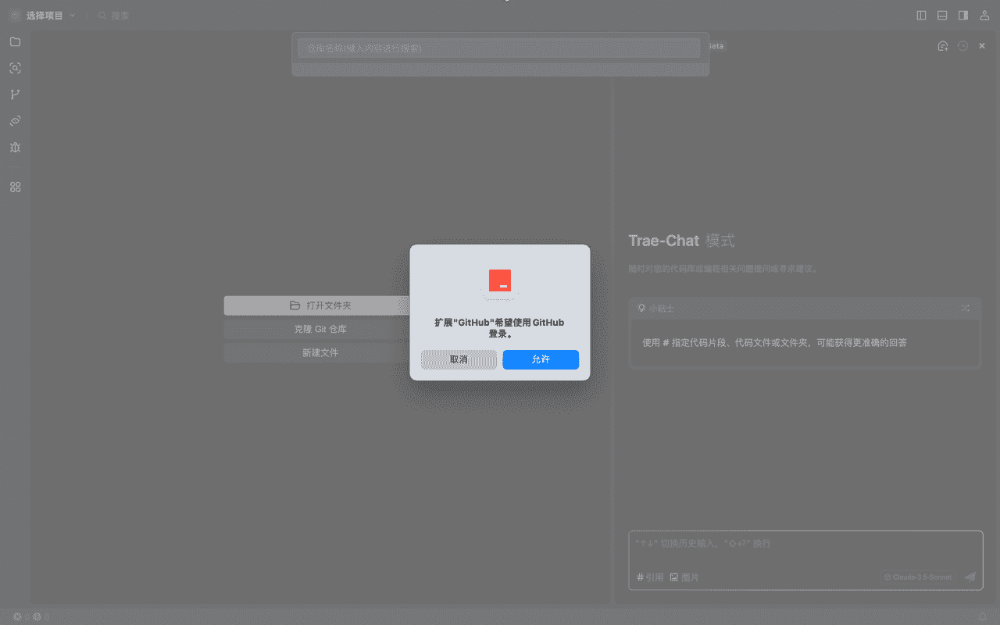

1.  授权 GitHub 登录 Trae：

+   点击 **允许** 。

你将看到以下展示授权码的弹窗：

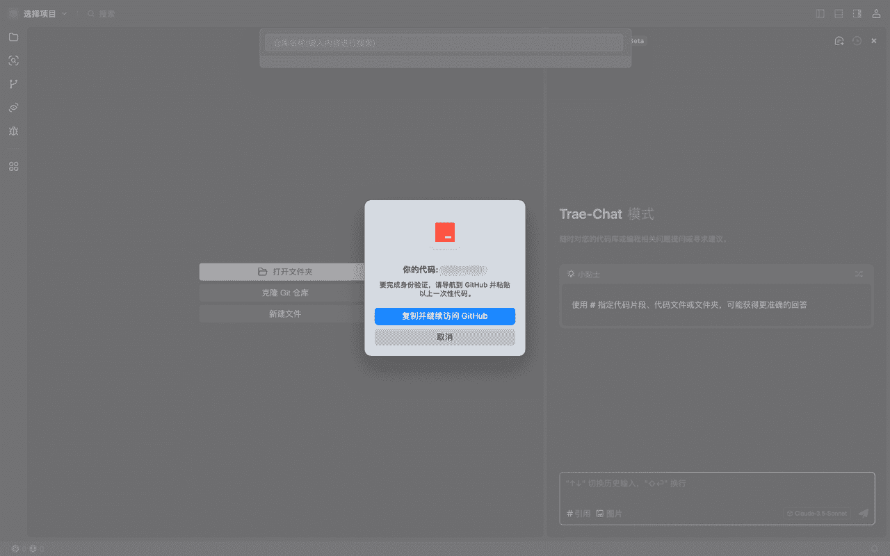

+   点击 **复制并继续访问 GitHub** 。

已复制授权码，然后你将看到以下弹窗：

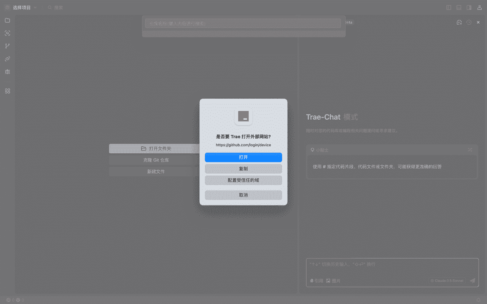

+   点击 打开 。

你将前往 GitHub 上的登录授权页面。

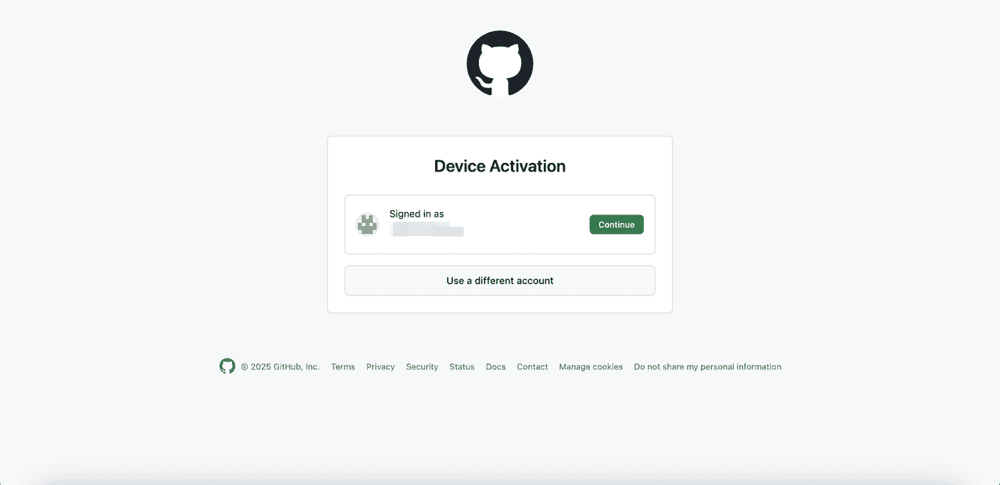

+   根据页面提示，完成授权。

1.  返回 Trae。

弹框中展示可克隆的仓库列表。

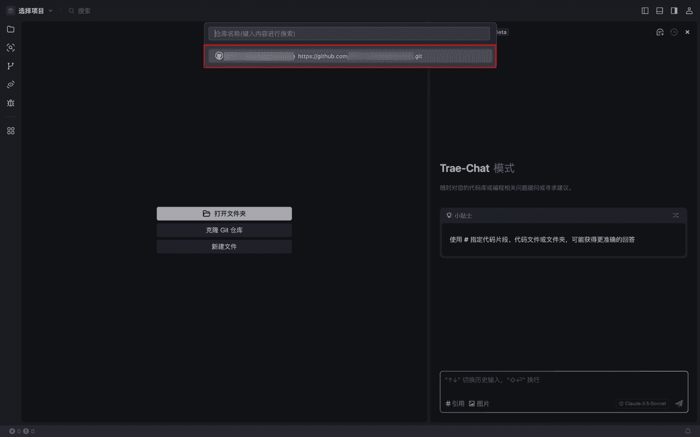

1.  直接从列表中选择一个仓库。

或

**     输入期望克隆**的仓库名称，然后点击 从 GitHub 克隆 。

1.  **在弹窗中，选择该**仓库的存储位置，然后点击 选择为存储库目标 。

Trae 开始克隆该仓库。克隆完毕后，你会看到以下弹窗。

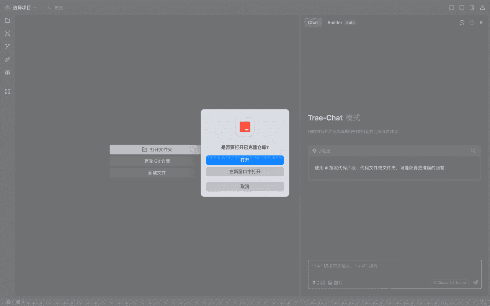

1.  按需从以下操作中选择其一：

+   点击 **打开** ，直接在 Trae 的当前窗口打开该仓库。

+   点击 **在新窗口中打开** ，在 Trae 中用新窗口中打开该仓库。

你将看到以下授权弹窗：

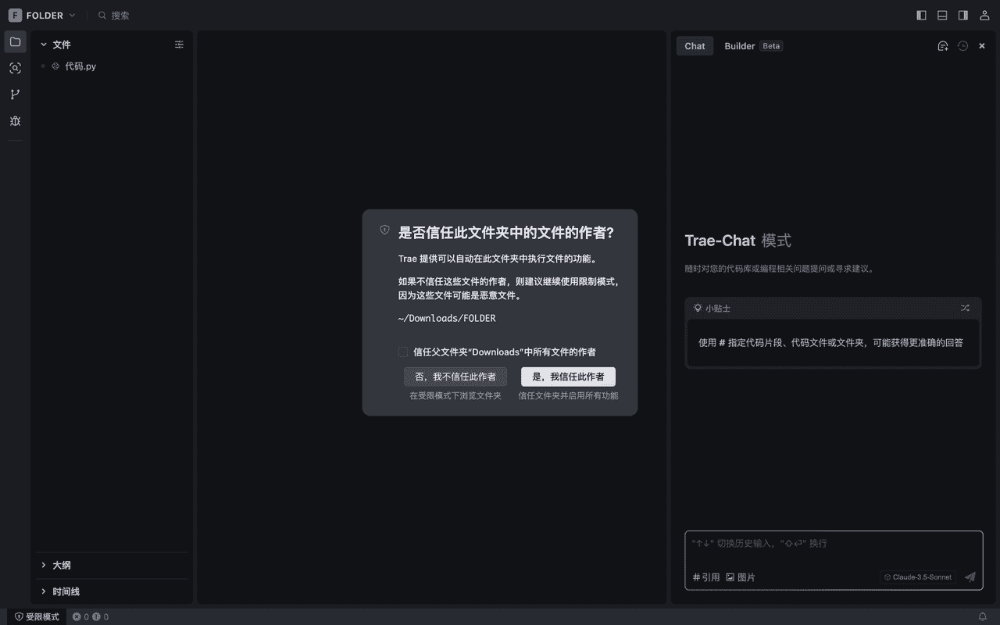

1.  在 **是否信任此文件夹中的文件的作者**？ 弹窗中：

+   (可选) 勾选 信任父文件夹“Downloads”中所有文件的作者。

此后，在 Trae 中打开任何 “Downloads”（下载） 目录下的文件夹将不再弹出该授权窗口。

+   点击 **是，我信任此作者**。

仓库已在 IDE 中打开，你可以开始编辑项目。

### 方式三：直接从 Git 仓库的 URL 克隆

此方式无需授权 GitHub 登录 Trae，你可以直接使用目标仓库的 URL 来将其克隆至 Trae。

1.  点击左侧面板中央的 **克隆 Git 仓库** 按钮，或在界面左上角点击 **选择项目** >**克隆 Git 仓库**。

1.  **在 URL 输入框中，输入**目标 Git 仓库的 URL，然后点击 存储库 URL {URL}。

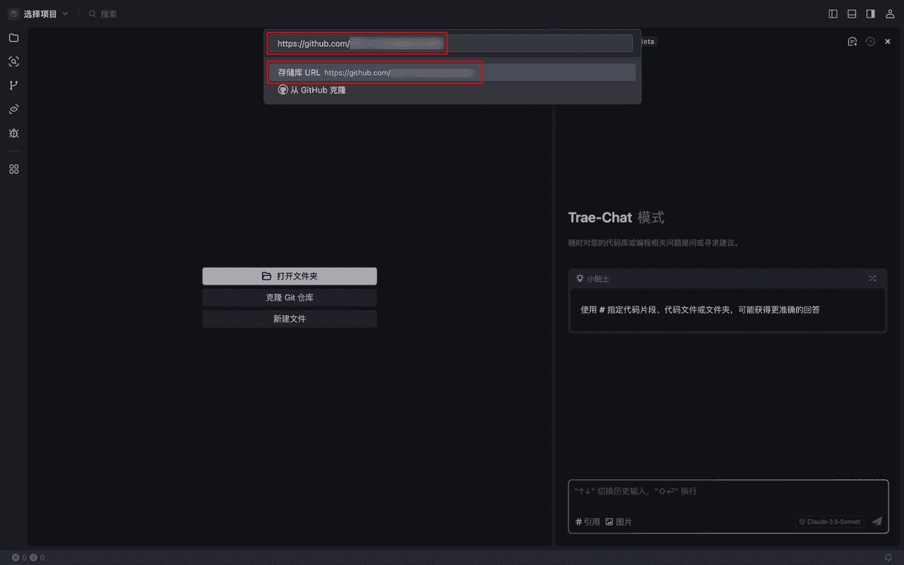

1.  **在弹窗中选择该仓**库的存储地址，然后点击 选择为存储库目标。

Trae 开始克隆该仓库。克隆完毕后，你会看到以下弹窗。

1.  按需从以下操作中选择其一：

+   点击 **打开**，直接在 Trae 的当前窗口打开该仓库。

+   点击 **在新窗口打开**，在 Trae 中用新窗口中打开该仓库。

你将看到以下授权弹窗：

1.  在 是否信任此文件夹中的文件的作者？ 弹窗中：

+   (可选) 勾选 信任父文件夹“Downloads”中所有文件的作者。

此后，在 Trae 中打开任何 “Downloads”（下载） 目录下的文件夹将不弹出该授权窗口。

+   点击 **是，我信任此作者**。

该仓库已在 IDE 中打开。你可以开始编辑项目。

## 切换项目

当 Trae 中存在多个项目时，你可以切换不同的项目进行开发。

1.  在界面左上角，点击当前项目的名称。

界面上显示如下面板，展示最近导入或使用的项目列表。

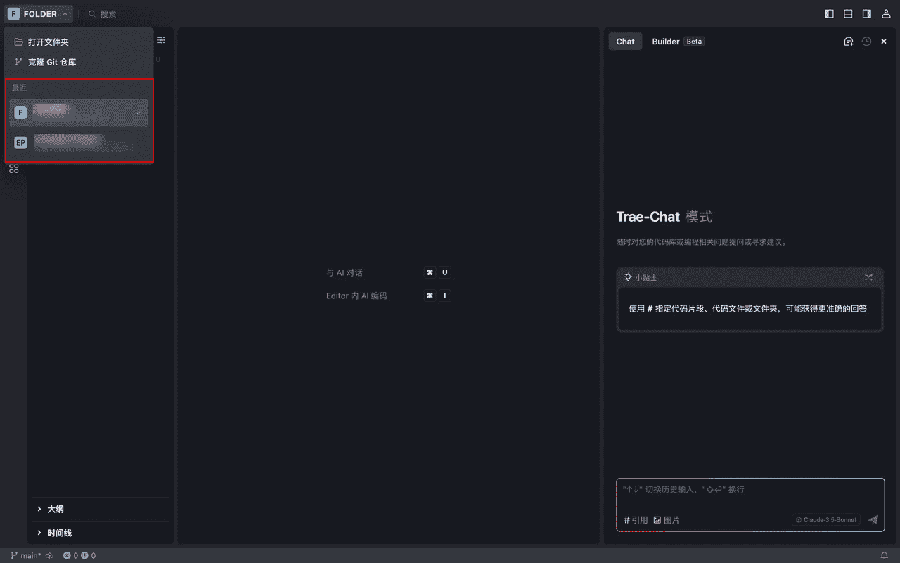

1.  在 **最近** 列表中，选择需打开的项目。

Trae 打开一个新的窗口，加载并展示该项目。