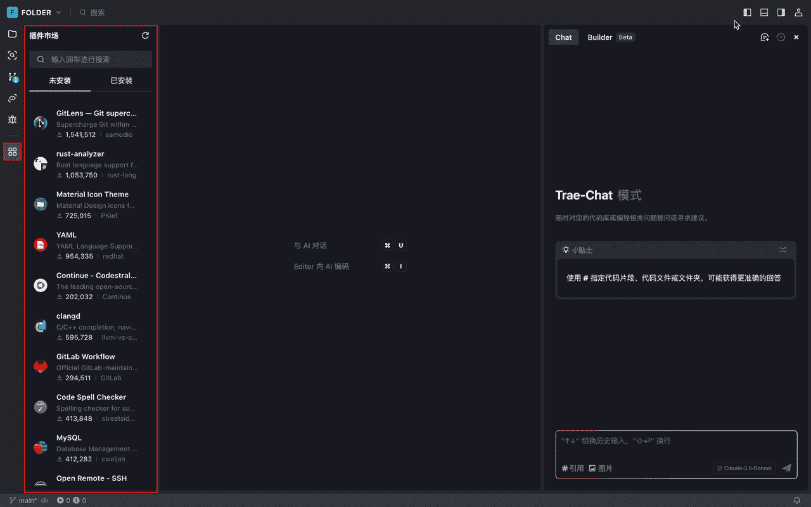
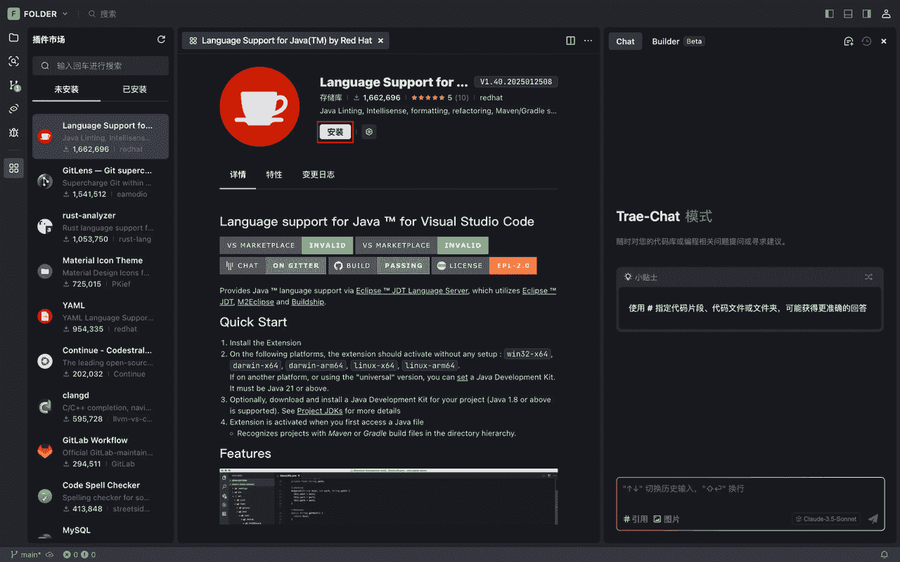
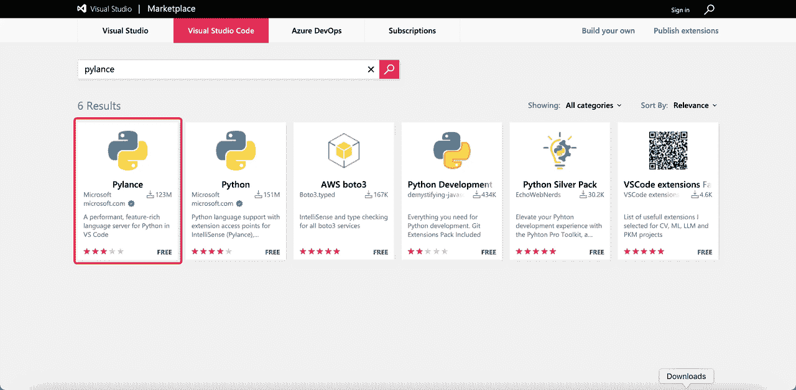
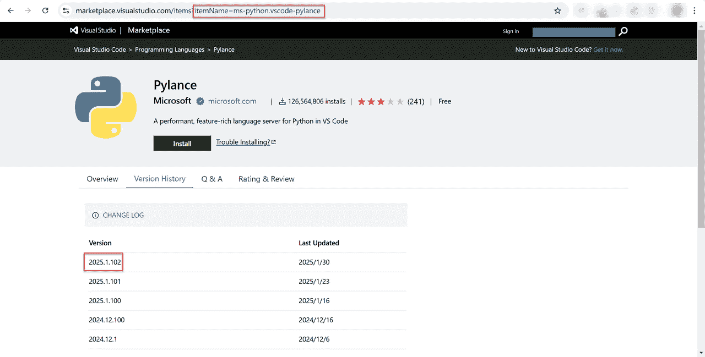
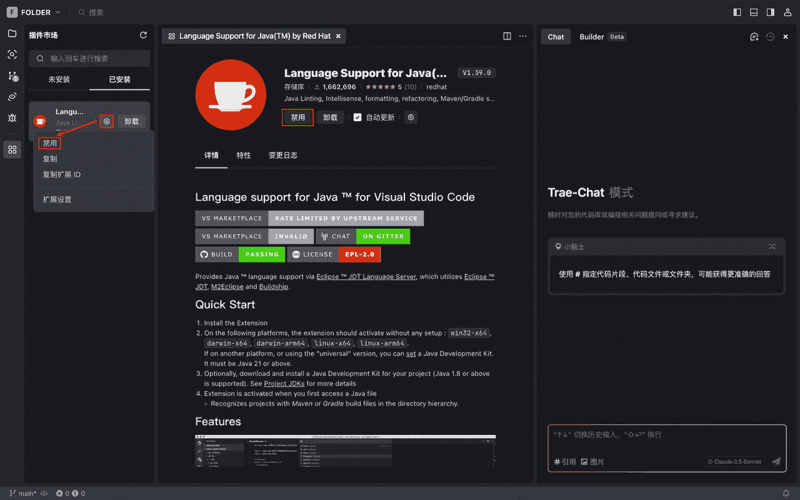
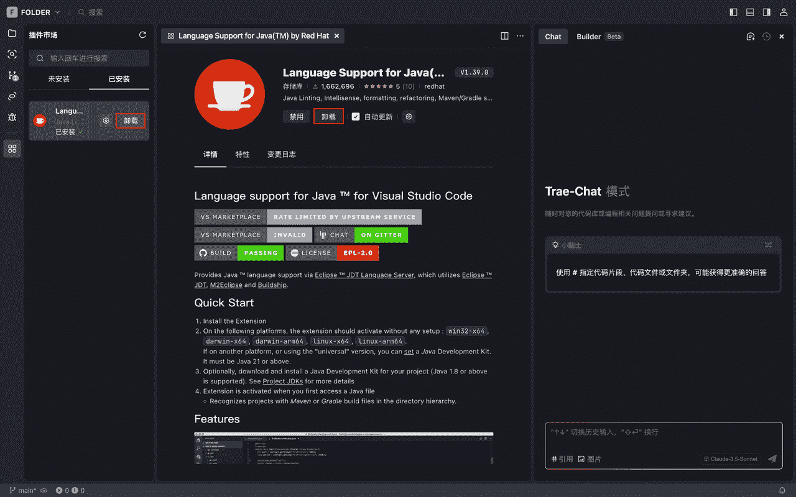
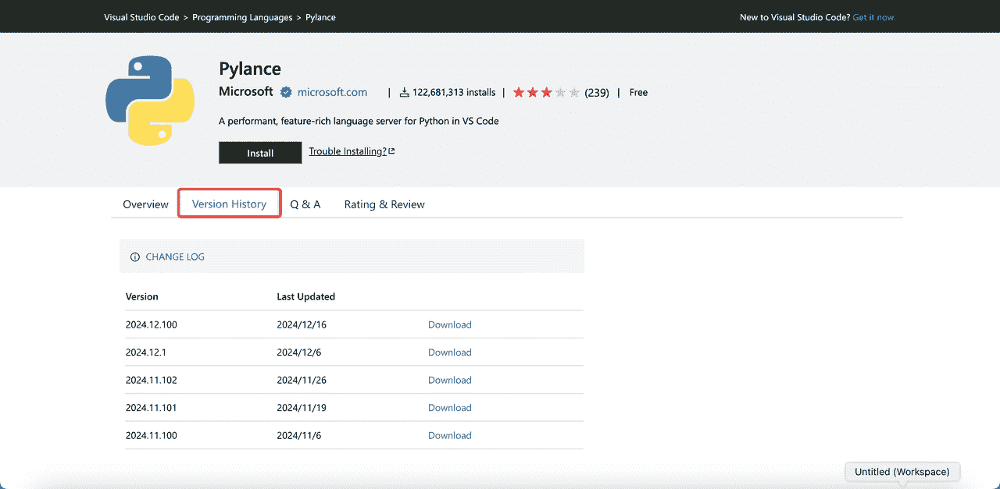

# 管理插件

> 来源：[https://agijuejin.feishu.cn/docx/TnxedCf3aoIpXPx49zucqjV4nxe](https://agijuejin.feishu.cn/docx/TnxedCf3aoIpXPx49zucqjV4nxe)

> 链接：https://docs.trae.ai/docs/manage-extensions?_lang=zh

在 Trae 中，你可以安装、禁用和卸载插件。

## 安装插件

你可以从 Trae 或 VS Code 的插件市场安装插件。

### 从 Trae 的插件市场安装

1.  在左侧导航栏中，点击 **插件市场** 图标。

界面左侧显示 **插件市场** 面板。



1.  搜索你想要的插件并在 **未安装** 列表中将其选中。

界面上显示该插件的详情窗口，展示该插件的详细说明、变更日志等信息。

1.  点击 **安装**。

**Tra**e 开始安装该插件。安装完成后，该插件会出现在 已安装 列表中。



### 从 VS Code 的插件市场安装

如果 Trae 的插件市场未提供你所需的插件，可以将 VS Code 插件市场中的插件安装至 Trae。

1.  前往 [VS Code 的插件市场](https://marketplace.visualstudio.com/vscode)。

1.  搜索你想要的插件，例如：Pylance。



1.  在搜索结果中，点击你所需的插件。

你会前往该插件的详情页。

1.  在详情页中，点击 **Version History**。

1.  结合插件页的 URL 和 Version History 中的信息，提取出以下信息（以 Pylance 为例）：

+   itemName：URL Query 中的 itemName 字段，如截图中的 ms-python.vscode-pylance，并将小数点（.）前后的内容分成以下两个字段：

+   fieldA：ms-python

+   fieldB：vscode-pylance

+   version：如截图中的 2025.1.102



1.  使用提取出来的 3 个字段的值替换下方 URL 中的同名字段。

```
模板：
https://marketplace.visualstudio.com/_apis/public/gallery/publishers/${itemName.fieldA}/vsextensions/${itemName.fieldB}/${version}/vspackage

示例：
https://marketplace.visualstudio.com/_apis/public/gallery/publishers/ms-python/vsextensions/vscode-pylance/2025.1.102/vspackage
```

1.  在浏览器中输入修改后的 URL，然后按下回车键。

浏览器开始下载该插件。

1.  下载完成后，返回 Trae 并打开插件市场。

1.  **将下载的** .vsix 文件拖拽至 插件市场 面板中。

**Tra**e 开始自动安装该插件。安装完成后，该插件会出现在 已安装 列表中。

## 禁用插件

1.  在 Trae 中，打开插件市场。

1.  在 **已安装** 列表中，找到需禁用的插件。

1.  **鼠标**悬浮至**列表**中的插件，然后点击 设置 > 禁用。

或

**点击**该插件以打开其详情窗口，然后点击 禁用。



## 卸载插件

1.  在 Trae 中，打开插件市场。

1.  在 **已安装** 列表中，找到需卸载的插件。

1.  鼠标悬浮至该插件，然后点击 **卸载**。

或

**点击**该插件以打开其详情窗口，然后点击 卸载。



## 常见问题

### 暂不支持安装 VS Code 插件市场中某个版本的插件

若 VS Code 插件市场中某个版本的插件依赖了新版 VS Code 中的某些接口，则可能会导致该插件与 Trae 不兼容。你可以查看该插件的 Version History，然后下载该插件的历史版本。

