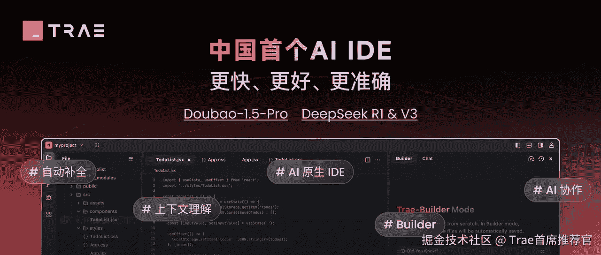
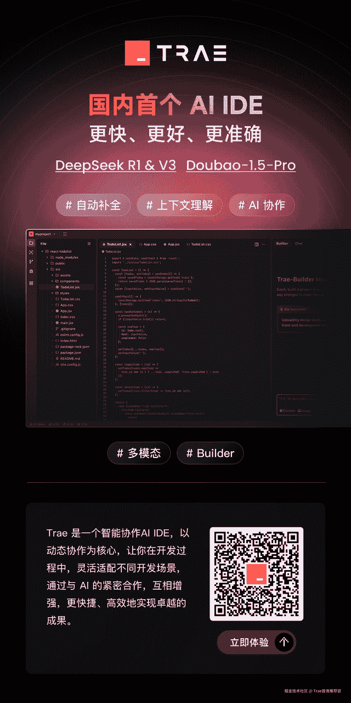

# Trae国内版发布，中国首款AI IDE 正式上线，配置Doubao-1.5-pro，支持切换满血版DeepSeek 模型

> 来源：[https://agijuejin.feishu.cn/docx/ZKDmdEFOJocjerxfeaxc4nqAnwd](https://agijuejin.feishu.cn/docx/ZKDmdEFOJocjerxfeaxc4nqAnwd)

> **超前体验 一键下载 >> **https://www.trae.com.cn/

今日，中国首个AI原生集成开发环境（AI IDE）Trae 国内版正式上线，配置Doubao-1.5-pro，并支持切换满血版DeepSeek R1、V3模型，让编程速度起飞。

作为更贴合中国开发者开发习惯与开发场景的AI IDE，Trae 以动态协作为核心，打造了一种人机协同，人与AI互相增强的全新开发体验，助力开发者高效应对复杂技术挑战，释放创新潜能。

### 人与 AI 默契协作，全新开发体验

A**I技术的快速发展，让开发方式**面临着巨大的变革，开发者亟需更高效率、更智能化的工具支持。Trae 应需而发，定位为 “智能协作AI IDE ” ，以“人机协同、互相增强”为核心理念，对 代码补全 ，代码理解，Bug修复，基于自然语言生成代码 等开发过程全场景都有非常好的适应性，不仅是一个开发工具，更是一位全天候开发“拍档”。

而基于人与AI协作开发的理念，无论是人还是AI，Trae 让恰当的对象，在恰当的时间接管工作，确保每一个代码片段都是人与AI共创的最优结果，为开发者带来更加高效、优质的开发体验。

### 更快，更好，更准确

Trae 为开发者打造了前所未有的开发体验，帮助开发者更快速，更准确，更高质量的完成开发需求。

全新 Builder 模式能充分利用AI的能力，无论是初学者还是资深的开发者，都能够轻松通过自然语言描述迅速的，端到端的生成应用：只需要用简单的语言描述需求，Trae 就可以迅速搭建起项目框架，还能持续进行调优修改，产出可用代码。这种智能化的"思想到代码"直通车能力，全程助力开发者将需求端到端完美落地，极大缩短了项目筹备周期，为高效开发奠定坚实基础。

在代码理解维度，Trae 的能力边界实现了质的突破，凭借对开发项目上下文的极致理解，深入剖析代码仓库，实时获取IDE中的各种环境上下文，精准洞察开发者的需求，从而为开发过程提供最为契合、准确的解决方法。

针对需求沟通效率问题，Trae 的实时代码续写技术可基于开发项目整体上下文进行智能补全，提升编码效率，而在交互体验方面，开发者可以便捷地将 AI 生成的代码一键应用到多个模块，还能根据实际需求随时灵活调整指令，并实时预览 AI 生成代码的前端效果。

在**通往A**I C**od**ing **的 **AG**I **时代里，有众多 **AI **辅助编程工具出现，但Trae 希望成为更可靠的、值得开发者信赖的“AI 工程师” （T he R eal A I E ngineer ）： 通过真正的 AI 编程 Agent， 帮助开发者实现「从需求到落地」的端到端全链路开发闭环。Trae 相信，一个好的“AI 工程师”，不仅是一个好用的工具，更是一个多面手AI合作伙伴，可以更好的帮助开发者解决多种问题，让其有精力去重新构想价值创造的方式，触摸创造力的天花板。

### 即刻体验 **畅快编程**

Trae 国内版不仅针对中国开发场景和习惯进行了一些优化，后续还即将支持模型自定义，用户可以根据自己的喜好，接入合适的大模型API，希望给开发者带来全新的AI IDE 开发体验。

即刻访问官网 [trae.com.cn ](https://www.trae.com.cn/?utm_source=juejin&utm_medium=juejin_trae&utm_campaign=AGI_article)，下载安装包，和我们一起，解锁AI驱动的开发新未来~