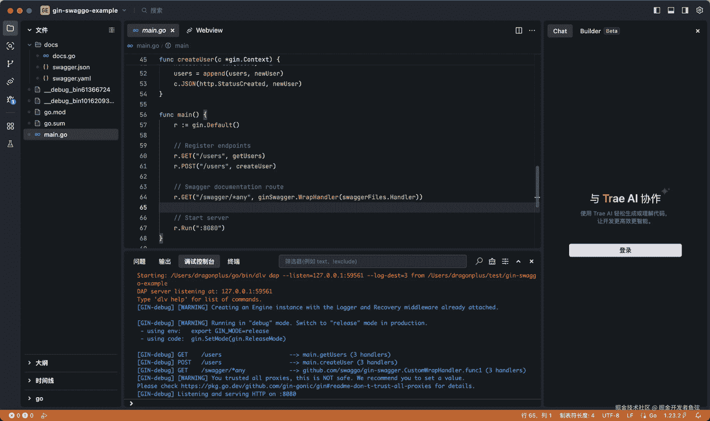
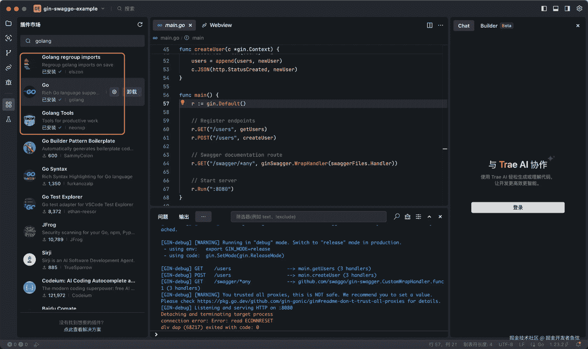
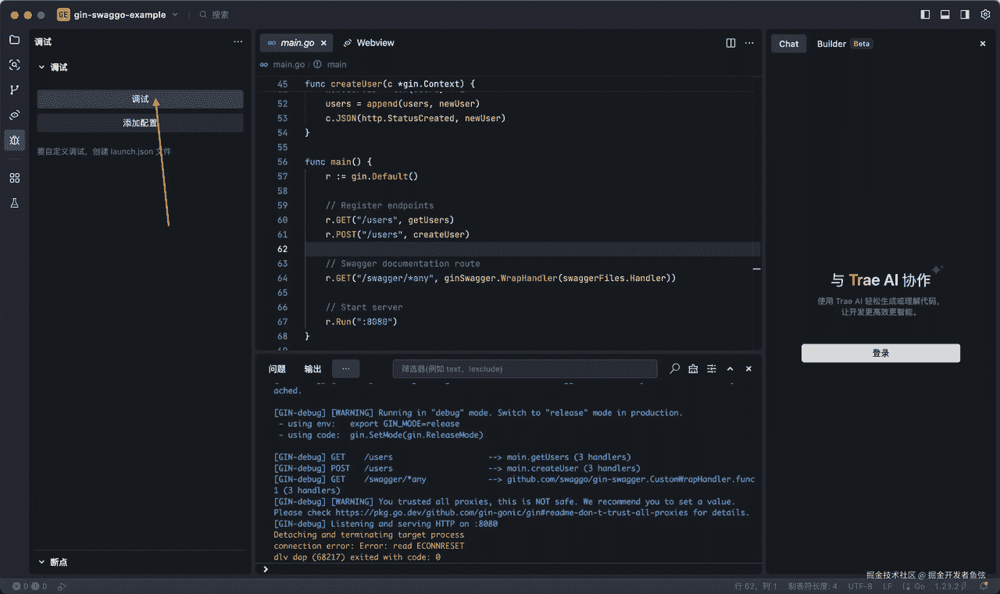
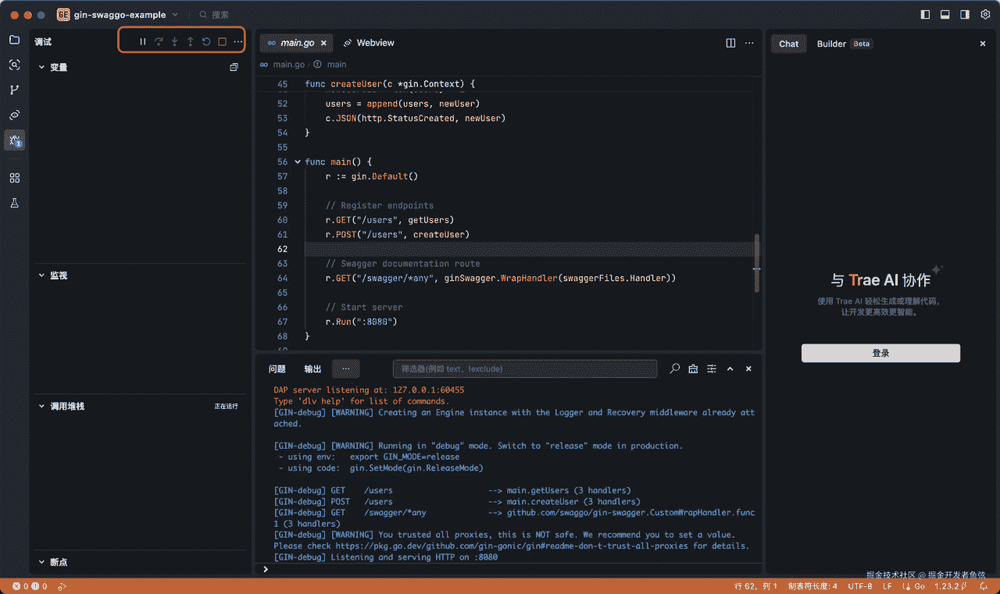
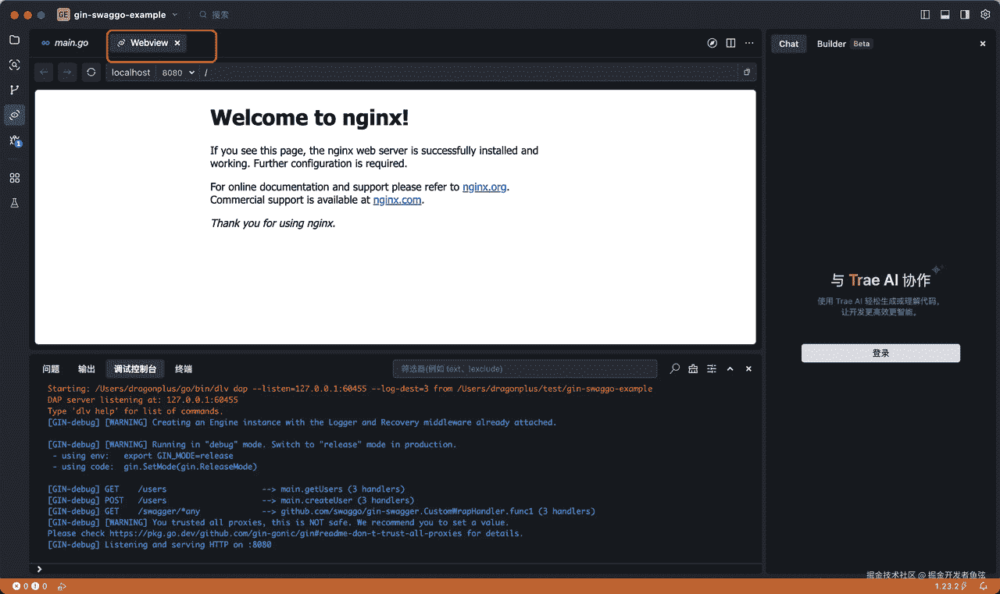

# 【惊叹】字节跳动的 AI IDE Trae 入门教程

> 来源：[https://agijuejin.feishu.cn/docx/N7kmdWMIIoOwwjx4TTYcOiRvnug](https://agijuejin.feishu.cn/docx/N7kmdWMIIoOwwjx4TTYcOiRvnug)

> 作者：掘金开发者鱼弦

> 链接：https://juejin.cn/post/7467811232582500386

> 来源：稀土掘金

> 著作权归作者所有。商业转载请联系作者获得授权，非商业转载请注明出处。

> 如有侵权，请联系删除。

我正在参加Trae「超级体验官」创意实践征文，  本文所使用的 Trae 免费下载链接：  www.trae.ai/?utm_source…

字节跳动的 AI IDE Trae 是一个集成开发环境，设计用于简化和增强 AI 开发体验。在 Trae 中创建并运行一个 Go 语言项目，以下是一个可能的步骤指南。

### 使用 Trae 创建和运行 Go 项目

1.  **设置和安装**

+   获取 Trae：确保已从官方渠道下载并安装最新版本的 Trae IDE。

+   启动 Trae：双击应用程序图标或通过命令行启动 Trae。

1.  **创建新 Go 项目**

+   **启动新项目向导**：

+   在 Trae 的主界面中，选择 “新建项目”。

+   选择 “Go 应用程序” 模板（如果提供的话）。



+   **配置项目**：

+   输入项目名称，例如 MyGoProject。

+   选择项目保存位置。

+   确保 Go SDK 已正确配置。



+   **完成项目初始化**：

+   点击 “创建” 按钮以生成项目骨架。

1.  **编写 Go 代码**

+   **打开 ****main.go**** 文件**（或根据模板自动生成的入口文件）：

+   在项目结构中找到 main.go 并打开。

+   **编写简单的 HTTP 服务**：

```
go
 代码解读
复制代码
package mainimport (    &quot;fmt&quot;    &quot;net/http&quot;)func handler(w http.ResponseWriter, r *http.Request) {    fmt.Fprintf(w, &quot;Hello, Trae AI IDE!&quot;)}func main() {    http.HandleFunc(&quot;/&quot;, handler)    http.ListenAndServe(&quot;:8080&quot;, nil)}
```

1.  **构建与运行**

+   **构建项目**：

+   在 Trae 菜单中选择 “构建” > “构建项目”。



+   **运行项目**：

+   点击工具栏中的 “运行” 按钮，或选择菜单中的 “运行” > “运行项目”。

+   确保控制台输出显示服务已启动。



+   **测试服务**：

+   在浏览器中访问 http://localhost:8080，应显示 “Hello, Trae AI IDE!”。



1.  **调试与优化**

+   **设置断点**：在代码行号旁边点击以设置断点。

+   **启动调试模式**：点击工具栏中的 “调试” 按钮。

+   **检查变量和状态**：使用调试窗口查看变量值和调用栈。

1.  **部署准备**

+   **进行代码审查和优化**：确保代码符合最佳实践。

+   **创建 Dockerfile**（如需要部署到容器）：

```
dockerfile
 代码解读
复制代码
FROM golang:1.23WORKDIR /appCOPY . .RUN go build -o myappCMD [&quot;./myapp&quot;]
```

### 材料链接

+   [Go 官方文档](https://link.juejin.cn?target=https%3A%2F%2Fgolang.org%2Fdoc%2F)

+   Trae IDE 的帮助资源（通常在 IDE 内部提供，或通过其官方网站）

### 总结

Trae 提供了集成的开发环境，支持多种编程语言和工具集成，通过它，你可以快速创建、测试和部署 Go 项目。熟悉这些功能将极大提升你的开发效率，使得开发过程更为流畅。

### 未来展望

IDE 不断演进以支持更多语言特性和工具链整合。随着 AI 和机器学习技术的发展，IDE 将继续集成更多智能化的开发辅助功能，如代码补全、错误检测和自动化部署工具，进一步提高开发者的生产力。