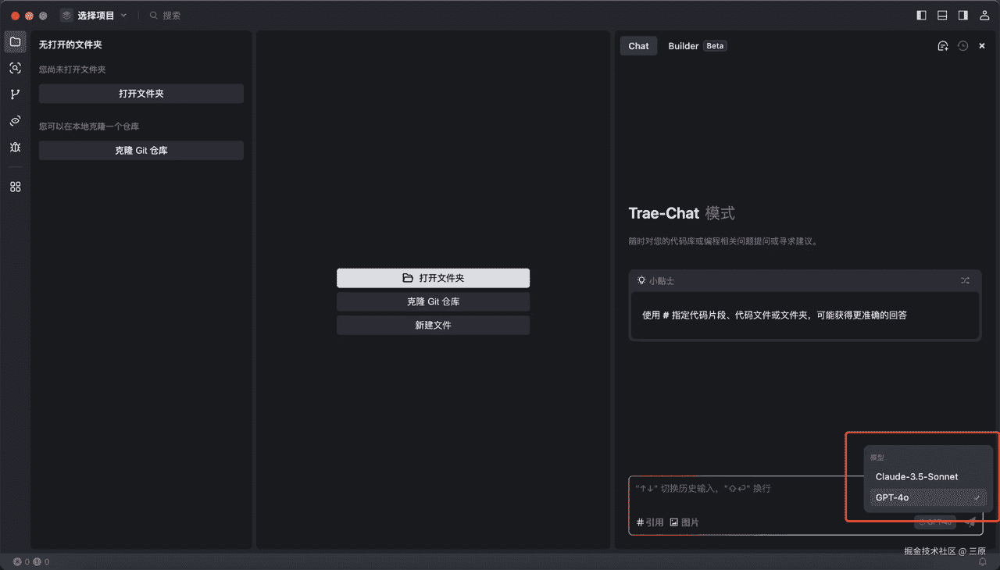
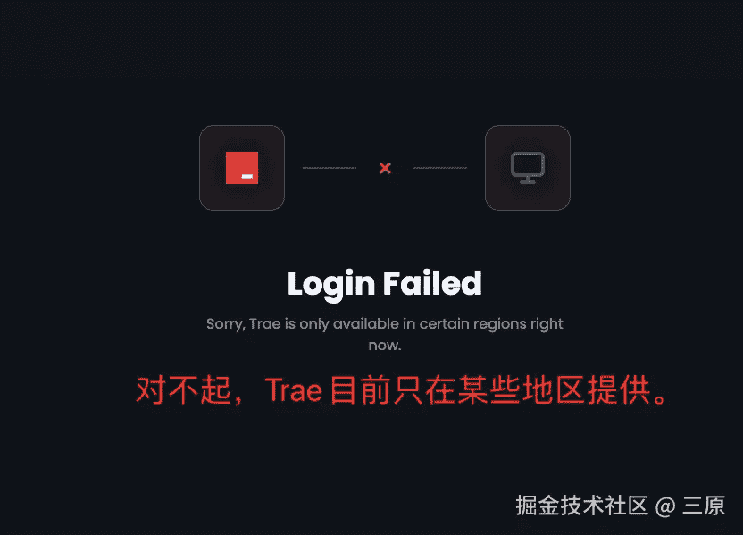
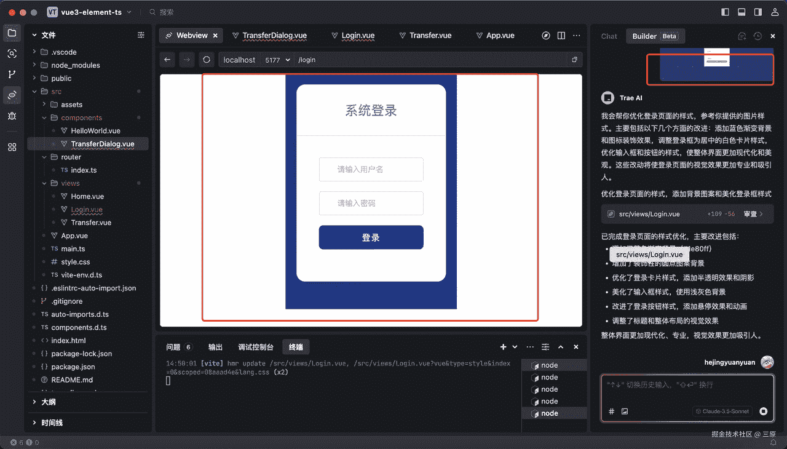
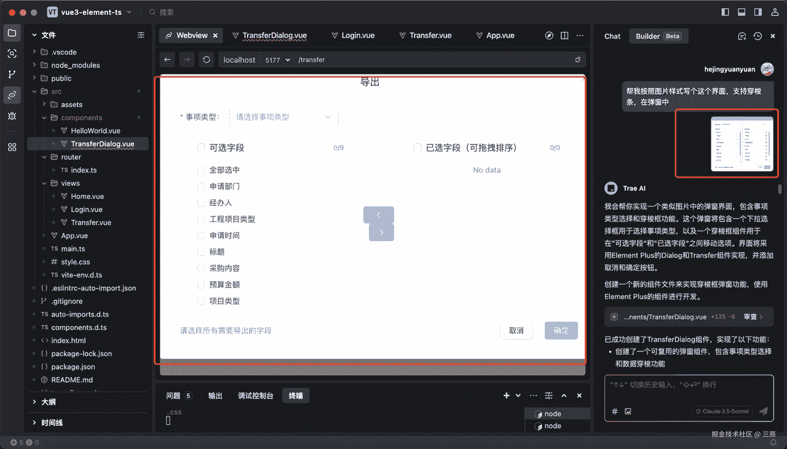

# Trae字节推出AI编程你确定不来使用试试？

> 来源：[https://agijuejin.feishu.cn/docx/Ep3FdWRWcoJH93xWN0UchHkInFB](https://agijuejin.feishu.cn/docx/Ep3FdWRWcoJH93xWN0UchHkInFB)

> 作者：三原

> 链接：https://juejin.cn/post/7462978602457514019

> 来源：稀土掘金

> 著作权归作者所有。商业转载请联系作者获得授权，非商业转载请注明出处。

> 如有侵权，请联系删除。

**我正在参加Trae「超级体验官」创意实践征文， **本文所使用的 Trae 免费下载链接： www.trae.ai/?utm_source…

## Trae字节跳动推出AI编程你确定不来使用试试？

**我觉得我们首先知道****我们需要一个****什么样的 **辅助编程类的AI ，大胆一点：我想要产品告诉我需求后，经过我的 脑袋想一下 ，这个AI就能给我实现项目，这个样子我就能 好好摸鱼 了！！

未来应该肯定可以达到这个高度，但是也预示着可能就不需要程序员了！

说下现在 AI ChatGPT 问世后，国内的AI也是百花起放，首当其冲的是 豆包、通义灵码、Kimi 等等

我先说下本人对这些 chatGpt 产出后的一些使用,主要体现在查询上，我遇到问**题了我会去**问 gpt ，得到的答案很中**肯，有好的**有坏的，但是我感觉要比我查询高效很多，尤其是在我不 🪜 的情况下。 我觉得我不需要 🪜 ，就能得到我想要的答案了

我查询类的问题会去问 KIMI , vscode插件安装的是 通义灵码 ，我 通义灵码 主要用来做代码提示（摁Tab回车应用），有些时候还是蛮好用的。

## Trae的底层大模型

缺点： 现在需要 **🪜 **并 **Mac用户 **才能去使用，预计春节过后发布windows版本 ,因为它的底层模型使用的是 Claude 3.5 Sonnet 和 GPT-4o 。





都是一些国外的大模型， GPT-4o 就不在多说了，咱们来说下 Claude 3.5 Sonnet

Cla**ude 3.5 So**nnet 是由 Anthropic 公司研发的先进人工智能模型。Anthropic 是一家专注于开发高性能人工智能模型的公司，Claude 3.5 Sonnet 是其 Claude 系列模型中的最新版本，于 2024 年 6 月 21 日正式发布。

+   **性能提升 **：Claude 3.5 Sonnet 在多项基准测试中超越了 OpenAI 的 GPT-4o 和谷歌的 Gemini 1.5 Pro。它在编码、数学推理、视觉处理等方面表现出色，尤其在编码能力上解决了 64% 的问题，显著高于前代的 38%。

+   **多模态支持 **：该模型支持文本和图像输入，能够处理复杂的视觉任务，如图表解释和从不完美图像中转录文本。

+   **性价比高 **：Claude 3.5 Sonnet 的成本仅为前代 Claude 3 Opus 的五分之一，每百万输入 tokens 仅需 3 美元，输出 tokens 15 美元。

> 从现在的 Trae** 来看**目前还没有收费用，未来感觉会有 **收费 **，万事肯定是以**盈利为基础的。**所以趁着还没收费，先爽了再说。你可以说他是 套壳 。 但是为了 提供好的服务 ，整合好的资源本身就是一种能力啊。

## Trae 的界面


可是使用 trae 命令直接唤起 trae 应用 （前提是安装了trea命令）

## Trae 的两种模式

**Trae-Chat模式 **随时对您的代码库或编程相关问题提问或寻求建议。这个不回给你直接**创建文**件等之类的你可以选择需要不需要去 应用 ，适合一些基础的问题应用


**Trae-Builder模式 **轻松完成从零到一的项目构建。在 Builder 模式下，对代码文件的任何更改都会自动保存。 这个模式下会自动根据你的需求创建一些资源文件，更适合需要它编写复杂的应用场景。

接下来咱们使用Trae-Builder模式让他帮咱们搞一个vue3 的工程如下：


安装依赖的时候报错了，但是任务并没**有停止，或**者说我可能最想要的是它能帮我 解决报错 。之后它又提示我重新运行了下npm install，原来是进错目录了！！


接着运行时提示 **node **版本过低无法运行最新的 **vite **,其实也一直在帮我解决问题。那么咱们接受它的意见继续往下走，可以厉害帮我解决了！！！


走到这里，咱们来总结下，第一次错误时进错文件目录执行 npm install ,然后紧接着帮我切换目录让我重新运行 npm install 。

第二次错误是电脑本机安装了node版本过低 16.xx.xx ,完事它给我们匹配了适合我node版本的 vite 版本。

正常没有使用 Trae 的时候，我可能真的会花点时间去解决问题。首先我们拿着错误提示去问问 kimi 看看它给我们什么样的参考建议：

> 可以看出其实 KIMI 也给出参考建议说又 node 版本问题了，说让我切换 nvm node 版**本，假**如我的本地没有nvm就需要继续去找解决方案。 Trae 的 优势 就体现出来了！ 直接能提示你运行 npm uninstall vite @vitejs/plugin-vue 接着提示你安装适合你的依赖 npm install vite@4 @vitejs/plugin-vue@4 --save-dev 解决了遇到的问题。

咱们接着往下走，我让他帮我创建一个 Login 界面看看他会怎么写：


> 如上它写好了并能支持运行，它帮我自动引入了 router ，我本来项目中是没有的！！！ 而且我检查了下它的代码写的也是蛮规范的如下：

```
&lt;script setup lang=&quot;ts&quot;&gt;
import { ref, reactive } from &#x27;vue&#x27;
import { useRouter } from &#x27;vue-router&#x27;
import type { FormInstance, FormRules } from &#x27;element-plus&#x27;

const router = useRouter()

interface LoginForm {
  username: string
  password: string
}

const loginForm = reactive&lt;LoginForm&gt;({
  username: &#x27;&#x27;,
  password: &#x27;&#x27;
})

const loginFormRef = ref&lt;FormInstance&gt;()

const rules = reactive&lt;FormRules&gt;({
  username: [
    { required: true, message: &#x27;请输入用户名&#x27;, trigger: &#x27;blur&#x27; },
    { min: 3, max: 20, message: &#x27;长度在 3 到 20 个字符&#x27;, trigger: &#x27;blur&#x27; }
  ],
  password: [
    { required: true, message: &#x27;请输入密码&#x27;, trigger: &#x27;blur&#x27; },
    { min: 6, max: 20, message: &#x27;长度在 6 到 20 个字符&#x27;, trigger: &#x27;blur&#x27; }
  ]
})

const handleLogin = async (formEl: FormInstance | undefined) =&gt; {
  if (!formEl) return
  await formEl.validate((valid) =&gt; {
    if (valid) {
      router.push(&#x27;/home&#x27;)
    }
  })
}
&lt;/script&gt;

&lt;template&gt;
  &lt;div class=&quot;login-container&quot;&gt;
    &lt;el-card class=&quot;login-card&quot;&gt;
      &lt;template #header&gt;
        &lt;h2&gt;系统登录&lt;/h2&gt;
      &lt;/template&gt;
      &lt;el-form
        ref=&quot;loginFormRef&quot;
        :model=&quot;loginForm&quot;
        :rules=&quot;rules&quot;
        label-width=&quot;80px&quot;
        class=&quot;login-form&quot;
      &gt;
        &lt;el-form-item label=&quot;用户名&quot; prop=&quot;username&quot;&gt;
          &lt;el-input v-model=&quot;loginForm.username&quot; placeholder=&quot;请输入用户名&quot; /&gt;
        &lt;/el-form-item&gt;
        &lt;el-form-item label=&quot;密码&quot; prop=&quot;password&quot;&gt;
          &lt;el-input
            v-model=&quot;loginForm.password&quot;
            type=&quot;password&quot;
            placeholder=&quot;请输入密码&quot;
          /&gt;
        &lt;/el-form-item&gt;
        &lt;el-form-item&gt;
          &lt;el-button type=&quot;primary&quot; @click=&quot;handleLogin(loginFormRef)&quot;&gt;
            登录
          &lt;/el-button&gt;
        &lt;/el-form-item&gt;
      &lt;/el-form&gt;
    &lt;/el-card&gt;
  &lt;/div&gt;
&lt;/template&gt;

&lt;style scoped&gt;
.login-container {
  height: 100vh;
  display: flex;
  justify-content: center;
  align-items: center;
  background-color: #f5f5f5;
}

.login-card {
  width: 480px;
}

.login-card :deep(.el-card__header) {
  text-align: center;
}

.login-form {
  padding: 20px;
}
&lt;/style&gt;
```

> 写到这里我其实是 **震惊的 **，太棒了！

## Trae 的图片识别完成界面开发

我拿了一个 demo.buildadmin.com/#/admin/log… 后台管理的登陆页面截图给他，让他帮我实现一个登陆页面。发现并没有完全实现



我又经过几次修改，还是没能达到预期。

我又测试了一下让他帮我实现一个从网上找来的截图如下：


实现效果如下:



> **实现的也还**行，文字也都识别了，但是后来我让他一直实现对 已选字段 做一个拖拽排序，一直没能成功。

## 总结

其实看到这里已经能看到 Trae 的能力了，他针对的还是 **开发工程师 **，能一定的帮你解决问题，并且实现功能。 以那个穿梭条为例，就是咱们自己实现来说页面还是需要写的，完事经过了 Trae 后咱们只需要写个拖拽排序的逻辑就行了，他跟低代码平台相比来说，他写的代码更加规范，可读。

再者假如有项目运行报错了，可以交给它试试帮你解决，我相信它一定会帮你解决！！

关于 **🪜 **以及Mac系统。春节后官方说就会**支持Win**dows系统，搓搓手期待下。 🪜 的话我只是在登陆阶段开启了，在问问题阶段用不用都行。

这个其实不用担心，后面肯定会全面放开的。

经过我以上的演示你觉得这个 Trae 怎么样，我接下来会深入应用到项目中，等有问题再来总结，咱们评论区见