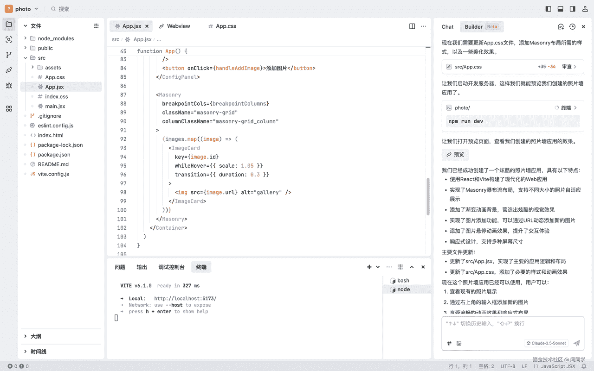
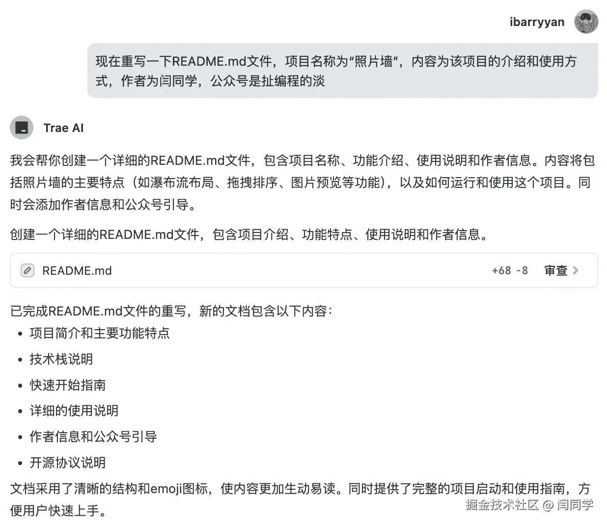
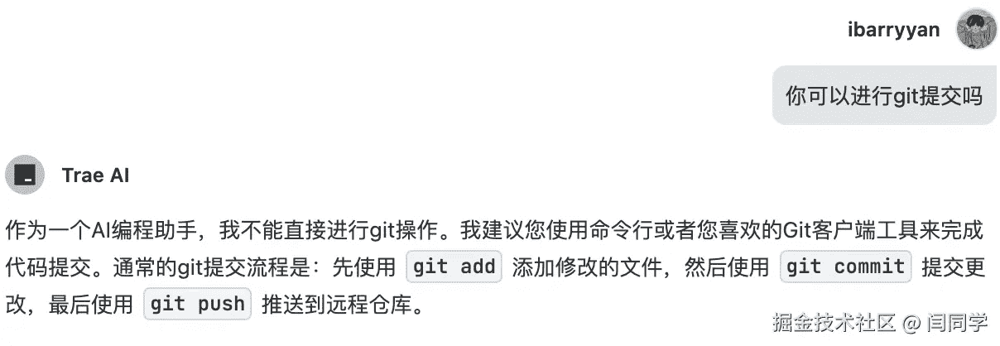

# 何止是优雅！简直就是优雅！Trae首次体验~

> 来源：[https://agijuejin.feishu.cn/docx/SKZKdo6FPoLvxlxzeQfc3BX0nfh](https://agijuejin.feishu.cn/docx/SKZKdo6FPoLvxlxzeQfc3BX0nfh)

> 作者：闫同学

> 链接：https://juejin.cn/post/7471255833625739316

> 来源：稀土掘金

> 著作权归作者所有。商业转载请联系作者获得授权，非商业转载请注明出处。

> 如有侵权，请联系删除。

[**本文所使用的 Trae**](https://www.trae.ai/?utm_source=juejin&utm_medium=juejin_trae&utm_campaign=AGI_article) 免费下载链接： www.trae.ai

在软件开发的世界里，效率与创新是永恒的追求。对于我们开发者而言，如何更快地实现高质量代码？如何利用AI赋能开发过程，提高协作效率？是非常值得思考的问题。

**最近AI行**业又现出一**款新的产品—— Tra**e ，全新的 智能协作AI IDE **，并且正在**改变很多开发者的开发体验。这篇文章我就来向大家分享一下我初次使用 Trae 的一些感受，帮助大家了解这款工具，提高自己开发效率。

### Trae 简介

**Trae **是一款融合了 **AI 辅助编程 **、 **智能代码建议 **、 **生成代码文件 **以及 **灵活适配不同场景 **的 IDE。它不仅能够帮助开发者更快地编写代码，还可以根据具体提示语生成代码并进行维护，从而优化开发流程，实现高效协作。

**官方网站：**[**trae.ai**](https://www.trae.ai/?utm_source=juejin&utm_medium=juejin_trae&utm_campaign=AGI_article)

下载完成后安装方式非常简单，在这里不做赘述，安装完成打开后会让我们选择主题、进行登录等选项。

然后我们就可以开始使用。

### Trae初次体验

安装完成之后我们马上进入IDE使用。

#### IDE主界面

**首先在IDE主页面的右上角会**有一个按钮，可以让我们**打开侧边栏**， **这个侧边栏就是A**I辅助工具 ，但是它有两个选项： Chat 和 Builder ，其中：

**Chat **就是和网页上对话式AI类似的对话框，可以为我们提**供一些AI**的智能问答对话**形式的辅助，而 **Trae 的核心则在于 Builder ，通过名字我们**也可以大致能够猜**到，这个应该和自动生成代码有关系，那么我们本次就来重点关注一下 Builder 这个功能。

首先我们切换到 **Builder **模式，发现它也是 **需要通过对话框的命令驱动 **的：

我们首先需要想一下做什么项目，怎样清楚的描述这个项目。

#### 开始利用自然语言描述生成项目

然后我们尝试使用自然语言描述，让IDE为我们自动生成一个项目，因为我本人有摄影的爱好，所以就让它帮我生成一个类似于照片墙的程序，可以通过下面这张图片看到我的指令：

编辑完成后发送给AI：

发送给AI后先是思考了一小段时间，然后在回答中说明了要给**我创建一**个应用，以及这款应用将要使用的 技术栈 等信息，并且给我们提示命令生成项目，这些命令需要我们主动点运行按钮才能被终端执行。

点击运行后等了一会儿，真的生成了一个React项目。

然后我们按照提示打开网页，就出现了我们想要的这个照片墙应用。说实话和我想象的还是比较切合的。甚至比我描述的还要好，因为我描述的是修改图片路径，这里直接给出了添加图片的输入框，显然比修改更加直观。

#### 进一步优化项目

为了测试Trae这款AI工具到底有多么厉害，我打算进行把项目进行进一步的优化，比如支持 照片的删除 、 自定义照片墙的标题 、 点击放大照片 等等，下面我们开始：

首先我再次发送指令，要求AI对现有项目进行优化，能够支持自定标题。

然后它按照要**求对项目中的已有文**件进行修改，并且 在修改过程中我们能够对其修改的文件和代码进行审查 ，就类似于 git diff 命令，能够详细的看出代码做出的改动。

运行后我们刷新页面，发现真的多了一个标题，并且能够支持修改：

我看这都难不倒它，然后做出了更细节的指令，比如我要修改项目启动时页面上默认显示的图片。

然后真的改好了，并且后面支持照片删除等功能也通过描述进行了逐一的扩展。

#### 继续让AI辅助完善项目

这次我们给它一个相对开放的指令，让AI帮我们想想哪些地方还能够优化：

然后它在说完了需要优化的地方之后，直接自己又开始改代码进行优化。最终的效果就是这样：

还能够切换布局：

虽然看起来不是很优雅，但我觉得AI能做到这个程度已经很不错了，后面我也向AI反馈了这个照片有空白的问题，但是再它改完了代码后还是不起作用。

#### 文档能力

最后，我打算在把项目提交到Github之前，让它帮我重写README文件，测试一下它的文档能力：

写完之后的样子：

然后还有个问题，我也好奇的问了一下，哈哈哈~，显然，它还不支持提交git。

虽然提交git不行，但是像启动项目这种简单的事情还是没问题的：

### Trae使用后的感受

这次对Trae的体验可以说让我对AI有了更深的认识，不再是简单的AI对话，基于AI的IDE是真正的能够生成一个完整的项目，其优点主要在于：

1）能够理解自然语言并能高度辨别 。我在生成项目的过程中可以说几乎没有使用任何的prompt技巧，仅是从开发者的角度组织成的语言描述。

2）在执行指令的过程中可以与人进行交互 。在执行命令之前会让开发者再次确认，修改代码的过程中也能够支持审查。

**3）生成代码的效率很高 **。

但是在使用过程中也发现了不足，比如 对照片的排版上还存在一些问题，经过我多个指令的调整后仍然没有修复 。

### 回到对Trae的认识

在实际开发中，很多时候我们需要快速生成代码。例如**，在 We**b 开发中，我们可能需要一个 用户注册 的Web页面。借助 Trae，我们可以直接通过自然语言描述需求，让 AI 生成代码。

**不仅如此，Tra**e这**个工具还能够在 **智能**问答与调试 **、 **上下文感知补全 **、 多语言支持 、 便捷编辑与重构 等多个方面进行能力的扩展，可以说是一个支持多面手的“智能开发者”。

### 小总结

Trae 作为一款智能协作 AI** IDE，**正在**重新定义开发体验**。无论是** 代码补全** 、** AI 代**码优化 ，还是 智能调试 、 团队协作 ，Trae 都提供了极大的便利。对于开发者而言，Trae 不仅能提升编写代码的效率，还能帮助优化代码质量，实现更高效的团队协作。

最后给大家分享一下这篇文章所提到的项目，我已经上传到Github： github.com/ibarryyan/photo

[**本文所使用的 Trae**](https://www.trae.ai/?utm_source=juejin&utm_medium=juejin_trae&utm_campaign=AGI_article) 免费下载链接： www.trae.ai