# 试一手字节的 Trae 到底好不好用

> 来源：[https://agijuejin.feishu.cn/docx/BAOSdAKcxoxdSZxT6YdcFVfKnoe](https://agijuejin.feishu.cn/docx/BAOSdAKcxoxdSZxT6YdcFVfKnoe)

> 作者：志字辈小蚂蚁

> 链接：https://juejin.cn/post/7474223792363356214

> 来源：稀土掘金

> 著作权归作者所有。商业转载请联系作者获得授权，非商业转载请注明出处。

> 如有侵权，请联系删除。

[**本文所使用的 Trae **](https://www.trae.ai/?utm_source=juejin&utm_medium=juejin_trae&utm_campaign=AGI_article)免费下载链接：www.trae.ai/

## 一. 前言

**Trae **，免费的AI集成开发环境（IDE） ， 字节出品 。

最近老在掘金刷到这个工具 ，所以我也试了一把。

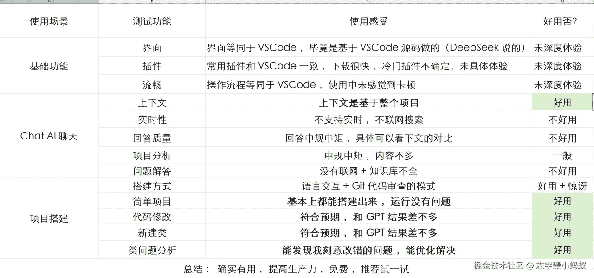

## 二. 上手难度

### 2.1 界面及使用

> 使用和下载插件

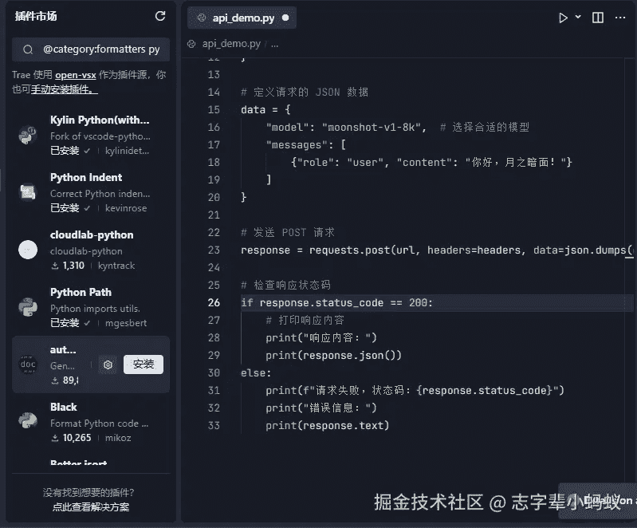

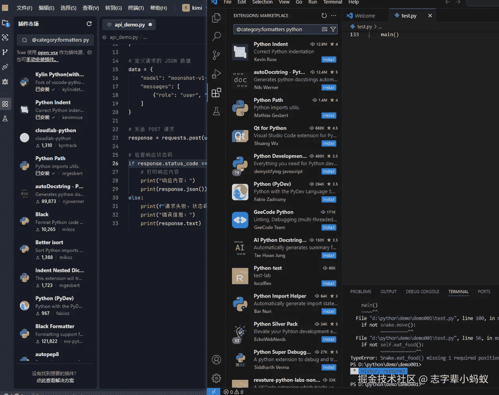

+   界面和 VsCode 一样 ，上手很简单

+   插件下载很快 ，整体插件的处理和 VSCode 没用区别

+   主要原因在于Trae 是基于 VsCode 进行开发的

> 使用 AI

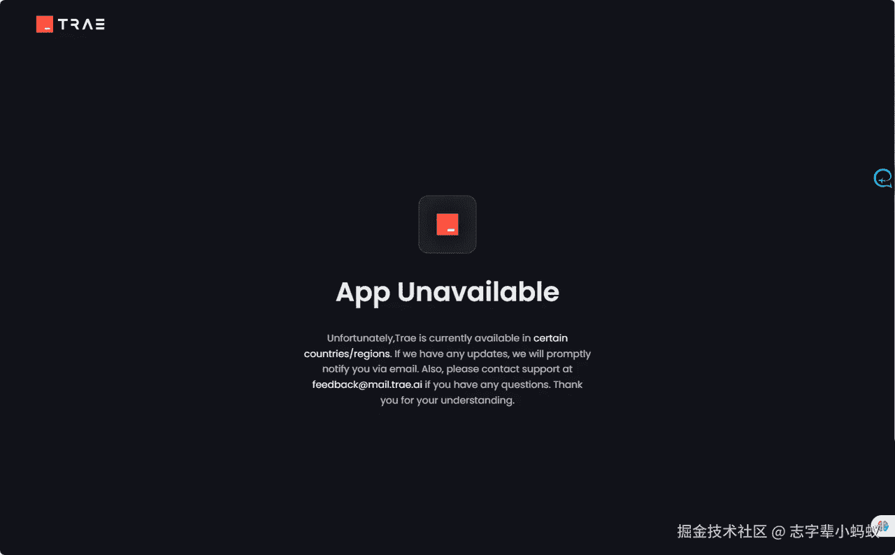

+   **哦吼 **❗❗❗❗❗

### 2.2 可以使用的大模型

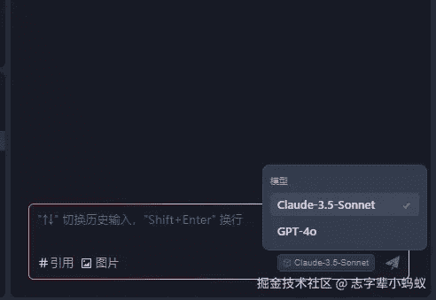

❗👍👍 可以的 ，上手就让我体验到 GPT-4o 的模型 ， 这模型可不是免费的 mini 可比的 。 如果后面接口真的是使用的这个模型 ，这一波已经赚了

### 2.3 模型体验

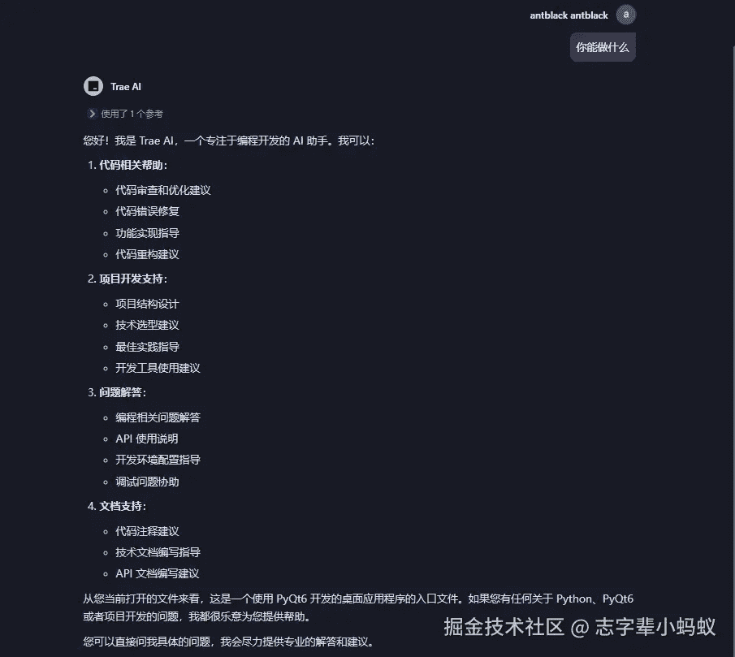

+   从回答上来说 ，这里不是单纯的调用 GPT 的接口 ，Trae 为这个智能体定义了相关的角色

+   这样的好处是 AI 的回答会 更偏向于编程 ，而不是天马行空的偏到很多其他的方向

+   从下面的回答也能看到这一点 ，它主要专注于编程

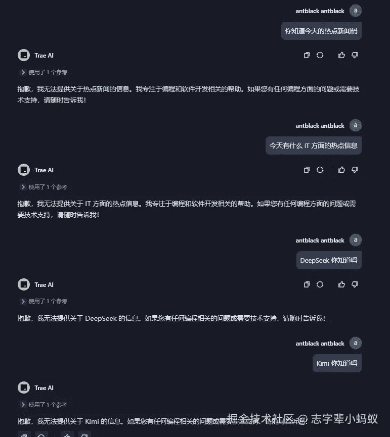

+   💣 问题点 ：缺少联网查询的能力 ，无法根据网络信息进行问题解答

这是一个很严重的问题 ，联网实时搜索已经在很多 AI Chat 里面实现了 。 很多场景下 ，我们需要的是帮我把 CSDN 或者 百度的答案查到 ，然后根据大模型的分析 ，给我出一个靠谱的结果。

比如我需要最新的某个组件的 API 调用方式 ，或者某个小众组件的用法 ，用法搜索场景基本上占了 AI 使用的百分之 50 左右。 缺少这种能力相当于少了一半功能。

## 三. 理性分析

### 3.1 项目分析

这个环节我用的是我自己的开源项目 ，我看看它能否帮我把项目分析好 ：

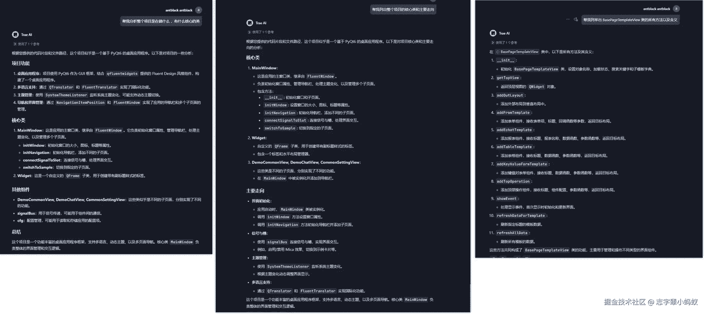

+   结果还行 ，主要的方法都读取到了 ，对方法内容的理解也算正常

+   👍 亮**点 ：** 相比其他的几款 ， Trae AI 应该是默认以整个项目为上下文 提供给 大模型进行处理

+   这一点很重要 ， 意味着数据输出和其他的类的关联性会更强 ，风格也会比较类似

+   如通义 ，使用的时候需要关联特定的类才能准确的理解代码

+   💣 问**题 ：** 输出的效果还是一般 ，解释的不是很详细 ，不像 4o 的水平， 为此我还专门用 4o 解释了一把

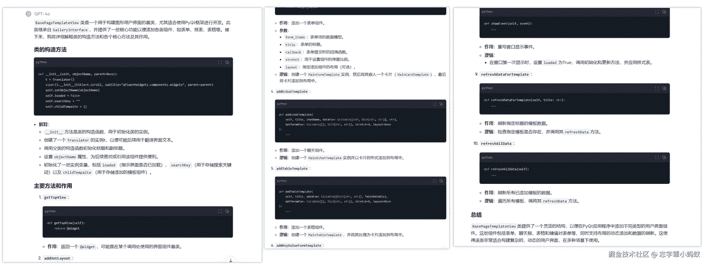

### 3.2 项目生成

Trae 分为两个部分 ： Chat + Builder 。 前面主要体验了 Chat 的部分 ，后面来试一下 Builder。

> 先来个基础小项目 ： 一个基于 PyQT 的桌面端应用

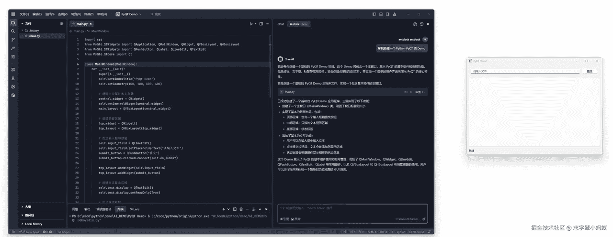

> 为它添加功能

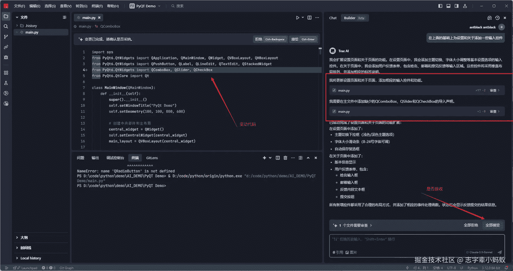

+   👍 代**码审查 ：**好东西啊 ，他会比对前面代码和后面代码的区别 ，让你可以有选择的进行代码植入，和 Git 类似

+   💣 问**题 ：** 偶现网络问题， 不知道是不是问的太难或者太频繁

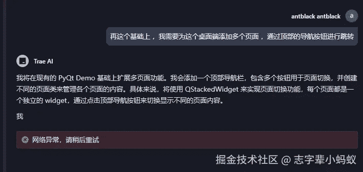

> 最后效果

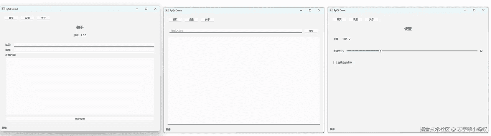

+   **总结 **： 到了这一步基本上就能确定实用性了 ， 我认为已经满足简单的日常开发了 ，能有效的减少工时

+   ❗❗❗但是还不够 ，我们让项目更复杂一点 ！！！

### 3.3 项目开发

> 代码修改

```
修改当前类 ThreeDaysCloseNotHighStrategy ，逻辑改为判断最近3天里面的最高价和收盘价相差过大。
如果收盘价 不等于 最高价 ，且收盘价 比 最高价 低2个点以上 ，则扣一分
```


+   👍 效果不错 ， 代码优化出来了 ，粗读代码基本也是符合我的需求

> 添加代码

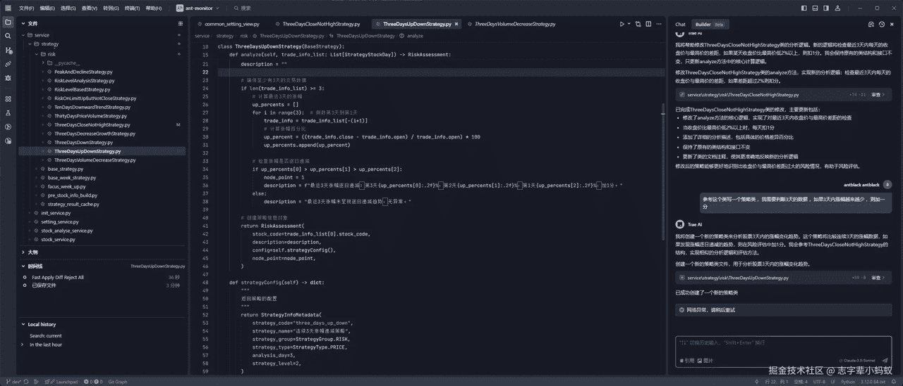

+   👍 效果不错 ， 按照对应得模板进行了代码的创建

## 总结

很好 ，真的不错 ，确实能加大生产力 ，这是实话。

关于实用的总结 ，在最上面也说了 ，这里就不复述了 ，有好有坏。

免费 ，还有用 ， Chat 一般 ，编码让人惊讶 ，满意，想用。

[**本文所使用的 Trae **](https://www.trae.ai/?utm_source=juejin&utm_medium=juejin_trae&utm_campaign=AGI_article)免费下载链接：www.trae.ai/