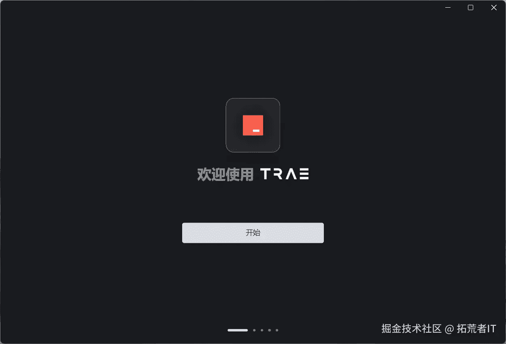
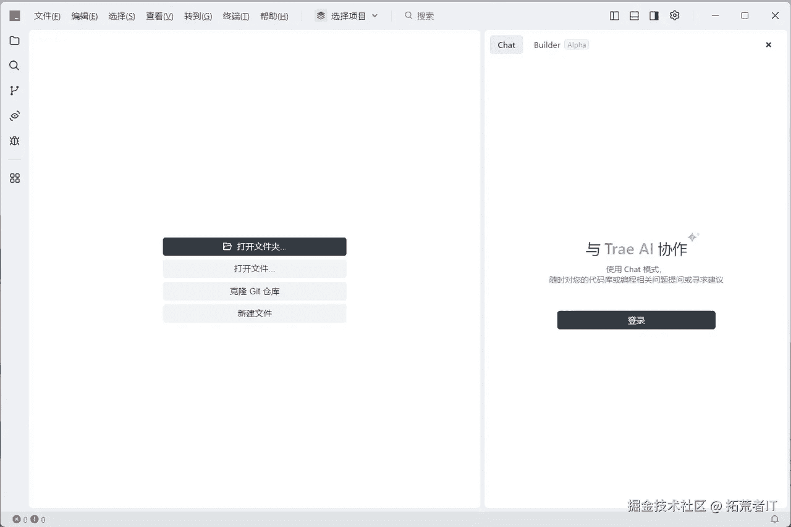
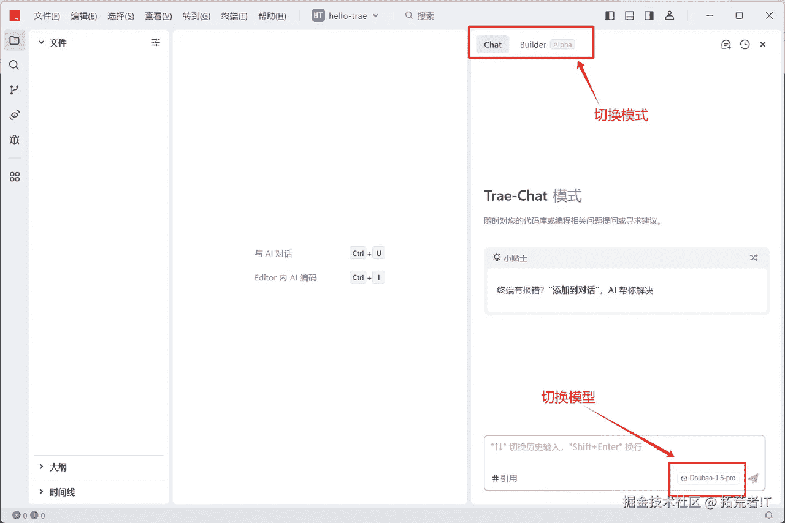
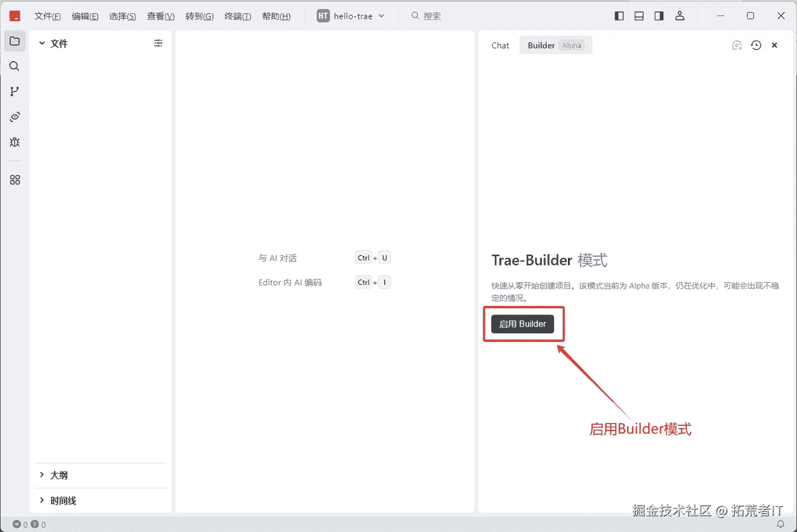
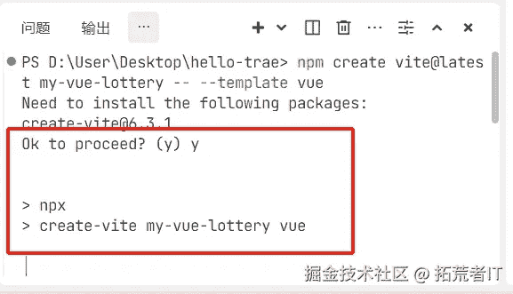

# Trae 国内版 快速上手

> 来源：[https://agijuejin.feishu.cn/docx/QkVddBPVAo5Zttx5cH1cnvLAnlc](https://agijuejin.feishu.cn/docx/QkVddBPVAo5Zttx5cH1cnvLAnlc)

> 作者：拓荒者IT

> 链接：https://juejin.cn/post/7477534896716103720

> 来源：稀土掘金

> 著作权归作者所有。商业转载请联系作者获得授权，非商业转载请注明出处。

> 如有侵权，请联系删除。


朋友们，今天听说字节上线了Trae 国内版，对标Claude的一款AI智能IDE，晚上迫不及待的下载安装，并使用trae来创建一个年会抽奖程序（方便和cline做对比）。废话不多说，马上奉上体验报告！

## 安装&启动

下载地址： www.trae.com.cn/

打开网址，根据你的操作系统选择对应版本，我使用的windows系统，这里默认的就是windows，直接下载，无脑下一步安装。

安装完成后打开Trae，界面非常简洁：



这里会进行一些配置，我们点击开始按钮，继续下一步：


选择自己喜欢的主题，我这里选择的是亮色，黑色和深蓝配色也很棒，大家可以选一个自己舒适的颜色。选定后继续：


因为trae是基于vs code开发的，完全兼容vscode的插件和配置，由于我想要一个干净的开发环境来进行测试，因此这里选择跳过。等后面验证完开发功能之后再决定是否导入。跳过导入之后继续：


添加命令行，trae可以通过命令行来启动。这里用处不大，我选择了安装，如果在刚好打开命令行，启动trae会更方便一些。安装完成后继续下一步：


这里是配置的最后一步，刚开始我选择跳过，但是打开之后如果不登录，则无法使用AI功能，因此这里点击登录。此时会打开浏览器，在浏览器登录完成后会对trae授权。目前支持两种登录方式：

1.  手机号登录

1.  掘金账号登录

我这里使用手机号进行登录。登陆后打开编辑器：



界面依然简洁，左侧是工作区，右侧是AI助手面板。

## AI编程配置

当我们登录账号后，在AI面板会展示出来支持的两种模式，分别是Chat模式和Builder模式。



### Chat模式

Trae Chat模式左侧面板展示一个对话框，用来输入我们想要AI帮助解决的问题。在窗口底部右侧可以选择使用的AI模型


目前支持的模型有：

1.  Doubao-1.5-pro (默认)

1.  DeepSeek-Reasoner(R1)

1.  DeepSeek-Chat(V3)

这些模型都是免费无限量使用的，我们可以随便提问，速度非常快。相比于让AI给出编程提示，我更喜欢Builder模式，因此快速跳到下一节，期待已久的Builder模式！

### Builder模式（Alpha）

在切换模式时可以明确看到，Builder模式仍处于Alpha阶段，功能可能会不稳定（所以使用过程中我们要多一些包容，慢慢尝试，细心引导）：



启动后，我们可以看到和Chat模式相似的窗口：


在builder模式中，我们可以使用两种大模型，分别是(字节自家的豆包还不支持)：

1.  DeepSeek-Reasoner(R1)

1.  DeepSeek-Chat(V3)

我们这里选择DeepSeek R1，在对话框里输入：

```
帮我生成一个基于网页的抽奖程序，要求采用vue来进行开发，界面简洁，易于使用
```

回车，让代码飞一会儿~


trae在执行命令的时候，会停下来让我们审阅和运行。我们点击运行，trae会帮我们运行创建项目的命令，接下来每一个步骤都会询问我们（个人感觉有点烦哦，可能是Alpha的原因），命令行里执行代码也需要选择和确认：



项目生成完之后，又通过几个指令对功能进行微调，全程没有输入一行代码，仅告诉trae需要什么，要进行哪些修改，耗时半个小时左右，完成了一个效果还说得过去的抽奖程序：


（为啥总是写抽奖程序呢？因为刚入坑的时候，几乎每年都有朋友问我要抽奖程序。这回好了，AI可以帮他们搞定~）

## 总结

朋友们，今天这篇文章只能算是trae初体验，但是我已经被Trae AI IDE震撼了，尽管目前Trae还处于Alpha阶段，但是功能已经如此强悍了，代码辅助、自动编码、代码补全……后面会对我们的开发提供什么样的帮助，让我们一起期待吧~

**Trae 国内版下载地址： **www.trae.com.cn/