# Trae国内版正式上线！普通人到底Trae不Trae

> 来源：[https://agijuejin.feishu.cn/docx/Gud3dUwwCoOhhKxGYrHcId9OnSd](https://agijuejin.feishu.cn/docx/Gud3dUwwCoOhhKxGYrHcId9OnSd)

> 作者：11在上班

> 链接：https://juejin.cn/post/7477143031801479222

> 来源：稀土掘金

> 著作权归作者所有。商业转载请联系作者获得授权，非商业转载请注明出处。

> 如有侵权，请联系删除。

## 前言

**在 IDE 工具**持续进化的今天， Trae 国内版的正式发布标志着国产 AI 辅助开发进入新纪元。**我作为长期**使用** VS C**ode 并体验过 Cursor 早期版本的开发者，发现大多数人工具适应性的本质矛盾在于： 开发惯性 与 效能跃迁 的博弈。正如电影《火锅艺术家》中"扣细节"的哲学，本文将从技术架构、功能使用，对 Trae 进行快速体验。

## 强大的AI功能

[安装部分已](https://www.trae.com.cn/?utm_source=juejin&utm_medium=juejin_trae&utm_campaign=AGI_article)跳**过，感兴趣**的同学先去 官网下载 。看到这个官网的**时候，感觉动画**和交**互的审美很在线，这周**有时间的话我要写一篇文章聊一聊前端交互的美学设计，废话不说多，打开 Trae ，可以看到默认常驻了一个AI区域。这个区域通过 Button 表明了两个功能，具体为 Chat模式 和 Builder模式 ：

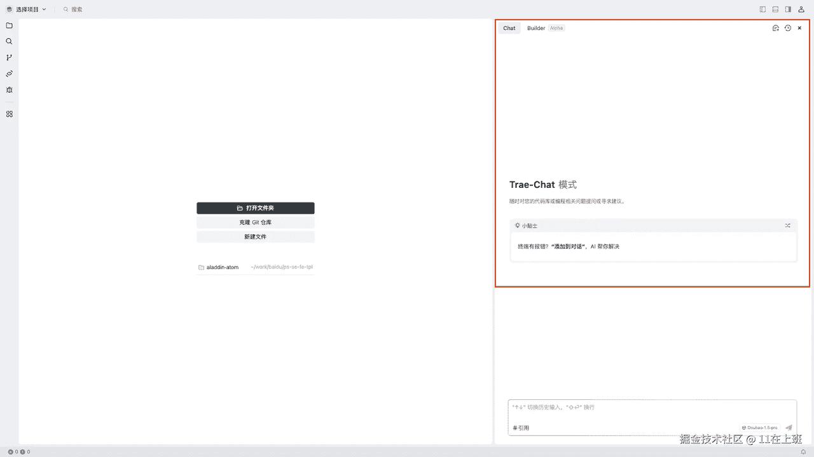

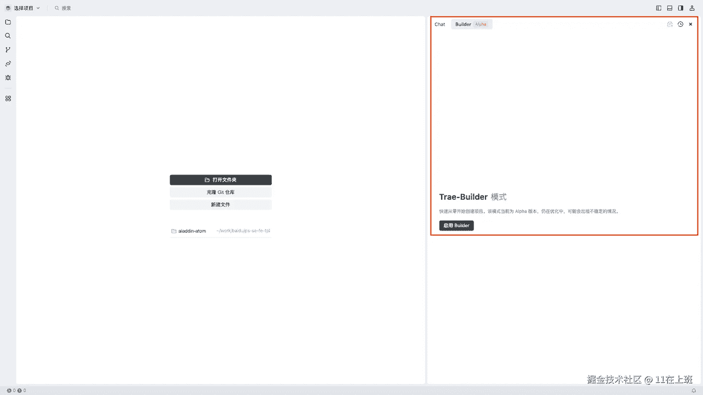

其中：

1.  **Builder 模式 **：通过文字描述应用，Ai 会轻松完成从零到一的项目构建

1.  **Chat 模式 **：AI 将理解#所选内容，可以是code、file、folder。可以随时提出问题、寻求AI的建议。

### Builder 模式：项目脚手架生成引擎

#### 实现原理

**Trae 的 Bui**lder 采用 多模态代码生成架构 （Multimodal Code Generation Architecture），其核心由以下组件构成：

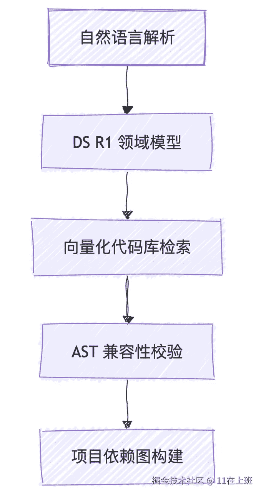

#### 功能使用

Builder 模式中可以选择模型，我选的是 DS R1 ：


选择完成后，输入一段文字描述完成项目从0-1的搭建。我想实现个人日历，页面内容基本是静态的，所以我要求builder使用 Next.js 来搭建：

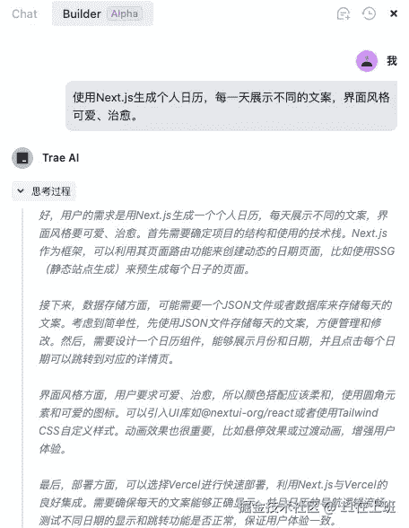

根据我的要求，AI会自动创建文件夹、生成代码以及在完成后弹出可交互的提示：

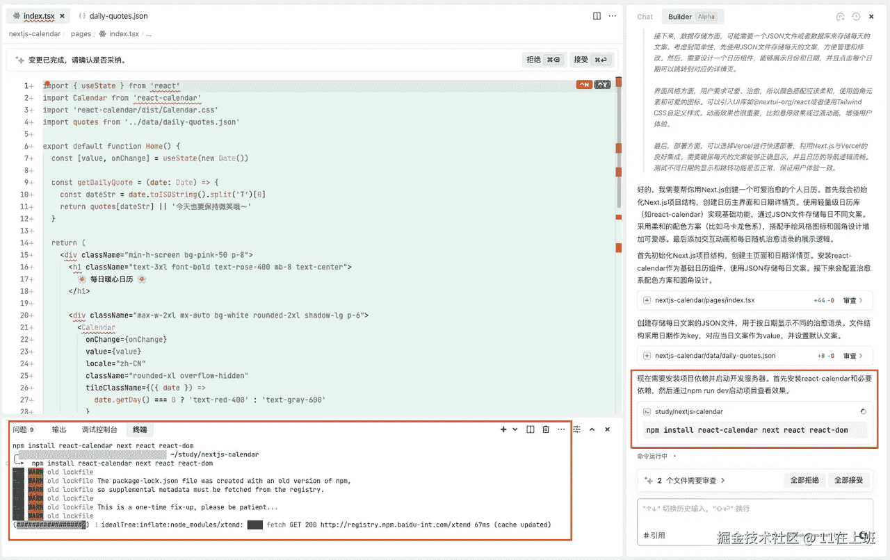

代码生成后，会提示可运行的命令，执行 npm run dev 即可运行该项目，一起看下效果吧～

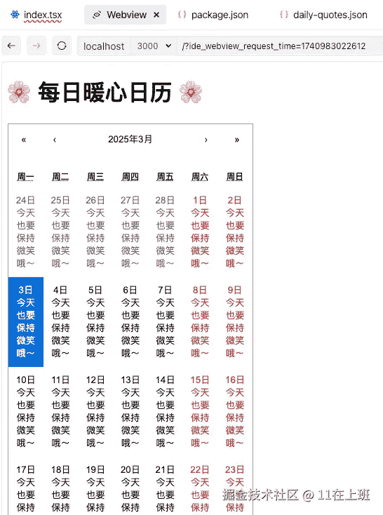

虽然启动了，并且基本不需要我更改生成后的代码，但是这个UI吧，感觉远远不及我的预期啊，那么现在来试试和AI沟通一下我的预期，来优化一下UI吧：

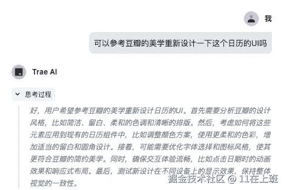

通过沟通，发现一些细节问题：

1.  每次沟通后，Builder会生成一个新的项目，而不是在原有项目中改。

1.  每次点击运行时，都会新开一个终端界面，默认路径不在本次创建的应用下，需要手动更改。

由**于时间原因（工**作摸鱼写的），先不继续优化我这个日历项目了，感觉从0-1创建出我想要的项目还是有点子费劲。下面会通过 Chat模式 尝试去优化第一个创建出来的项目。

### Chat 模式：上下文感知的智能编码助手

#### 架构创新点

1.  **多粒度上下文捕获**

+   代码块级： @function calculateDates()

+   文件级： #/utils/date.ts

+   项目级： monorepo-project

1.  **实时语义分析引擎**

```
// Trae 的上下文理解机制
class ContextAnalyzer {
  constructor() {
    this.embeddingModel = new BertForSequenceClassification();
    this.codeGraph = new CodeGraphBuilder();
  }

  analyzeSelection(codeSnippet) {
    const embeddings = this.embeddingModel.encode(codeSnippet);
    const relatedNodes = this.codeGraph.findSimilar(embeddings);
    return this.generateContextPrompt(relatedNodes);
  }
}
```

#### 功能使用

**Chat 模式 **：通过沟通让AI帮助开发者/普通用户解决遇到的问题，适合优化已有代码：

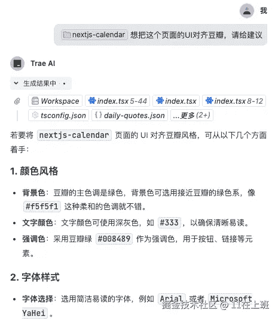

1.  点击「应用」，将AI生成的代码一键同步到文件里，可以满足高效开发：

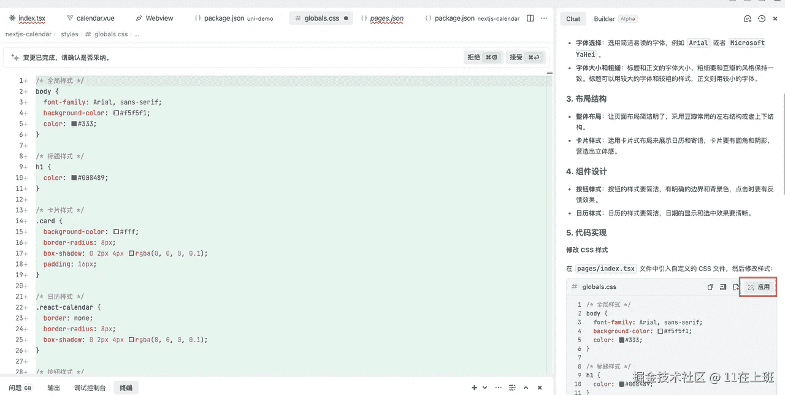

1.  遇到控制台报错时，通过选中错误信息点击「添加到对话」，一键完成提问。

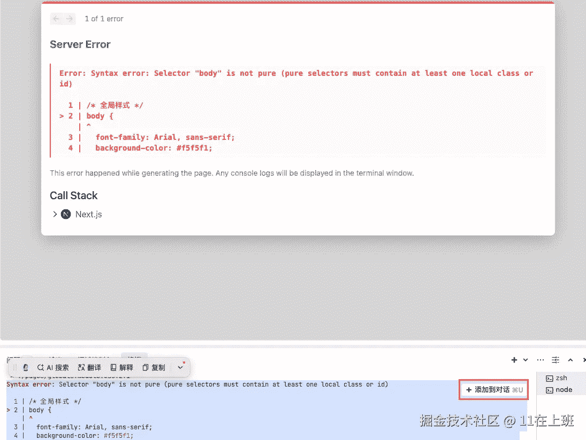

1.  选中有疑问的代码，完成一键「添加到对话」：

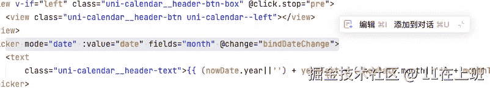

经过简单对话后，完成了一部分UI优化，我需要优化的还有很多地方...

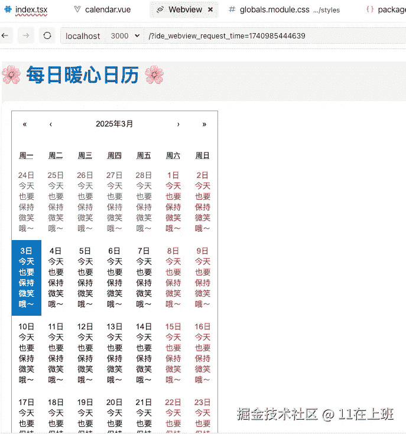

## 总结

### 局限性

**当前版本痛点：**

1.  **项目迭代连续性**
Builder 模式每次生成独立项目，缺乏版本演进能力

1.  **UI 规范适配性**
生成的界面组件存在布局冗余：

```
/* 优化前 */
.calendar-grid {
  display: grid;
  grid-template-columns: repeat(7, 1fr);
  gap: 0.5rem; /* 不符合 8px 基准规范 */
}

/* 建议优化 */
.calendar-grid {
  @apply grid grid-cols-7 gap-1;
}
```

### 结语

**Trae 的出现不仅代表着工**具链的升级，更预示着 AI-First 开发范式 的成熟。尽管存在初期适配成本，但其在以下维度带来的变革值得关注：

1.  **知识抽象层级 **：从语法记忆转向业务逻辑设计

1.  **质量保障体系 **：从后置测试转向实时验证

1.  **协作模式进化 **：从文档沟通转向语义化协同

建议开发者通过渐进式采用策略：

```
1. 辅助工具阶段：Chat 模式日常使用
2. 核心生产工具：Builder 模式启动新项目
3. 全流程集成：CI/CD 管道深度整合
```

正如量子物理学家费曼所言："What I cannot create, I do not understand." Trae 正带领我们走向"理解即创造"的新纪元。

**Trae国内版下载地址：**www.trae.com.cn/