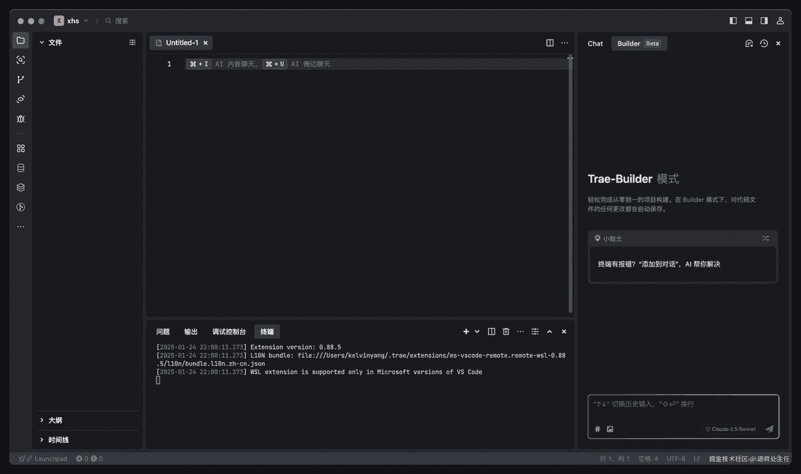
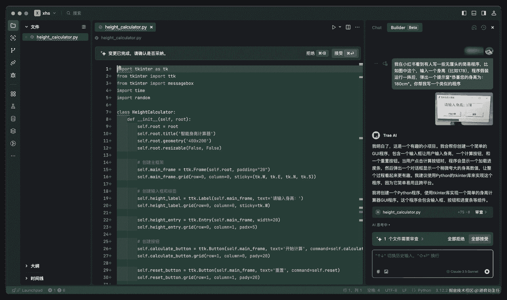
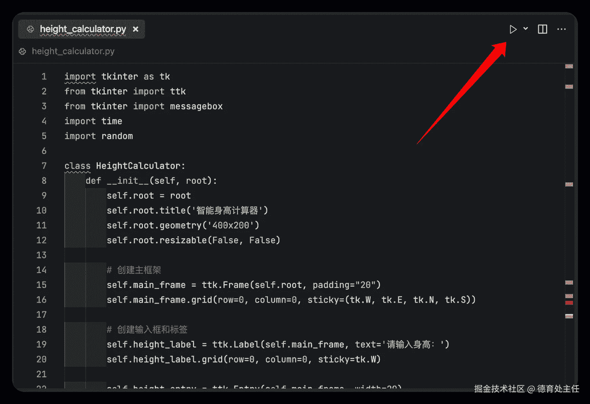
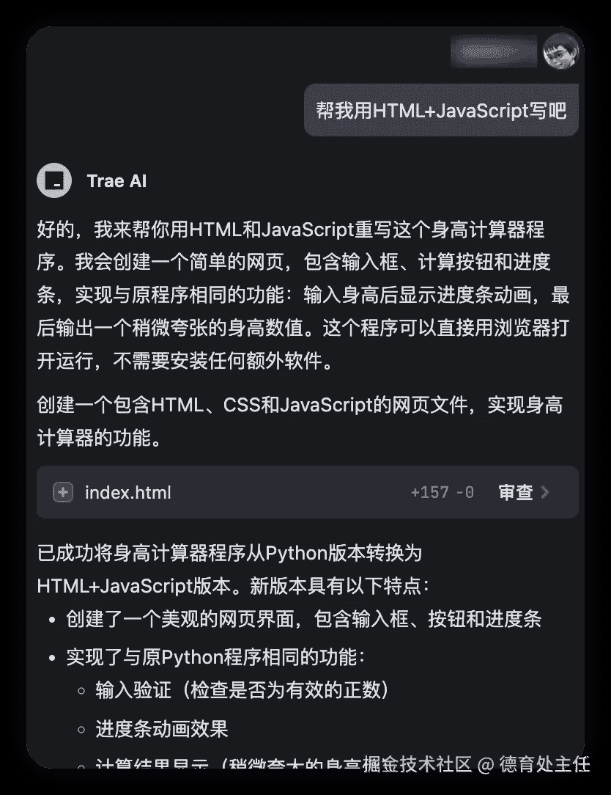
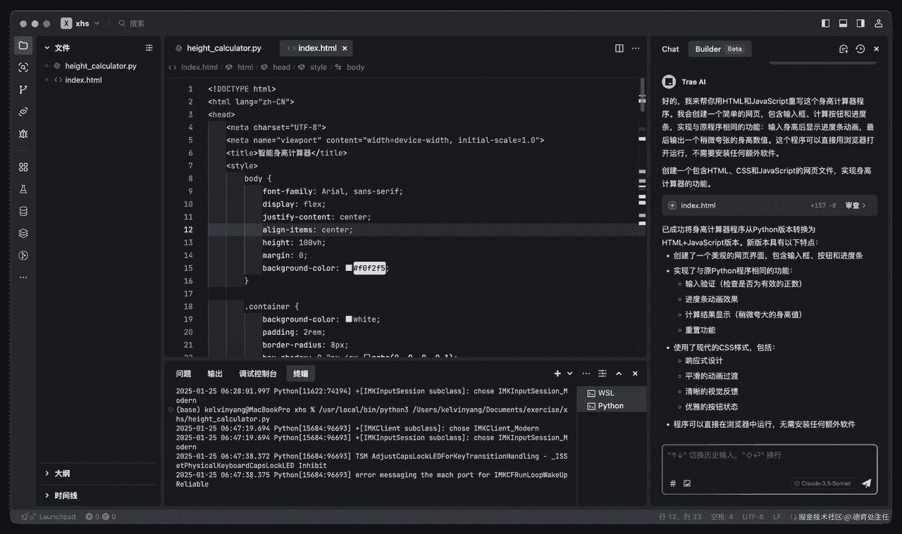
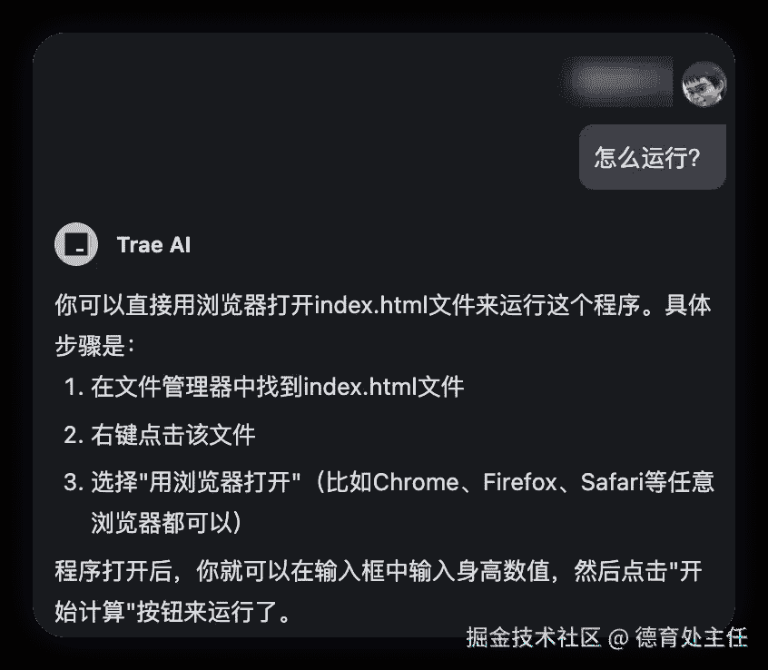
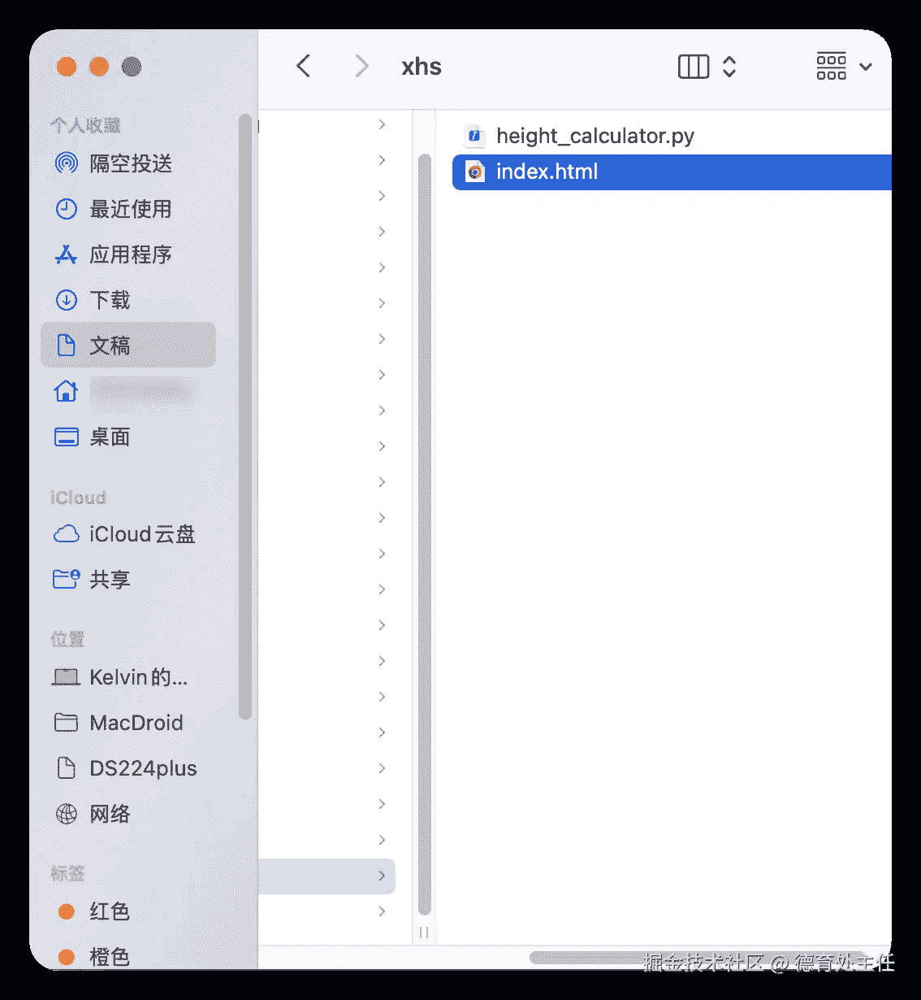
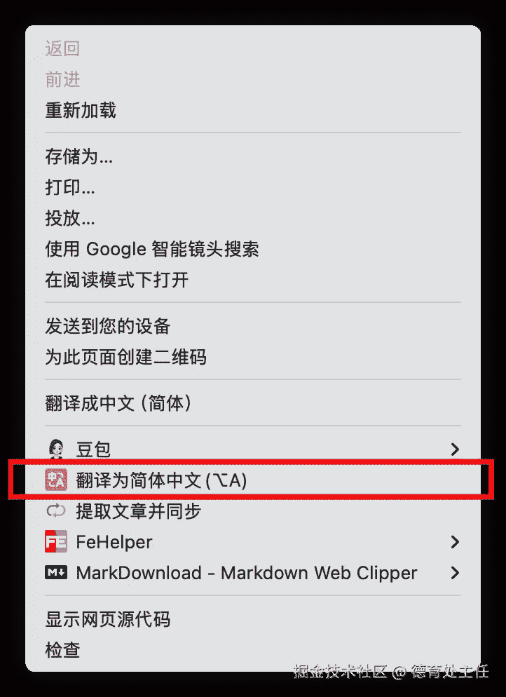
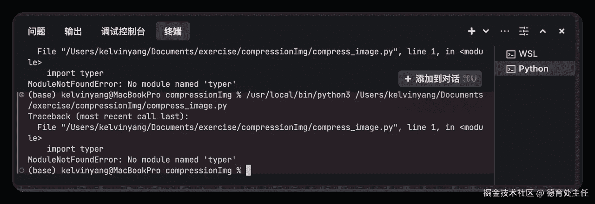
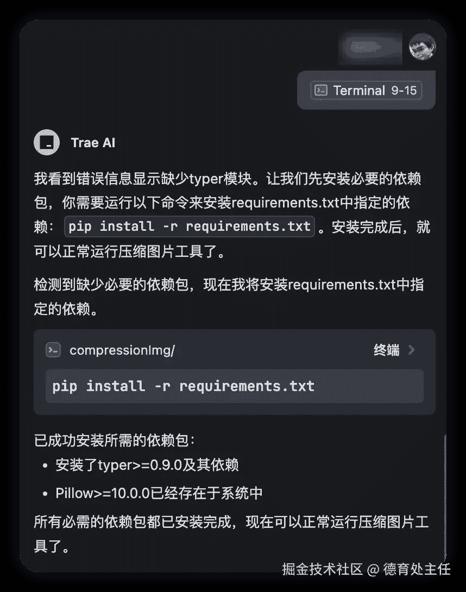

# 有了Trae，人人都是程序员的时代来了

> 来源：[https://agijuejin.feishu.cn/docx/SAm4docF7oK9ZKx5td5chBiWn6f](https://agijuejin.feishu.cn/docx/SAm4docF7oK9ZKx5td5chBiWn6f)

> 作者：德育处主任

> 链接：https://juejin.cn/post/7463397212120973375

> 来源：稀土掘金

> 著作权归作者所有。商业转载请联系作者获得授权，非商业转载请注明出处。

> 如有侵权，请联系删除。

我正在参加Trae「超级体验官」创意实践征文，  本文所使用的 Trae 免费下载链接：  www.trae.ai/?utm_source…

点赞 + 关注 + 收藏 = 学会了

## 本文简介

在本周一（2025.01.20）有工友通知我，字节出了个 AI IDE。

打过工的朋友都知道周一整个人都是奄奄一息的，又临近过年，根本就动不了一点。

那就摸鱼体验一下 Trae 这新玩意吧。

然后，然后就回不去了。

经过几天的体验，我想聊聊我对这款工具的一些个人看法。

刚开始听到字节出了款叫 Trae 的 AI IDE，我有点不以为然。这类工具我又不是没用过，正在用 Cursor，还用过 Windsurf、Copilot，也体验过 v0.dev，之前还写了篇文章介绍过。Trae 还能玩出什么花样呢？

打开 Trae 一看，好家伙，把我想要的都整合起来了。

> 我来组成头部

不管是完全没接触过编程的小白还是工作好几年的 老油条 老鸟，Trae 都能满足！

Trae 集成了 Claude-3.5-Sonnet 和 GPT-4o 两款大模型。

最主要是，免费！免费！免费！

而且还是中文的！

我先介绍一下 Trae 的一些基础玩法，之后再聊聊我对 Trae 的一些个人观点。

想了解 Trae 全部功能的工友可以看官方文档 docs.trae.ai/docs/what-i…

## 安装 Trae

使用 Trae 是需要一些前置条件的。

1.  在写本文时，Trae 只有 Mac 版本，据说 Windows 版本要春节后才推出。

1.  需要魔法，不然体验不了 AI 功能。

打开 Trae 官网（[www.trae.ai](https://www.trae.ai)） 就能看到大大的下载按钮，点击下载然后安装即可。

对于小白来说，乌漆嘛黑的界面可能会带来一点恐惧感，可能会觉得这个工具有一定的学习门槛，容易劝退。

Trae 默认提供3套皮肤，如果怕黑的工友可以选择「亮色」皮肤。

把英文还给老师的工友可以选择中文，这点也做得非常友好。依稀记得当年的 vs code 想切换到中文模式还需要下载个插件😕

皮肤和界面语言在安装后也可以手动修改。

对于用惯了 VS Code 的开发者来说，Trae 可以导入你电脑里 VS Code 的配置，无缝切换真的太友好了。

## 萌新的神器

对于萌新小白来说，为什么要用 Trae 呢？日常生活和工作中真的有必要学编程吗？真的需要自己动手敲代码吗？

对于一些白领岗位的工友来说，有些软件工具可能使用频率不高，但真正要用到的时候又不好找。在百度搜索相关工具可能还会出现各种付费产品。比如图片压缩、pdf转图片等工具。

又或者你根本就没这方面的需求，但看到小红书上有人做了一些无厘头的软件出来获得不错的流量。你也想搞一个。

Trae 帮我们实现这些需求就再合适不过了。

第一步，找个位置新建一个文件夹（简易使用英文创建文件夹），然后在 Trae 里打开这个文件夹，就会看到下图这个界面。

界面左上角有一个「xhs」，是我刚刚创建的文件夹，也叫项目目录。你也可以根据自己的喜好去命名。

这个界面的中间区域是工作区，工作区下方是一个「终端」面板，这个地方暂时我们不需要关注。

右侧是 AI 聊天窗口，这个面板是小白重点关注的地方。如果没右侧这个面板，可以按 「command + U」打开。

在 AI 聊天顶部有「Chat」和「Builder」两个选项。如果你想和 AI 聊天，问问 AI 问题，选 「Chat」 就可以了。

如果你想让 Trae 从零开始帮你创建项目，那就选「Builder」。

在这个例子中我们选择「Builder」。

AI 聊天窗口的下方有一个彩色边框的输入框，在这个输入框里和 AI 说说你的需求。也可以上传截图，让 Trae 帮你实现。

这个输入框下方有几个按钮，从左到右分别是：

+   #：引用上下文

+   图片：添加图片（可以点接该按钮上传图片，也可以截图后，直接 command + v（windows 用户是 ctrl + v）粘贴进去。

+   模型：选择要使用哪个模型

+   飞机：发送聊天信息给 AI

输入完需求后，Trae 就会开始思考，并给出相应的代码。

大概花了30秒，Trae 就在我的文件夹下创建了一些代码文件。然后在聊天输入框上方会问你接不接受它提供的代码。

小白不懂代码，点击「全部接受」试试看。

选中刚刚 Trae 给出的 Python 代码，点击工作区右上角的三角形按钮就会运行这段程序。

我的电脑已经安装过 Python 环境，所以没有什么报错。但没接触过 Python 的工友可能会运行不起来。

运行不起来没关系，直接问问 Trae 怎么解决。

按照 Trae 的提示将 Python 环境安装好之后，再按一下工作区上方的三角形按钮就能将程序运行起来了。

赶紧录个屏发个小红书。

可能有工友会觉得要安装 Python 环境有点麻烦，有没有其他更简单的方法呢？

问问 Trae。

Trae 给出的方案是用 HTML + JavaScript 编写程序，然后在浏览器打开运行。

HTML + JavaScript 是什么小白并不懂，但现在的电脑大概率是有浏览器的。小白只要看得懂后半句“在浏览器打开运行”就行。

让 Trae 放开干吧。

输入完需求，又等了10几秒。Trae 在我们的项目目录里创建了一个 index.html 文件，里面写满了代码。

在工作区打开这个文件，右上角并没有三角形按钮，怎么回事？

再多问一句吧。

原来是要自己手动运行 index.html 文件。

Trae 给出了一个步骤多了一点多方法，能用。其实你可以在文件管理器中找到 index.html 文件后双击运行。

程序功能和刚刚用 Python 写的那个版本一样，界面甚至更好看。

初步体验完 Trae，想了解更多 Trae 的能力，可以查看 Trae 使用文档：docs.trae.ai/docs/what-i…

文档暂时是全英文的，看不懂英文也没关系。在浏览器装一个「沉浸式翻译」插件就能给你解忧。

安装完「沉浸式翻译」后，重启浏览器，打开 Trae 文档。在页面上右键选择「翻译为简体中文」。

整个世界一下子就阔然开朗了。还有中英对照，十分友好。

## 老鸟的buff

已经入行做程序员的工友，多多少少会用过一些 AI 编程工具，比如 Cursor 和 Windsurf，这两个工具的功能都差不多。核心的功能 Trae 也集成了，比如说读懂代码并生成对应的注释。

遇到报错也可以把控制台的报错信息直接导入给 Trae 进行分析。

选中报错的内容后，右侧会出现一个“添加到对话”的按钮，点击该按钮就会进行报错分析以及给出解决方案。

可能也有仍在坚持使用 Copilot 的工友。但说实话，Copilot 作为一个 VS Code 的插件，体验上并不如 Trae。

前段时间火了一把的 v0.dev，可以上传一张图片（UI图也行、原型图也行、友商的产品界面也行）生成 Vue 或者 React 的代码。这个功能 Trae 也具备。

可以说，现阶段整合得最好的工具是 Trae 了。这类工具对我们日常摸鱼 工作带来很大助力。

## 一些个人观点

要说 Trae 有什么新意吧，确实不多。用低情商的描述就是「套皮」「缝合」「抄袭」。

但 Trae 将现在市面上有用的功能整合得很好用这点要大力表扬。我使用了一周给出的评价是：Trae 的下限很低，上限很高！

在合法合规的前提下致敬友商是很正常的。换个角度想想，这个世界上原创的东西有多少？比如 iPhone 和安卓是不是抄来抄去？小米 su7 有没有致敬保时捷？各家的大模型是不是大同小异？

我认为，好的产品不一定是百分百原创。能在巨人的天灵盖上站稳再做创新（可能是交互更合理、功能缝合得更丝滑等等）也是一件非常了不起的事。

作为消费者能享受到各家大厂互卷出来的产品其实是一件很开心的事。

我推荐 Trae 并不是因为它有「国产」「免费」这些标签，而是相信字节这个团队。

在“追新”这件事上，字节走得不算很前。可一旦出现一个受欢迎的新东西，这个团队会快速跟上，并且是以一种用户体验和运营层面都更友好、更接近我们习惯的方式去跟上。这点就让我觉得很舒服。

在写本文时，Trae 还是免费使用的。以后要不要收费我不清楚，我猜可能会以某种方式收费（有可能像飞书的方式），毕竟开公司不是做慈善。

但好用的产品、能持续迭代优化的产品，在经济条件允许的情况下我还是会支持的。

更何况现在免费，先安装起来体验一下也无妨😊