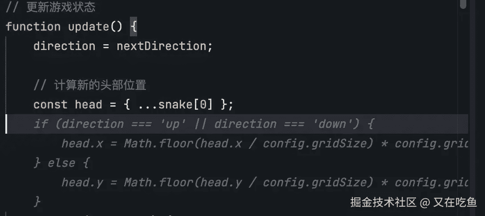
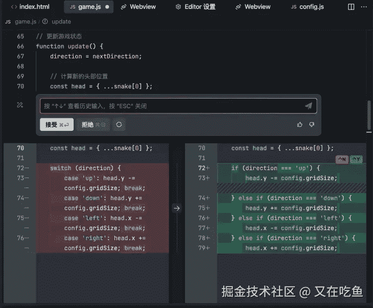

# cursor 用户对 trae 的体验感受

> 来源：[https://agijuejin.feishu.cn/docx/QeOddIYfcoRkhmxwsePcXWKpnRd](https://agijuejin.feishu.cn/docx/QeOddIYfcoRkhmxwsePcXWKpnRd)

> 作者：又在吃鱼

> 链接：https://juejin.cn/post/7462031597585793061

> 来源：稀土掘金

> 著作权归作者所有。商业转载请联系作者获得授权，非商业转载请注明出处。

> 如有侵权，请联系删除。

## 背景

最近开始收到陆陆续续的字节自研编辑器 trae 的推文，本着好奇的心理，体验了一下，下面是我的个人感受，目前是仅支持 mac 跟堂主聊了会，节后会上 windows。因为是海外版本，所以需要自备🪜

## 开始

下面是使用流程，我放了一些我觉比较有特色的场景，不是全场景 界面很清爽简约

友好的中文支持

添加命令行，可以像 vsc. 或者 code. 打开当前目录 一键导入配置，还支持cursor 方便国人迁移

登录环节，支持海外的主流三方，可以不用注册很赞

主界面，和现在vscode cursor 差不多

由于 trae 内置的是两个主流大模型：

1.  Claude 3.5 Sonnet

1.  GPT-4o 特别是  Claude 3**.5 Sonne**t 我**们知道他分首发**版本20240620 和 0241022 两个版本 所以我准备调侃一下它

看的出来还挺严谨的，不过同样的问题我又问了 cursor 内置的模型

## 实战

网上其他文章都介绍了 chat 模式和 buider 模式，那我直接从实战开始。 首先来一个经典的贪吃蛇，由于我之前习惯使用 cursor的 composer 所以我直接使用 buider 来帮我

代码是生成好了，它默认使用 python 来构建 web 服务器，但是我没有装python 环境，所以出现了卡死。 后来我重新进行了纠正，使用 anywhere 来进行构建

### web 预览

trae 特色功能之一就是 preview 所以让我们来预览贪吃蛇吧

刚开始我不会玩，点击 web 预览没反应，后面我尝试先运行再预览就 ok 了。我以为这个功能点击以后会自动运行，目前来看还不行，后面我先看下这个原理，打开了控制栏的开发工具，如下图

可以看出是用 iframe 实现的和我预期的一样，技术实现不难，创新确实不错👍 比较适合不会编码的小白用户，这小窗口切来切去，还是没整多个显示器方便

### Tab 补全

我又尝试了一下智能补全，如下图

效果还可以，意满离。我又尝试了局部编辑如下图

这个 Diff 效果做的很好，CodeReview 的时候更方便更清晰

### Chat

再说说 Chat 其他功能如下图，感觉跟 cursor 的 @ 操作符差不多

但是目前有个体验比不上 cusor 的地方就是，我们引用文件的时候得打开这个 # 然后去选择，cursor 选择左侧文件直接扔到对话窗口。好处就是我们比如有多个重名的 index.js 的时候可以很清晰，这点期望 trae 能跟进

### Builder

从上面的贪吃蛇实战情况下来看它具备以下能力：

+   Agent升级 | 终端交互能力增强

+   自我纠错能力，比如 npm i 失败可以自助排查 这个我个人理解的是 cursor 就是 Yolo 模式，简称无人驾驶模式：一句话全搞定。目前整体体验来看，跟 cursor 差不多，并且自带预览功能，更方便。准确度来看，底层模型都一样，难以拉开差距

### 其他和 cursor 对比

#### 新项目引入

我在一台新电脑上同时使用 cursor 和 trae, 一些体验如下 同时打开了一个新的项目，trae 无事发生，cursor 识别到我是一个 vue 项目，询问我是否需要装 vue 插件

#### 内存占用

在打开情况下不做任何操作的内存占用：

不知道为何 trae 稍微高一点 第二次都启动 Agent 模式执行启动命令

让我们再次看下内存，发现两者一样了

大家发现 trae 跟 cursor 差不多了，但是你要知道目前 cursor 内置的功能比 trae 丰富，所以得看未来 trae 的表现

## 个人感受

### 优点

1.  **免费**
 无需多言！

1.  **深度中文定制**
 Trae 界面和功能全面本地化，更适合中国宝宝

1.  **强大的 AI 功能**
 集成 Claude 3.5 和 GPT-4o，支持智能代码生成、优化建议和多模态交互，可上传图片辅助生成代码，最主要还是免费

1.  **高效项目构建**
 提供 Builder 功能，可快速生成项目代码和运行命令，简化开发流程。

1.  **便捷迁移**
 支持从 VS Code 或 Cursor 导入配置，实现无缝切换。

1.  **Web 预览功能**
 支持在 IDE 内预览 Web 页面，方便前端开发。

### 不足

1.  **性能有待优化**
 部分复杂任务下存在卡顿现象。

1.  **上下文引用功能不完善**
 对话连贯性不如 Cursor。

1.  **系统兼容性有限**
 目前仅支持 MacOS，Windows 用户需等待更新。

1.  **缺乏自定义 API**
 无法满足高级用户自定义需求。

### 总体评价

第一个版本做成这样很不错了，期待未来的版本，有竞争才有动力，不然某家独大，更新随心所欲，苦的就是我们这些用户