# 与 Cursor 对比，我深度测试字节的 AI 编程新品，懂我的国产AI IDE 它叫 Trae

> 来源：[https://agijuejin.feishu.cn/docx/CCRBdp1qWo4Hk2xbX9ZcMh5cnrg](https://agijuejin.feishu.cn/docx/CCRBdp1qWo4Hk2xbX9ZcMh5cnrg)

> 纵所周知101｜[阅读原文](https://mp.weixin.qq.com/s/Td5qhRS6NAcwp8rTxev5NQ)，如有侵权，请联系删除。

> 转载请联系原作者取得授权

hi，我是周知，持续探索与 AI 协作的方式，觉醒强大的自己。

一款好的，懂中文开发者的 AI IDE AI 编程产品应该怎样的？

我最近深度测试了字节刚发布的 Trae

我找到了一些理想中的答案。

先上结论：

💡

和主流的 AI 开发工具相比，Trae 的核心竞争力在于：

完整的 API 支持、全面的技术栈覆盖，

特别是在中文场景下的优化做得到位，

它的"双模式"Builder 让开发更顺畅，Chat 让调试更便捷，

两种模式无缝切换，搭配上稳定的自动保存，整个开发过程行云流水。

免费的Claude3.5 和GPT4o，

响应速度和 AI 模型表现也都在线，

它确实让我眼前一亮。

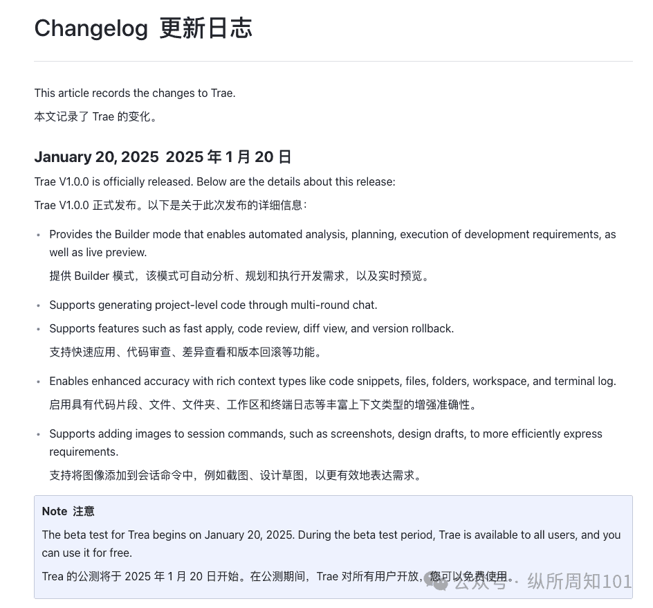

地址：https://sourl.cn/XNPrkH

---

## **洞察：5 个维度**

如何测评一款 AI 编程产品？

以下是我总结的 5 个维度。

接下来依次做总结。

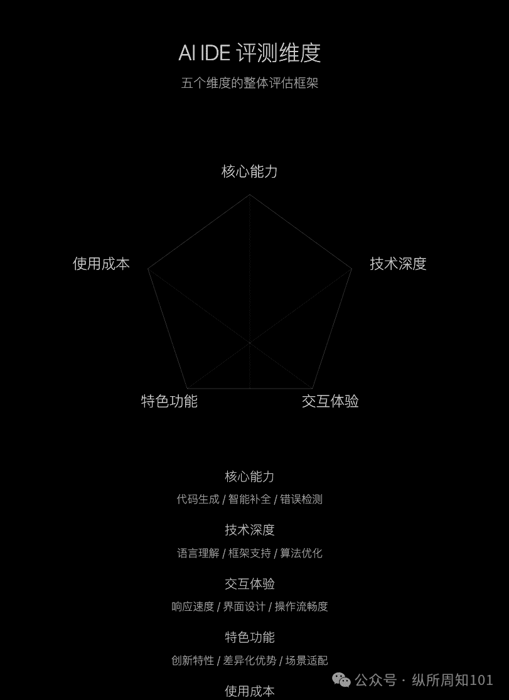

---

### **核心能力：主动编程**

说实话，我已经习惯于 AI 辅助我编程了

因为，本质上：

人写代码和 AI 写代码都是一样的

关键点在于， AI 工具能否封装你的思考。

AI IDE 解放程序员的关键在于，如何通过一系列流程

让 AI 自动准确感知任务分配，并且正确执行任务

而当 AI 能按照我们的指令开始正确地工作时

工作效率就会提高，个人就会被解放出来

而这一系列流程生成的代码质量问题

则是通过AI IDE + 人去完成的

我总结了一个公式：

+   **代码生成质量 = system prompt + Claude-3-5-sonnet（支**撑底层模型） + Workflow代码索引+ user iuput prompt

💡

Cursor 和 Trae 都是基于 vscode 二创而来

二者底层都是有一个强大的 Agent workflow 做支撑

Cursor/Trae 底层运作示例模型（仅供理解 AI IDE 运行核心机制）

**核心点**在于prompt+Agent workflow+代码索引上

Prompt 分为两部分

**System prompt**

Cursor/Trae 工程师定义的 Agent 交互之间的规则

**User prompt**

**对话框输入 or #引用文件（和 c**ursor 里的@引用文件 是一个逻辑）

**并且这里通过提示 “⬆️⬇️切换历史输入”，“**shift+↩︎”换行是非常实用的小技巧


### **Agent Workflow**

目前 Trae 调用的工具：

分析

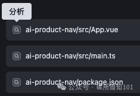

创建


更新


命令行操作

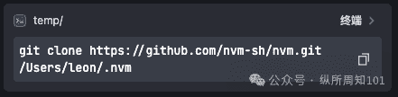

删除


webview 视图

这十分符合开发过程的思维 flow

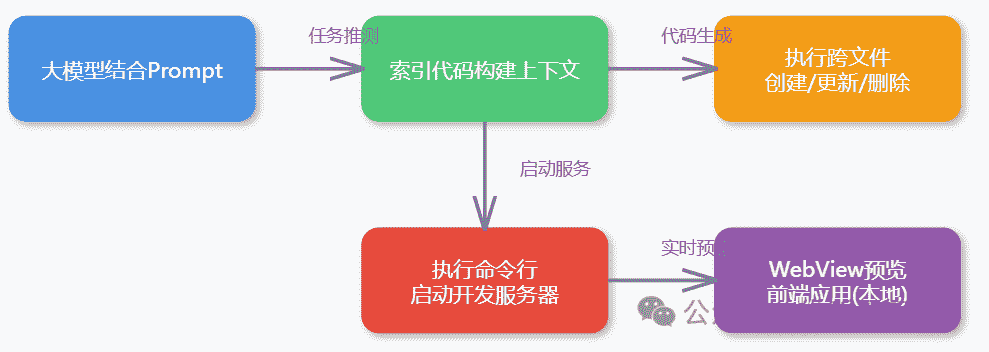

通过核心的 Agent 根据用户的需求执行对应的操作

##### **不一样的是：**

💡

cursor

在删除文件这一项较为严格，它是在 composer 模式下开启 yolo 模式后，有禁止删除代码文件的选项，而 Trae 则是可以直接通过 prompt 直接调用删除代码文件

💡

Trae

工具调用呈现的 UI 更具审美，点击即可跳转到对应修改点，人工审查 AI 代码更省心（cursor 也可跳转）

### **代码索引**

代码索引精度决定 AI 理解项目文件实际运行逻辑

准确找到对应的代码，成功构建起上下文十分重要

cursor 和 Trae 在设置界面，都可以对当前的代码做索引管理，

二者在不显式调用（即@或#引用代码）时，均能准确构建项目上下文，

二者在第一次引用后，后期不引用时，也能使用第一次构建上下文！

核心能力维度上，摒弃单点列举的方式，

通过底层 AI IDE 运行模式来分析它们是如何工作的，

同时将每一个功能点串联起来，打通开发新范式，上列因素聚齐，

则代码生成质量问题迎刃而解

简单的举例只是论证可行性，

而结合底层运行规律思考才是解决问题根本

#### **结论：**

Cursor 和 Trae 目前的能力都接住了大家对 AI 编程的第一波期待

在功能点上 cursor 领先于 Trae，但是 Trae 的工具调用能力展示却更直观

---

## **核心能力：辅助编程**

以上的开发新范式的核心是在于让AI IDE 主动编程，但往往，也需要被动辅助编程⬇️

比如：

+   代码补全

+   代码优化 ：重构建议｜性能提升｜最佳实践推荐

1.  Cursor/Trae 都提供了代码补全功能，实测下来，二者差距不大，均能准确提供参考代码

1.  代码优化上，二者底层都是使用的 claude，在中低级任务中，二者都相差不大

#### **细节对比：单个代码文件修改：**cursor cmd+k** vs **Trae cmd+I

Trae

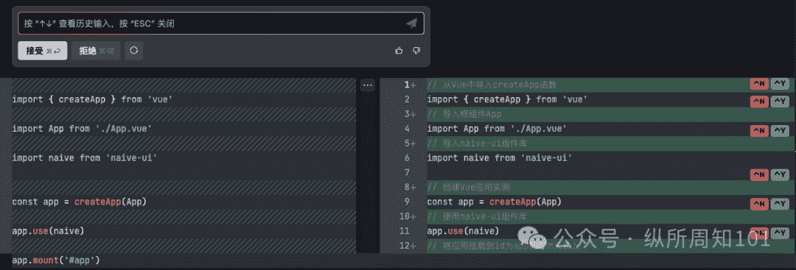

Cursor

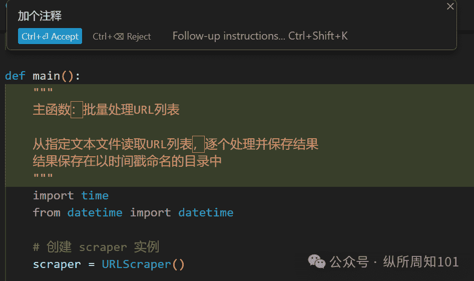

二者的差异在于排版的位置不统一，Trae 的 UI 更加直观，cursor 更嵌入

#### **细节对比：代码引用：**cursor @** vs **Trae #

cursor

A. Chat 模式

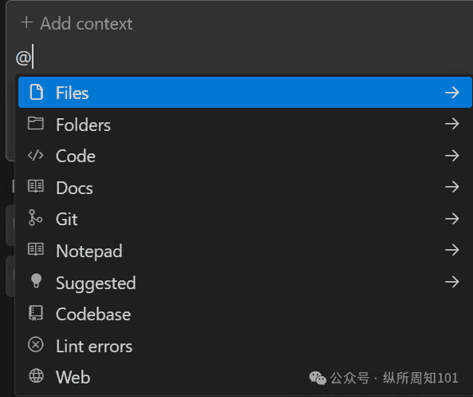

B. Composer 模式

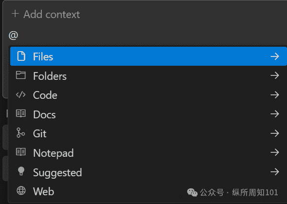

Trae

A. Chat 模式

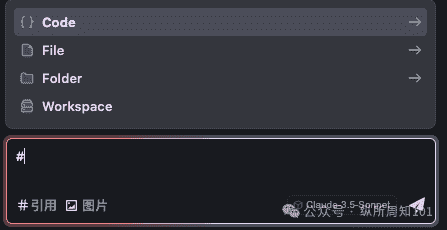

B. Builder 模式

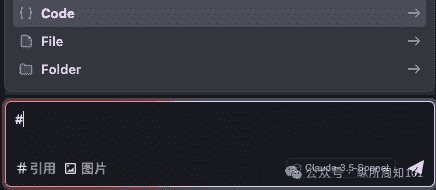

💡

总结：Cursor 在功能完整度上面仍然具有领先优势

但 Trae1.0 更友好地是对中文的支持

任何垄断性的行业终将迎来寒冬

良性的竞争会带来更好地 AI IDE 产品！

期待字节的 Trae 后来居上，Cursor 持续创新

---

## **核心能力：编程语言**

语言支持

Trae 在这一点上，完全契合中文程序员，在初始化的时候，就可以选择语言类


系统自带界面显示

但是 cursor 只有在安装了中文插件之后才能，

一些具体的命令没有支持的翻译，

Trae 是符合中文程序员的需求的，

整体界面显示都符合中文程序员操作习惯

基础功能两者均支持：

编程语言支持主流语言全覆盖:

**前端:**

JavaScript/TypeScript、HTML、CSS等

**后端:**

Python、Java、Go、Rust等

**移动端:**

Swift、Kotlin等

编程框架支持

**前端框架:**

+   React/Vue/Angular生态系统完整支持

+   新兴框架如Svelte、Next.js的智能提示

+   完整的TypeScript类型推导

**后端框架:**

Spring Boot/Django/Express

**主流框架：**

+   微服务架构相关框架

+   数据库 ORM 框架集成

---

## **技术深度**

特定的场景有多维的解决方案

其基础是：核心能力的支撑

我将采用一个例子，由浅入深：

### 用 Trae 写一个 AI 导航工具网站

我的需求：

```
我的需求：
我现在要做一个 AI 产品的导航网站，其中包括基本的一些商品的售卖，我目前没有具体的规划，请你先帮我生成一份具体的规划，然后根据这个规划开始生成前端的各项内容

我的操作系统是 macos，没有代码操作环境，技术栈要求：vite/ts/vue3/支持 vue3 的 UI 框架，请你先使用 nvm 帮我安装 npm,10以上的LTS环境，然后再换成 cnpm，之后的全局都使用cnpm即可，所以请你先帮我安装好基础的环境
```

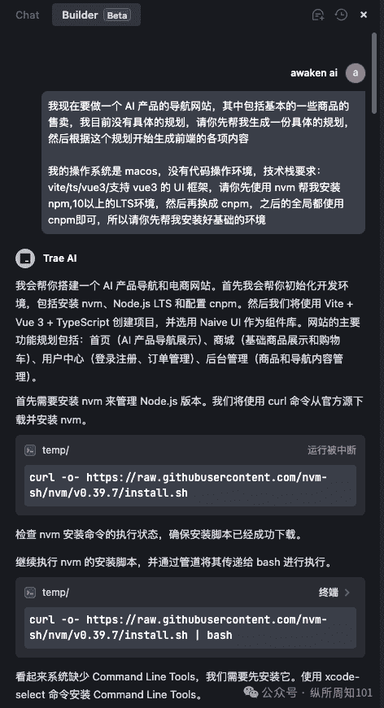

Trae 自动分析了我的意图，并且调用工具开始分析问题

期间我跳过执行它的命令，它也能智能感知当下的进度以及意图

Trae:

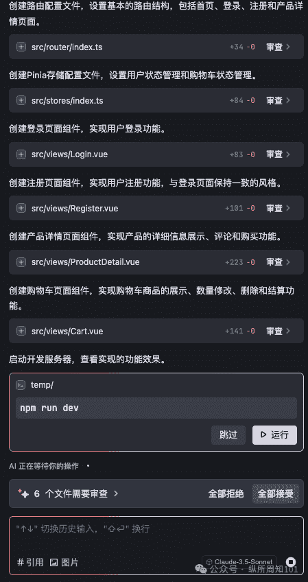

Cursor:

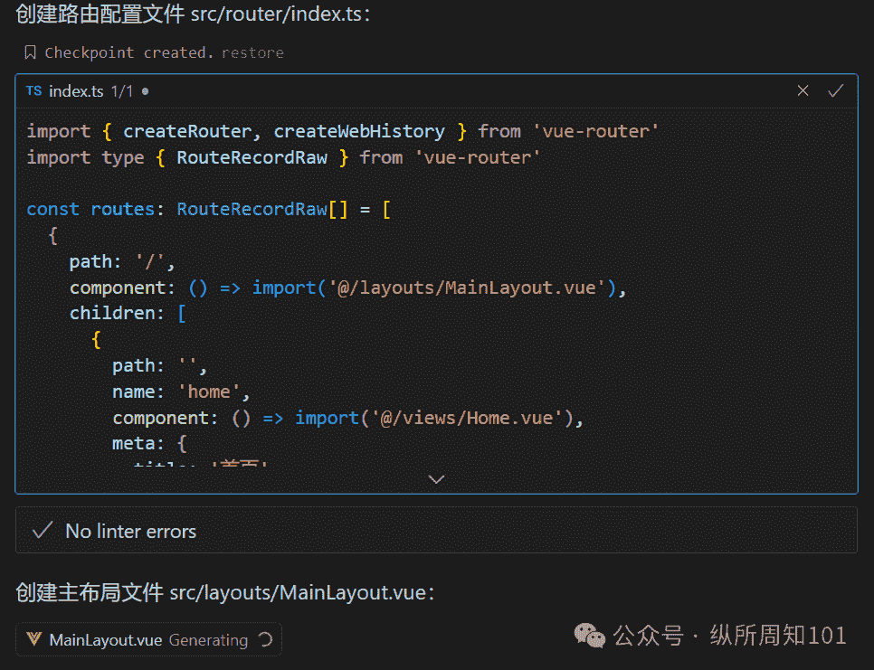

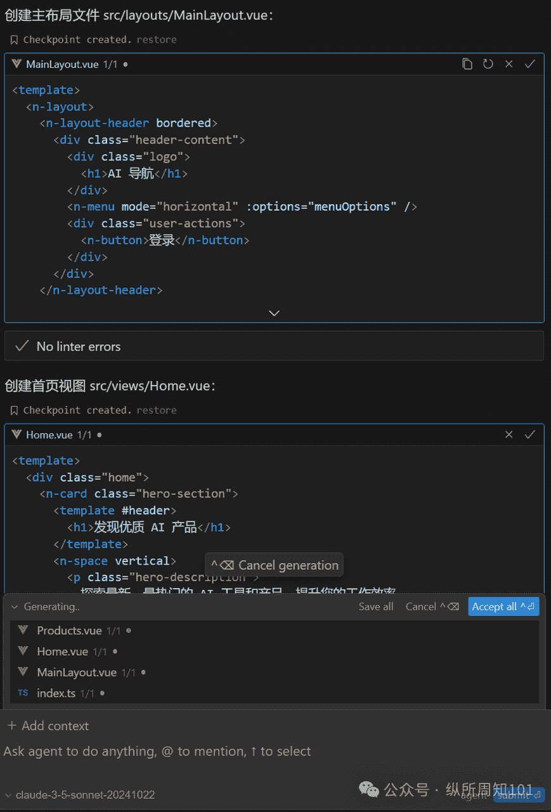

**核心提炼：**

💡

**相同点：** 提供实时的代码检查（linter）功能

支持项目文件的自动生成

支持组件化开发

提供完整的项目结构搭建能力

支持命令行操作

### **不同点：**

##### **界面语言和本地化**

Trae:

+   完全中文化的界面

+   操作提示和文件说明都是中文

+   更符合中文开发者使用习惯

Cursor:

+   默认英文界面

+   代码注释和提示以英文为主

##### **交互方式**

Trae:

+   提供更直观的文件路径创建说明

+   显示每个文件的具体用途和功能说明

+   带有"+xx"的行数变更提示更醒目

+   提供"全部拒绝"和"全部接受"的批量操作选项

Cursor:

+   更偏向传统IDE的操作方式

+   代码生成过程更直接展示

+   文件操作反馈更简洁

##### **生成代码的展现形式**

Trae:

+   以任务描述为导向

+   展示完整的功能模块说明

+   更注重业务逻辑的完整性

Cursor:

+   以代码实现为导向

+   直接展示代码结构

+   更注重技术实现的展示

##### **用户引导和提示**

Trae:

+   提供更详细的中文引导说明

+   每个文件都有明确的功能描述

+   操作步骤更清晰直观

Cursor:

+   提示信息相对简洁

+   更依赖用户对开发流程的理解

+   专注于代码本身的展示

结论：

这些差异反映出 Trae 更注重本地化和用户体验的优化，

而 Cursor 则保持了更传统的 IDE 风格

这两种方式各有优势，

选择哪个主要取决于开发者的个人偏好和使用习惯

Trae 的工作流回调做得很好！

我测试了当它需要我确认命令的时候，

我间隔 30 分钟之后再来确认发现也是无缝衔接上了，

而对比 cursor，它则偶尔会掉线，影响开发效率。

Trae 的命令行是直接在控制台显示，

而 cursor 是需要 pop out terminal，并且 pop 了之后，

偶尔回调就有问题，但是 Trae 是全程都在控制台显示，更符合开发展示。

##### **引用功能显示差异**

Trae


Cursor

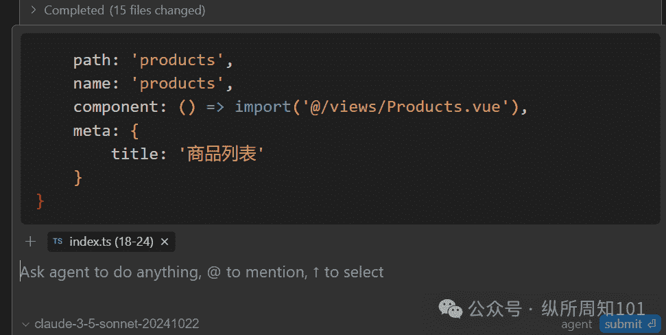

结合到 Trae 的命令行展示，

它引用的代码块不会有大显示区在侧边栏里，

而是点击则跳转到对应的代码文件对应的代码块里，

而 cursor 点击之后是只在侧边栏显示

再结合到 Trae 的新功能：webview（后面会详细展开）可以看出，

Trae 是关注于整体的 UI 的美观，而 cursor 则关注于功能点的集成，

让开发者专注于一个点。

##### **复杂需求开发：**

开发思维链：

**代**码生成质量 = prompt + claude-3-5-sonnet + workflow + 代码索引

#### 结合 Trae：

当项目逐渐进入复杂的阶段，

每次单纯地引用代码块 或者 使用#workspace ，

让 Agent 去理解项目的时候，

大模型的理解是不精准的，

此时在最开始的需求文档确定好之后，

让 Trae 在每次编写代码的同时，更新细节文档。

在每次引用这个细节文档告诉 Agent 细节部分，

如此，便可精准地撰写每一部分代码，

相比于 cursor 拥有.cursorrules/.cursorignore/rules for AI

Trae 目前仍处于早期阶段，暂时不具备这些功能，但是也可以使用#引用文件

让 AI 大模型精准理解需求，更好地辅助实现人的思想，

#### **本质上：**

#### Trae 和 cursor 都拥有代码索引功能，因此这是定量

而底层的Agent workflow也是黑盒子

唯一开放给开发者的变量是：prompt 部分

因此针对项目的实际需求

可以设定：

技术的语言支持/框架覆盖/工具链集成/架构理解/设计模式/性能优化

最终实现：

对业务的问题诊断/原因分析/方案设计/评价方案完整性

---

## **交互体验**

界面展示（类 vscode 界面）

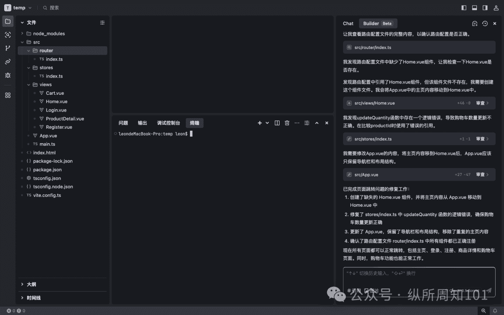

在 AI IDE 的产品体验中

对我们开发者

交互体验丝滑是重要的

决定了整个开发过程的舒适度

### **核心：**

依旧回顾这个公式

**代**码生成质量 = prompt + claude-3-5-sonnet + workflow + 代码索引

AI IDE 接受的输入就是Prompt 和 引用文件

人 接受的输出就是 实时性的代码生成 和 代码文件操作思路

### **输入方面：**

我们想要 AI IDE 更精准地知道需求所在的代码区域

那么就得用一种方式告诉它：

在 cursor 中用 @符号 对文件进行引用

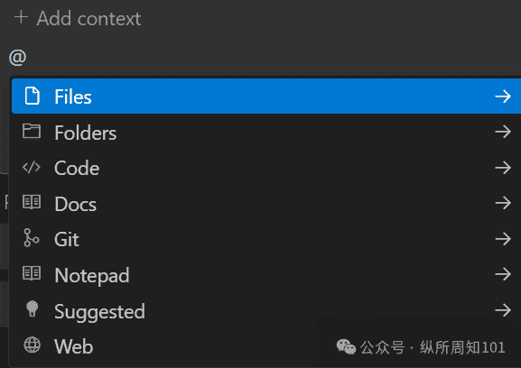

在 Trae 中用 #符号 对文件进行引用

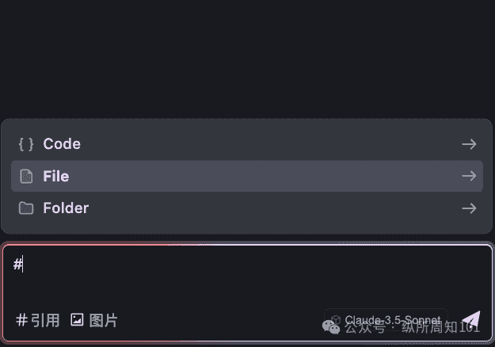

而当用途不同

即我们要让 AI 快速知道我们的项目详细情况时

不可能把数百个文件都引用一遍

所以 cursor的@codebase 或 Trae的#workspace（chat 模式下）应运而生

即，快速上手一个功能点的最佳方式是：

知道它为何而生，而不是苦思文字含义

当引用了代码时

底层的 Agent workflow 就会开始让 AI 深度理解业务场景

### **输出方面：**

而Prompt输入之后

AI IDE 的响应速度/精度/持续性十分重要

通过 AI IDE 最直观的是减少代码编写的时间

因此 AI IDE 的响应速度就应该是实时性的

我们要做的是审查代码的合理性

及时调整核心需求，

让 AI 将想法快速变为现实

**Trae 的交互体验尤其丝滑**

写前端构建的/src/router/index.ts 这种的排布

**详细的界面展示，精确的工具调用**

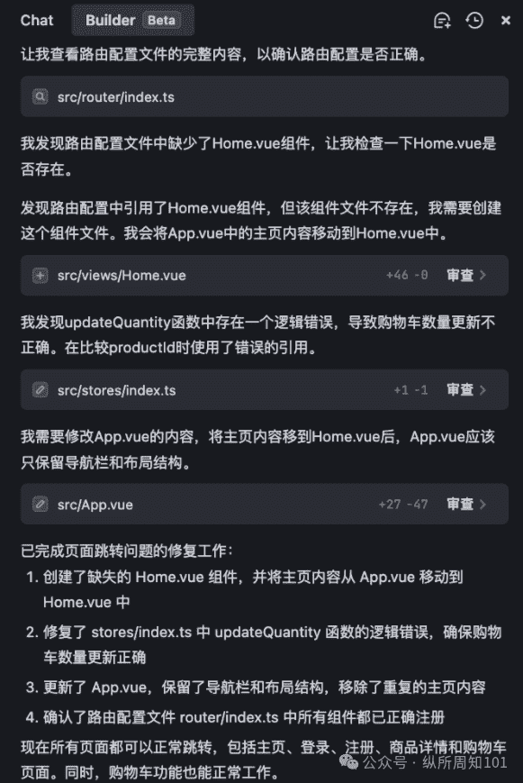

### **提示词理解：**

说实话，传统的 IDE 总让我觉得像在对着机器说外语

而现代 AI IDE，特别是 Trae 的做法，

更像是在和一个懂你的搭档沟通：

**它真的听懂了我的意思：**

不是机械的关键词匹配，

不用反复解释你的意图，

给出符合上下文的回应。

**它记得整个对话的脉络，**

不用重复解释前文，

能自然承接之前的讨论，

维持思维的连贯性。

我觉得，

好的交互体验不应该被感知，

而应该像呼吸空气一样，

自然地融入开发的每一刻。

是否能让开发者：

自然地表达想法，

专注于创造本身，

享受开发的过程，

这一点相比于 cursor，Trae 的整体清爽一些。

---

## **特色功能维度**

真正强大的 AI IDE，我觉得不在于它有多少功能，

而是，是否真正更帮我高效写代码。

### **Builder 模式：**


重新定义项目生命周期

用Trae 的 Builder 模式时，

我感受到：

```
不是被动的代码编辑器，是一个能理解你想法的开发伙伴
```

这样的场景：

+   你用自然语言描述你的想法

+   AI 理解你的意图，分解成具体任务

+   自动规划项目结构，生成框架代码

+   实时反馈执行进度，及时纠正错误

这就像有了一个无需过多解释就能领会你心意的搭档

让开发从"写代码"变成了"讲述想法"

### **Chat 模式：**

而在日常开发中，Chat 模式则像是你身边的技术顾问：

+   不用切换窗口打开搜索引擎

+   不用在社区论坛苦等回复

+   不用担心上下文丢失

它就在那里，准备好：

+   解答你的疑惑

+   优化你的代码

+   指出潜在问题

### **很懂中文开发者：**

**语言障碍**

原来是"能用就行"的中文支持，

现在是"浑然天成"的本土化体验，

安装初始就可以选择全中文面板。

**交互体验**

不再是生硬的命令式对话，

而是自然流畅的意图表达。

深度使用 cursor 和 Trae 之后，

好的 AI IDE 应该是无形的

+   当你需要它时，它就在那里

+   当你在思考时，它能理解你

+   当你有想法时，它能实现它

编程的本质不是写代码，

而是将想法转化为现实，

Trae和 cursor 做到的，

正是让我们能够专注于创造本身，

而不是被工具的使用所束缚。

### **Webview**

我们习惯了编辑器和浏览器之间的不断切换

这看似微小的操作，实际上打断了我们的思维流

Trae 的 Webview 功能，

正是对这一痛点的优雅解决

而 Trae 的做法是：

**让预览无处不在，又若隐若现**

+   IDE 内直接预览

+   实时响应变化

+   零延迟反馈

特别是在以下场景中，这种体验尤为珍贵：

前端页面开发

交互效果调试

响应式设计适配

数据可视化呈现

---

#### **总成本对比（按年）**

从成本效益比来看，Trae 在各个维度都展现出明显的成本优势，

特别适合初创团队和个人开发者。

而 Cursor 虽然收费，

但其专业版和企业版的功能更适合对特定功能有强需求的商业用户。

选择哪个工具，最终还是要根据团队实际需求和预算情况来决定。

主要可劳德完全免费，字节真的给我们又送了波福利。

---

世人皆求大而全，而我独寻专而精。

在深度与 AI IDE 协作的过程中

使用五个维度去选择一款最贴近使用需求的 IDE

毕竟适合自己的才是最好的

不是"完全依赖"，而是"辅助增强"

更不是"替代程序员"，而是让我们"提升生产效率"。