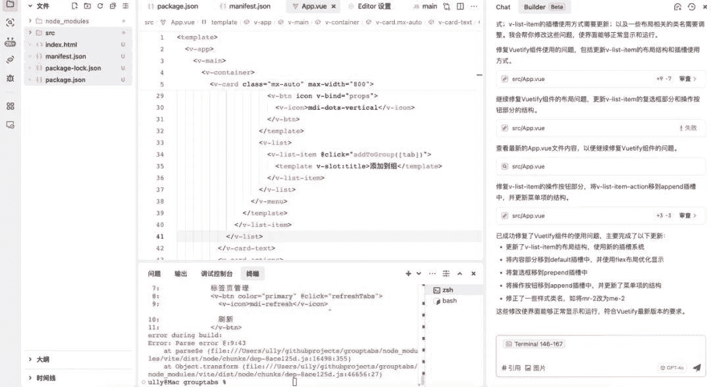
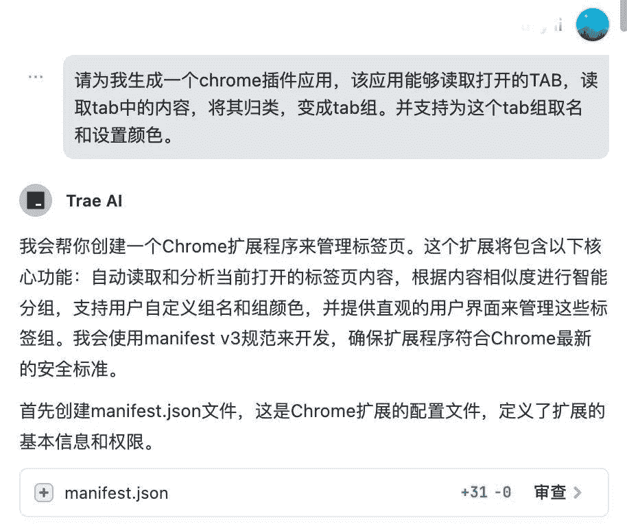
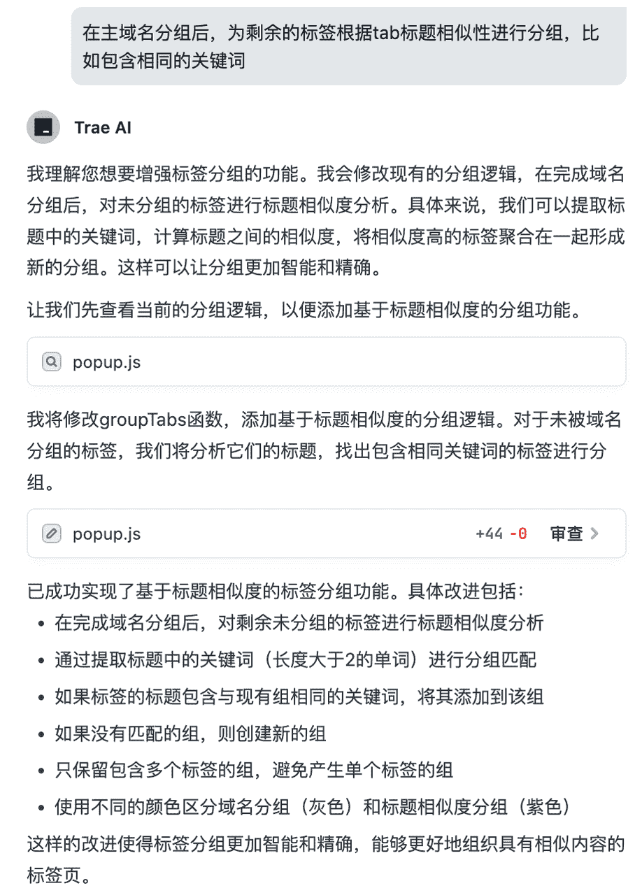

# 不止免费无限次Claude 3.5：字节 Trae 能否颠覆 Cursor、WindSurf？小项目亲测体验

> 来源：[https://agijuejin.feishu.cn/docx/D65mdFmM9ofvOqxYh2ucv8lEnLW](https://agijuejin.feishu.cn/docx/D65mdFmM9ofvOqxYh2ucv8lEnLW)

> ully AI工程化｜[阅读原文](https://mp.weixin.qq.com/s/3phAU5KmMLZISqLmj5vLZA)，如有侵权，请联系删除。

> 转载请联系原作者取得授权

AI 编程工具已步入决胜之年，各方势力摩拳擦掌。前两天，Windsurf 发布 2025 年的首波重磅升级，引发业界广泛关注，无疑是为这场争霸赛鸣响了第一枪。

然而，令人意想不到的是，一匹黑马横空出世。就在20日，字节跳动推出了对标 Cursor 、Windsurf的 AI 编程工具——Trae，它的发布迅速成为行业焦点。

笔者第一时间体验了 Trae，全中文界面和与 Cursor、Windsurf 相似的产品设计逻辑，让用户能够快速上手，几乎没有学习成本。同时，与 Cursor 和 Windsurf 明显的 VS Code 风格不同，Trae 在界面交互上也颇具匠心，给人一种耳目一新的感觉。

和 Cursor 一样，Trae 也提供了 Chat 和 Builder 两种模式，其中 Builder 相当于 Cursor 的 Composer。从使用体验上看，两者在大的方面比较相似，但 Trae 在一些细节上更显用心。例如，笔者一直强调 AI 开发工具的第一要义是及时 commit，但有时开发起来就容易忘记，一旦改动破坏了原有代码，想要恢复就比较麻烦。Cursor 虽然在 Composer 中有 Checkpoint restore 功能，但在 Chat 模式下却没有，而 Trae 就具备这个功能！

类似的功能还有预览功能，可以直接看到代码变动，无需来回切换页面。此外，相较于 Cursor 和更为激进的 Windsurf，Trae 显得更为谨慎，每一次变更都会有清晰的说明，要求用户确认审核。

官方发布了一个视频介绍，展示了通过 Trae 快速生成一个 Todo 应用的过程，一张截图，一次性就完成开发，完全是小菜一碟。

但这毕竟是官方宣传，实际体验如何呢？笔者一直想做一个插件，整理浏览器上不舍得关闭但又密密麻麻的标签页。于是，我决定用 Trae 来帮我实现。

第一次尝试，失败了！

众所周知，Cursor、v0 等工具比较擅长 React、Next.js 等技术栈，对 Vue 等框架则不太熟悉。因此，我第一次尝试时特意加大了难度，要求它使用 Vue + Vuetify 来生成。遗憾的是，它一直在一个模板标签上打转，没有解决问题。我问它是否熟悉 Vue 技术栈，是否需要更换技术栈，它给出的回复是：

为了节省时间，笔者不再与它纠缠，重新开始！

这一次，我没有设置技术栈要求，Trae 没有采用任何框架，一次性就完成了大部分代码。

在此基础上，我与 Trae 越聊越嗨，我发现我自己都无法用文字表达清楚的需求，它能够很好的get到我的点，并把它们细化出来给我确认，甚是贴心。

在这里我也给大家介绍一个使用小技巧，我们可以先让 Trae 完成基础功能，再逐步添加复杂逻辑，利用Builder实现大面的功能，然后再通过Chat精雕细琢功能或者寻找不同思路对问题debug，在这一过程不论是Builder还是Chat都是可以无痛回退，让人感觉到安全感满满。同时，对于一些无效的Chat也可以删除，避免一些上下文对Trae和开发者干扰。同时，Trae 还有很强的上下文理解能力，可以选择性的参考不同层次的内容，比如Workspace，文件夹，文件及代码片段，这就让开发者使用更加针对性。最终，进行了大约 20 轮的交流，Trae 帮我实现了超我最初预期能力的插件，不仅支持根据主域名分组，还能智能地根据标签相似性进行分类。

客观来**讲**，Cursor 和 WindSurf 已经相当强大，加上它们的基础模型也相同，在整体能力上不分伯仲。Trae 要想脱颖而出，就必须尽快追平现有功能的情况下，在细节体验上突破。现在看，Trae确实也是这么做了，不仅如此，相较于 Windsurf、Cursor 的涨价和限流，Trae 还带来了一个“王炸”：注册即可无限次稳定使用 GPT-4o 和 Claude-3.5-sonnet。这对于广大开发者来说极具吸引力。

可以预见，随着大量国内开发者的加入，AI 编程工具很快将从双雄争霸进入三国鼎立的阶段，各位开发者就瞧好吧！