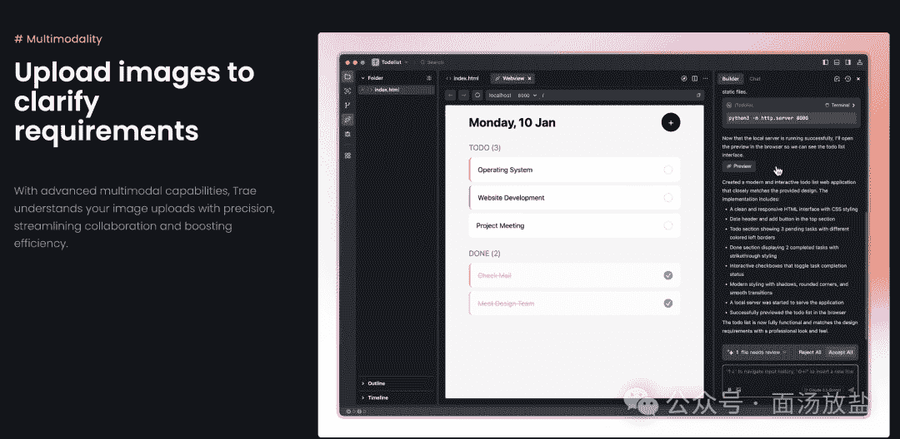
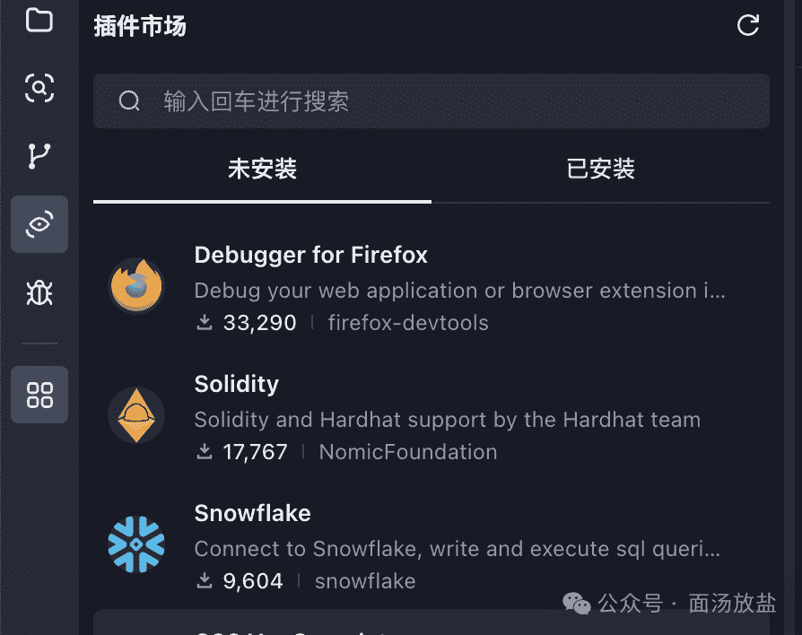
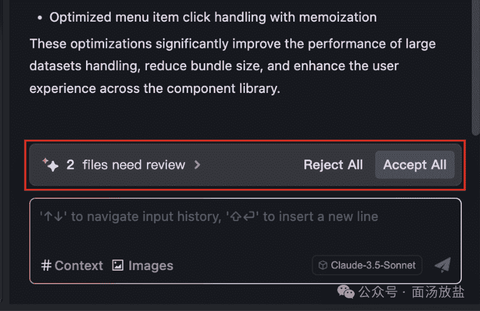
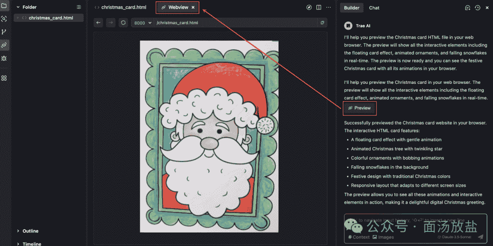
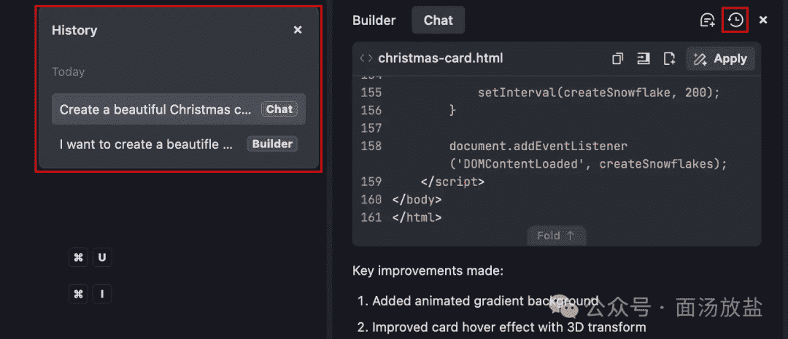
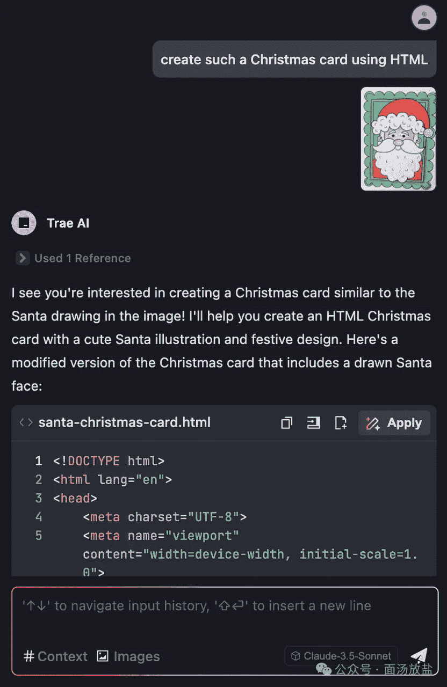
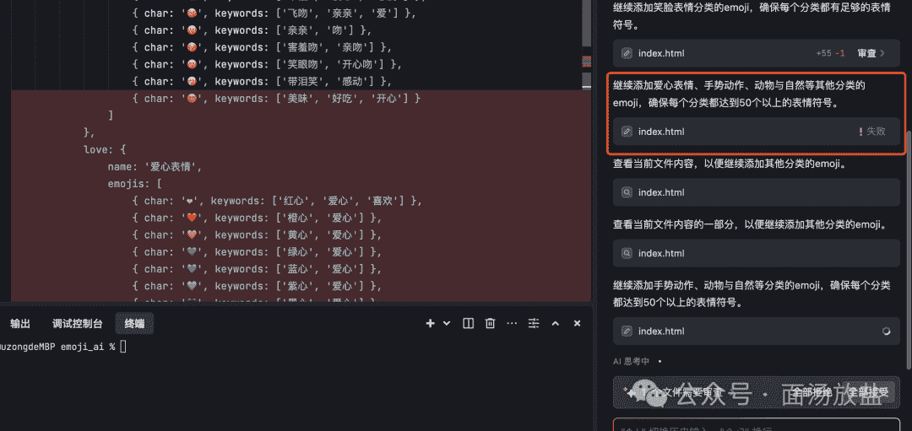

# Trae 介绍和最佳实践

> 来源：[https://agijuejin.feishu.cn/docx/GP0kd6cQtoNED8xJsTzcLO03nlg](https://agijuejin.feishu.cn/docx/GP0kd6cQtoNED8xJsTzcLO03nlg)

> uzong 面汤放盐｜[阅读原文](https://mp.weixin.qq.com/s/Ga1sWFCt26TNg96veMaHHA)，如有侵权，请联系删除。

> 转载请联系原作者取得授权

下面是我用 Trae 完善的 emoji 网页 （纯 AI 打造的静态网站）

截图展示如下； 访问地址：https://uzong.github.io/emoji/

现在 AI 在代码工程的能力也越来越强了。接下来让我介绍今天的主角 Trae。

## 一、Trae 是什么

Trae 是字节跳动于 2025 年 1 月 19 日推出的一款 AI 编程工具，旨在通过人工智能技术提升开发效率。

官方网址：https://www.trae.ai/

有以下三点需要注意：

+   目前 Trae 仅支持 macOS 版本，Windows 版本即将上线

+   **Trea 的 beta 测试将于 2025 年 1 月 20 日开始。在** beta 测试期间，Trae 对所有用户开放，可以免费使用 （后续应该会收费）

+   很遗憾，需要使用梯子才行，普通网络别想玩 😂

### 1.1 核心功能

+   **智能代码生成与优化**：Trae 能够通过自然语言输入生成代码片段，并提供代码优化建议。（试用还不错！）

+   **Builder 模式****：支持从零开始构建项目，根据用**户需求自动生成完整的代码项目。（支持通过多轮聊天生成项目级代码）

+   **Chat 模式**：允许用户通过对话方式获取编程帮助，解答代码问题。

+   **多模态交互**：**支持上传图片以澄清需求**，结合上下文分析整个代码库，生成更精准的代码。

+   **Webview 功能**：在 IDE 内直接**预览 Web 页面**，方便前端开发和调试。（静态网页差点意思）

+   **原生中文支持**：界面语言全面中文化，适合中文开发者使用 （对中文理解确实不错）

比如下面是官网的介绍，上传图片理解需求。 （未来：如果产品经理画好原型，上传后是不是就可以实现功能了呢？）

### 1.2 优势和特征

Trae 集成了 Claude 3.5 和 GPT-4o 等先进的 AI 模型。目前使用的是 Claude 3.5

包括以下能力：

+   **人工智能问答**：在编码时，可以随时与AI助手聊天并寻求编码帮助，包括让AI助手解释代码，编写代码注释以及修复错误和模式。

+   **实时代码建议**： 人工智能助手将理解当前的代码，并在编辑器中实时提供建议的代码。

+   **代码片段生成**：通过用自然语言向AI助手描述你的需求，它将生成相应的代码片段或独立编写项目级、跨文件的代码。

+   **0到1项目开发**：告诉AI助手你想要开发什么样的程序，它就会根据你的描述提供相应的代码或者自动创建相关文件。

## 二、安装和使用介绍

### 2.1 安装

说了这么多，现在进入正题。

直接到官网下载：https://www.trae.ai/

Trae 提供基本的 IDE 功能，包括代码编写、项目管理、扩展管理、版本控制、web预览等。（使用过 cursor 的人，对这几个应该不陌生，感觉比 cursor 在 UI 上更舒服）

+   可以通过 git 获取项目；也可以打开本地项目工程文件等。

+   插件市场、可以按需要安装插件。

对于 UI 就不过介绍了，接下来谈一谈关键功能能力。

### 2.2 Builder 模式 / chat 模式

builder 模式是强大的工程模式，就像软件所说的那样，可以轻松完成 0 到 1 的项目。

在Builder 模式下:

1.  AI 助手可以理解当前项目的上下文，包括代码、文件和文件夹

1.  在聊天中添加图片，例如错误截图、设计草稿、参考样式等，以更准确、更高效地表达需求

1.  批量接受或拒绝当前项目中的所有代码更改

1.  支持预览功能。（完成需求后会生成一个web预览功能，在预览期间，如果继续与 AI 助手交互并修改需求，结果将在 实时更新）

1.  可以将项目恢复到特定轮次聊天之前的版本。 （这个功能是非常nice的功能，比如修改不如意，想回答上一个版本）；非常点赞的功能，用过 cursor 写工程的人都知道，有时候完善工程的过程，会生成不如意的代码，这个时候回滚是非常麻烦的。而 Trae 集成了这个能力

1.  可以查看了管理聊天历史

**chat模式**

缺少 Builder 的工程能力，另外聊天模式只是在问答流程中运行，其中 AI 助手不会在后台使用任何相关工具来使其答案更有效。在 Builder 模式下，AI 助手会根据问题中给出的需求调用各种工具，包括用于分析代码文件、编辑代码文件、运行命令等的工具。

### 2.3 多模态输入

**在聊天过程中添加图片，例如错误截图、设计草稿、**参考样式等，以更准确、更高效地表达需求。

如何使用：

1.  上传错误信息，让 Trae 帮你理解 （这个是不错的！）

1.  上传设计稿，帮你实现功能。（马马虎虎）

### 2.4 自动完成

1.  通过注释生成代码

1.  当按下 Enter 键在光标位置创建新行时，AI 助手会读取并理解当前代码，然后自动完成后续代码。

### 2.5 上下文能力

与 AI 助手聊天时，可以在 Trae 中指定内容（例如代码、文件、文件夹和工作区）作为 AI 助手阅读和理解的上下文。这可确保 AI 助手的响应更紧密地符合需求。

更多用法可以参考：https://docs.trae.ai/docs/context?_lang=en

## 三、实战-emoji 项目

有了上面的基础学习以后，接下来进行实战演练。 使用 Trae 完善我的 emoji 项目 https://github.com/uzong/emoji

### 3.1 让Trae 理解项目

Trae 可以理解项目工程，问题不大。

### 3.2 让Trae 完善项目

让 Trae 继续完善我的项目， emoji 的数量更加丰富。

emoji 的数量确实有丰富，但是也对历史的进行删除了。（+46 -106）

**要想让 AI 完全听自己的，就应该多在 P**rmopt 上下功夫，随意必须强调一下！

另外不排除有失败的情况

经过多轮测试，确实丰富了不少图标，值得点赞！

到这里，图标已经丰富不少，再让其增加分类以及分类的数量。

注意：如果发现代码生成的效果不如意，千万别妄下结论，说它不行，不如试着和它耐心地对话，给出更多 Prompt ，并通过对话修正、引导 AI 工具，从而达到目标效果

### 3.3 让Trae更进一步

让我的 emoji 项目更加强大，所以我继续让 Trae 完善项目

**从右**边聊天框来看，逻辑是缜密的，并按照步骤逐一拆解实现！不会一下子返回！（有可能数据太大导致超时、网络中断，这一点使用上比cursor 要强一点！最后按照命令生成了剩余的 emoji 图）

通过分步骤实现，能力非常不错！

当所有样式都完成以后，再美化一下样式，最终成型，完结撒花！

https://uzong.github.io/emoji/

## 四、后续

1.  Trae.AI 在使用上，个人感觉对中文的理解比较强

1.  拆解思路，分步骤执行比较厉害（不会偷懒跳过你的需求！至少让他生成20，不会生成15个，后面5个忽略掉）

1.  目前属于免费，可以多玩一玩

1.  我的 emoji 已经初步成型，欢迎使用

在 AI 工具大行其道的今天，拥有更多的 idea 将变得无比重要！