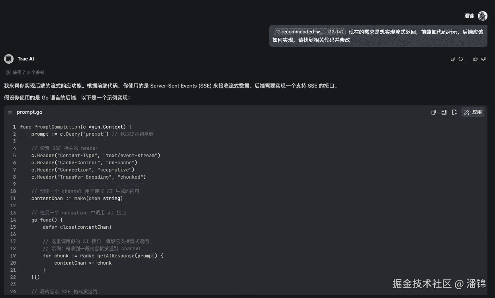
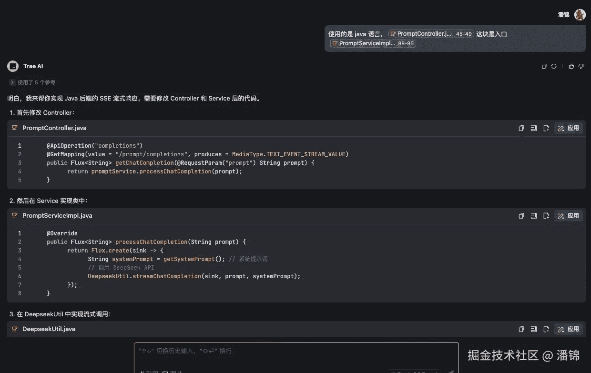
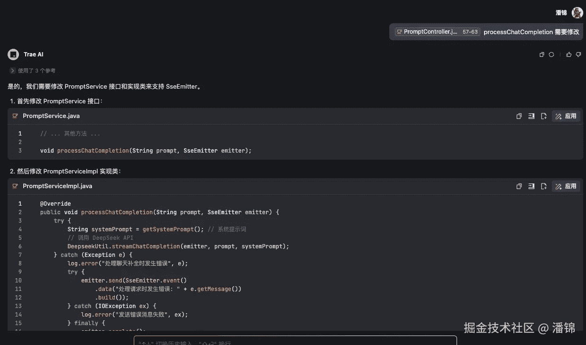
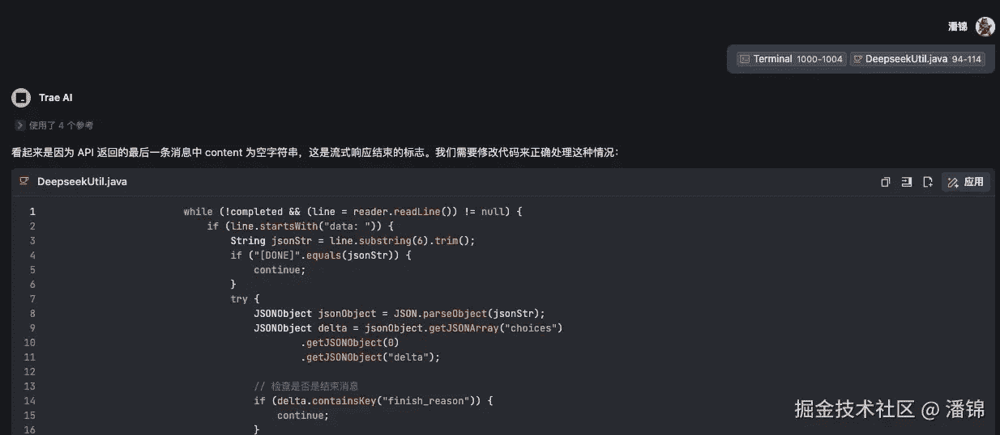
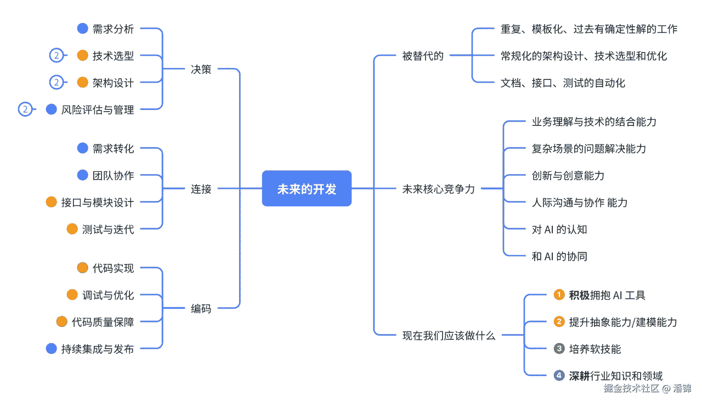

# AI 编程真的会让程序员失业！

> 来源：[https://agijuejin.feishu.cn/docx/Dn9hdqF4FomM2YxPuZzcIt5NnWF](https://agijuejin.feishu.cn/docx/Dn9hdqF4FomM2YxPuZzcIt5NnWF)

> 作者：潘锦

> 链接：https://juejin.cn/post/7463350947123183653

> 来源：稀土掘金

> 著作权归作者所有。商业转载请联系作者获得授权，非商业转载请注明出处。

> 如有侵权，请联系删除。

**我正在参加 Trae「超级体验官」创意实践征文， **本文所使用的 Trae 免费下载链接： www.trae.ai/?utm_source…

---

**2025 **[年 1 月 20 日上午](https://www.trae.ai/) 10:24 ，这个包含了 1024 的时间点，字节发布了其 AI 编程 IDE: Trae www.trae.ai/

对标 Cursor，Windsurf 的国内出海的一个 IDE，当前可使用 Claude-3.5-Sonnet 和 GPT-4o 大语言模型

深入使用，花了三个小时， **不写一行代码 **，实现了一个前端后端分离架构，包含登录/退出，数据库查询，跨域，以及首页功能的小管理后台，包括前端和后端的代码。前端所使用技术栈为 Vue，后端使用了 golang + beego。

这 3 个小时有一个耗时点是想让 AI 来解决跨域的问题，我们知道跨域主要是 Access-Control-Allow-Origin 等头信息的处理，把前后端的代码上下文都给了，反复试 OPTIONS 请求跨域总是不成功，后来发现是后台接口实现所修改的跨域文件没有加载导致的。

除了通用功能，实际业务开发中，花了 30 分钟实现了 Java 的流式输出，其场景是要实现 DeepSeek 的模型调用，以实现打字机的输出效果。

这里 AI 给的 golang 的实现，但是当前我需要的是 Java 的，这里的问题是没有把需求讲清楚。同时也表示在开始对话时，需要把一些背景信息讲清楚能提高整体的效率。

经过了大概 10 轮对话，他大概就了解我真正想要的是什么了，再经过 6 轮对话补全，把过程中有问题的地方和相关代码圈出来给到 AI，很快就有结果，并解决了问题。

## 1. 使用过程中的感受

1.  表述清楚需求很重要，在最开始的时候一些背景重要的背景信息可以提前给出，如技术栈，表结构、想做的事情等等；

1.  给到更多的上下文，更容易得到正确的答案，在 Trea 中使用 # 号引入，当前支持代码、文件、目录及工作区间；

1.  从 AI 中来，到 AI 中去，可以跳出 AI 来解决问题，当 AI 限入解决问题的死循环，可以找 google 要一些答案喂给 AI，后续应该会自动支持这个功能；

1.  出错的地方，选中后，直接让 AI 解决，甚至不需要多说一句话，当然，你也可以多说几句，更清晰的表述你想要的东西；

1.  多模态的能力，在界面有问题的地方，截图说明给到 AI 就能解决；

1.  先做框架，再逐个功能实现，当前阶段，AI 解决小范围的问题会更合适一些。

到这里，对于这种通用类的功能，AI 已经能发挥出很大的能力了，再进化一段时间，程序员的大部分编码工作真的就会被 AI 取代了。那是不是我们就失业了呢？从纯粹写代码的角度来说，是的，但是从整个项目的角度不一定。

## 2. 程序员的当前职责

和康总有聊到这块，当前我们程序员基本在解决的问题包括决策、连接和编码三部分。

+   **决策 **：技术选型、架构设计等高层次决策，AI 尚无法完全替代。

+   **连接 **：跨部门需求分析、团队沟通与资源协调。

+   **编码 **：过去程序员的核心工作，但 AI 的介入正在加速其主要功能的边缘化。

### 2.1 决策

项目开发的过程实际上是一个个的决策过程组成的，决策是咱们的核心职责之一，是一个项目从业务需求到技术实现的过程中，如何选择解决方案的过程。

我们需要在不确定性和多种选择中，基于经验、知识和实际需求，做出技术上的关键决定。这些决策往往会对团队的效率、产品的质量和未来的技术发展方向产生深远影响。

**决策 **指的它涉及从业务层面到技术层面的全局性规划，包括但不限于：

+   **需求分析 **：

+   理解并提炼业务需求，制定核心目标和功能优先级。

+   与产品经理、业务方的沟通，明确业务目标和用户需求。

+   **技术选型 **：

+   决定使用何种技术栈（前端框架、后端框架、数据库、云服务等）。

+   评估不同技术的可行性、扩展性和成本。

+   **架构设计 **：

+   系统架构的顶层设计，比如单体架构 vs 微服务架构。

+   数据库选择（SQL vs NoSQL）、缓存策略、性能优化方案。

+   **风险评估与管理 **：

+   评估技术方案的风险（如性能瓶颈、技术债务、团队技术栈能力）。

+   制定备选方案和应急措施。

**AI 替代能力：**

+   **当前能力 **：

+   AI 已能提供强大的技术选型建议（如根据场景推荐框架、库、工具）。

+   在简单的架构设计中，AI 已能生成初步方案（如微服务与单体架构优劣分析）。

+   **未来潜力 **：

+   AI 可能在复杂的技术决策中辅助更精准的数据分析和方案评估。

+   但最终决策依赖对业务需求的深刻理解，这仍需要人类的经验和判断。

**程序员核心竞争力：**

+   理解业务需求和行业背景，能够将技术与业务深度结合。

+   解决复杂的非结构化问题，比如协调跨团队需求冲突，平衡业务优先级。

+   创新能力：AI 只能在已有知识中提供建议，真正的创新需要人类。

### 2.2 连接

**连接 **是将技术方案具体化并协调各方资源，使其从理论走向实践的过程。重点包括：

+   **需求转化 **：

+   将业务需求拆解为可执行的技术任务。

+   明确模块划分、接口定义以及交互方式。

+   **团队协作 **：

+   前后端、测试、运维、产品经理之间的沟通与协作。

+   协调跨部门资源，解决技术与运营、市场等职能间的矛盾。

+   **接口与模块设计 **：

+   定义 API 接口规范（RESTful、GraphQL）。

+   确保接口的安全性、性能和兼容性。

+   **测试与迭代 **：

+   制定测试方案，组织单元测试、集成测试。

+   根据测试反馈快速调整，推动迭代优化。

**AI 替代能力：**

+   **当前能力 **：

+   AI 已能快速生成接口文档、代码示例、测试用例。

+   在协作方面，AI 可以辅助生成任务拆解、需求文档、项目计划等。

+   **未来潜力 **：

+   AI 可以成为跨部门的沟通桥梁，如生成更加精确的技术-业务对接文档。

+   但复杂、动态的沟通和协调仍是 AI 难以替代的领域。

**程序员核心竞争力：**

+   优秀的沟通能力和团队协作能力，能在矛盾或模糊的需求中推动项目前进。

+   对复杂系统的整体把控力，确保各模块之间的高效协作。

+   快速适应变化的能力，能够在项目中临时调整资源和策略。

### 2.3 编码

**编码 **是程序员的核心工作之一，涉及将设计方案转化为实际运行代码的过程。它包括：

+   **代码实现 **：

+   基于需求和设计文档，开发具体功能模块。

+   包括前端开发（UI、交互逻辑）和后端开发（业务逻辑、数据库操作）。

+   **调试与优化 **：

+   修复 BUG，优化代码性能。

+   解决复杂的技术难点（如跨域问题、性能瓶颈、并发冲突）。

+   **代码质量保障 **：

+   编写单元测试、集成测试，确保代码质量。

+   遵循代码规范，进行代码审查。

+   **持续集成与发布 **：

+   使用 CI/CD 工具进行自动化构建和部署。

+   实现代码版本管理和持续优化。

**AI 替代能力：**

+   **当前能力 **：

+   AI 已能生成高质量的代码片段、调试建议，甚至完整的模块代码。

+   对于常见的编码任务（如脚本处理类，CRUD 功能），AI 的效率和准确性已超过人类。

+   **未来潜力 **：

+   AI 将进一步替代大部分重复性、模板化的编码工作。

+   但对于复杂场景下的创新性编码，AI 的能力仍有限。

**程序员核心竞争力：**

+   对技术深度的理解，能够在 AI 提供的代码基础上进行优化和扩展。

+   解决复杂问题的能力，比如在非标准化场景下实现创新功能。

+   对代码质量的把控能力，确保生成代码的安全性、性能和可维护性。

## 3. AI 替代的趋势与程序员未来的价值

### 3.1 当前 AI 会逐步替代哪些部分？

1.  **重复性、模板化的工作 **：

+   例如脚本类、通用类、CRUD 重复类的功能。

+   常见的 BUG 修复、代码优化建议。

1.  **常规化的架构设计和技术选型 **：

+   AI 将能处理大部分标准化场景下的技术决策。

+   在数据驱动的决策场景中，AI 的效率更高。

1.  **文档、接口、测试的自动化 **：

+   自动生成 API 文档、测试用例，将成为默认功能。

### 3.2 程序员的核心竞争力是什么？

1.  **业务理解与技术结合能力 **：

+   AI 不理解业务逻辑背后的真实需求，程序员能够通过与产品、业务沟通，设计出更贴合实际的解决方案。

1.  **复杂场景的解决能力 **：

+   比如跨团队协作、大规模分布式系统设计、非标准化需求的实现。

1.  **创新与创意能力 **：

+   AI 是基于已有数据训练的，无法真正创新。程序员在新领域和新需求中的创意能力不可替代。

1.  **人际沟通与团队协作能力 **：

+   项目中的决策、问题协调、资源整合都需要人类来推动。

### 3.3 程序员未来应该做什么？

1.  **提升抽象能力和建模能力 **：

+   从写代码转向设计方案，专注于高层次的架构和技术规划。

1.  **拥抱 AI 工具 **：

+   熟练使用 AI 编程工具（如 Trae、Cursor）提升效率，将 AI 当作“助手”。

1.  **深耕行业知识 **：

+   了解特定行业的业务逻辑，成为领域专家。

1.  **培养软技能 **：

+   强化沟通能力、团队协作能力和项目管理能力。

画了一个思维导图，大概是这样：

以上。