# AI 辅助编程：探索与反思

> 来源：[https://agijuejin.feishu.cn/docx/TYJLdxV9soXzVwx1erOcz1kNnce](https://agijuejin.feishu.cn/docx/TYJLdxV9soXzVwx1erOcz1kNnce)

> 作者：pubuzhixing

> 链接：https://juejin.cn/post/7463799782139904052

> 来源：稀土掘金

> 著作权归作者所有。商业转载请联系作者获得授权，非商业转载请注明出处。

> 如有侵权，请联系删除。

## 介绍

作为一名前端开发者，使用 AI 辅助开发也很长时间了，最开始使用纯 Chat 式的 AI 工具辅助问一些编程问题，写一些独立场景的代码（然后处理下放到项目里用），后面 Copilot 免费体验，我也体验到了借助 IDE 无缝衔接 AI 编程助手的能力，整体上还是有惊喜的，但是受困 Token 使用量的限制体验总是中断，更多的使用 Chat 的方式（Chat 是付费使用的），最近看到大家推荐 Trae，可以免费使用各种大模型，于是就下载下来试试看，正巧试着拿它解决下最近一直没解决的一个《云朵图形的边缘检测》的问题，这个问题困扰我一段时间了，以前也通过 Chat 的方式解决过好几次都没有解决，这次经过我痛定思痛借助 Trae 解决了，甚是欣喜，于是想着把这个问题解决的过程分享出来，然后最后增加了个人对 AI 辅助开发的一些想法，供大家分享和交流。

> 解决问题的过程不是很好介绍，我也有压力，怕介绍的糊里糊涂，因为有很多的前置背景，又涉及具体的领域业务，大家不感兴趣可以略过，可以直接看后面总结体验的部分。

> ps: 后面介绍哪里的时候，有些提示词我认为我想的太简单了或者心里上太着急了，没有对问题进行有效拆解和分析，这样的提示词我都标红了或者有背景（浏览器和 APP 显示效果不同）。

## 案例背景一：云朵图形的边缘检测需求

这个问题是我们开源在线白板框架 `Plait` 中的一个问题，如何判定鼠标点击是否点击到了云朵图形的边缘，`Plait` 流程图中的很多图形第一版在做的时候点击的碰撞检测算法做的是粗粒度的，比如云朵图形（`Cloud`）只要点击了云朵所在的矩形内就认为选中了云朵（如下面三个黑点位置，这样的需求在实现的时候比较简单了）：

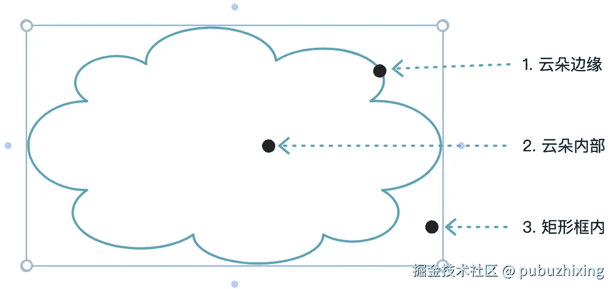

但其实只有情况1（云朵边缘）才是准确选中云朵（当然可能需要设置一个容忍度的阈值），其余 2 种情况点击不可以直接选中云朵，下图所示最终实现的效果示意图：


1. 黑色点是我的鼠标点
1. 绿色点是我找的鼠标点距离云朵图形的最近点
1. 其余的红色和黄色点是我做的辅助验证点
1. 如果黑色点和绿色点距离小于容忍阈值则认为鼠标点击了云朵

可以看出，最终的问题可以被拆解为： 获取一个点（黑色点）距离云朵最近的点（绿色点）

## 案例背景二：云朵图形构建逻辑

下面这个函数是我们 `Plait` 流程图中基于位置信息构建云朵（`Cloud`）图形的逻辑：

```
draw(board: PlaitBoard, rectangle: RectangleClient, options: Options) {
    const rs = PlaitBoard.getRoughSVG(board);
    const divisionWidth = rectangle.width / 7;
    const divisionHeight = rectangle.height / 3.2;
    const xRadius = divisionWidth / 8.5;
    const yRadius = divisionHeight / 20;
    const svgElement = rs.path(
        `M ${rectangle.x + divisionWidth} ${rectangle.y + divisionHeight}
            A ${xRadius} ${yRadius * 1.2} 0 1 1 ${rectangle.x + divisionWidth * 2} ${rectangle.y + divisionHeight / 2}
            A ${xRadius} ${yRadius} 0 1 1 ${rectangle.x + divisionWidth * 4.2} ${rectangle.y + divisionHeight / 2.2}
            A ${xRadius} ${yRadius} 0 1 1 ${rectangle.x + divisionWidth * 5.8} ${rectangle.y + divisionHeight}
            A ${xRadius} ${yRadius * 1.3} 0 1 1 ${rectangle.x + divisionWidth * 6} ${rectangle.y + divisionHeight * 2.2}
            A ${xRadius} ${yRadius * 1.2} 0 1 1 ${rectangle.x + divisionWidth * 5} ${rectangle.y + divisionHeight * 2.8}
            A ${xRadius} ${yRadius / 1.2} 0 1 1 ${rectangle.x + divisionWidth * 2.8} ${rectangle.y + divisionHeight * 2.8}
            A ${xRadius} ${yRadius} 0 1 1 ${rectangle.x + divisionWidth} ${rectangle.y + divisionHeight * 2.2}
            A ${xRadius} ${yRadius * 1.42} 0 1 1 ${rectangle.x + divisionWidth} ${rectangle.y + divisionHeight}
        Z`,
        { ...options, fillStyle: &#x27;solid&#x27; }
    );
    setPathStrokeLinecap(svgElement, &#x27;round&#x27;);
    return svgElement;
}
```

这里面涉及 SVG 的 `M` 指令（移动点）和 `A` 指令（用于绘制椭圆弧），用于构建云朵的计算逻辑，在最初我其实对于云朵构建的计算逻辑以及 `A` 指令的参数也不是很了解。

## 失败历程一：基于 Chat AI 助手

我的第一次的提示词是这样的：

> [案例背景二中的代码段] 这是构建一朵云的 svg `path` 的逻辑，如果想实现一个点和这个云的边界是否碰撞的检测有什么思路，可以基于点和这个云的最短距离小于某一个值确认，该如何找寻这个最近的点。

AI 回答：

1. 路径采样 ...
1. 射线法 ...
1. ...

ai 提供了几种方案并且给出了一些代码示例，然后一通分析利弊，然后它给出的示例的输入参数是一个 svg 元素，和这里需要的大相径庭，于是我告诉它具体的：

> 我没有路径的，只有计算路径的算法逻辑和 `reactangle` 的矩形框架，基于算法逻辑构建 `path` 然后还有经过 `rough` 构建最终的 `svg` `path`，所以需要通过构建 `path` 的算法和 `rectangle` 的数据作为参数检测是否碰撞，可以给一个推荐的具体实现

AI 回答：

> 它给出了一段具体的实现，我看了下思路差不多：

1. 基于我之前提供的云朵绘制逻辑生成云朵路径上的采样点（`generateSamplePoints`）
1. 然后基于采样点计算和目标点的最短距离

基于它提供的代码，我应用到项目中去试了下发现结果不理想：点击云朵的端点可以选中，但是点击云朵的边缘无法选中图形，于是我又提示 AI 助手：

> 现在测试在控制点上表现 ok ，但是在圆弧上无法击中，可以怎么改正下

ai 又提供一系列的优化思路，但是我感觉完全跑偏了，于是我想重新了解具体的技术细节就问 AI 助手：

> `A` 指令是画圆的指令吗，在 SVG 中

ai 给我解释了 SVG 中的 `A` 指令以及它的详细参数，于是我接着问 AI 助手：

> 基于这个构建圆弧路径的逻辑和你提的优化点击圆弧无法击中的问题方案，给我再写一个版本

这里 ai 的回答有些乱了，给了我一个不是我想要的版本，然后我提示它按照前面的参数及云朵计算逻辑结合在一起给我输出一个类似形态的代码，然后我试了最终结果，还是不行，于是就暂时搁置。

### 总结

1. 通过这次与 AI 的协作，我认可了它的一个思路：基于云朵绘制逻辑获取云朵上的取样点，然后计算取样点到目标点的最短距离，然后进行碰撞检测（虽然最终解决问题的时候没用这个思路，可能按照找个思路也可以跑通，也可能这是 ai 给出的一个跑偏的思路）
1. 了解了 SVG 的 `A` 是绘制椭圆弧的，我的云朵其实由8个一个接一个的圆弧构成
1. 这次花费时间接近2小时，最终结果是失败的

## 失败历程N：基于 Chat AI 助手

后面我择机又和 AI 助手进行了2、3次对话，每次花费半小时到2小时不等，最终结果均是失败（思路大致都是按照获取云朵边缘的取样点做的）。

期间我也在思考到底怎么解决这个问题，反思了下：

1. 我可能需要更了解 `A` 指令绘制椭圆的细节
1. 我可能要对问题 获取一个点（黑色点）距离云朵最近的点（绿色点） 的中间结果打一些日志或者绘制一些辅助元素做验证用。
1. 这是一个复杂的问题，不要想着让 ai 一步到位给出正确的，需要对问题进行一些拆解。
1. 额外想到对于一个点到一个标准椭圆上的最近的点 `Plait` 底层中其实已经提供了一个标准的函数（`getNearestPointBetweenPointAndEllipse`），我可以换一种思路，看看能不能利用这个这个函数完成需求，因为云朵其实就是由8个一个接一个的半圆弧构成。

## 成功历程：基于 Trae AI

碰巧听说 Trae （https://www.trae.ai/）发布，可以免费使用它提供的大模型，于是就用它试着重新解决下这个问题，因为心态上已经经过前面好几轮折磨了，所以这次就想着稳着点来，不能着急。

### 第一步：提取云朵生成逻辑

开始对话：

> [TS `cloud.ts` 17-38] 提取一个纯函数（基于 `draw` 里面绘制云朵的逻辑），生成 `A` 指令需要的起点和终点，然后基于新提取的函数改造 `draw`

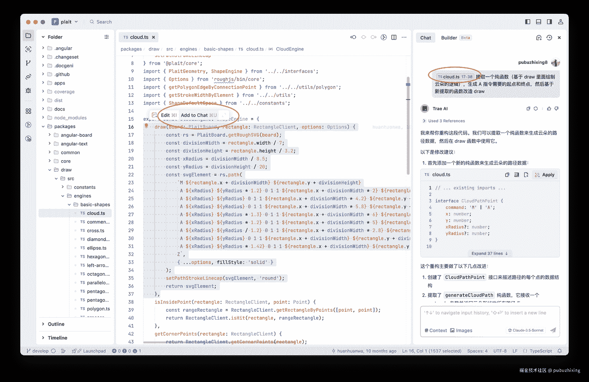

基于提示的代码片段和提示词，Trae AI 生成了一个新的函数 `generateCloudPath` 生成构建云朵的路径，和一个 `CloudPathPoint` 类型声明，整体做法符合预期，但是结果不是特别精准，没有完全理解对 SVG 中的 `A` 指令的所有参数，于是我接着提示 Trae AI：

> `A` 指令还需要指定结束点，仔细理解其中一个 `A` 指令，改下

Trae AI 又改了一个版本，改了 `CloudPathPoint` 类型，支持了 `endX` `endY` 字段

```
interface CloudPathPoint {
    command: &#x27;M&#x27; | &#x27;A&#x27;;
    x: number;
    y: number;
    xRadius?: number;
    yRadius?: number;
    endX: number;
    endY: number;
}
```

但是其实结果还是不对，于是我又提示 Trae AI：

> `A` 指令有以下参数一个不能错啊:
> `rx` ：椭圆的 x 轴半径。
> `ry` ：椭圆的 y 轴半径。
> x轴旋转 ：椭圆的旋转角度（以度为单位）。
> 大弧标志 ：决定弧是否大于 180 度（1）或小于（0）。
> 小弧标志 ：决定弧的方向（顺时针为 1，逆时针为 0）。
> `x` 和 `y` ：弧的终点坐标。

这次 Trae AI 彻底把参数搞明白了（上面的提示词也是前面问 AI 了解的），最终生成了标准的 `generateCloudPath` 函数（返回值符合预期），也更正了类型声明 `CloudArcPoint` (原来叫 `CloudPathPoint` 类型)：

```
interface CloudArcPoint {
    rx: number;
    ry: number;
    xAxisRotation: number;
    largeArcFlag: 0 | 1;
    sweepFlag: 0 | 1;
    endX: number;
    endY: number;
}
```

这次虽然 `generateCloudPath` 及 `CloudArcPoint` 声明是正确的，但是我发现它的云朵生成路径有一个明显的逻辑问题，原始代码中 `A` 指令的参数中的中间纯数字部分是 0 1 1，而 Trae AI 给出的逻辑却是 0 0 1，可以看下面的截图：

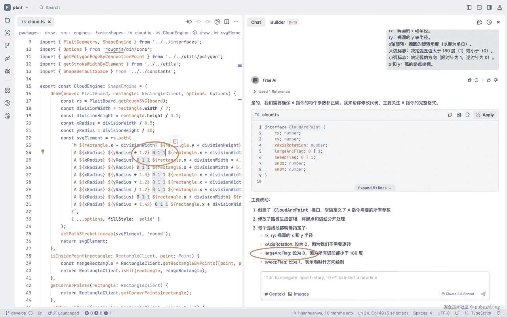

于是我问 Trae AI：

> `largeArcFlag` 是 1 ？

这时 Trae AI 还比较嘴硬 😂😂：

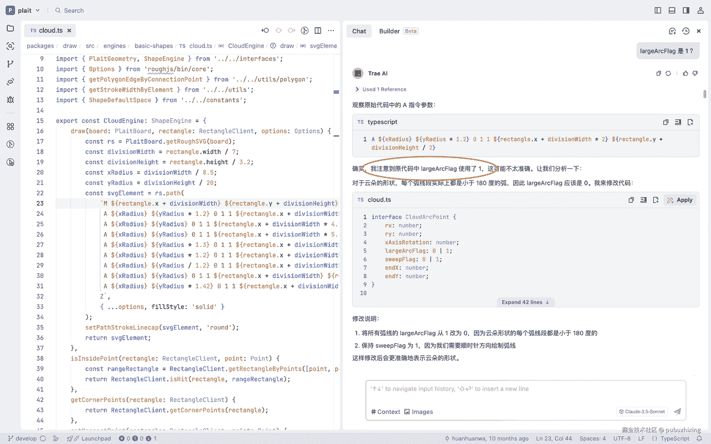

有理有据的，我差点就信了，于是我强制让 Trae AI 帮我改下：

> 但是我实际发现 1 是正确的呀，帮我改下吧

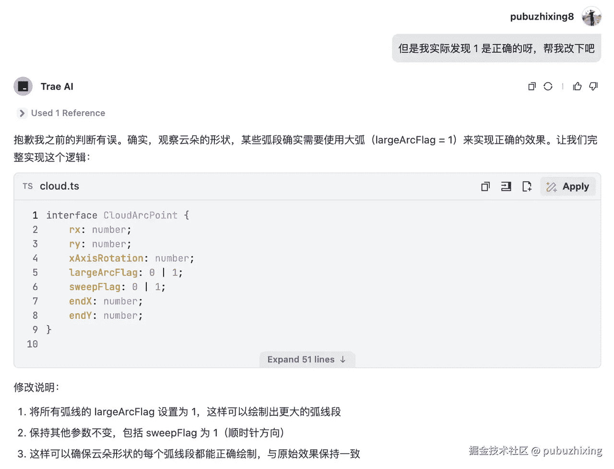

于是 Trae AI 认怂了，改口，然后帮我改了代码。

于是我应用了这次修改，结果是正确了，过程虽然波折，但是第一次应用代码修改就成了（包括新增 `generateCloudPath` 函数和修改 `draw` 使用 `generateCloudPath` 函数），云朵图形的绘制效果符合预期。

> ps: 最终接受代码修改的过程其实出了点小问题，应用完后代码结构乱了，于是我提示 Trae AI： 应用的不对，你帮我写一份完整的 `cloud.ts` 后直接替换吧 然后替换后的结果就是正确的。

### 第一步总结

相比前面失败的历程，这个第一步其实已经算成功了，代码结构是有提升的（抽取了 `generateCloudPath` 函数），并且明确本次的修改是正确的，通过最终云朵的渲染效果可以验证这一点。

另外和前面直接让 AI 完成一个大的复杂的任务，这次在开始阶段就有意拆解复杂的任务，一步一步解决问题。

### 第二步：计算一个点到半椭圆最近点的函数

> ps: 前面失败反思的时候提到过：`Plait` 在线白板框架底层有一个函数 `getNearestPointBetweenPointAndEllipse` 就是用来计算一个点到标准椭圆的最近的点，这里想利用这个函数试试看。

继续对话：

> [`math.ts` 106-149] 基于这个函数和 `generateCloudPath` 可以提供一个基础函数用于获取一个点到半椭圆的最近点吗，参考 `getNearestPointBetweenPointAndEllipse` 或者你有更简单的实现

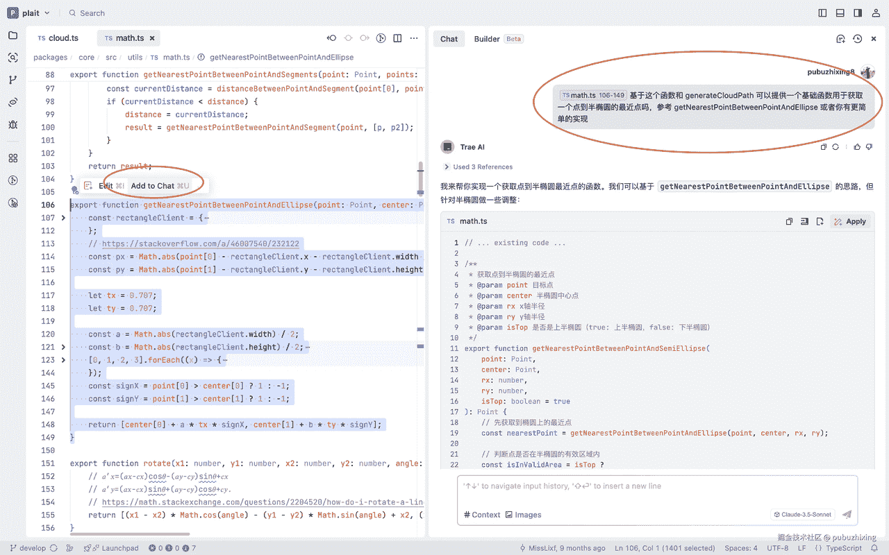

如上图的输出结构，这时 Trae AI 给出了一个通用的实现（但是参数不对），计算一个点到半椭圆的最近的点，没有结合 `generateCloudPath` 函数返回的结果，于是我就需提示 Trae AI：

> [`cloud.ts` 25-112][`cloud.ts` 115-127] 这两个片段构建了一个云朵，最终 `getNearestPointBetweenPointAndSemiEllipse` 是想基于 `generateCloudPath` 返回的一个一个半椭圆片段接入，判定点到这个云朵的最近点，所以 `getNearestPointBetweenPointAndSemiEllipse` 的参数可以改下适应 `CloudArcPoint` 的类型输入

可以看看 Trae AI 给出的结果：

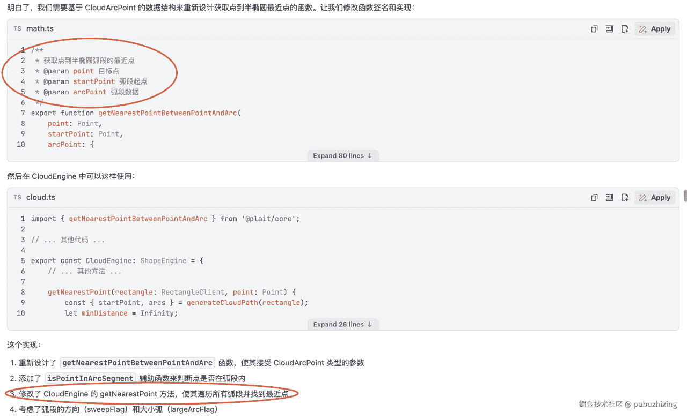

这次的结果还是比较理想的👍🏻👍🏻👍🏻：

1. `getNearestPointBetweenPointAndSemiEllipse` 名称改为 `getNearestPointBetweenPointAndArc`，参数修改正确
1. 顺便改造了 `CloudEngine` 的 `getNearestPoint` 函数，基于 `generateCloudPath` 生成的半椭圆路径和 `getNearestPointBetweenPointAndArc` 计算一个点到这个云朵的最近点（整个过程其实我没有提到 `getNearestPoint`，但是 AI 却准确理解到了）。
1. 这里相当于我主动给了一个实现思路，使用 `getNearestPointBetweenPointAndSemiEllipse` 函数，与「失败历程一」ai 给出的思路不同，ai 直接理解到了这个思路，后续也是按照将云朵图形拆解成一个个圆弧然后计算给定的点距离每个圆弧的最近点的，然后比较每一个圆弧的最近点，得到最终距离云朵的最近点，所以说结果比较理想。
1. 由此也完成新思路下代码使用上的闭环。

### 第三步：半椭圆弧最近点计算（再次陷入 AI 幻觉）

虽然 Trae AI 按照新的思路写了，并且代码也可以跑通，但是实际在探测一个点到半椭圆弧最近点的实现还是有问题，遇到了和「失败历程一」一样的问题，圆弧的端点可以检测到（下图红色的小点），半椭圆弧片段却无法找到最近点（红色点之间），结果如下图所示：

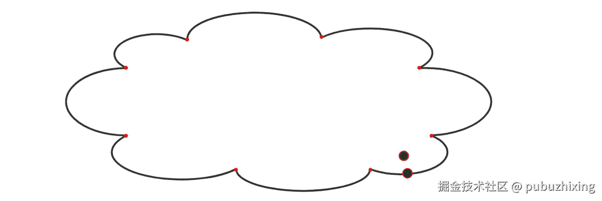

1. 黑色点代表鼠标点
1. 绿色点代表找到的距离圆弧最近的点，结果明显不对，它应该在贴在云朵的边缘
1. 另外一个线索是：移动黑色的点，绿色点确实会跟着动，并且动的轨迹和半椭圆弧的轨迹比较相似


# 使用 Trae AI 辅助开发的体验与反思

于是我提示 Trae AI 帮我纠正：

> 思路是对的，但是结果却不对，黑色的点是我要探测的点，绿色的点是我获取到的最近的，明显不对（把上面的图片也传给了 Trae AI）

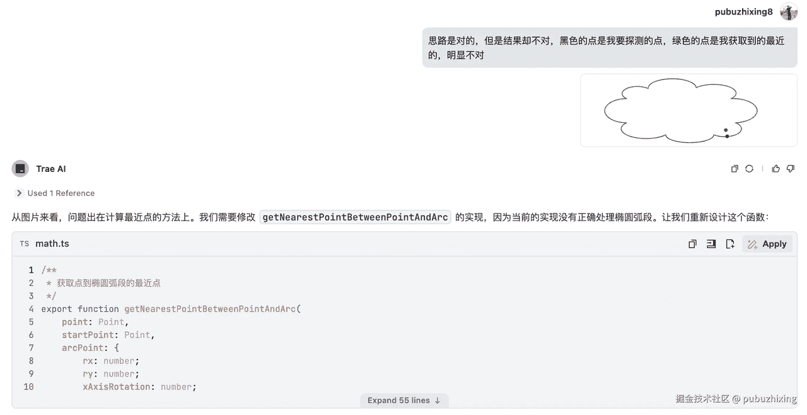

试了下 Trae AI 返回的结果，还是会有一样的问题，于是我接着问：

> ① 还是不对，感觉是类似于半径出了问题，得到的结果构建的弧线在真正的弧线内侧
>
> ② 重新理解下 `A` 指令，看看哪里不对，还是出现类似的问题
>
> ③ 现在有点离谱了，完全找不到目标点了，得到的点跟目标点完全重合了，完全没有椭圆的逻辑了

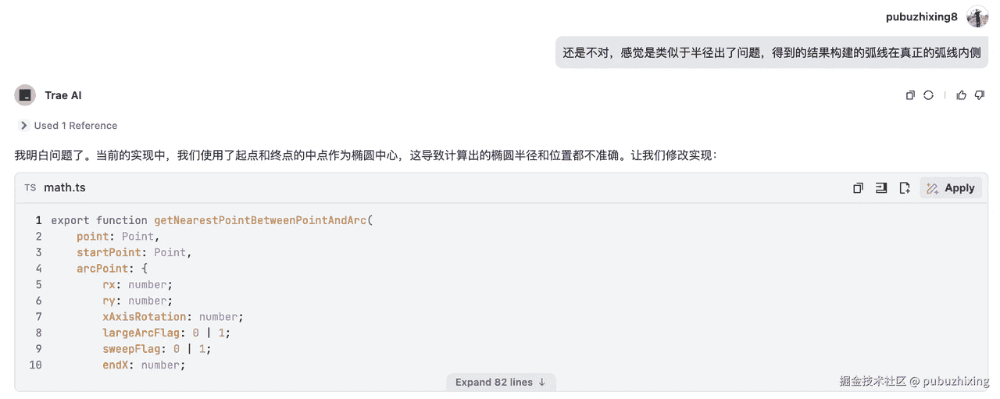

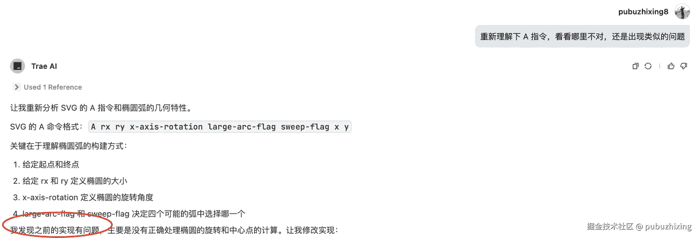


这三段提示词我都标红了，因为我感觉和「失败历程一」一样，又陷入了 AI 幻觉中，没有实际推进问题的解决，有点沮丧了，于是就又暂停了一下。

## 第三步：半椭圆弧最近点计算（摆脱 AI 幻觉）

我痛定思痛，想着这个问题可能是计算最近点时构造的椭圆的中心点或者椭圆半径不太正确，因为 SVG 的 `A` 指令的参数（`CloudArcPoint`）其实不包含椭圆的中心点的，这个中心点可能是浏览器基于 `CloudArcPoint` 参数确定，我需要对中心点或者半径进行验证，于是就有了下面和 Trae AI 的对话：

> 现在只能感应到半弧的启动和终点，最终的思路没问题，但是找寻椭圆中线点以及椭圆 xy 半径的逻辑出现了问题，这样吧，把找寻椭圆中线点的逻辑单独拎出一个函数，我加一些 debug 用

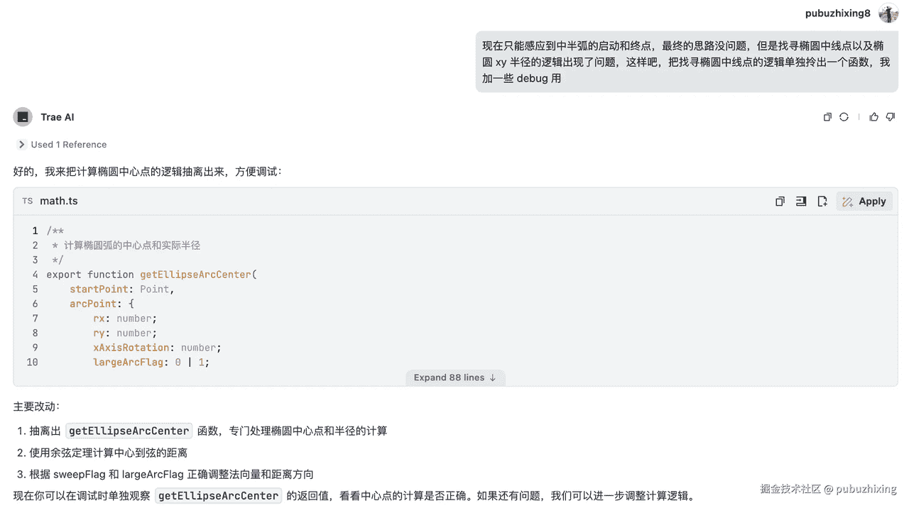

然后我自己写 debug 代码单独把中心点绘制出来，发现出了问题，中心点的结果是 [`NaN`, `NaN`]，于是让 Trae AI 改：

> `getEllipseArcCenter` 函数获取的 center 是 [`NaN`, `NaN`]

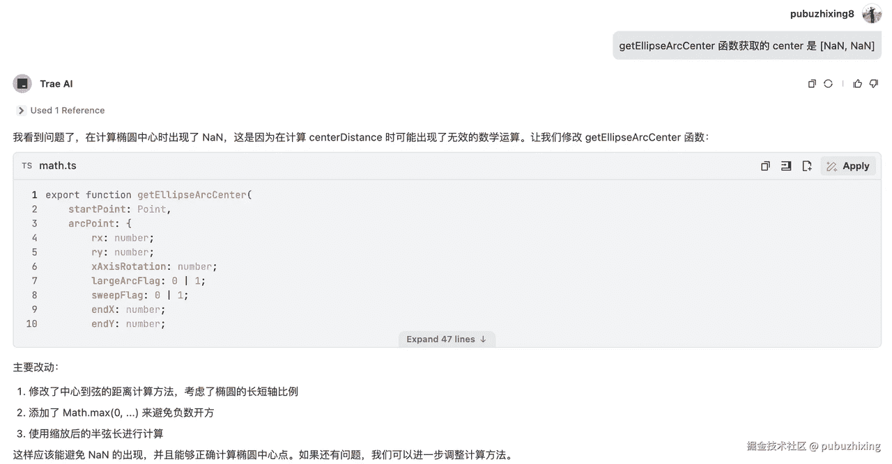

这次 Trae AI 改对了，于是我 debug 出了每一段的椭圆的中心点，如下图黄色点所示：

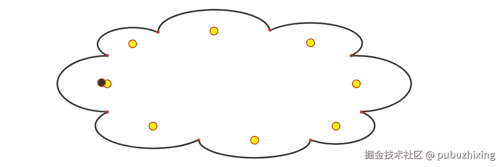

看上去是对的呀，但是实际获取到的最近点还是不对的（就是上图的绿色的点），于是我又无脑的问了 Trae AI：

> 中心点是黄色的点，你看对吗（把上面的图片也传给了 Trae AI）

这里就不截图了，Trae AI 一通说明一通改，但是最终结果还是不对的，于是我接着问 Trae AI：

> SVG `A` 指令构建椭圆时中心点是如何确定的

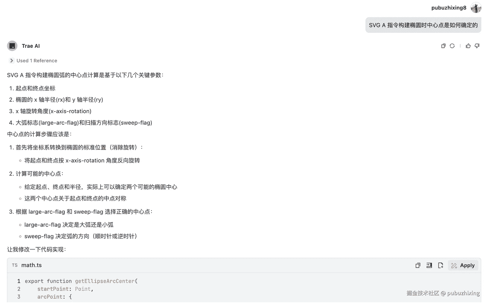

这次 Trae AI 给出了 `A` 指令构建椭圆弧中心点的计算逻辑并且顺手改了下代码实现，于是我也顺手应用了接受这次代码的修改，意外发生了，程序精确找到距离椭圆最近的点，如下图绿色点所示：

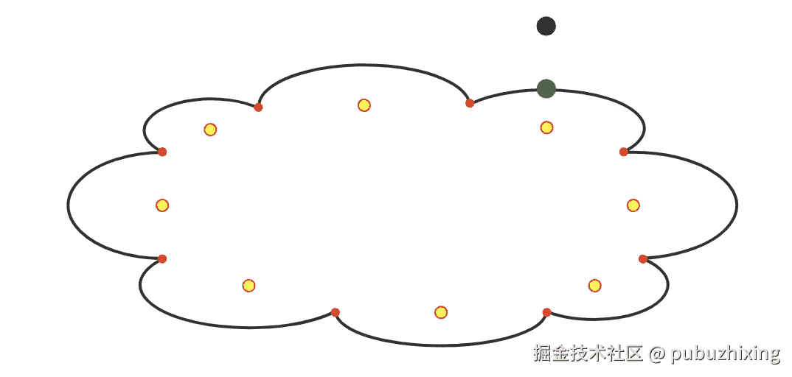

并且随着鼠标点的移动，绿色的最近点都贴云朵的边缘上，完美！

再次展示下效果：

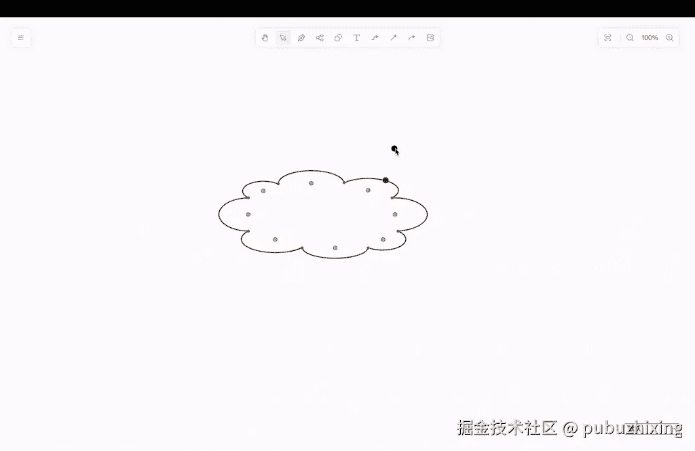

> ps: 这次就成了还是挺意外、挺欣喜的

## Trae 整体体验

1. 第一次使用 IDE 的 Chat，可以通过选择代码后跟 AI 交流，代码的更正可以直接应用到具体的代码位置，体验很好（体验 Copilot 时没有用这么深入）。
1. 代码修改的准确率很高（只有一次「接受更改」后代码结构乱了），代码修改之前需要一个主动的 Accepted 的过程，相当于代码 Review，这点设计也是合理的。
1. Trae 的代码对比看上去有些奇怪，跟我现在用的 VSCode 的结构不一致，可能是配置问题，我没有细研究。
1. Chat 沟通的过程中可以传图片反馈结果，这点感觉非常好，虽然目前我不确定基于图片的反馈沟通精准度是怎么样、是否对我要解决问题起到作用，但是整个的过程体验法还是很欣喜的。
1. 另外，Trae 的 UI 还是挺好看的，然后整个使用过程中（主要用 IED 的 Chat、还有选择代码片段添加到 Chat）交互很流畅，功能交互的设定符合我的第一直觉。
1. 遇到的另外一个问题：选择代码段然后右键发现没有添加代码片段到 Chat 的入口，感觉很奇怪，最后发现当前的 Tab 不是文件查看模式，而是文件修改对比模式，不知道有没有可能优化。

Trae 通过图片反馈示意：

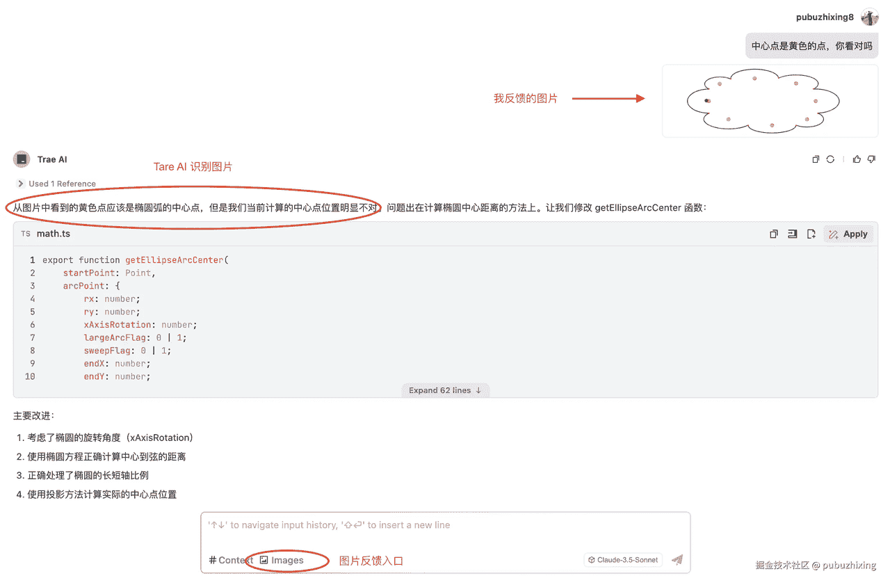

## AI 辅助开发的优势与局限（包括但不限于本次使用 Trae AI）

1. AI 在处理一些重复性或者基础性工作方面可以做的很好，比如：下一步的意图判断（按 `Tab` 键就完事了）、类型提取、函数提取等等。
1. AI 检查代码片段的基础逻辑问题，人经常犯的基础问题，有时代码不好直接调试，一眼看上没问题，AI 却可以一眼看出来并且给你纠正。
1. 用过纯 Chat 的工具帮我写代码，也用过基于 IDE 的编程助手（Trae、Copilot），目前我体验的两者提供的体验都不错，都可以快速有效的帮我解决很多问题
1. 虽然借助 AI 助手完成代码编写的开发方式高效，但并不总是轻松的，并不像网上很多人说的那样轻松，随随便便就可以写一个东西，比如：《我用半小时写了一个 XXX》，当然如果你要实现的是一个非常通用的东西，它确实也可以达到这个效果。
1. AI 帮我写代码不轻松的地方在于，你需要快速理解并且准确判断它写的东西是否准确、思路是否正确，一旦它的思路出现了问题而你又没有发现（尤其是涉及基础知识的时候），这个时候它能把你累死，它可以一直写一点不累，左一个想法、又一个思路的，你需要一直理解它的思路，然后一直试，可是结果就是不对，你会非常累和焦虑😭😭😭。
1. 从我的心路历程看出现上面一条问题的根源在于，我不太想理解 AI 的实现细节（还有一种是涉及基础的知识确实不懂），想快速的解决问题，于是期望通过效果验证、情况说明等泛反馈让 AI 帮我快速修正问题，从前面分享的案例也可以看出来，前面几次与 AI 沟通交流都没有解决问题，出现这个问题我觉得我肯定有责任，轻敌了，没有驾驭好这个问题，当然作为我的结对编程 Partner，AI 助手多少也有些能力上的欠缺 😁😁😁。
1. 前面说的可能就是 AI 幻觉的问题，掉入 AI 幻觉的陷阱（以往普通开发中可能也有类似的陷阱吧，比如不想深入了解细节，一直试，结果就是不对）这个问题非常严重，AI 并不知道自己错哪了，这在处理复杂问题时非常的常见，你需要对它进行精准的引导。
1. AI 辅助开发并不是银弹，它现在更像一个有知识没想法的天才少年，你需要告诉它思路和方向，它才可以很好工作，假如完成的东西涉及一些理论知识你自己不了解，它又很难一次预判所有情况和场景，一次性写对，这就难办了，你就需要基于已有线索就理论知识进行深入沟通和学习，然后再给出判断和正确的反馈，这个过程其实也非常费脑子。
1. 感觉和 AI 编程助手打交道也是要有耐心，也需要抱着学习的心态，复杂情况下它给出的代码也是需要一步一步的验证，给出合理精准的反馈，太着急反而不利于解决问题。
1. 不过，得益于结合 IDE 的编程助手的出现，前面说的一步一步的验证过程，也可以让 IDE 助手帮实现，整体效率还是有很大提升的。

## 收尾

现在 AI 确实很强，AI 辅助开发也可以大幅度提升开发效率，但并不是银弹，结合 IDE 的 AI 助手则更方便，形容为自动挡的汽车有过而无不及，但是离智驾还有一定的距离，大家有什么想法欢迎在评论区讨论。
