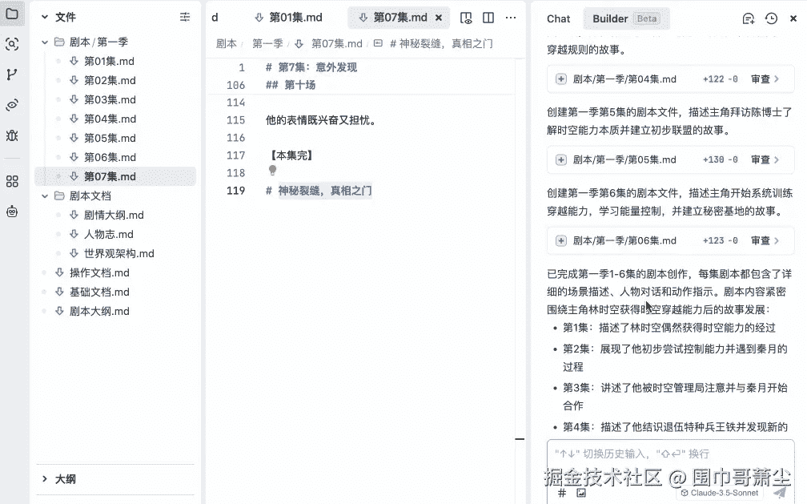
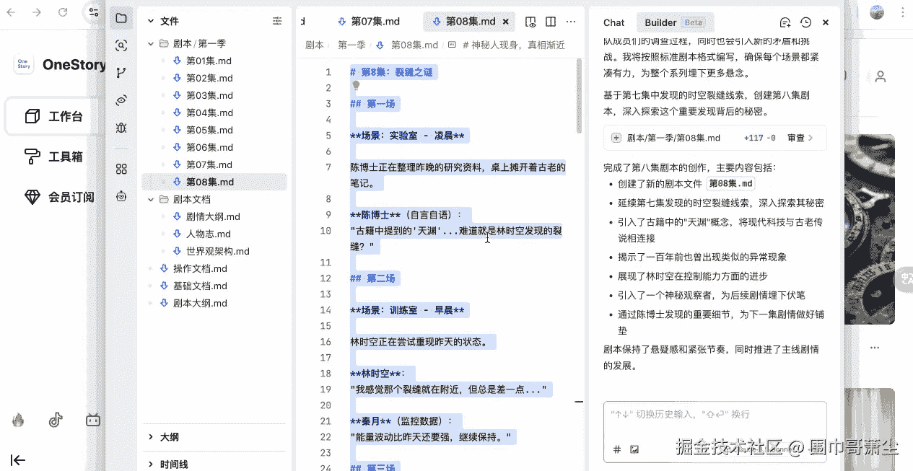
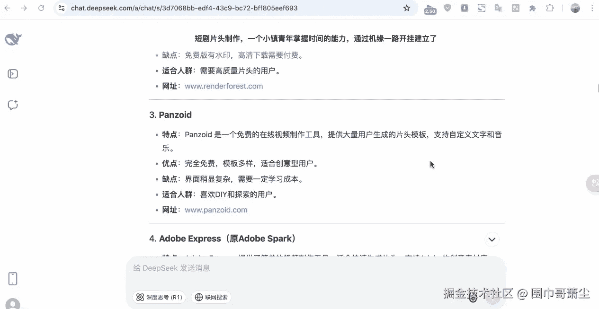

# 「短剧创作」Trae AI & DeepSeek & AneStory 爆款短剧的剧本自动撰写和视频效果的生成🧣

> 来源：[https://agijuejin.feishu.cn/docx/NkGZdYppiol9ZSxHTGAcZdNBnjg](https://agijuejin.feishu.cn/docx/NkGZdYppiol9ZSxHTGAcZdNBnjg)

> 作者：围巾哥萧尘

> 链接：https://juejin.cn/post/7472560819936772137

> 来源：稀土掘金

> 著作权归作者所有。商业转载请联系作者获得授权，非商业转载请注明出处。

> 如有侵权，请联系删除。

[**本文所使用的 Trae **](https://www.trae.ai/?utm_source=juejin&utm_medium=juejin_trae&utm_campaign=AGI_article)免费下载链接： www.trae.ai/

<https://player.bilibili.com/player.html?bvid=1UdAFejE8E&spm_id_from=333.1387.0.0&vd_source=3c05f709993522f785b1b5f3989b0b97>

今天我想和大家分享一下我最近在尝试的短剧创作过程，尤其是如何利用 Trae AI 工具来完成从爆款短剧的构思到视频生成的整个流程。

#### 一、创作的初衷与灵感来源

我一直以来对创作短剧很感兴趣，尤其是那些能在短时间内抓住观众注意力的故事。最近，我参考了一个博主的教程，主题是“ # 如何用AI创作100集短剧，克服超长上下文导致剧情不连贯的问题 ”，这让我深受启发。这位博主详细讲解了如何克服上下文剧情不连贯的问题，我觉得非常实用，于是决定自己动手尝试完成短剧的自动化撰写。

#### 二、剧本构思与大纲搭建

我的剧本主题是借鉴博主的主题：“一个小镇青年偶然掌握了时间能力，通过一系列机遇一路开挂，最终建立自己的势力，并在现代与自己的势力融合。”这个故事听起来很像常见的穿越或奇幻题材，但我希望通过一些独特的设定让它脱颖而出。

在开始创作之前，我首先构建了剧本大纲、人物志和世界观三个文档。

大纲主要梳理了故事的主线，包括能力觉醒、势力扩张、冲突对立等关键情节。人物志则详细描述了主角和其他重要角色的性格、背景和成长轨迹。世界观部分则设定了故事发生的背景，包括时间、空间和一些奇幻元素。

不过，在实际操作过程中，我发现这些架构还可以更丰富一些。比如人物设定，我希望出场角色再多一些，这样可以撑满100集的内容。如果时间允许，我还会进一步完善这三个文档，让整个故事的逻辑更加清晰。

#### 三、分集撰写与 Trae AI 的应用

接下来，我开始撰写第一季的剧本。以1~10集为例，前6集主要描述了主角临时空偶然获得时空能力，并开始系统训练、完善基地建设的过程。在这个过程中，我使用了Trae AI 工具来辅助完成分镜和视频的创作，比如“AneStory”和“海螺AI”,以及“白日梦”等。

“白日梦”工具的优势在于生成的内容比较完善，但它需要的时间比较长。比如我昨天花了大概一个晚上才完成第七集的生成。而“海螺AI”工具则更注重画面感，生成的图片很逼真，但它没有配音功能，需要我手动添加。

在撰写第一集时，我先输入了剧本内容，然后通过 Trae AI 工具生成分镜头脚本。比如第一场场景是白天的公寓，主角坐在床边，回想起刚才发生的一切，他的手掌中突然泛起蓝光，证实了一切都是真实的。这种细节的描写，让我觉得AI工具在创作过程中确实很有帮助。

#### 四、视频制作与优化

生成剧本后，我尝试将文字内容转化为视频。

在这个过程中，我发现最难的部分是人物模拟和画面感的整合。比如，AI生成的画面虽然很逼真，但人物的动作和表情有时会显得生硬，需要我手动调整。

我用DeepSeek生成了一段旁白：“《时空隐士》片头旁白（霸气侧漏版）”希望通过文字和画面的结合，营造出一种神秘的氛围。不过，这个过程真的让我思考了很久，如何才能更好地将文字转化为画面，再从画面转化为视频。

#### 五、音乐创作与未来展望

除了剧本和视频，我还尝试创作了《时空隐士》的主题曲。歌词大概如下：

> **《时空之巅》 （主歌1）**

> 时光的齿轮，悄然转动， 命运的交响，在指尖流淌。

> 穿越千年的风，掠过山河的梦， 我是时空的旅者，书写传奇的篇章。

虽然我花了很长时间，但最终效果却不是很满意的。

但是我今天早上创作的 Trae AI 进行曲却不错，下午做成了视频，我计划明天和大家分享一下 Trae AI 歌曲的制作过程，包括如何用 AI 音乐工具完成音乐创作。

<https://player.bilibili.com/player.html?bvid=1aFA8eKEZi&vd_source=921270471e745ada21af6b8406e3ff55>

#### 六、总结与分享

通过这次创作，我最大的感受是，Trae AI 工具虽然强大，但创作的核心仍然是构思和逻辑架构。只有把世界观、人物志和剧情大纲搭建得足够完善，Trae AI 生成的短剧内容才会更连贯、更有吸引力。

最后，我想鼓励大家也尝试一下 AI 创作。如果你有好的想法，不妨动手实践一下。如果能成功地将文字转化为画面，再从画面转化为视频，那真的是一件很酷的事情。

[**本文所使用的 Trae **](https://www.trae.ai/?utm_source=juejin&utm_medium=juejin_trae&utm_campaign=AGI_article)免费下载链接： www.trae.ai/