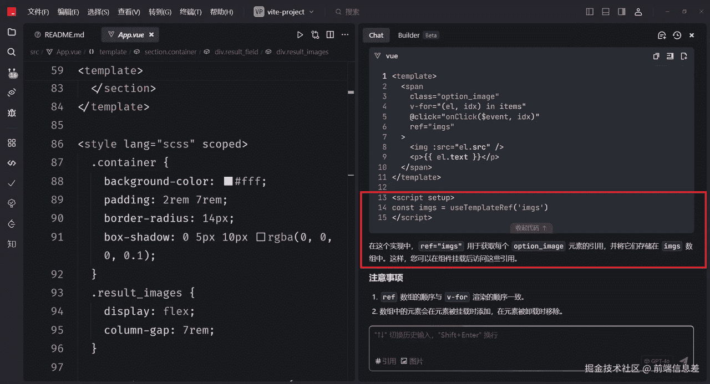
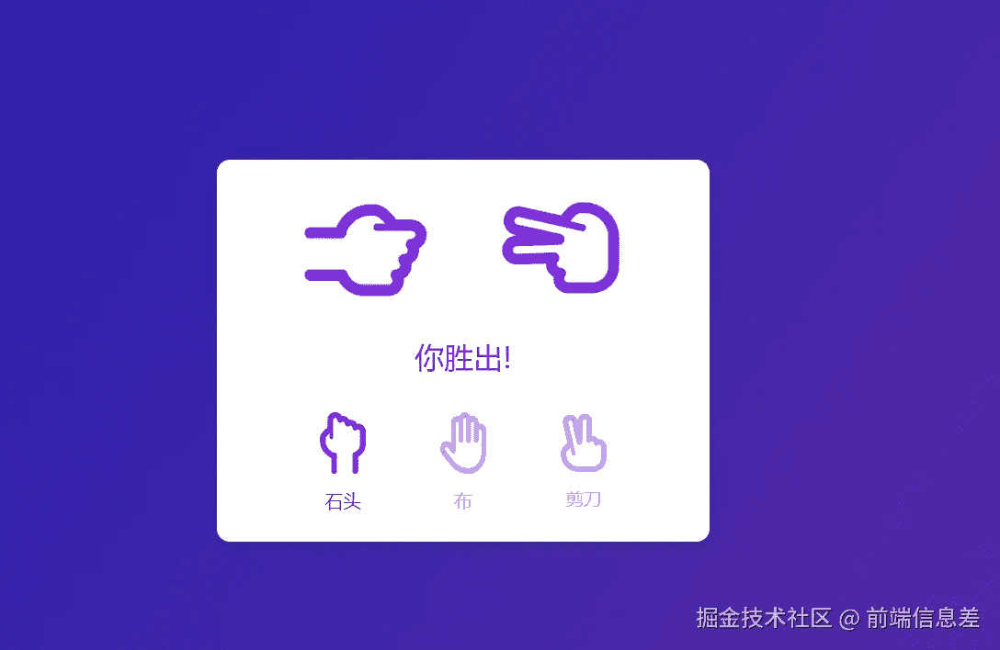

# Trae 测评，联手 AI 五分钟用 Vue 实现划拳游戏

> 来源：[https://agijuejin.feishu.cn/docx/ULWXdzQzdoTWxnx2epYczbainje](https://agijuejin.feishu.cn/docx/ULWXdzQzdoTWxnx2epYczbainje)

> 作者：前端信息差

> 链接：https://juejin.cn/post/7477532065656651803

> 来源：稀土掘金

> 著作权归作者所有。商业转载请联系作者获得授权，非商业转载请注明出处。

> 如有侵权，请联系删除。

## 速览

[**本文所使用的 Trae **](https://www.trae.ai/?utm_source=juejin&utm_medium=juejin_trae&utm_campaign=AGI_article)免费下载链接： www.trae.ai/

最近，DeepSeek 火爆全球，GPT 等大模型在 IDE 中的应用也日益成熟。

我选择的是字节的 Trae AI 编辑器来测评，因为它除了兼容 Mac/Windows 多种操作系统之外，还可以让我们免费白嫖 DeepSeek 和 GPT-4o 等大模型。最重要的是，Trae 还支持一键导入 VSCode 的配置，只需要使用 GitHub 登录就能无缝切换，不需要从零开始重新配置自己的 IDE。

刚好我在油管上看到一个使用原生 JS 的剪刀石头布小游戏，决定试试联手 AI 编辑器使用 Vue 自己也实现一下，这是最终效果：


## 快速起步

由于测评期间，DeepSeek 开源周过于火爆，结果瘫痪了，所以我退而求其次选择了 GPT-4o 模型。

首先使用 Vite 快速搭建一个 Vue 项目，你也可以使用 React 或 Vue 的 JSX 插件来试试：

```
npm init vite@latest
```

在提示中选择项目名称和框架（选择 Vue），依赖安装完毕后，我们就可以开始写代码了。

如果忘记了上述流程，也不需要亲自去查 Vite 官网，在 Trae 中免费向 GPT 聊天就会直接告诉你终端命令和基本流程：


## 功能实现

划拳游戏的基本原理并不复杂，我们使用 Math.random() 伪装 AI 人机，产生一个随机的手势，然后再让它和玩家点击选择的手势进行比较，判断胜负即可。

整个算法能且仅能产生三种结果：

+   双方手势相同，平局；

+   玩家获胜；

+   AI 获胜。

这里主要使用到 v-for 指令来生成可供玩家选择的手势列表，然后使用 v-on 指令来绑定点击事件，玩家选中手势后触发，然后使用 setTimeout() 开始定时器生成 AI 的手势，两者比较胜负即可。

在 DOM 操作中，经常会出现一些性能有害的写法，比如我们可能下意识地在每个手势上绑定了点击事件，浪费性能。

性能更友好的方案是利用事件委托机制，即只在父元素上绑定一次点击事件，然后在事件处理函数中判断点击的目标元素是否是我们需要的手势元素，如果是，再触发相应的操作。

我们可以询问 Trae 如何使用 Vue 在 v-for 列表上高效地绑定事件，它会给出一个解决方案：


这里另一个问题在于，获取手势的 DOM 元素时，一般我们可以使用 ref() 来获取，并自定义一些真实 DOM 的操作。但是，如果还需要这个 ref 对应的父级元素 —— 即整个 v-for 的列表元素时，我们该怎么实现呢？

这里分享一个 Trae 和 GPT 模型提供的新版 Vue 小技巧，可以使用 useTemplateRef() 来获取 v-for 列表元素的父级元素。



然后再结合使用 ref() 在事件处理程序中自定义操作。

```
&lt;script setup&gt;
  import { ref, useTemplateRef } from &#x27;vue&#x27;

  const main = useTemplateRef(&#x27;main&#x27;)
  const user = useTemplateRef(&#x27;user&#x27;)
  const ai = useTemplateRef(&#x27;ai&#x27;)
  const result = useTemplateRef(&#x27;result&#x27;)
  const imgs = useTemplateRef(&#x27;imgs&#x27;)

  function onClick(e, idx) {
    e.target.classList.add(&#x27;active&#x27;)
    user.value.src = ai.value.src = &#x27;/images/rock.png&#x27;
    result.textContent = &#x27;稍等一下...&#x27;
    imgs.value.forEach((el, index) =&gt; {
      idx !== index &amp;&amp; el.classList.remove(&#x27;active&#x27;)
    })
    main.value.classList.add(&#x27;start&#x27;)
    // add animateion
    let time = setTimeout(() =&gt; {
      let imageSrc = e.target.querySelector(&#x27;img&#x27;).src
      user.value.src = imageSrc
      main.value.classList.remove(&#x27;start&#x27;)

      let randomNumber = Math.floor(Math.random() * 3)
      let cpuImages = [
        &#x27;/images/rock.png&#x27;,
        &#x27;/images/paper.png&#x27;,
        &#x27;/images/scissor.png&#x27;,
      ]
      ai.value.src = cpuImages[randomNumber]
      let cpuValue = [&#x27;R&#x27;, &#x27;P&#x27;, &#x27;S&#x27;][randomNumber]
      let useValue = [&#x27;R&#x27;, &#x27;P&#x27;, &#x27;S&#x27;][idx]
      // create an object with all possible outcomes
      let outcomes = {
        RR: &#x27;Draw&#x27;,
        RP: &#x27;AI&#x27;,
        RS: &#x27;你&#x27;,
        PP: &#x27;Draw&#x27;,
        PR: &#x27;你&#x27;,
        PS: &#x27;AI&#x27;,
        SS: &#x27;Draw&#x27;,
        SR: &#x27;AI&#x27;,
        SP: &#x27;你&#x27;,
      }
      // look up the outcome value based on user and CPU options
      let outComeValue = outcomes[useValue + cpuValue]
      result.value.textContent =
        useValue === cpuValue ? &#x27;平手&#x27; : `${outComeValue}胜出!`
    }, 2500)
  }

  let items = ref([
    { text: &#x27;石头&#x27;, src: &#x27;/images/rock.png&#x27; },
    { text: &#x27;布&#x27;, src: &#x27;/images/paper.png&#x27; },
    { text: &#x27;剪刀&#x27;, src: &#x27;/images/scissor.png&#x27; },
  ])
&lt;/script&gt;

&lt;template&gt;
  &lt;section class=&quot;container&quot; ref=&quot;main&quot;&gt;
    &lt;div class=&quot;result_field&quot;&gt;
      &lt;div class=&quot;result_images&quot;&gt;
        &lt;span class=&quot;user_result&quot;&gt;
          &lt;img src=&quot;/images/rock.png&quot; ref=&quot;user&quot; /&gt;
        &lt;/span&gt;
        &lt;span class=&quot;cpu_result&quot;&gt;
          &lt;img src=&quot;/images/rock.png&quot; ref=&quot;ai&quot; /&gt;
        &lt;/span&gt;
      &lt;/div&gt;
      &lt;div class=&quot;result&quot; ref=&quot;result&quot;&gt;点击出手！&lt;/div&gt;
    &lt;/div&gt;
    &lt;div class=&quot;option_images&quot;&gt;
      &lt;span
        class=&quot;option_image&quot;
        v-for=&quot;(el, idx) in items&quot;
        @click=&quot;onClick($event, idx)&quot;
        ref=&quot;imgs&quot;
      &gt;
        &lt;img :src=&quot;el.src&quot; /&gt;
        &lt;p&gt;{{ el.text }}&lt;/p&gt;
      &lt;/span&gt;
    &lt;/div&gt;
  &lt;/section&gt;
&lt;/template&gt;
```

核心算法和基本功能实现之后，设计自己的喜欢的样式即可，我只是简单地使用了油管上的同款样式。

如果你想尝试更加前沿的方案，CSS 样式方面，可以引入 UnoCSS/Tailwind CSS 等原子 CSS 框架；其次，如果图片方面也想优化，可以使用 icon 相关的库引入 SVG，打包体积方面会有一定的优势。

## 总结



本文我们联手 Trae AI 编辑器使用 Vue 重构了一个划拳游戏，实现了基本的功能和样式，也展示了如何使用 Vue 来高效地绑定事件和新 API useTemplateRef() 。

Trae 目前的大模型是我比较喜欢的 DeepSeek 和 GPT，使用起来更加得心应手。除了可以在 IDE 中免费白嫖主流的大模型，Trae 还支持一键导入 VSCode 的配置和 GitHub 的一键登录，这种无缝衔接的用户体验非常棒。

听说Trae 国内版也上线了，大家也可以试试看：www.trae.com.cn/