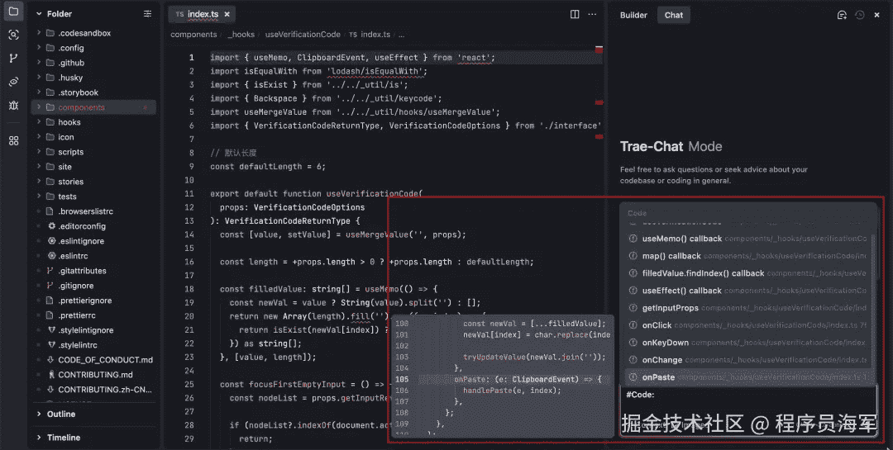
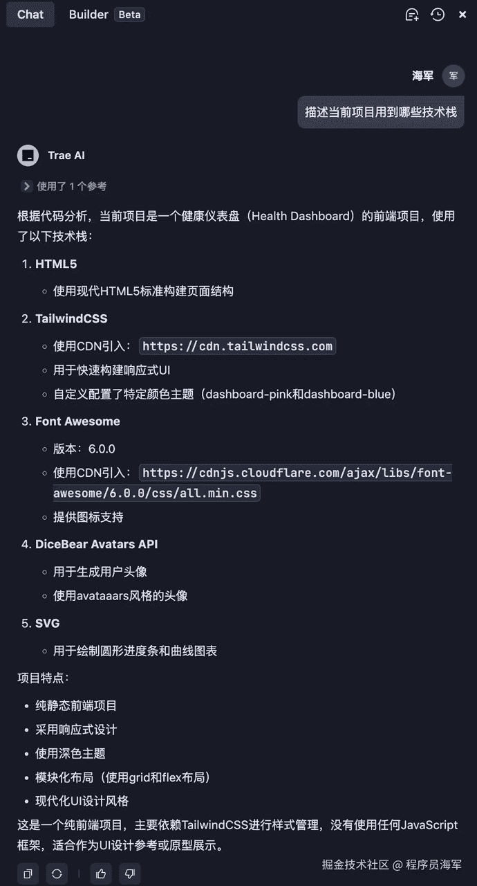
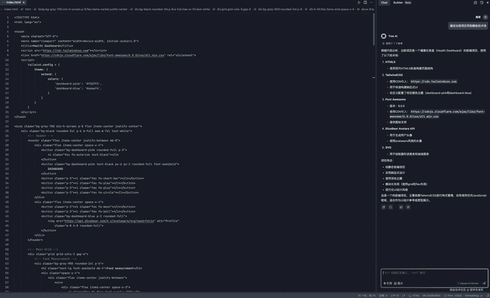
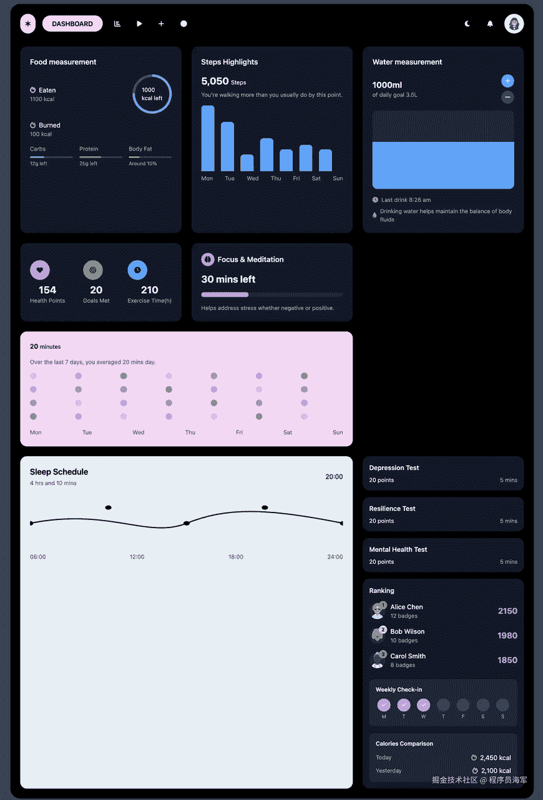
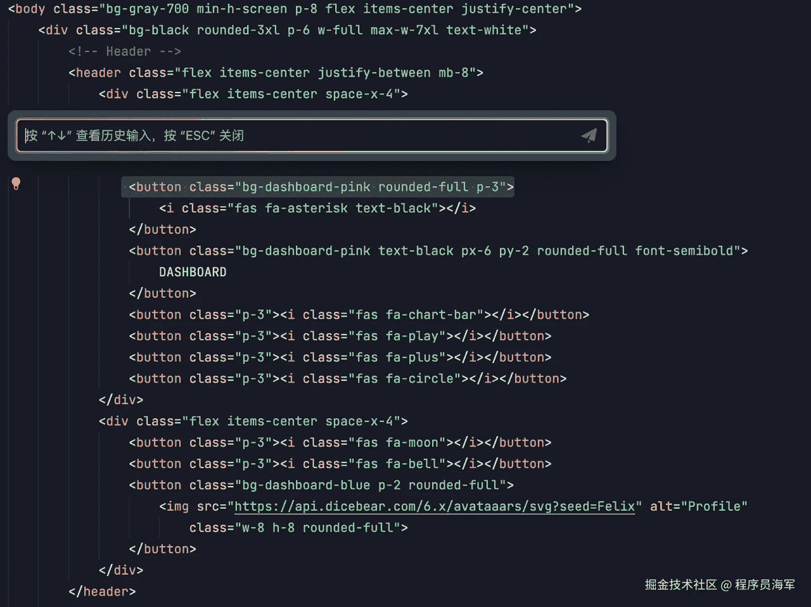
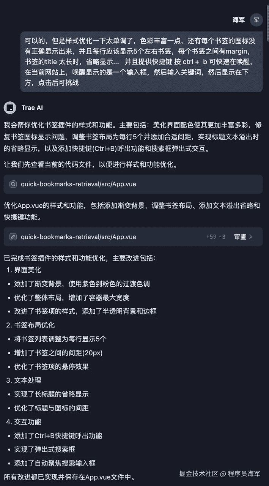
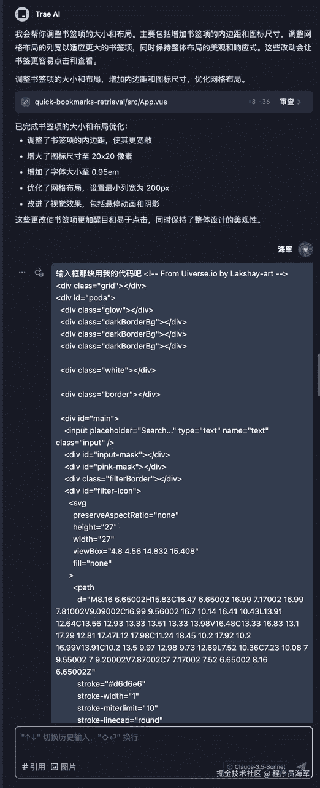

# 字节跳动推出AI编程神器Trae，基于Trae 从 0 开发一个Google 插件！

> 来源：[https://agijuejin.feishu.cn/docx/Ee0Udt9Fjos2jpxv9XNcn95jnsb](https://agijuejin.feishu.cn/docx/Ee0Udt9Fjos2jpxv9XNcn95jnsb)

> 作者：程序员海军

> 链接：https://juejin.cn/post/7462542925915848744

> 来源：稀土掘金

> 著作权归作者所有。商业转载请联系作者获得授权，非商业转载请注明出处。

> 如有侵权，请联系删除。

我正在参[**加Trae「超级体验官**](https://www.trae.ai/?utm_source=juejin&utm_medium=juejin_trae&utm_campaign=techcall)」创意实践征文，  本文所使用的 Trae 免费下载链接：  www.trae.ai

2025年1月20日，字节跳动正式发布了AI编译器Trae，这款产品不仅标配了Claude 3.5 Sonnet和GPT-4o两大顶级AI模型，还限时免费开放下载，瞬间引爆了开发者社区。作为一款AI驱动的集成开发环境（IDE），Trae的目标是让编程变得更智能、更高效。今天，我们就来深度解析这款“编程神器”，看看它如何改变开发者的工作方式。

目前Window 需要排队使用。

## Trae主要功能

1.  智能化代码生成与优化

+   通过自然语言生成代码片段，支持代码补全、优化和重构，帮助开发者高效编程。

#### 2.AI驱动的交互模式

+   Chat模式：支持代码问题解答和代码更新建议。

+   Builder模式：基于用户需求直接生成完整的代码项目。

1.  原生中文支持

+   从底层设计上支持中文，界面语言全面中文化，适合中文开发者使用。

#### 4.集成主流AI模型

+   内置Claude 3.5和GPT-4o等强大AI模型，完全免费使用，帮助开发者快速生成高质量代码。

#### 5.便捷的项目预览与调试

提供Webview功能，支持在IDE内直接预览Web页面，方便前端开发。

#### 6.灵活的上下文引用

在AI对话中支持引用代码块、文件、文件夹或整个项目，便于精准交互。

#### 7.高效开发体验

提供简洁直观的交互界面，支持代码变更的直观展示和快速应用。

## Trae如何使用

#### 1.安装与启动

访问Trae官网（trae.ai）下载安装包，首次启动时可以选择界面语言（推荐中文）和主题。支持与VSCode或Cursor配置迁移，方便快捷上手。

#### 2.注册与登录

使用Google邮箱或社交媒体账号注册并登录，登录后可免费使用内置的AI模型（如Claude 3.5和GPT-4o）。

#### 3.Chat模式

+   使用快捷键（cmd + i 或 cmd + u）调用Chat功能。

+   在对话框中输入问题或代码需求，Trae会基于AI模型生成代码建议或解答。

+   显示原始代码和优化后的代码对比，开发者可选择接受或拒绝。

#### 4.Builder模式

+   通过简单描述（如“根据设计稿完成项目”），Trae可自动生成项目代码。

+   在生成过程中，Trae可能会征求用户意见（如是否执行命令），需手动确认。

#### 5.代码预览与调试

+   提供Webview功能，可直接在IDE内预览Web页面。

+   遇到错误时，可通过点击命令行中的“Add To Chat”按钮，将错误信息复制到Chat中，让AI帮助解决。

#### 6.上下文引用

+   在Chat中可引用代码块、文件、文件夹或整个项目。

#### 7.命令行工具

支持在本地终端安装Trae的命令行工具。

## 使用Trae 从 0 开发一个Google 插件

上才艺

### 喂食

输入Propmt 设计稿 + 需求点

### 优化

时不时会出现网络错误，可以多尝试下

### 开始构建

### 持续优化

页面效果不太好，开始喂它我的代码

### 效果图

### 项目地址

+   github.com/TickHaiJun/…

## 最后

AI工具的竞争为我们带来了显著的效率提升和学习便利，但也带来了技能退化、隐私安全和职业竞争等挑战。未来，程序员需要在充分利用AI工具的同时，注重基础能力的培养和创新思维的提升，以应对技术变革带来的机遇与挑战。