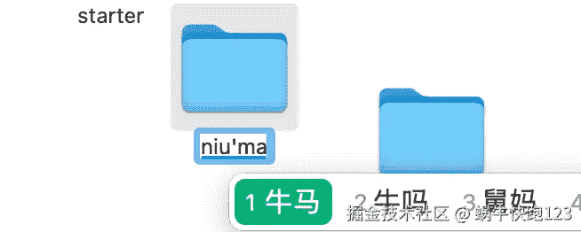
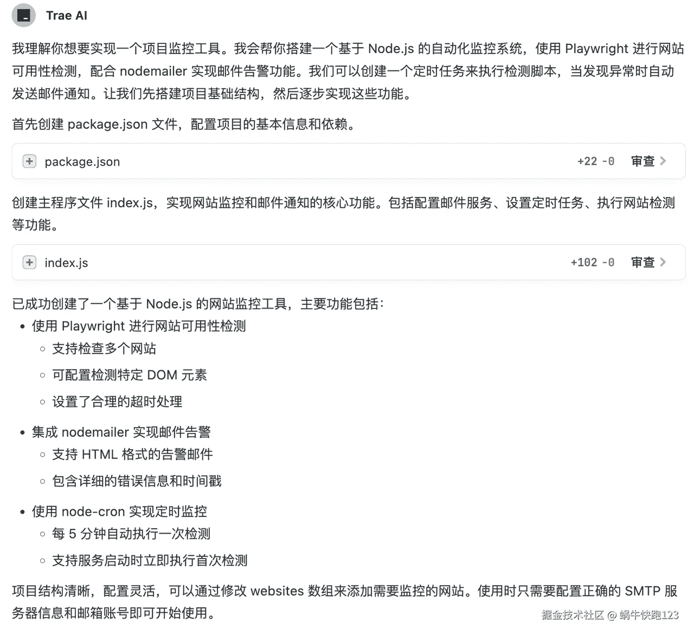
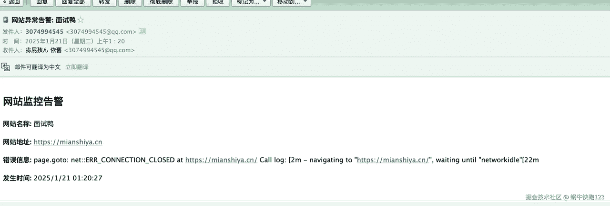
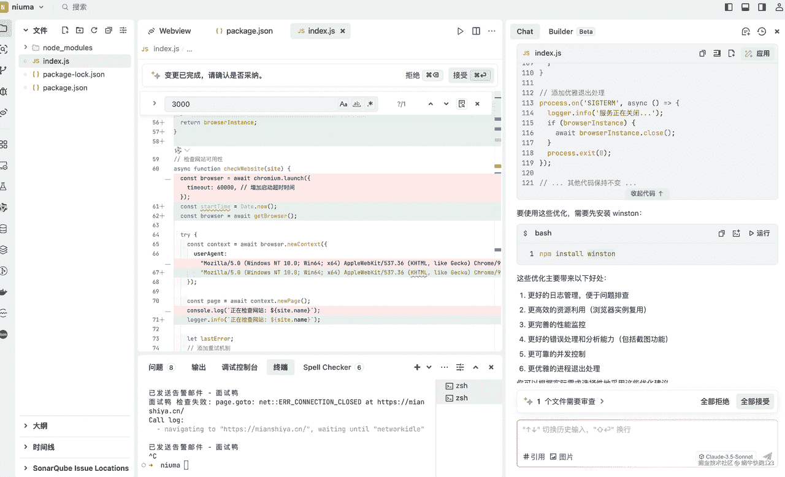
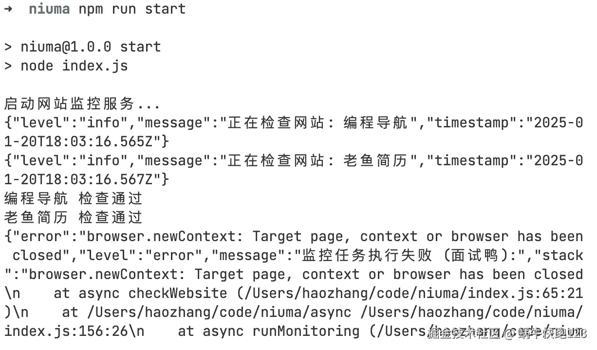
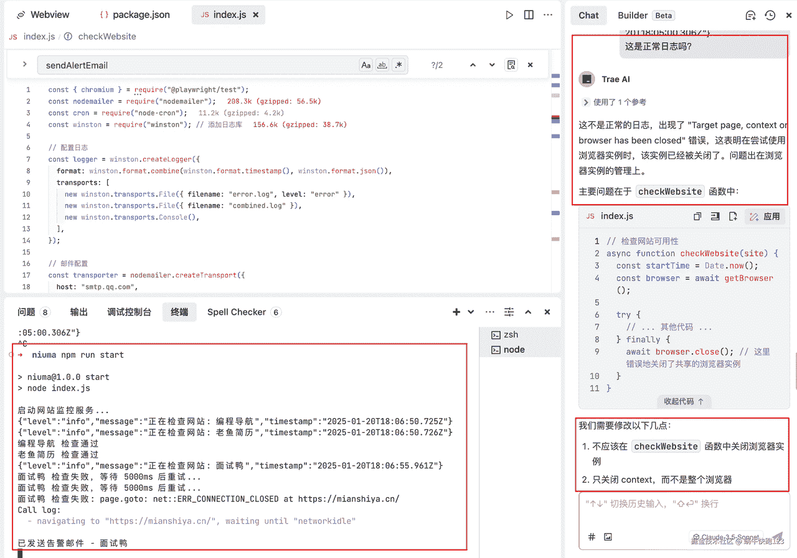

# 使用字节 TRAE 开发一个牛马工具

> 来源：[https://agijuejin.feishu.cn/docx/HrVJdJNEhocQpRxKlNscQ8YInBg](https://agijuejin.feishu.cn/docx/HrVJdJNEhocQpRxKlNscQ8YInBg)

> 作者：蜗牛快跑123

> 链接：https://juejin.cn/post/7462031597585252389

> 来源：稀土掘金

> 著作权归作者所有。商业转载请联系作者获得授权，非商业转载请注明出处。

> 如有侵权，请联系删除。

大家好我是 luckySnail。在浏览流媒体的时候，发现都在推荐这个工具，字节刚刚发布了 AI 编辑器 - TRAE（The Real AI Engineer）[，](https://juejin.cn/post/7461825527059611686)真正的 AI 引擎吗？，必须赶紧体验一波，刚好想要开发一个小工具，希望它不要让我失望。偷偷说一下它已经让 windows 用户失望了，因为它目前仅支持 mac 电脑。你可以看冴羽的这篇了解TRAE：juejin.cn/post/746182…

## 初体验

让我们新建一个文件夹，为什么叫这个名字，接下来你就知道了。



接下来我们要做一个工具来帮我监控我的公司项目是否都正常运行。如果出问题了，就需要赶紧通知我出事了，赶紧爬起来修 bug ！

简单的梳理了一下需求，我使用了它的 builder 能力来初始化项目，提问：“我要做一个小的工具来帮我们监控我的公司项目是否都正常运行。如果出问题了，就需要赶紧通知我出事了，赶紧修 bug 。通知方式是邮箱通知，使用前端技术实现，我如何实现？我目前调研可以使用 Playwright 来做充分的网站可用性检测，使用nodemailer 来进行邮箱通知，由于 nodemailer 是必须 node 环境，所以你需要给我搭建一个 node 服务”，这里我是预先告诉了它如何实现，防止它给出不合理的实现方式。

然后它很快理解了我们的需求，并且搭建好了一个基础服务：



启动项目后发现邮箱服务是有问题的，于是我把错误信息给它，然后问它为什么？如何修复？但是会出现：

于是我只能切换 chat 模式，发现是正常的，我把问题和相关代码（使用引用能力）给到它。它也很快发现了问题，然后给出了解决的方法。

我模拟了一个网站出现问题的场景，然后我们可以看到当检查网站存在问题的时候，就会触发发送邮件的逻辑：



到这里基本的流程算是跑通了，我们可以继续提问 AI，代码层面是否可以继续优化：



它给出了一些比较好的建议，我们可以点击“全部接受”，然后先安装依赖，再次启动查看一下效果：



这一次，它给出了更加细致的日志信息，但是我们发现最后一个 error 不太正常，我们问一下 AI 这个是否是正常日志，AI 发现了问题，并进行了修复，我们重启验证逻辑没有问题



邮箱也收到了告警信息！

到这里其实基本的牛马已经做好了，它能够实时的帮我监控网站是否运行良好，保证服务异常及时通知到人。但是真正场景下，需要的不仅仅是网站正常加载，还有很多其他需要监控的东西。

下面我们来看看 AI 的代码水平怎么样吧！

```
js
 代码解读
复制代码
const { chromium } = require(&quot;@playwright/test&quot;);const nodemailer = require(&quot;nodemailer&quot;);const cron = require(&quot;node-cron&quot;);const winston = require(&quot;winston&quot;); // 添加日志库// 配置日志const logger = winston.createLogger({  format: winston.format.combine(winston.format.timestamp(), winston.format.json()),  transports: [    new winston.transports.File({ filename: &quot;error.log&quot;, level: &quot;error&quot; }),    new winston.transports.File({ filename: &quot;combined.log&quot; }),    new winston.transports.Console(),  ],});// 邮件配置const transporter = nodemailer.createTransport({  host: &quot;smtp.qq.com&quot;,  port: 465, // 修改为465端口  secure: true, // 设置为true  auth: {    user: &quot;3074994545@qq.com&quot;, // 补充完整的QQ邮箱地址    pass: &quot;xxxx&quot;, // QQ邮箱授权码  },});// 要监控的网站列表const websites = [  {    name: &quot;老鱼简历&quot;,    url: &quot;https://laoyujianli.com&quot;,    checkElements: [&quot;.laoyu-page-container&quot;, &quot;.new-index-page&quot;, &quot;.template-item&quot;],  },  {    name: &quot;编程导航&quot;,    url: &quot;https://codefather.cn&quot;,    checkElements: [&quot;.ant-layout&quot;, &quot;.user-name&quot;],  },  {    name: &quot;面试鸭&quot;,    url: &quot;https://mianshiya.cn&quot;, // 移除多余的空格    checkElements: [&quot;#indexPage&quot;, &quot;.ant-list-item&quot;, &quot;#ccc&quot;],    retryCount: 3, // 添加重试次数    retryDelay: 5000, // 重试延迟时间（毫秒）  },];// 浏览器实例管理let browserInstance = null;async function getBrowser() {  if (!browserInstance) {    browserInstance = await chromium.launch({      timeout: 60000,    });  }  return browserInstance;}// 检查网站可用性async function checkWebsite(site) {  const startTime = Date.now();  const browser = await getBrowser();  const context = await browser.newContext({    userAgent:      &quot;Mozilla/5.0 (Windows NT 10.0; Win64; x64) AppleWebKit/537.36 (KHTML, like Gecko) Chrome/91.0.4472.124 Safari/537.36&quot;,  });  try {    const page = await context.newPage();    logger.info(`正在检查网站: ${site.name}`);    let lastError;    // 添加重试机制    for (let i = 0; i &lt; (site.retryCount || 1); i++) {      try {        // 设置页面加载超时时间        await page.goto(site.url, {          timeout: 30000,          waitUntil: &quot;networkidle&quot;, // 等待网络空闲        });        // 检查关键元素是否存在        for (const selector of site.checkElements) {          try {            await page.waitForSelector(selector, { timeout: 5000 });          } catch (elementError) {            console.log(`元素 ${selector} 未找到，继续检查其他元素`);          }        }        console.log(`${site.name} 检查通过`);        return { success: true };      } catch (error) {        lastError = error;        if (i &lt; (site.retryCount || 1) - 1) {          console.log(`${site.name} 检查失败，等待 ${site.retryDelay || 5000}ms 后重试...`);          await new Promise((resolve) =&gt; setTimeout(resolve, site.retryDelay || 5000));        }      }    }    console.error(`${site.name} 检查失败:`, lastError.message);    return {      success: false,      error: lastError.message,    };  } finally {    await context.close(); // 只关闭 context，不关闭浏览器  }}// 添加进程退出时的清理process.on(&quot;SIGTERM&quot;, async () =&gt; {  logger.info(&quot;服务正在关闭...&quot;);  if (browserInstance) {    await browserInstance.close();    browserInstance = null;  }  process.exit(0);});process.on(&quot;SIGINT&quot;, async () =&gt; {  logger.info(&quot;服务正在关闭...&quot;);  if (browserInstance) {    await browserInstance.close();    browserInstance = null;  }  process.exit(0);});// 发送告警邮件async function sendAlertEmail(site, error) {  const mailOptions = {    from: &quot;3074994545@qq.com&quot;, // 使用完整的发件人邮箱    to: &quot;3074994545@qq.com&quot;, // 使用完整的收件人邮箱    subject: `🚨 网站异常告警: ${site.name}`,    html: `      &lt;h2&gt;网站监控告警&lt;/h2&gt;      &lt;p&gt;&lt;strong&gt;网站名称:&lt;/strong&gt; ${site.name}&lt;/p&gt;      &lt;p&gt;&lt;strong&gt;网站地址:&lt;/strong&gt; ${site.url}&lt;/p&gt;      &lt;p&gt;&lt;strong&gt;错误信息:&lt;/strong&gt; ${error}&lt;/p&gt;      &lt;p&gt;&lt;strong&gt;发生时间:&lt;/strong&gt; ${new Date().toLocaleString()}&lt;/p&gt;    `,  };  try {    await transporter.sendMail(mailOptions);    console.log(`已发送告警邮件 - ${site.name}`);  } catch (error) {    console.error(&quot;发送邮件失败:&quot;, error);    // 如果是认证错误，输出更详细的信息    if (error.code === &quot;EAUTH&quot;) {      console.error(&quot;邮箱认证失败，请检查以下内容：&quot;);      console.error(&quot;1. 确保QQ邮箱已开启SMTP服务&quot;);      console.error(&quot;2. 确保使用的是正确的授权码而不是邮箱密码&quot;);      console.error(&quot;3. 访问 https://service.mail.qq.com/cgi-bin/help?subtype=1&amp;&amp;id=28&amp;&amp;no=1001256 获取帮助&quot;);    }  }}// 执行监控任务async function runMonitoring() {  // 添加并发限制  const concurrentLimit = 2;  const chunks = [];  for (let i = 0; i &lt; websites.length; i += concurrentLimit) {    chunks.push(websites.slice(i, i + concurrentLimit));  }  for (const chunk of chunks) {    await Promise.all(      chunk.map(async (site) =&gt; {        try {          const result = await checkWebsite(site);          if (!result.success) {            await sendAlertEmail(site, result.error);          }        } catch (error) {          logger.error(`监控任务执行失败 (${site.name}):`, {            error: error.message,            stack: error.stack,          });        }      })    );  }}// 添加优雅退出处理process.on(&quot;SIGTERM&quot;, async () =&gt; {  logger.info(&quot;服务正在关闭...&quot;);  if (browserInstance) {    await browserInstance.close();  }  process.exit(0);});// 设置定时任务，每5分钟执行一次监控cron.schedule(&quot;*/5 * * * *&quot;, () =&gt; {  console.log(&quot;开始执行网站监控...&quot;);  runMonitoring();});// 立即执行一次监控console.log(&quot;启动网站监控服务...&quot;);runMonitoring();
```

你觉得写的怎么样呢？我觉得蛮好的：

+   代码逻辑清晰，每个函数都符合单一原则，开发中它也提醒我要把 websites 配置信息单独创建文件存储

+   能够基于代码进行重构优化，使用社区流行的 winston 日志库来记录信息

+   有重试，try catch 兜底逻辑

## 总结

1.  TRAE 的 UI 和交互不输 cursor

1.  builder 模式下，提出一个需求，它能快速帮我拆解需求，生成项目，安装依赖，启动项目到最后的 web 预览。这对没有接触过编程的人更加友好

1.  在有些时候，它也会乱说，明明有问题，但是硬说已经解决了！

1.  连接不稳定，经常网络错误，这个非常影响开发体验

1.  免费使用 claude 3.5 和 chatGpt 很香。

1.  代码块右上角的一些能力非常好用，例如应用功能，能够智能的把相关的内容进行替换，然后通过 diff 清晰的让你知道你修改了什么

1.  感觉模型深度链接了代码上下文，能给出和我目前项目相关的代码

需要深度使用才能发现它更多使用场景！