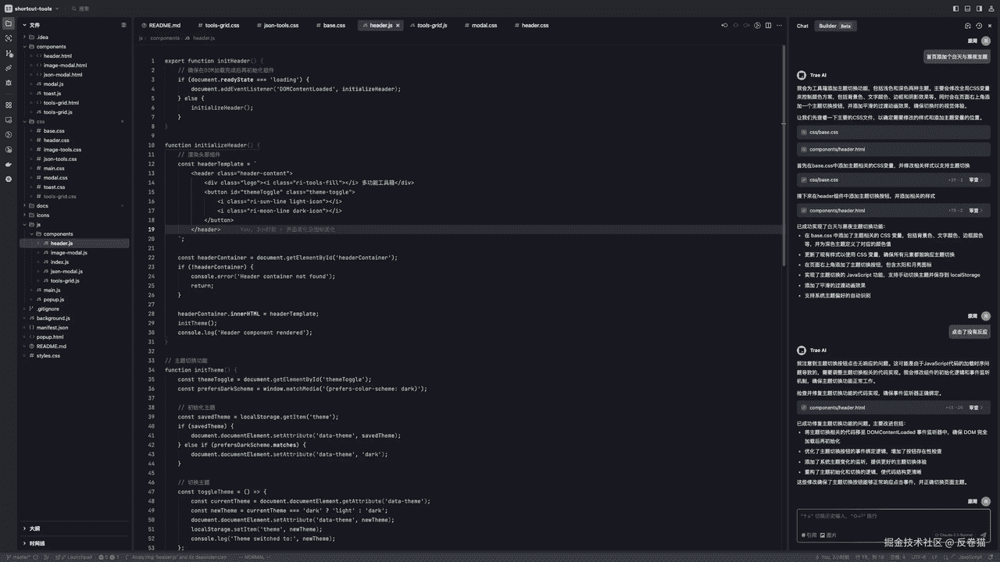
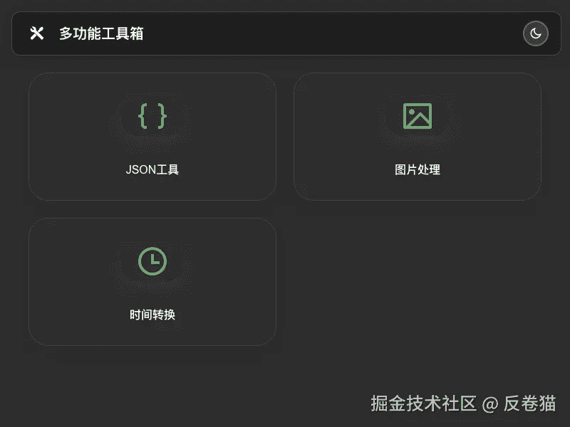
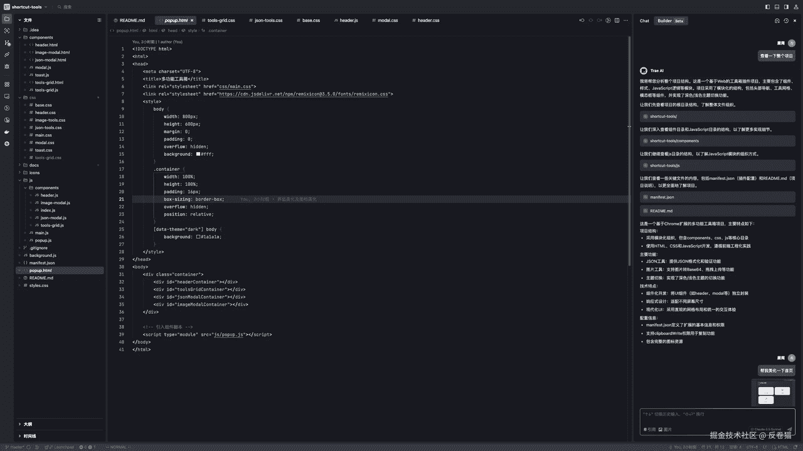

# 30 分钟通过Trae 写了个浏览器插件工具箱

> 来源：[https://agijuejin.feishu.cn/docx/H55KdSrTUoFl59xIFNAcOiCLnQp](https://agijuejin.feishu.cn/docx/H55KdSrTUoFl59xIFNAcOiCLnQp)

> 作者：反卷猫

> 链接：https://juejin.cn/post/7462552458306764810#heading-15

> 来源：稀土掘金

> 著作权归作者所有。商业转载请联系作者获得授权，非商业转载请注明出处。

> 如有侵权，请联系删除。

## Trae.ai 编译器生成工具

### 引言

在当今快速发展的软件开发领域，AI 驱动的编译工具正在改变传统的开发模式。Trae.ai 编译器作为新一代智能开发工具，将 AI 能力与编译技术深度结合，为开发者提供了一个革命性的编程助手。

### 核心技术架构

#### 1. 智能代码生成引擎

```
// 示例：智能生成模态框组件
@trae.generate
function generateModalComponent() {
    const modalTemplate = `
    &lt;div class=&quot;modal&quot; id=&quot;toolModal&quot;&gt;
        &lt;div class=&quot;modal-content&quot;&gt;
            &lt;div class=&quot;modal-header&quot;&gt;
                &lt;h2 id=&quot;modalTitle&quot;&gt;&lt;/h2&gt;
                &lt;button class=&quot;close-btn&quot; onclick=&quot;closeModal()&quot;&gt;
                    &lt;i class=&quot;ri-close-line&quot;&gt;&lt;/i&gt;
                &lt;/button&gt;
            &lt;/div&gt;
            &lt;div class=&quot;modal-body&quot; id=&quot;modalBody&quot;&gt;
                &lt;!-- 动态加载工具内容 --&gt;
            &lt;/div&gt;
        &lt;/div&gt;
    &lt;/div&gt;`;

    return {
        template: modalTemplate,
        methods: {
            openModal: (title, content) =&gt; {
                const modal = document.getElementById(&#x27;toolModal&#x27;);
                modal.style.display = &#x27;block&#x27;;
            },
            closeModal: () =&gt; {
                const modal = document.getElementById(&#x27;toolModal&#x27;);
                modal.style.display = &#x27;none&#x27;;
            }
        }
    };
}
```


#### 2. 代码优化系统

```
// 性能优化示例：JSON处理优化
@trae.optimize
function formatJson() {
    const textarea = document.getElementById(&#x27;jsonInput&#x27;);
    const lineNumbers = document.getElementById(&#x27;lineNumbers&#x27;);

    try {
        // AI优化：预处理JSON字符串，移除末尾多余的逗号
        let jsonStr = textarea.value
            .replace(/,(\s*[}\]])/g, &#x27;$1&#x27;)
            .replace(/,\s*$/g, &#x27;&#x27;);

        // AI优化：使用更高效的解析方式
        const json = JSON.parse(jsonStr);
        const formattedJson = JSON.stringify(json, null, 2);

        textarea.value = formattedJson;
        updateLineNumbers(textarea, lineNumbers);
    } catch (e) {
        // AI优化：智能错误处理
        let errorMsg = &#x27;JSON格式错误&#x27;;
        if (e.message.includes(&#x27;position&#x27;)) {
            errorMsg += &#x27;：语法错误&#x27;;
        } else if (e.message.includes(&#x27;trailing comma&#x27;)) {
            errorMsg += &#x27;：存在多余的逗号&#x27;;
        }
        showToast(errorMsg, &#x27;error&#x27;);
    }
}
```

#### 3. 智能主题系统

```
// 智能主题管理示例
@trae.analyze({
    performance: true,
    accessibility: true
})
function initTheme() {
    const themeToggle = document.getElementById(&#x27;themeToggle&#x27;);
    const prefersDarkScheme = window.matchMedia(&#x27;(prefers-color-scheme: dark)&#x27;);

    // AI优化：智能主题初始化
    const savedTheme = localStorage.getItem(&#x27;theme&#x27;);
    if (savedTheme) {
        document.documentElement.setAttribute(&#x27;data-theme&#x27;, savedTheme);
    } else if (prefersDarkScheme.matches) {
        document.documentElement.setAttribute(&#x27;data-theme&#x27;, &#x27;dark&#x27;);
    }

    // AI优化：性能优化的主题切换
    const toggleTheme = () =&gt; {
        const currentTheme = document.documentElement.getAttribute(&#x27;data-theme&#x27;);
        const newTheme = currentTheme === &#x27;dark&#x27; ? &#x27;light&#x27; : &#x27;dark&#x27;;
        document.documentElement.setAttribute(&#x27;data-theme&#x27;, newTheme);
        localStorage.setItem(&#x27;theme&#x27;, newTheme);
    };

    // AI优化：智能事件监听
    if (themeToggle) {
        themeToggle.addEventListener(&#x27;click&#x27;, toggleTheme);
    }
}
```





### 实践应用场景

#### 1. 快速原型开发

+   通过自然语言描述快速生成基础代码框架

+   自动生成 API 文档和测试用例

+   智能推荐最佳实践和设计模式


#### 2. 代码重构优化

+   自动识别代码异味

+   提供重构建议和方案

+   保证重构后的代码质量



#### 3. 性能调优

+   自动分析性能瓶颈

+   提供优化建议

+   生成性能报告

### 最佳实践指南

#### 1. 组件化开发

```
// 好的组件化实践
import { initHeader } from &quot;./header.js&quot;;
import { initToolsGrid } from &quot;./tools-grid.js&quot;;
import { initJsonModal } from &quot;./json-modal.js&quot;;
import { initImageModal } from &quot;./image-modal.js&quot;;

// AI自动组织组件初始化
export async function initComponents() {
  await Promise.all([
    initHeader(),
    initToolsGrid(),
    initJsonModal(),
    initImageModal(),
  ]);
}
```

#### 2. 响应式设计

```
/* AI优化的响应式样式 */
@media (max-width: 768px) {
  .tools-grid {
    grid-template-columns: repeat(auto-fit, minmax(240px, 1fr));
    gap: 16px;
    padding: 16px;
  }

  .tool-item button {
    height: 160px;
    padding: 24px;
  }

  .tool-item i {
    font-size: 40px;
    width: 70px;
    height: 70px;
    border-radius: 20px;
  }
}
```

### 技术规格

+   **编译优化 **：

+   即时编译（JIT）

+   静态分析优化

+   内联优化

+   循环优化

+   **AI 模型 **：

+   基于 Transformer 架构

+   支持增量学习

+   上下文感知能力

+   多模态输入支持

### 安全性考虑

1.  代码安全

+   自动检测安全漏洞

+   符合 OWASP 标准

+   敏感信息保护

1.  数据安全

+   本地优先处理

+   加密传输

+   访问控制

### 未来展望

Trae.ai 编译器代表了 AI 辅助开发的未来方向：

+   更智能的代码理解

+   更精准的优化建议

+   更自然的人机交互

+   更强大的多语言支持

### 通过Trae编写的智能工具箱浏览器插件( gitee.com/class-java/… )


```
# 快捷工具集 (Shortcut Tools)

一个实用的浏览器扩展工具箱，集成了多种常用的开发工具和实用功能。

## 功能特性

### 1. JSON 工具

- JSON 格式化和验证
- 提供直观的 JSON 数据处理界面

### 2. 图片工具

- 支持图片转 Base64 编码
- 支持拖拽上传图片
- 快速复制 Base64 编码结果
- 实时图片预览功能

## 界面特点

- 简洁现代的用户界面
- 响应式设计
- 直观的工具网格布局
- 统一的模态框交互体验
- 友好的操作提示

## 项目结构

├── components/     # 组件目录
├── css/           # 样式文件
├── icons/         # 图标资源
├── js/            # JavaScript 源码
│   └── components/  # JS 组件
├── manifest.json  # 扩展配置文件
└── popup.html     # 扩展弹出页面

## 安装方法

1. 下载本项目代码
2. 打开 Chrome 浏览器，进入扩展程序页面 (chrome://extensions/)
3. 开启「开发者模式」
4. 点击「加载已解压的扩展程序」
5. 选择本项目所在目录

## 使用说明

1. 点击浏览器工具栏中的扩展图标
2. 在弹出的工具箱中选择需要使用的工具：
   - 选择「JSON 工具」进行 JSON 相关操作
   - 选择「图片工具」进行图片转 Base64 操作

## 技术栈

- 原生 JavaScript (ES6+)
- HTML5 &amp; CSS3
- Chrome Extensions API

## 开发说明

本项目采用模块化的开发方式，各功能组件独立封装，便于维护和扩展。使用原生 JavaScript 开发，无需额外依赖，保持轻量级的特点。

```

工具地址： gitee.com/class-java/…

### 结语

Trae.ai 编译器通过将 AI 能力与传统编译技术相结合，为开发者提供了一个强大的开发工具。它不仅提高了开发效率，还确保了代码质量和安全性。随着技术的不断进步，我们期待看到更多创新性的应用场景。